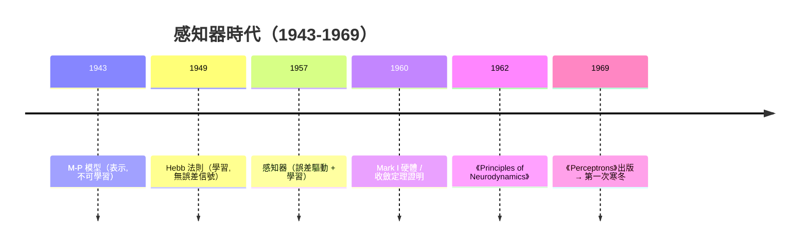

# 2.1 Rosenblatt 感知器與收斂定理（1957）

## 一、歷史背景：從紙上模型到學習的機器

M-P 神經元（1943）與 Hebb 法則（1949）分別解決了「表示」與「學習的哲學原型」兩個問題，但它們之間存在斷裂：Hebb 的規則沒有誤差概念，無法根據「答錯了」來修正自己。1957 年，康乃爾航空實驗室的 Frank Rosenblatt 在美國海軍研究辦公室（ONR）資助下提出**感知器（Perceptron）**，第一次實現了**誤差驅動、有收斂保證**的學習演算法，並將其做成了實體硬體 Mark I Perceptron（以電動馬達調節電位器來「儲存」權重）。

時代氛圍對此極為有利：

- 二戰後模式識別成為軍事需求（雷達信號識別、字元辨識）；
- 數位計算機開始普及，學習演算法有了實驗載體；
- 控制論運動使「會學習的機器」成為公眾想像。

Rosenblatt 1958 年在紐約時報的報導中留下了日後被反覆引用的狂想：「感知器將能走路、說話、看見、書寫、自我複製並意識到自己的存在。」這種樂觀既推動了資金流入，也埋下了幻滅的種子。

## 二、感知器：M-P 神經元的可學習版

### 2.1 數學定義

感知器與 M-P 神經元的**前向計算完全相同**：

$$
\hat{y} = H\Big(\sum_{i=1}^{n} w_i x_i + b\Big)
$$

革命在於**權重不再人工設定，而由演算法從資料中學得**。Rosenblatt 的學習規則：

$$
w_i \leftarrow w_i + \eta\,(y - \hat{y})\,x_i, \qquad b \leftarrow b + \eta\,(y - \hat{y})
$$

其中 $y$ 是標籤、$\hat{y}$ 是預測、$\eta$ 是學習率。其行為可讀作：

- **預測正確**（$y = \hat{y}$）：不更新；
- **漏報**（$y=1, \hat{y}=0$）：把所有活躍輸入的權重調大，使下次更容易放電；
- **誤報**（$y=0, \hat{y}=1$）：把權重調小，使下次更難放電。

與 Hebb 法則的對比一目了然：Hebb 是「共同活動就增強」（$\Delta w = \eta x y$），感知器是「**以誤差為信號**修正」（$\Delta w \propto (y-\hat{y})x$）。這一步引入了監督學習的本質結構：**預測 → 比較 → 糾正**。

### 2.2 幾何詮釋：學一個超平面

感知器在 $n$ 維輸入空間中學習一個線性分類器（超平面）：

$$
w \cdot x + b = 0
$$

學習過程就是每次犯錯後，把超平面向被誤分樣本的方向微調。若資料線性可分，這個過程必然在有限步內找到一個正確的超平面。

```mermaid
flowchart LR
    A[輸入樣本 x] --> B[計算 w·x + b]
    B --> C{"y_hat = H(...)"}
    C -->|"正確"| D[不更新]
    C -->|"錯誤: y-y_hat=±1"| E[w ← w + η(y−y_hat)x]
    E --> B
    D --> F{全部樣本正確?}
    D2[E 更新後繼續掃描] --> F
```

## 三、感知器收斂定理：第一個學習保證

### 3.1 定理內容

**定理（Perceptron Convergence Theorem, 1960-1962）**：若訓練集線性可分，即存在單位向量 $w^*$ 與邊距 $\gamma > 0$ 使得 $y_i (w^{*\top} x_i) \geq \gamma$ 對所有樣本成立（且 $\|x_i\| \leq R$），則感知器演算法的更新次數不超過

$$
M \leq \left(\frac{R}{\gamma}\right)^2
$$

### 3.2 證明（本書第一個完整證明，值得細讀）

定義成對標籤 $\tilde{y} \in \{-1, +1\}$，更新只在 $y_i w \cdot x_i \leq 0$ 時發生，每次更新 $w \leftarrow w + y_i x_i$。設 $w_0 = 0$，經 $M$ 次更新後的 $w_M$ 滿足：

**（1）權重與理想方向的投影有下界**：

$$
w_M \cdot w^* = \sum_{t \in \text{更新}} y_t (w^* \cdot x_t) \geq M\gamma
$$

因為每次更新都發生在誤分樣本上，而誤分樣本滿足 $y_t (w^*\cdot x_t) \geq \gamma$（由線性可分性）。又 $w^*$ 是單位向量，故 $\|w_M\| \geq w_M \cdot w^* \geq M\gamma$。

**（2）權重的範數有上界**：

$$
\|w_M\|^2 = \sum_{t}\|y_t x_t\|^2 + 2\sum_{t < s} y_t y_s (x_t \cdot x_s)
$$

關鍵：更新前該樣本被誤分，即 $y_t (w_{t-1} \cdot x_t) \leq 0$，這蘊含交叉項

$$
y_t y_s (x_t \cdot x_s) \geq y_t (w_{s-1} \cdot x_t) \geq \cdots \geq 0 \quad (\text{逐項歸納})
$$

因此

$$
\|w_M\|^2 \leq \sum_t \|x_t\|^2 \leq M R^2
$$

**（3）合併**：由 $\|w_M\| \geq M\gamma$ 與 $\|w_M\|^2 \leq MR^2$：

$$
M^2 \gamma^2 \leq M R^2 \;\Longrightarrow\; M \leq \left(\frac{R}{\gamma}\right)^2
$$

證畢。$\blacksquare$

### 3.3 定理的深意與邊界

這是人類歷史上第一個「**學習演算法有理論保證**」的結果，其影響遠超感知器本身：

- **間距（margin）首次登場**：收斂速度由 $R/\gamma$ 決定——資料的幾何「間距」越大，學得越快。這個概念日後成為 SVM（1992-1995）與最大邊距學習的理論核心，也是現代神經網路泛化理論（第 9 章）的基石之一。
- **但條件苛刻**：定理只對「線性可分」的資料成立。若資料不可分，感知器會**永遠震盪**，權重不收斂——這正是 2.2 節 XOR 危機的技術根源。

## 四、程式碼實作

### 4.1 從零實作感知器演算法

```python
import numpy as np

class Perceptron:
    def __init__(self, n_features, lr=1.0, max_epochs=1000):
        self.w = np.zeros(n_features)
        self.b = 0.0
        self.lr = lr
        self.max_epochs = max_epochs

    def predict(self, X):
        return np.where(X @ self.w + self.b >= 0, 1, -1)

    def fit(self, X, y):
        updates = 0
        for epoch in range(self.max_epochs):
            errors = 0
            for xi, yi in zip(X, y):
                if yi * (xi @ self.w + self.b) <= 0:      # 誤分才更新
                    self.w += self.lr * yi * xi
                    self.b += self.lr * yi
                    errors += 1; updates += 1
            if errors == 0:
                print(f"第 {epoch} 輪收斂，總更新次數 = {updates}")
                return self
        raise RuntimeError("未收斂：資料可能線性不可分！")

# OR 問題（線性可分）
X = np.array([[0,0],[0,1],[1,0],[1,1]], float)
y = np.array([-1, 1, 1, 1])                            # OR，用 ±1 標籤
p = Perceptron(2).fit(X, y)
print("OR 預測:", p.predict(X))                        # [-1, 1, 1, 1]

# XOR 問題（線性不可分）→ 必然拋出未收斂例外
try:
    Perceptron(2).fit(X, np.array([-1, 1, 1, -1]))
except RuntimeError as e:
    print("XOR:", e)
```

### 4.2 驗證收斂上界

```python
import numpy as np
rng = np.random.default_rng(0)
# 造出間距 γ 已知的線性可分資料
w_true = np.array([1.0, 2.0]); w_true /= np.linalg.norm(w_true)
X = rng.uniform(-1, 1, (500, 2))
y = np.sign(X @ w_true)
mask = np.abs(X @ w_true) > 0.05            # 挑出距決策邊界夠遠的點, γ=0.05
X, y = X[mask], y[mask]
R = np.max(np.linalg.norm(X, axis=1))

p = Perceptron(2, lr=1.0).fit(X, y)
print(f"實際更新數 vs 理論上界 (R/γ)² = {(R/0.05)**2:.0f}")
# 實際更新數遠小於上界——定理給的是保證而非緊界
```

### 4.3 感知器與梯度下降的關係（預告第 3、4 章）

感知器更新規則其實是對「感知器損失」$\ell(w) = \max(0, -y\, w\cdot x)$（Hinge 形式）做次梯度下降，只是步長被固定為 $\eta x$。把階躍函數換成可微的 Sigmoid、把損失換成交叉熵，就得到邏輯迴歸與多層感知器訓練的基礎。**從感知器到反向傳播，數學上是「把硬階躍軟化、把錯誤信號泛化為梯度」的連續過程。**

## 五、感知器的成就與時代的狂熱

1958-1962 年間，感知器熱潮席捲全美：

- ONR 與空軍投入鉅額資金，Cornell 建立感知器硬體計畫；
- Rosenblatt 出版《Principles of Neurodynamics》（1962），系統化感知器理論，包括收斂定理與多層感知器的構想（但他找不到多層的訓練演算法）；
- 媒體渲染「會思考的機器」即將誕生。

然而理論邊界已經清晰可見。Rosenblatt 本人及同代人都知道：

1. 單層感知器**只能表達線性可分函數**，XOR 無法表示；
2. 多層感知器雖然「理論上」可表達 XOR，但**沒有學習演算法**——手動設計隱層權重違背了學習的初衷；
3. 收斂定理在不可分資料上失效，現實感知任務（雜訊、非線性）幾乎必然不可分。

這些技術限制本身並不致命——致命的是 1969 年 Minsky 與 Papert 以嚴格的數學著作《Perceptrons》將它們公之於眾，並在當時的技術條件下得出悲觀結論。下一節將細看這場被稱為「第一次 AI 寒冬起點」的著名論戰。



## 六、本節重點

- 感知器（1957）保留 M-P 神經元的前向結構，革命在於**誤差驅動的權重更新**：$\Delta w_i = \eta (y - \hat{y}) x_i$，首次把「學習」落地為可執行、可收斂的演算法。
- 感知器在幾何上學習一個**線性超平面**；收斂定理證明：線性可分資料下，更新次數不超過 $(R/\gamma)^2$，由資料半徑與間距決定。
- 收斂定理的證明技術（投影下界 + 範數上界 + 更新前誤分條件）是間距學習理論的源頭，影響了 SVM 與現代泛化理論。
- 定理的邊界同樣重要：資料**線性不可分時演算法不收斂**，而多層版本「能表示但不能學」。
- 感知器時代的媒體狂熱與技術邊界之間的落差，為 1969 年的批評與第一次 AI 寒冬埋下伏筆。

## 七、思考問題

1. 感知器更新規則與 Hebb 法則的本質差異是什麼？「誤差信號」的引入為何是監督學習的關鍵？
2. 收斂上界 $(R/\gamma)^2$ 中，若把資料做線性縮放（$x \leftarrow 5x$），上界如何變化？這提示我們特徵縮放（feature scaling）為何重要？
3. 請用幾何直覺解釋：為什麼「每次犯錯就朝正確方向挪一點」必然能找到線性可分資料的解，卻在不可分資料上永遠震盪？
4. 感知器損失 $\max(0, -y\,w\cdot x)$ 與邏輯損失 $\log(1+e^{-y\,w\cdot x})$、hinge 損失 $\max(0, 1 - y\,w\cdot x)$ 有何行為差異？哪一種對「已正確但距離邊界很近」的樣本仍會繼續學習？
5. Rosenblatt 的媒體承諾（走路、說話、有意識）與當時技術能力之間的落差，對今天關於大型語言模型的公眾宣傳有什麼警示？
