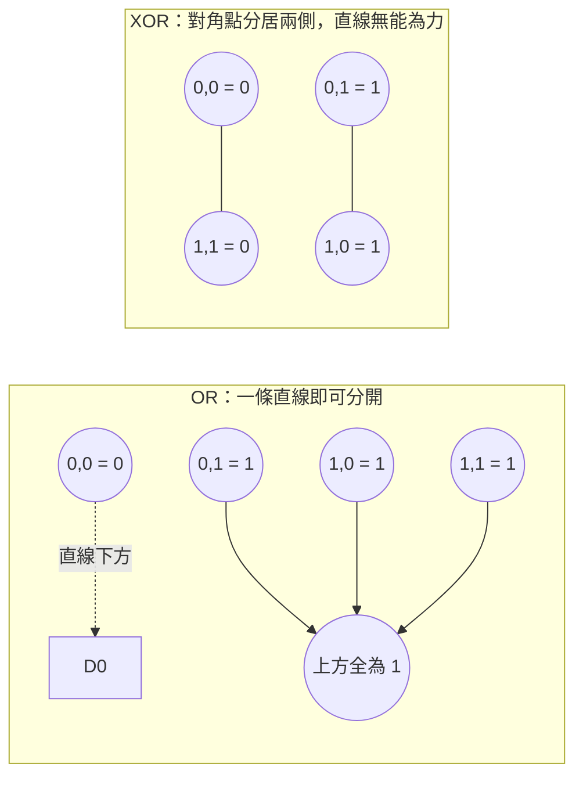
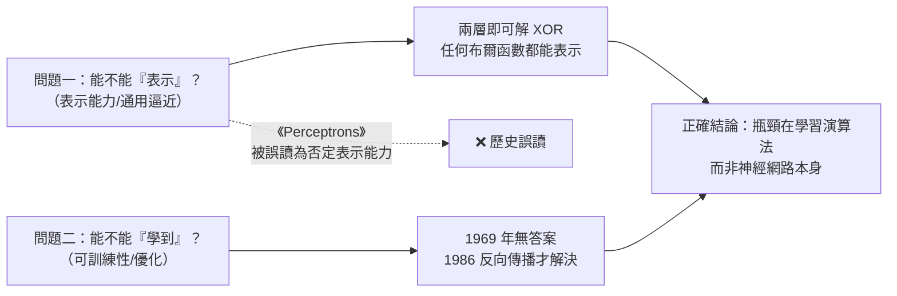
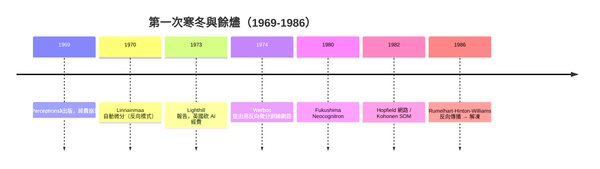

# 2.2 XOR 危機與 Minsky-Papert 批評、第一次寒冬（1969）

## 一、歷史背景：從狂熱到冰封的轉折

1960 年代末，感知器熱潮到達頂點，也開始露出裂縫。1969 年，MIT 的 Marvin Minsky 與 Seymour Papert 出版《Perceptrons: An Introduction to Computational Geometry》，以精確的數學分析系統性地指出：**單層感知器在計算能力上有不可逾越的天花板**。這本書與其說「證明」了神經網路無用（它沒有），不如說在當時的資助環境與研究氛圍下，**宣判**了神經網路研究的不合時宜。其後十餘年，神經網路經費大幅萎縮、論文難以發表、研究者紛紛轉行——史稱**第一次 AI 寒冬（First AI Winter，約 1974-1980）**。

要理解這場危機，必須先理解它紮根的兩個問題：一個是數學的（XOR 線性不可分），一個是社會學的（承諾與交付的落差）。

## 二、數學核心：XOR 為何不可分

### 2.1 問題的形式化

XOR（互斥或）函數：

| $x_1$ | $x_2$ | XOR |
|-------|-------|-----|
| 0 | 0 | 0 |
| 0 | 1 | 1 |
| 1 | 0 | 1 |
| 1 | 1 | 0 |

**命題**：不存在單一感知器 $H(w_1 x_1 + w_2 x_2 + b)$ 能實作 XOR。

**證明（幾何法）**：感知器的決策邊界是一條直線 $w_1 x_1 + w_2 x_2 + b = 0$ ，把平面分成兩個半平面。要正確分類 XOR，必須使 $(0,0)$ 與 $(1,1)$ （輸出 0）落在直線一側，而 $(0,1)$ 與 $(1,0)$ （輸出 1）落在另一側。但這四點構成凸四邊形的四個頂點，且「同類點」位於對角線上——**對角點分居兩側的四邊形，任何一條直線都無法把它們切開**：直線若分開 $(0,1)$ 與 $(1,1)$ ，則 $(0,0)$ 必與 $(1,1)$ 同側（凸性），與要求矛盾。 $\blacksquare$

**證明（代數法）**：設四條約束成立。由 $(1,1)\to 0$ 與 $(1,0)\to 1$ ：

$$
w_1 + w_2 + b < 0, \qquad w_1 + b \geq 0
$$

兩式相減得 $w_2 < 0$ 。由 $(0,1)\to 1$ 得 $w_2 + b \geq 0$ ，即 $b \geq -w_2 > 0$ 。再由 $(0,0)\to 0$ 得 $b < 0$ 。矛盾。 $\blacksquare$



### 2.2 《Perceptrons》的真正論點

《Perceptrons》並非只談 XOR。書中以「群不變性（group invariance）定理」證明了一整類問題（平移不變性、連通性 parity、對稱性等）**單層感知器原理上無法解決**，其中最著名的是**連通性（connectedness）問題**：判斷圖形是否連通，單層感知器不可能以有界權重實作。

書中在第一章承認：「多層感知器沒有這些限制……但我們認為研究多層系統是徒勞的（sterile），因為我們找不到使它們可學習的方法。」——這句話在當時看來是嚴謹的判斷，在事後看來則是本書最大的歷史失誤：**表示能力的限制被（被讀者）擴大解讀為整個神經網路路線的死刑**，而真正的問題只是「缺一個多層訓練演算法」。

歷史上的爭議還包括 Rosenblatt 的回應困境：他其實已在 1962 年的書中討論了多層架構（包括今日稱為「back-coupling」的概念），但始終找不到有效訓練法；而《Perceptrons》第一版未明確標註「本書只分析單層與簡單循環網路」，使許多讀者誤以為全書結論適用於所有神經網路。1969-1970 年間神經網路經費應聲崩落。

### 2.3 危機的社會學放大

純技術限制通常只會導致研究降溫，但第一次寒冬是「技術限制 + 承諾泡沫 + 資助結構」三者共振的結果：

| 因素 | 內容 |
|------|------|
| 承諾過度 | 1958 年紐約時報式的渲染使資助方預期「智能機器」近在咫尺 |
| 交付不足 | 感知器只能解決線性可分玩具問題，實際感知任務（雜訊、變形）遠超其能力 |
| 權威背書 | Minsky 是 MIT AI 實驗室主持人、1969 年圖靈獎得主，其判斷具有市場力量 |
| 資助斷流 | 1973 年英國 Lighthill 報告嚴厲批評 AI 進展，英國政府大幅削減 AI（含神經網路）研究 |

結果：1970 年代，神經網路研究在美英主要大學幾乎絕跡，僅少數人（如日本的福島邦彥、芬蘭的 Kohonen）仍在堅持。這段冰封期反而孕育了日後的突破：Seppo Linnainmaa 1970 年提出自動微分的反向模式（反向傳播的數學前身），Paul Werbos 1974 年將其應用於神經網路訓練——**寒冬中沒有死去的種子，在解凍後長成了反向傳播**（第 3 章）。

## 三、危機給我們的教訓：表示 ≠ 學習

XOR 危機的根本教訓，是區分兩個經常被混淆的問題：



1. **表示問題（representation）**：函數族裡存不存在解？——XOR 答案是「兩層就存在」，且 1989 年萬能逼近定理（見 3.1）將證明單隱層即可逼近任意連續函數。
2. **學習問題（learning/optimization）**：能否用可行的演算法找到那些參數？——這才是 1969 年的真瓶頸，也是 1986 年反向傳播真正回答的問題。

這一區分在今天的深度學習中依然鋒利：我們知道 Transformer 可以表示任何序列映射，但「訓練能否找到好參數、樣本複雜度多少、泛化為何成立」仍是開放問題（第 9 章）。

## 四、程式碼實驗：親眼看到線性不可分

### 4.1 用感知器與邏輯迴歸分 XOR，觀察失敗

```python
import numpy as np
import torch
import torch.nn as nn

X  = np.array([[0,0],[0,1],[1,0],[1,1]], dtype=np.float32)
y_or  = np.array([0,1,1,1], dtype=np.float32)
y_xor = np.array([0,1,1,0], dtype=np.float32)

def train_linear(X, y, epochs=2000, lr=0.5):
    Xd = torch.tensor(X); yd = torch.tensor(y).unsqueeze(1)
    model = nn.Linear(2, 1)
    opt = torch.optim.SGD(model.parameters(), lr=lr)
    for _ in range(epochs):
        loss = nn.functional.binary_cross_entropy_with_logits(model(Xd), yd)
        opt.zero_grad(); loss.backward(); opt.step()
    with torch.no_grad():
        acc = ((model(Xd) > 0).float() == yd).float().mean().item()
    return acc, loss.item()

print("OR  準確率:", train_linear(X, y_or))    # 準確率 1.0，loss 接近 0
print("XOR 準確率:", train_linear(X, y_xor))   # 準確率停在 0.5~0.75，loss 卡在高位
```

### 4.2 加入隱藏層：同一個框架，XOR 立刻可解

```python
# 唯一的改動：插入一個非線性隱層。這正是 1969 年「缺失的那一塊」。
model = nn.Sequential(nn.Linear(2, 4), nn.Sigmoid(), nn.Linear(4, 1))
Xd  = torch.tensor(X); yd = torch.tensor(y_xor).unsqueeze(1)
opt = torch.optim.SGD(model.parameters(), lr=1.0)
for _ in range(5000):
    loss = nn.functional.binary_cross_entropy_with_logits(model(Xd), yd)
    opt.zero_grad(); loss.backward(); opt.step()      # ← 1986 年的反向傳播

with torch.no_grad():
    print("MLP-XOR 預測:", (model(Xd) > 0).int().flatten().tolist())  # [0, 1, 1, 0]
```

兩段程式碼的對比就是整章的濃縮：**1969 年的問題不是神經網路「不行」，而是「單層 + 無多層訓練法」不行**。插入隱藏層配上可微損失與梯度更新，XOR 十行即解。

### 4.3 視覺化：決策邊界的形狀

```python
import numpy as np
# 取得隱層的兩個「特徵」，觀察 MLP 如何把 XOR 變成線性可分
with torch.no_grad():
    h = torch.sigmoid(model[0](Xd))          # 隱層輸出 (4,4)
    print("隱層表示：")
    print(np.round(h.numpy(), 2))
# 可發現四個樣本在隱層空間中被映射為線性可分的配置：
# 「表示變換」是解決線性不可分性的唯一出路——這正是表示學習（第9章）的思想胚胎
```

## 五、寒冬中的餘燼：沒有死去的火種

第一次寒冬並非全滅，幾條支線在艱難中存活，成為復興的火種：

1. **福島邦彥的 Neocognitron（1980）**：受 Hubel-Wiesel 視覺研究啟發的多層特徵提取網路，是卷積神經網路（LeNet, 1998）的直接前身（見 5.1）。
2. **Kohonen 的自組織映射（1982）**：無監督 Hebbian 學習路線的延續。
3. **Hopfield 網路（1982）**：把統計物理（自旋玻璃）引入神經網路，重燃物理學界對神經計算的興趣，並間接促成 1986 年的復興浪潮。
4. **自動微分與 Werbos（1970-1974）**：Linnainmaa 的反向模式微分 + Werbos 的應用構想，為反向傳播備好了數學工具。
5. **統計學習理論（Vapnik, 1960s-1995）**：在符號主義陣營之外，以 VC 維與結構風險最小化建立學習理論，後來以 SVM 形式在 1990 年代一度壓過神經網路，又反過來貢獻了間距與泛化理論給深度學習。



## 六、本節重點

- XOR 不存在單層感知器解：幾何上對角點分居兩側、直線無法切分；代數上約束系統自相矛盾。XOR 只是象徵，連通性、平移不變性等問題同樣超出單層能力。
- 《Perceptrons》（1969）嚴格分析了單層感知器的限制，作者也承認多層可繞過限制，但認為多層「不可學習而徒勞」——這一判斷被當時的研究共同體擴大解讀為神經網路的死刑。
- 第一次寒冬是技術天花板、承諾泡沫與資助結構共振的結果；Lighthill 報告（1973）是資助層面的標誌性事件。
- 危機的核心教訓是區分**表示問題**（有沒有解）與**學習問題**（能否找到解）：1969 年的真正瓶頸是後者，1986 年反向傳播回答的也是後者。
- 寒冬期存活的火種（Neocognitron、Hopfield、自動微分、統計學習理論）成為 1986 年復興的物質基礎。

## 七、思考問題

1. 請獨立完成 XOR 不可分的代數證明，並說明為什麼「加一層隱藏神經元」就能繞過矛盾。
2. 《Perceptrons》的科學內容（單層限制）是正確的，但其社會效果（寒冬）是災難性的。科學家在發表「某路線不可行」的結論時，應承擔什麼樣的溝通責任？
3. 若你是 1970 年代的資助者，面對「多層可表示但不可學」的現狀，你會把錢投給（a）尋找多層學習演算法，還是（b）符號 AI？請用當時可得的資訊論證。
4. 「表示 ≠ 學習」的區分在深度學習今天仍適用：我們知道 Transformer 是通用逼近器，但訓練動態、泛化能力仍是難題。請舉一個當代例子說明這個區分。
5. 感知器的收斂定理在不可分資料上失效。1970 年代是否有「部分正確就繼續改進」的替代損失與演算法？（提示：Widrow-Hoff 的 LMS（1960）與後來的 hinge loss / SVM。）
