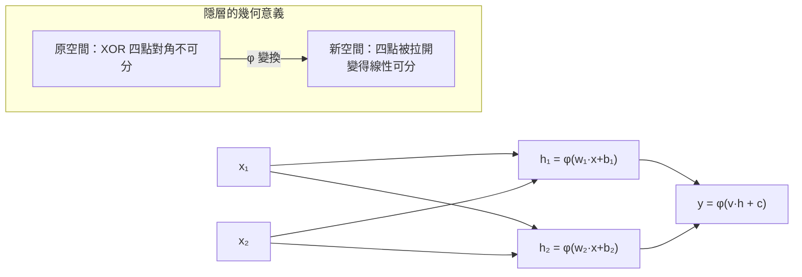

# 3.1 多層感知器與萬能逼近定理（1989）

## 一、歷史背景：解凍的前夜

第一次寒冬（1974-1980）留下的僵局非常明確：**多層網路理論上可以表達 XOR 與任意複雜函數，但沒有人知道如何訓練它**。1980 年代的復興由三股力量推動：

1. **認知科學的平行分散處理（PDP）運動**：Rumelhart 與 McClelland 主編的《Parallel Distributed Processing》（1986）把神經網路重新定位為「認知的計算模型」，吸引了心理學、認知科學界的大批注意力——這比純工程的訴求更容易獲得跨領域資助。
2. **數學工具的成熟**：Linnainmaa（1970）的反向模式自動微分、Werbos（1974）的應用構想，已為「多層訓練」備好演算法骨架。
3. **計算資源的緩慢增長**：工作站與小型機使數百神經元規模的實驗成為可能。

在講述反向傳播（3.2 節）之前，必須先回答一個更根本的問題：**多層網路究竟強到什麼程度？值不值得為它發明訓練演算法？** 萬能逼近定理（Universal Approximation Theorem）給出了肯定的答案。

## 二、多層感知器（MLP）：架構與數學

### 2.1 從單層到多層

多層感知器由輸入層、一個或多個隱藏層、輸出層組成。單隱層網路的數學形式：

$$
f(x) = \phi\Big(\sum_{j=1}^{m} v_j \, \phi\Big(\sum_{i=1}^{n} w_{ji} x_i + b_j\Big) + c\Big)
$$

- 第一層 $\phi(W x + b)$：把原始輸入映射到 $m$ 維的「特徵空間」；
- 第二層 $v \cdot h + c$：在特徵空間上做線性組合。

關鍵在於**非線性激活函數 $\phi$**。若沒有 $\phi$，兩層線性變換的複合仍是線性：$v^\top (Wx+b)+c = (v^\top W)x + (v^\top b + c)$，多層退化为單層，XOR 依舊無解。**非線性是多層結構有意義的最低門檻。**



### 2.2 激活函數的選擇史

| 激活函數 | 定義 | 年代 | 特點 |
|----------|------|------|------|
| 階躍 $H(z)$ | $\mathbb{1}[z\geq 0]$ | 1943 | 二值、不可微 → 無梯度 |
| Sigmoid | $\frac{1}{1+e^{-z}}$ | 1960s-1986 | 可微、輸出 (0,1)；飽和導致梯度消失（第 6 章禍根） |
| tanh | $\frac{e^z - e^{-z}}{e^z + e^{-z}}$ | 1980s | 零中心，略優於 sigmoid |
| ReLU | $\max(0, z)$ | 2010 AlexNet 推廣 | 正區間梯度恆為 1，緩解梯度消失，計算極快 |

從階躍到 Sigmoid 的轉換是反向傳播的**前提**：訓練需要梯度，梯度需要可微。從 Sigmoid 到 ReLU 的轉換則是深度擴展的**前提**（見 4.2 與 5.2）。

## 三、萬能逼近定理：多層網路的表示力保證

### 3.1 定理內容

**定理（Cybenko 1989；Hornik-Stinchcombe-White 1989）**：設 $\sigma$ 為任一非常數、有界、連續、單調遞增的函數（如 sigmoid），$K \subset \mathbb{R}^n$ 為緊集，$g: K \to \mathbb{R}$ 為連續函數。則對任意 $\varepsilon > 0$，存在單隱層網路

$$
f(x) = \sum_{j=1}^{m} v_j\, \sigma(w_j^\top x + b_j)
$$

使得 $\sup_{x \in K} |f(x) - g(x)| < \varepsilon$。

1991 年 Leshno 等人放寬條件：**只要 $\sigma$ 是非常數函數**（包括 ReLU），單隱層網路即可在緊集上一致逼近任意連續函數。

### 3.2 證明核心思想（以 ReLU 為例的構造性直覺）

以一維為例最直觀：ReLU 網路可以構造「折線函數」。兩個 ReLU 之差

$$
\max(0, x - a) - \max(0, x - b), \quad a < b
$$

是一個高度為 $b-a$ 的「斜坡台階」。用 $m$ 個這樣的台階以不同權重疊加，可以拼出任意精度的折線逼近。推廣到高維：多維 ReLU 把空間切成線性區域（pieces），隱層神經元越多，線性區域的數量呈指數增長（Montúfar et al. 2014：單隱層 $n$ 輸入、$m$ 神經元的 ReLU 網路最多可切出 $\binom{m}{n}$ 量級的線性區域），足夠多的線性小片自然能拼出任意連續曲面。


### 3.3 定理的「能」與「不能」：歷史的反諷

萬能逼近定理在 1989 年為神經網路提供了「表示力」的正名，但細讀會發現三個重要限制，每一條都指向之後三十年的研究方向：

1. **存在性 ≠ 可學習性**：定理只說「存在一組權重」，不說反向傳播找不找得到。這正是 1969 危機「表示 vs 學習」區分的迴響。
2. **不給寬度上界**：所需隱神經元數 $m$ 可能是 $O(1/\varepsilon)$ 甚至指數級。理論上後來證明某些函數（如 parity）用單隱層需要指數寬度，而**深度**網路可以用多項式甚至線性寬度表達同樣的函數（深度效率，depth efficiency）——這是「為什麼要深不要寬」的第一個理論線索，直接支持深度學習的核心信念。
3. **不談泛化**：逼近訓練點上的函數，不等於在沒見過的資料上正確。泛化的理論要到第 9 章的過參數化與雙下降時代才有新答案。

因此萬能逼近定理的正確讀法是：**它證明了「找得到好函數族」，把戰場完全讓給了「學習與泛化」**——這正是 3.2 節反向傳播、第 4 章優化與正則化登場的理由。

## 四、程式碼實作：用 MLP 逼近與分類

### 4.1 構造性驗證萬能逼近：折線擬合

```python
import torch
import torch.nn as nn
import numpy as np

# 目標：一維複雜連續函數
def g(x):                       # 例如：abs(sin) 型的折線目標
    return np.abs(np.sin(3 * x))

X = torch.linspace(-3, 3, 256).unsqueeze(1)
Y = torch.tensor(g(X.numpy()), dtype=torch.float32).unsqueeze(1)

# 單隱層 ReLU 網路：寬度 m 是逼近精度的關鍵
for width in [4, 16, 64]:
    model = nn.Sequential(nn.Linear(1, width), nn.ReLU(), nn.Linear(width, 1))
    opt = torch.optim.Adam(model.parameters(), lr=0.01)
    for _ in range(3000):
        loss = ((model(X) - Y) ** 2).mean()
        opt.zero_grad(); loss.backward(); opt.step()
    print(f"隱層寬度 {width:3d}  最終 MSE = {loss.item():.5f}")
# 寬度增大 → 誤差單調下降，驗證「更多台階、更好逼近」
```

### 4.2 XOR 復現與隱層表示的視覺化

```python
import numpy as np, torch, torch.nn as nn

X = torch.tensor([[0.,0.],[0.,1.],[1.,0.],[1.,1.]])
y = torch.tensor([[0.],[1.],[1.],[0.]])

mlp = nn.Sequential(nn.Linear(2, 2), nn.Sigmoid(), nn.Linear(2, 1))
opt = torch.optim.SGD(mlp.parameters(), lr=2.0)
for _ in range(10000):
    loss = nn.functional.binary_cross_entropy_with_logits(mlp(X), y)
    opt.zero_grad(); loss.backward(); opt.step()

with torch.no_grad():
    print("預測:", (mlp(X) > 0).int().flatten().tolist())   # [0,1,1,0]
    h = mlp[1](mlp[0](X))            # 隱層變換後的表示
    print("隱層表示:\n", np.round(h.numpy(), 3))
    # 兩個隱神經元各學出一條直線（如 x1+x2>0.5 與 x1+x2<1.5 的組合），
    # 在隱層空間中四點變得線性可分——多層 = 表示變換
```

### 4.3 觀察「深度效率」：深而窄 vs 淺而寬

```python
import torch, torch.nn as nn

def make(widths):
    layers = []
    for a, b in zip(widths[:-1], widths[1:]):
        layers += [nn.Linear(a, b), nn.ReLU()]
    return nn.Sequential(*layers[:-1], nn.Linear(widths[-2], 1))

# 同一個多項式級目標，比較兩種預算下限的網路
configs = {
    "淺而寬 (1-256-1)":  make([1, 256, 1]),
    "深而窄 (1-8-8-8-1)": make([1, 8, 8, 8, 1]),
}
X = torch.linspace(-2, 2, 256).unsqueeze(1)
Y = 0.5 * torch.sin(4 * X) * torch.exp(-X**2 / 4) + 0.1 * X ** 3

for name, model in configs.items():
    n_params = sum(p.numel() for p in model.parameters())
    opt = torch.optim.Adam(model.parameters(), lr=0.01)
    for _ in range(5000):
        loss = ((model(X) - Y) ** 2).mean()
        opt.zero_grad(); loss.backward(); opt.step()
    print(f"{name:20s} 參數量={n_params:5d}  MSE={loss.item():.5f}")
# 深網路以少一個數量級的參數達到相近或更好的逼近——深度的複合優勢
```

## 五、萬能逼近之後：引出的新問題

多層感知器的表示力被確認後，真正困難的問題全部浮出水面，構成本書後續章節的骨架：

| 新問題 | 表現 | 對應章節 |
|--------|------|----------|
| 如何找到好的權重（優化） | 損失面非凸、梯度消失 | 3.2 反向傳播、4.1 優化器 |
| 如何避免死記硬背（泛化） | 參數多於資料必過擬合 | 4.2 正則化 |
| 梯度在深層中衰減 | Sigmoid 導數 < 1 連乘消失 | 6.1 LSTM、5.2 ReLU/ResNet |
| 全連接對結構化資料低效 | 圖像參數爆炸 | 5.1-5.2 卷積網路 |
| 深度為何優於寬度 | 深度效率現象 | 9.1 表示學習 |

特別值得強調最後一條：萬能逼近定理是「寬度」的定理（單隱層足夠），而深度學習的實踐信念是「**深優於寬**」。兩者不矛盾——定理只保證存在性，而深度效率研究（Telgarsky 2016、Eldan-Shamir 2016）證明存在函數，深網路用多項式規模即可表達，淺網路卻需要指數規模。**「為什麼深」是比「能不能逼近」更深刻、更屬於深度學習的問題。**

## 六、本節重點

- MLP 的本質是「**非線性表示變換 + 線性決策**」：隱層把輸入映射到線性可分的新空間。無非線性則多層退化为單層。
- 萬能逼近定理（Cybenko 1989；Hornik 1989；Leshno 1992）證明單隱層網路可在緊集上一致逼近任意連續函數，只要激活函數非常數。
- 定理是**存在性**結果：不保證可學習、不給寬度上界、不談泛化——它把研究戰場讓給了訓練演算法與泛化理論。
- 深度效率研究表明深網路對特定函數族有指數級的表示優勢，這是「深優於寬」的理論根據，也是本書主題「深度」二字的來歷。
- 激活函數的演化（階躍→sigmoid→ReLU）由「可微性」與「梯度流動」驅動，是理解之後各章的技術主線。

## 七、思考問題

1. 為什麼沒有非線性激活函數的多層線性網路等價於單層？請用矩陣乘法結合律證明。
2. 萬能逼近定理不給寬度上界。請構造一個（或查閱文獻說明）單隱層需要指數寬度、而深網路只需多項式寬度的函數例子。
3. 「存在一組好權重」與「梯度下降能找到好權重」之間的鴻溝，在什麼條件下會縮小？請結合第 4 章的優化理論思考。
4. 定理要求 $g$ 連續、定義在緊集上。現實任務（如語言建模）不滿足這些條件，這是否使定理失去意義？請辯證討論「理論保證」與「工程實踐」的關係。
5. 單隱層萬能網路既然「存在」，為何 1986 年後的實踐者仍選擇訓練深網？請從優化難度、參數效率、硬體利用三方面論證。
