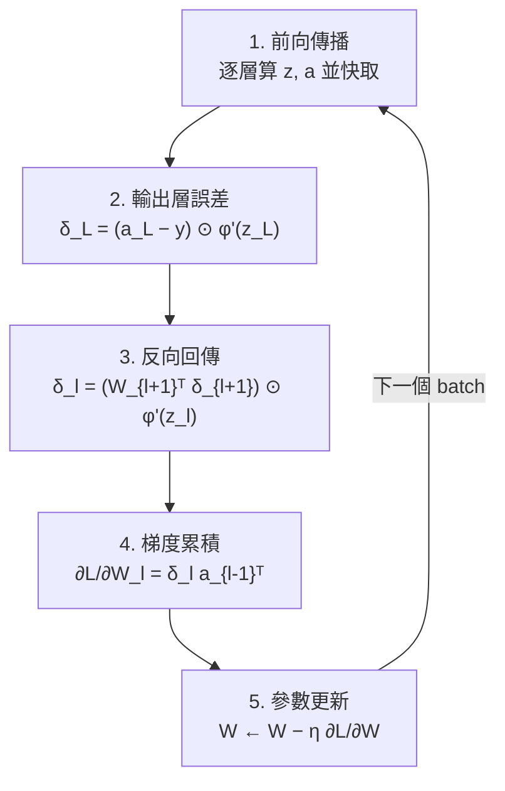
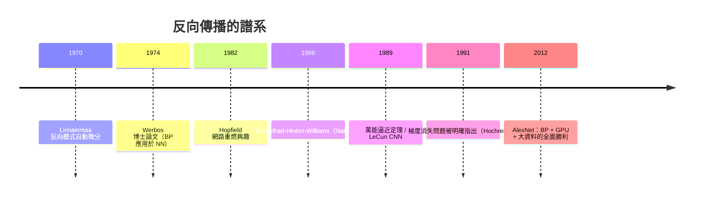

# 3.2 反向傳播演算法：鏈鎖律的系統化（1986 Rumelhart-Hinton-Williams）

## 一、歷史背景：最後一塊拼圖

1986 年，David Rumelhart、Geoffrey Hinton 與 Ronald Williams 在 *Nature* 發表《Learning representations by back-propagating errors》，把「反向傳播（Backpropagation, BP）」變成神經網路訓練的標準演算法，直接終結了第一次寒冬。

需要澄清的歷史事實是：**鏈鎖律本身毫無新意**——微積分三百多年前就有了。反向模式的自動微分思想可追溯到 Seppo Linnainmaa（1970，非線性函數的梯度計算複雜度分析），Paul Werbos 在 1974 年哈佛博士論文中已明確提出將其用於神經網路。1986 年論文的真正貢獻是：

1. **系統化與可讀化**：把 BP 寫成神經網路語言（層、誤差信號 $\delta$ 、局部梯度），使非數學背景的認知科學家與工程師都能實作；
2. **表示學習的論證**：論文標題強調「learning **representations**」——隱層學到的是有用的內部表示，而非僅是計算的中間步驟；
3. **示範性實驗**：XOR、語音、家族關係推理等實驗顯示 BP 能讓網路「自己發現特徵」，這在當時是革命性的證據。

換言之，BP 之於神經網路，如同福爾摩斯之於推理：**方法早已存在，但直到有人把它寫成人人能用的形式，它才成為力量。**

## 二、數學推導：反向傳播的完整推導

### 2.1 問題設定

考慮 $L$ 層前饋網路，逐層計算：

$$
z^{(l)} = W^{(l)} a^{(l-1)} + b^{(l)}, \qquad a^{(l)} = \phi\big(z^{(l)}\big), \qquad a^{(0)} = x
$$

損失函數 $\mathcal{L}(a^{(L)}, y)$ （例如平方誤差或交叉熵）。目標是計算梯度 $\dfrac{\partial \mathcal{L}}{\partial W^{(l)}}$ 對所有層。

### 2.2 鏈鎖律的兩個方向

損失是參數的深層複合函數，鏈鎖律指出：

$$
\frac{\partial \mathcal{L}}{\partial W^{(l)}} = \frac{\partial \mathcal{L}}{\partial a^{(L)}} \cdot \frac{\partial a^{(L)}}{\partial a^{(L-1)}} \cdots \frac{\partial a^{(l)}}{\partial W^{(l)}}
$$

直覺上有兩種計算順序：

- **從前向後**（前向模式微分）：每個參數走一遍完整鏈條，複雜度 $O(\text{參數數})$ 次前向——對百萬參數的網路是災難；
- ****從後向前**（反向模式）**：先算 $\partial\mathcal{L}/\partial a^{(L)}$ ，逐層回傳、**共享中間結果**，一遍反向掃描得到所有參數的梯度，複雜度與一次前向同階。

**反向傳播 = 反向模式自動微分應用於神經網路圖。** 這一個「計算順序」的選擇，就是整個深度學習能存在的效率根據。

### 2.3 核心公式：誤差信號 $\delta$ 的遞迴

定義第 $l$ 層的誤差信號（局部損失敏感度）：

$$
\delta^{(l)} \equiv \frac{\partial \mathcal{L}}{\partial z^{(l)}}
$$

**（1）輸出層**（ $l = L$ ，以平方誤差 + sigmoid 為例）：

$$
\delta^{(L)} = \frac{\partial \mathcal{L}}{\partial z^{(L)}} = \frac{\partial \mathcal{L}}{\partial a^{(L)}} \odot \phi'\big(z^{(L)}\big) = \big(a^{(L)} - y\big) \odot \phi'\big(z^{(L)}\big)
$$

**（2）逐層回傳**：由 $z^{(l+1)} = W^{(l+1)} a^{(l)} + b^{(l+1)}$ 與 $a^{(l)} = \phi(z^{(l)})$ ：

$$
\delta^{(l)} = \Big( (W^{(l+1)})^\top \delta^{(l+1)} \Big) \odot \phi'\big(z^{(l)}\big)
$$

這就是 BP 的靈魂：**誤差信號沿權重矩陣的轉置向後流動，並在每一層被激活函數的導數調製**。

**（3）參數梯度**：

$$
\frac{\partial \mathcal{L}}{\partial W^{(l)}} = \delta^{(l)} \big(a^{(l-1)}\big)^\top, \qquad \frac{\partial \mathcal{L}}{\partial b^{(l)}} = \delta^{(l)}
$$

### 2.4 完整演算法



**計算複雜度**：前向與反向各 $O(\text{權重數})$ ，總成本約為兩次前向傳播；記憶體需快取各層激活值（這也是後來混合精度、梯度檢查點等工程技術的動機）。

### 2.5 梯度消失：BP 天生的阿基里斯腱

把回傳公式中的 $\phi'$ 展開，梯度的大小由連乘決定：

$$
\|\delta^{(l)}\| \approx \prod_{k=l+1}^{L} \|W^{(k)}\| \cdot |\phi'(z^{(k)})| \cdot \|\delta^{(L)}\|
$$

若 $|\phi'| < 1$ （sigmoid 導數最大僅 $1/4$ ）且權重不大，連乘使梯度**指數級衰減**——深層靠近輸入的層幾乎學不到東西；權重過大則相反地爆炸。這個 1986 年就寫在公式裡的缺陷，成為此後二十年網路深度受限的主因，並催生了三條解藥：ReLU（5.2）、LSTM 的門控記憶（6.2）、ResNet 的恆等捷徑（5.2、9.2）。

## 三、程式碼實作：手寫反向傳播

### 3.1 純 NumPy 實作（不借助任何自動微分框架）

```python
import numpy as np

np.random.seed(0)
# 資料：XOR
X = np.array([[0,0],[0,1],[1,0],[1,1]], float)
y = np.array([[0],[1],[1],[0]], float)

n_in, n_h, n_out = 2, 4, 1
W1 = np.random.randn(n_in, n_h) * 0.5;  b1 = np.zeros(n_h)
W2 = np.random.randn(n_h, n_out) * 0.5; b2 = np.zeros(n_out)

def sigmoid(z):    return 1 / (1 + np.exp(-z))

lr = 1.0
for epoch in range(10000):
    # ---- 前向傳播（快取中間量）----
    z1 = X @ W1 + b1;  a1 = sigmoid(z1)
    z2 = a1 @ W2 + b2; a2 = sigmoid(z2)
    loss = np.mean((a2 - y) ** 2)

    # ---- 反向傳播（鏈鎖律）----
    delta2 = (a2 - y) * a2 * (1 - a2)          # 輸出層 δ：(a-y)⊙φ'
    dW2 = a1.T @ delta2                        # ∂L/∂W2 = δ2·a1ᵀ
    db2 = delta2.sum(axis=0)
    delta1 = (delta2 @ W2.T) * a1 * (1 - a1)   # 回傳：δ1 = (δ2 W2ᵀ)⊙φ'
    dW1 = X.T @ delta1
    db1 = delta1.sum(axis=0)

    # ---- 更新 ----
    W2 -= lr * dW2; b2 -= lr * db2
    W1 -= lr * dW1; b1 -= lr * db1

    if epoch % 2000 == 0:
        print(f"epoch {epoch}  loss = {loss:.4f}")

print("預測:", np.round(sigmoid(X @ W1 + b1) @ W2 + b2, 2).flatten())
# [0. 1. 1. 0.] —— 1969 年的危機被 30 行程式碼終結
```

### 3.2 用 PyTorch 驗證：自動微分就是「廣義 BP」

```python
import torch, torch.nn as nn

X = torch.tensor([[0.,0.],[0.,1.],[1.,0.],[1.,1.]])
y = torch.tensor([[0.],[1.],[1.],[0.]])

mlp = nn.Sequential(nn.Linear(2, 4), nn.Sigmoid(), nn.Linear(4, 1))
opt = torch.optim.SGD(mlp.parameters(), lr=1.0)

for _ in range(10000):
    loss = nn.functional.binary_cross_entropy_with_logits(mlp(X), y)
    opt.zero_grad()
    loss.backward()    # ← 框架自動完成 2.4 節的全部反向步驟
    opt.step()

print(torch.sigmoid(mlp(X)).round().flatten().tolist())
```

`loss.backward()` 一行背後，正是本節推導的 $\delta$ 遞迴與 $\delta a^\top$ 梯度累積。理解手寫版本的意義在於：**當訓練出問題（梯度 NaN、不收斂、某層學不動）時，只有理解 BP 的人能診斷**。第 8 章將看到，現代框架的計算圖（computational graph）就是這套推導的動態版本。

### 3.3 手動驗證梯度：數值梯度檢查

```python
import numpy as np

def numerical_grad(f, w, eps=1e-5):
    g = np.zeros_like(w)
    for idx in np.ndindex(w.shape):
        old = w[idx]
        w[idx] = old + eps; fp = f()
        w[idx] = old - eps; fm = f()
        w[idx] = old
        g[idx] = (fp - fm) / (2 * eps)
    return g

# 以 3.1 的單層為例，比較解析梯度 dW1 與數值梯度
# assert np.allclose(dW1, numerical_grad(...), atol=1e-6)
```

梯度檢查是所有深度學習工程師的第一防線：任何手寫層、自訂損失，都應先用數值梯度驗證 BP 的正確性。

## 四、1986 之後：BP 打開的大門與新問題

### 4.1 解決了什麼

1. **多層可學習**：XOR 到語音識別，隱層權重首次可以自動學習——第一次寒冬的核心障礙被移除。
2. **表示學習成為現實**：隱層激活被證明學到了語義特徵（論文中的家族關係實驗中，網路自發學出「性別」「世代」等內部特徵）——這是第 9 章表示學習的思想起點。
3. **統一框架**：任何由可微模塊組成的模型都能訓練，BP 成為後來 RNN、CNN、Transformer 的共同基礎。

### 4.2 引出了什麼新問題

| 新問題 | 內容 | 後續發展 |
|--------|------|----------|
| 梯度消失/爆炸 | 連乘導數使深層訓練失敗 | ReLU、LSTM、ResNet、初始化（4.2） |
| 優化非凸 | BP 給梯度，但梯度下降在非凸面如何行為？ | SGD 變體、Adam（4.1） |
| 過擬合 | 大網路記憶訓練集 | Dropout、正則化（4.2） |
| 計算量 | 反向傳播需要大量矩陣乘法 | GPU 與框架（第 8 章） |
| 生物合理性爭議 | 大腦沒有顯式的反向權重轉置 | 反饋對齊（feedback alignment）等研究至今 |

值得注意最後一條：BP 在生物學上不合情理（突觸無法攜帶「反向誤差」），這使 1986-2010 年間不少人質疑它作為大腦模型的地位。但深度學習的勝利最終以工程實用主義回答了這一爭議：**我們要的是能學習的機器，不一定是大腦的複製品**。



## 五、本節重點

- 反向傳播 = **反向模式自動微分 + 神經網路計算圖**：數學上是鏈鎖律，工程上是「一次反向掃描得到全部梯度」的效率革命（ $O(\text{參數數}) \to O(1)$ 次前向成本）。
- 核心公式： $\delta^{(l)} = (W^{(l+1)})^\top \delta^{(l+1)} \odot \phi'(z^{(l)})$ ，參數梯度 $\partial \mathcal{L}/\partial W^{(l)} = \delta^{(l)} (a^{(l-1)})^\top$ 。
- 1986 年論文的歷史貢獻不在發明微積分，而在**系統化、可讀化、並以實驗證明隱層學到了表示**——直接終結第一次寒冬。
- BP 的天生命門是**梯度消失/爆炸**：連乘的 $\|W\|\cdot|\phi'|$ 決定了深度的上限，此缺陷驅動了 ReLU、LSTM、ResNet 三大解藥的誕生。
- 現代框架的 `loss.backward()` 就是這套推導的自動化；理解手寫 BP 是診斷訓練問題的基本功。

## 六、思考問題

1. 前向模式微分與反向模式微分在「多輸入單輸出」情境下的複雜度各是多少？為何神經網路訓練必須選後者？
2. 請從 2.3 的回傳公式推導：若把 sigmoid 換成 ReLU，梯度消失問題在哪個區間被緩解？又在哪個區間（死 ReLU）會完全斷流？
3. 若某層權重全部初始化為 0，BP 會發生什麼？（提示：對稱性。）這如何說明初始化（4.2）不是工程細節而是理論必需？
4. 生物合理性爭議：大腦被認為用局部 Hebbian 式更新。你認為「工程有效但生物不合」的演算法算不算「智慧模型」？這對神經形態計算有何啟示？
5. 反向傳播需要快取所有中間激活值。當模型大到快取不下時（如超大語言模型），有哪些工程與數學手段（梯度檢查點、混合專家、流水線）可以緩解？這如何連結到第 8 章與第 9 章？
