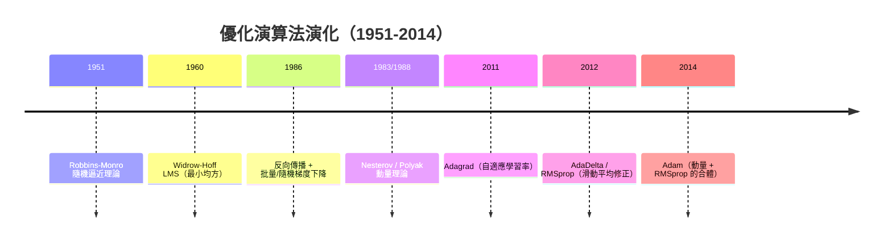

# 4.1 梯度下降變體、SGD、Momentum、Adam（2014）

## 一、歷史背景：反向傳播之後，優化成為主戰場

反向傳播（1986）解決了「梯度從哪裡來」，但沒有解決「拿到梯度之後怎麼走」。1986-2012 年間，優化方法經歷了一場靜悄悄但決定性的演化。這段歷史的主旋律是三個矛盾的拉鋸：

1. **精度 vs 速度**：全資料梯度（批量梯度下降）方向準確但每步太貴；單樣本梯度（純 SGD）快但方向嘈雜。
2. **當前 vs 記憶**：普通梯度下降只看當前梯度，沒有運動慣性；而真實損失面上存在狹長峽谷（病態曲率），需要慣性才能衝過。
3. **統一 vs 自適應**：不同參數的梯度尺度差異巨大（稀疏特徵 vs 高頻特徵），需要每參數的學習率自適應。

1986-2010 年間，訓練一個稍深的網路仍像煉丹。2012 年 AlexNet 用「GPU + ReLU + Dropout + 動量 SGD」一舉奪冠（5.2），證明優化技術是深度學習成功三大支柱之一；2014 年 Kingma 與 Ba 的 Adam 論文則把自適應方法推向大眾，成為至今引用量最高的優化論文。



## 二、梯度下降的三種尺度

### 2.1 批量、隨機、小批量

損失函數是資料上的平均：$\mathcal{L}(\theta) = \frac{1}{N}\sum_{i=1}^N \ell(f(x_i;\theta), y_i)$。

| 方法 | 每步使用的樣本 | 梯度品質 | 每步成本 | 收斂特點 |
|------|---------------|----------|----------|----------|
| 批量 GD | 全部 $N$ | 準確 | 極高 | 精確但慢，且停在嚴格駐點（易過擬合至極小值） |
| 純 SGD | 1 個 | 高方差 | 極低 | 嘈雜但快，噪聲有助逃離尖銳極小值 |
| 小批量 SGD | $B$ 個（32-4096） | 折衷 | 中 | **現代標準**，兼顧 GPU 平行度與噪聲正則化 |

數學上，Robbins-Monro（1951）的隨機逼近理論早已證明：只要學習率滿足 Robbins-Monro 條件

$$
\sum_{t=1}^{\infty} \eta_t = \infty, \qquad \sum_{t=1}^{\infty} \eta_t^2 < \infty
$$

隨機梯度下降在凸問題上幾乎必然收斂。前一支要求步長總和無限（能走遍全程），後一支要求平方和有限（噪聲最終被壓平）——實務上用指數衰減或階梯衰減近似。

### 2.2 小批量 SGD 的更新公式

$$
\theta_{t+1} = \theta_t - \eta \, \frac{1}{B}\sum_{i \in \mathcal{B}_t} \nabla_\theta \ell_i(\theta_t)
$$

關鍵洞見：**噪聲不是缺陷而是特性**。梯度噪聲使優化器能穿越鞍點與淺的局部極小值，且傾向於停在**平坦極小值**（flat minima）——平坦區域對參數擾動不敏感，通常泛化更好（Hochreiter & Schmidhuber 1997；Keskar et al. 2017 的大批量實驗）。

## 三、動量：物理學的禮物

### 3.1 病態曲率問題

深度損失面常呈狹長峽谷：一個方向極陡（如輸入尺度差異大的方向）、另一個方向極緩。普通 SGD 在此發生「之字形震盪」：陡方向來回彈跳，緩方向蝸牛前進。

### 3.2 動量更新公式

Polyak（1964）重型球法、Nesterov 加速梯度（1983，理論最優）：

$$
v_{t+1} = \beta v_t + \nabla \mathcal{L}(\theta_t), \qquad \theta_{t+1} = \theta_t - \eta\, v_{t+1}
$$

Nesterov 變體先「預走」半步再算梯度（lookahead），收斂理論更優：

$$
v_{t+1} = \beta v_t + \nabla \mathcal{L}(\theta_t - \eta \beta v_t)
$$

物理直覺：把參數看成有質量的球，梯度是力、$v$ 是速度。震盪方向的動量因反覆變號而互相抵消，緩方向動量持續累積——**峽谷被自動平滑**。實務中 $\beta = 0.9$（等效於過去約 10 步梯度的指數加權平均）是 AlexNet 以來的標準配置。

## 四、自適應學習率：從 Adagrad 到 Adam

### 4.1 動機：參數的梯度尺度天差地別

 embedding 表中低頻詞的梯度稀疏而小，高頻詞的梯度密集而大；同一學習率之下，低頻特徵學不到、高頻特徵過衝。理想情況是**每個參數有自己的步長**。

### 4.2 演化鏈條

**Adagrad（Duchi et al. 2011）**：累積歷史梯度平方，除之：

$$
G_t = G_{t-1} + g_t \odot g_t, \qquad \theta_{t+1} = \theta_t - \frac{\eta}{\sqrt{G_t} + \epsilon} \odot g_t
$$

缺陷：$G_t$ 只增不減，後期學習率趨於零——訓練「提前老化」。

**RMSprop（Hinton 2012 課程中提出）**：把累積改為指數滑動平均，遺忘久遠歷史：

$$
s_t = \beta_2 s_{t-1} + (1-\beta_2)\, g_t \odot g_t, \qquad \theta_{t+1} = \theta_t - \frac{\eta}{\sqrt{s_t} + \epsilon} \odot g_t
$$

**Adam（Kingma & Ba 2014）**：動量（一階矩）+ RMSprop（二階矩）+ 偏差修正：

$$
\begin{aligned}
m_t &= \beta_1 m_{t-1} + (1-\beta_1) g_t &\text{（梯度的一階滑動平均）}\\
v_t &= \beta_2 v_{t-1} + (1-\beta_2) g_t \odot g_t &\text{（梯度平方的二階滑動平均）}\\
\hat{m}_t &= \frac{m_t}{1-\beta_1^t}, \qquad \hat{v}_t = \frac{v_t}{1-\beta_2^t} &\text{（修正初期低估）}\\
\theta_{t+1} &= \theta_t - \eta \frac{\hat{m}_t}{\sqrt{\hat{v}_t} + \epsilon}
\end{aligned}
$$

標準超參數 $\beta_1 = 0.9, \beta_2 = 0.999, \epsilon = 10^{-8}$。偏差修正的必要性：$m_0 = 0$ 使初期 $m_t$ 系統性偏小，除以 $1-\beta^t$（初期接近 0、快速趨近 1）將其無偏化。

### 4.3 Adam 的理論爭議

Adam 雖實務稱王，理論卻一波三折：2017 年 Wilson 等人指出 Adam 在某些凸問題上不收斂（AMSGRAD 論文）；2018 年 Reddi 等給出 Adam 不收斂的反例。實務界的回答是工程性的：**Adam + 學習率預熱（warmup）+ 解耦權重衰減（AdamW, Loshchilov & Hutter 2017）**。AdamW 把權重衰減從梯度中剝離、直接作用於參數，成為 Transformer 時代的標配——這提醒我們：**優化的實踐常領先於理論**（與第 9 章的深度學習理論困境一脈相承）。

## 五、程式碼實作

### 5.1 從零實作 SGD、Momentum、Adam

```python
import numpy as np

def make_valley():                      # 病態峽谷：x 方向平緩，y 方向陡峭
    f    = lambda p: 0.05 * p[0]**2 + p[1]**2
    grad = lambda p: np.array([0.1 * p[0], 2 * p[1]])
    return f, grad

def sgd(p, g, lr):      return p - lr * g
def momentum(p, v, g, lr=0.1, beta=0.9):
    v = beta * v + g
    return p - lr * v, v
def adam(p, m, v, g, t, lr=0.2, b1=0.9, b2=0.999, eps=1e-8):
    m = b1*m + (1-b1)*g
    v = b2*v + (1-b2)*g*g
    m_hat = m/(1-b1**t); v_hat = v/(1-b2**t)
    return p - lr*m_hat/(np.sqrt(v_hat)+eps), m, v

f, grad = make_valley()
for name, runner in [("SGD",      lambda: (np.array([9.,9.]), None, sgd)),
                     ("Momentum", lambda: (np.array([9.,9.]), np.zeros(2), momentum)),
                     ("Adam",     lambda: (np.array([9.,9.]), None, adam))]:
    p, extra, step = runner()
    m = v = None; path = [p.copy()]
    for t in range(1, 101):
        g = grad(p)
        if name == "SGD":      p = step(p, g, lr=0.1)
        elif name == "Momentum": p, extra = step(p, extra, g)
        else:                  p, m, v = step(p, m or 0, v or 0, g, t)
        path.append(p.copy())
    print(f"{name:9s} 終點 = {np.round(p, 4)}, loss = {f(p):.5f}")
# 觀察：SGD 在 y 方向劇烈震盪；Momentum 壓平震盪；Adam 對兩軸自動平衡
```

### 5.2 用 PyTorch 比較優化器在真實網路上的表現

```python
import torch, torch.nn as nn, torchvision

device = "mps" if torch.backends.mps.is_available() else "cpu"
tf = torchvision.transforms.ToTensor()
tr = torchvision.datasets.MNIST("./data", train=True, download=True, transform=tf)
tl = torch.utils.data.DataLoader(tr, batch_size=128, shuffle=True)

def net():  # 一個小 MLP
    return nn.Sequential(nn.Flatten(), nn.Linear(784, 128), nn.ReLU(),
                         nn.Linear(128, 10)).to(device)

for opt_name in ["SGD", "SGD+Momentum", "Adam"]:
    model = net()
    params = dict(sgd=(0.5, {}), **{"SGD+Momentum": (0.2, {"momentum": 0.9})},
                  **{"Adam": (1e-3, {})})[opt_name]
    opt = getattr(torch.optim, "SGD" if "SGD" in opt_name else "Adam")(
        model.parameters(), lr=params[0], **params[1])
    for epoch in range(2):
        for x, y in tl:
            x, y = x.to(device), y.to(device)
            loss = nn.functional.cross_entropy(model(x), y)
            opt.zero_grad(); loss.backward(); opt.step()
    acc = sum((model(x.to(device)).argmax(1) == y.to(device)).sum().item()
              for x, y in tl) / len(tr)
    print(f"{opt_name:14s} 2-epoch 準確率 = {acc:.4f}")
# Adam 前期最快；SGD+動量後期泛化常更佳——「快」與「好」是不同的目標
```

### 5.3 學習率調度：優化的另一半學問

```python
import torch, torch.nn as nn

model = nn.Linear(100, 10)
opt = torch.optim.SGD(model.parameters(), lr=0.1, momentum=0.9)
sched = torch.optim.lr_scheduler.CosineAnnealingLR(opt, T_max=100, eta_min=1e-5)

for epoch in range(100):
    # ... train_one_epoch() ...
    sched.step()          # 學習率從 0.1 餘弦衰減到 1e-5
# 暖機+餘弦退火（warmup + cosine decay）是 Transformer 訓練的標準配方：
# 前期小步避免 Adam 初期的不穩定，後期小步精修
```

## 六、本節重點

- 優化方法的三個維度：**批量尺度**（噪聲與速度的折衷）、**慣性**（動量解決病態曲率）、**自適應**（每參數學習率）。
- 小批量 SGD 是現代標準：噪聲不僅是計算妥協，更是逃離尖銳極小值、提升泛化的隱形正則化。
- 動量把梯度變成速度：震盪方向互相抵消、緩方向累積加速；Nesterov 版本以 lookahead 獲得更優理論收斂。
- Adagrad → RMSprop → Adam 的演化主線是「累積歷史二階矩 + 指數遺忘」；Adam 合併動量與 RMSprop 並做偏差修正，成為事實標準；AdamW 的解耦權重衰減是 Transformer 時代的必需品。
- 學習率（含 warmup 與 decay schedule）常比優化器的選擇更重要；優化實踐長期領先於收斂理論，是深度學習「理論滯後」的典型例證。

## 七、思考問題

1. 為什麼純 SGD 的噪聲可能帶來**更好**的泛化？請用「平坦 vs 尖銳極小值」的幾何圖像解釋，並推想為何大批量訓練常泛化較差（Keskar 現象）。
2. Adagrad 的學習率必然單調遞減，這在什麼任務上是致命的？RMSprop 的滑動平均如何解決？代價是什麼？
3. Adam 的偏差修正若被移除，訓練初期會發生什麼？請用 $m_t$ 的期望值計算說明。
4. 實務中「Transformer 用 AdamW、CNN 用 SGD+動量」是常見配置。請推測原因（提示：注意力參數的梯度分布 vs 卷積參數的權重共享結構）。
5. Robbins-Monro 條件要求 $\sum \eta_t^2 < \infty$。固定的學習率違反此條件，為何實務中固定小學習率仍然「夠用」？這與「噪聲正則化」的觀點有何張力？
