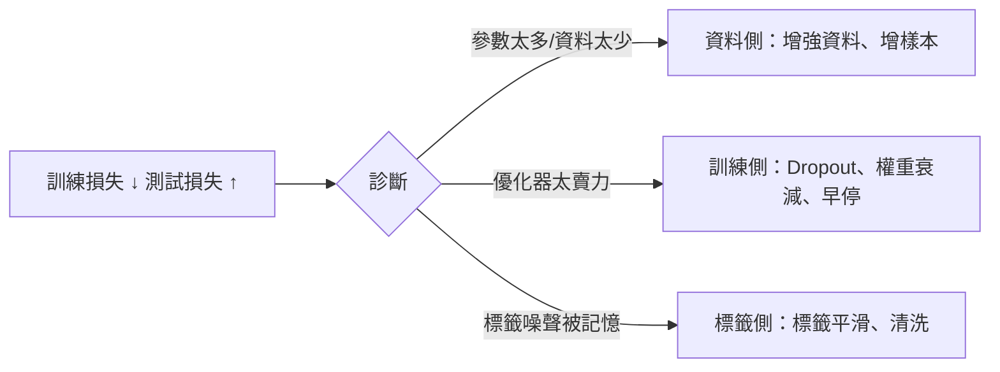

# 4.2 過擬合、正則化、Dropout、BatchNorm（2015）與初始化

## 一、歷史背景：能訓練之後，「訓得好」成為新戰場

反向傳播（1986）與優化方法（4.1）解決了「能不能訓練」，但神經網路隨即暴露出機器學習的永恆矛盾：**參數越多，記憶力越強，泛化力越不可靠**。傳統統計學的答案（奧卡姆剃刀、VC 維、偏差-方差權衡）主張控制模型複雜度，但深度學習走了一條看似悖論的路：

- 網路越來越大（百萬→上億參數），訓練資料相對顯得不足；
- 過參數化網路在訓練集上幾乎零損失，卻仍能在測試集上表現良好（Zhang et al. 2017 的經典實驗：隨機標籤也能被完美記憶）；
- 靠的不是「小模型」，而是**一系列正則化與訓練技巧的組合拳**。

2012 年 AlexNet 的勝利配方中，一半是正則化技術（Dropout、資料增強、權重衰減）；2015 年 Ioffe 與 Szegedy 的 Batch Normalization 把訓練穩定性問題一舉簡化，成為此後所有大模型的隱形地基。本章梳理這條「從對抗過擬合到馴服深度」的技術史。

## 二、過擬合：問題的數學刻畫

### 2.1 泛化誤差分解

設經驗風險（訓練損失）$\hat{R}(\theta) = \frac{1}{N}\sum_i \ell(f(x_i;\theta), y_i)$，真實風險 $R(\theta)$。泛化誤差可粗略分解為：

$$
R(\hat{\theta}) \leq \underbrace{\hat{R}(\hat{\theta})}_{\text{訓練損失}} + \underbrace{\big(R(\hat{\theta}) - \hat{R}(\hat{\theta})\big)}_{\text{泛化差距（generalization gap）}}
$$

過擬合 = 訓練損失低、泛化差距大。經典理論（VC 維）給出 $R - \hat{R} = O(\sqrt{d_{VC}/N})$ 的界，暗示必須限制模型複雜度 $d_{VC}$——但深度網路的 VC 維巨大，經典界完全鬆散無用（訓練正確率 100% 的過參數網路照樣泛化，經典理論無法解釋）。**這個理論-實踐的斷裂，是第 9 章現代泛化理論的出發點。** 實務上，深度學習的對策是「不縮模型，而是約束訓練過程」。

### 2.2 檢測與診斷

```python
import torch, torch.nn as nn

train_losses, val_losses = [], []
model = nn.Sequential(nn.Linear(784, 512), nn.ReLU(),
                      nn.Linear(512, 512), nn.ReLU(), nn.Linear(512, 10))
opt = torch.optim.SGD(model.parameters(), lr=0.1)

def epoch_loop(loader, train=True):
    model.train(train)                       # train=False 時關閉 Dropout/更新 BN
    total = 0
    for x, y in loader:
        with torch.set_grad_enabled(train):
            loss = nn.functional.cross_entropy(model(x.flatten(1)), y)
        if train:
            opt.zero_grad(); loss.backward(); opt.step()
        total += loss.item() * len(y)
    return total / len(loader.dataset)

# 訓練 20 輪，記錄兩條曲線：
# 若 train 持續下降而 val 先降後升 → 教科書式過擬合 → 該上正則化了
```



## 三、正則化技術全家福

### 3.1 顯式正則：權重衰減（L2 正則）

在損失中加入參數範數懲罰，偏好小權重的平滑解：

$$
\mathcal{L}_{\text{total}}(\theta) = \frac{1}{N}\sum_i \ell_i(\theta) + \frac{\lambda}{2}\|\theta\|_2^2
$$

梯度等價於在每步更新後做衰減：$\theta \leftarrow \theta - \eta(\nabla\mathcal{L} + \lambda\theta)$。理論上 L2 對應高斯先驗的最大後驗（MAP）估計；實務上（AdamW）則發現**把衰減與自適應梯度解耦**才能發揮作用（4.1）。

### 3.2 隱式正則：早停

驗證損失開始上升即停止訓練。L2 正則與早停在二次損失下數學等價（訓練時間 $t$ 對應有效 $\lambda \approx t^{-1}$）——深度學習的「隱式正則化」概念由此而來：**訓練動態本身就是一種正則化**，這是現代理論的重要主題。

### 3.3 資料側正則：資料增強與標籤平滑

- **資料增強（data augmentation）**：對輸入施加保持語義的變換（翻轉、裁剪、色彩抖動），等價於向模型注入「不變性先驗」。AlexNet 的成功一半歸功於它。對 CNN 的不變性研究（Goodfellow et al. 2009）證實增強的效果來自先驗而非單純資料量。
- **標籤平滑（label smoothing）**：把 one-hot 目標 $\delta_k$ 改為 $(1-\epsilon)\delta_k + \epsilon/K$，抑制模型對訓練標籤的過度自信，改善校準（calibration），是 Transformer 訓練標配。

## 四、Dropout（2012/2014）：訓練一個隱式的模型集成

### 4.1 機制與數學

Srivastava、Hinton 等人提出（論文 2014，思想見於 2012 AlexNet）：訓練時以機率 $p$ 隨機將每個神經元置零：

$$
\text{訓練：} \quad \tilde{a} = \frac{m \odot a}{1-p}, \quad m_i \sim \text{Bernoulli}(1-p); \qquad \text{推論：} \quad a \text{（不變，已由縮放補償）}
$$

縮放 $\frac{1}{1-p}$（inverted dropout）保證激活的期望值在訓練與推論間一致，無需在推論時做任何調整。

### 4.2 為什麼有效：三種理論視角

1. **集成視角**：每個 mini-batch 訓練的是一個不同的子網路（共有 $\binom{n}{(1-p)n}$ 個）；推論時使用全部權重近似於對指數多個子網路做平均——**模型集成的廉價實作**。
2. **共適應破壞**：隨機失活迫使每個神經元不依賴特定夥伴、必須獨立有用，破壞神經元之間的脆弱共適應（co-adaptation）。
3. **噪聲正則**：乘性噪聲在數學上等價於對激活施加自適應的 L2 型懲罰（Wager et al. 2013）。

### 4.3 程式碼

```python
import torch, torch.nn as nn

model = nn.Sequential(
    nn.Flatten(),
    nn.Linear(784, 512), nn.ReLU(), nn.Dropout(0.5),   # 訓練時 50% 失活
    nn.Linear(512, 256), nn.ReLU(), nn.Dropout(0.3),
    nn.Linear(256, 10),
)

model.train()      # 啟用 dropout（與 BatchNorm 的行為切換）
model.eval()       # 推論模式：dropout 關閉、無需任何縮放（inverted 已處理）

# 手寫驗證期望一致性：
x = torch.randn(1000, 100)
d = nn.Dropout(0.5)
print(torch.allclose(d.train()(x).mean(0), x.mean(0), atol=0.05))  # True
# 訓練模式下的期望 ≈ 原始期望 —— 縮放補償的作用
```

## 五、Batch Normalization（2015）：馴服內部協變量漂移

### 5.1 問題：深層的訓練不穩定

Ioffe 與 Szegedy 觀察到：前層參數更新會改變後層輸入的分布（他們稱之**內部協變量漂移，Internal Covariate Shift**），迫使每層不斷適應「移動的地面」，導致（a）需要小心的小學習率、（b）對初始化極敏感、（c）飽和非線性（sigmoid）加速梯度消失。

### 5.2 機制與數學

對每個 mini-batch 的每個通道做標準化，再學習性地縮放平移：

$$
\mu_B = \frac{1}{m}\sum_{i=1}^m x_i, \quad \sigma_B^2 = \frac{1}{m}\sum_i (x_i - \mu_B)^2, \quad
\hat{x}_i = \frac{x_i - \mu_B}{\sqrt{\sigma_B^2 + \epsilon}}, \quad
y_i = \gamma \hat{x}_i + \beta
$$

$\gamma, \beta$ 是可學習參數——若網路某層不需要標準化，可學出 $\gamma=\sigma_B, \beta=\mu_B$ 還原。推論時用**全訓練集的滑動平均** $\mu, \sigma$（而非 batch 統計），保證確定性輸出。

### 5.3 真正的作用機制：再參數化的平滑性

後續研究（Santurkar et al. 2018）指出「消除內部協變量漂移」的解釋並不準確（在 BN 後人為注入分布漂移，訓練照樣良好）。BN 的實質作用是**使損失面更平滑**：有效學習率在參數變化下更穩定（$\eta/\|\theta\|^2$ 的自適應效應），梯度預測性增強，因此可以用大得多的學習率。這個「論文動機錯了、技術卻大獲成功」的案例，再次印證深度學習實踐先於理論的常態。

### 5.4 與初始化的深層關聯

BN 使訓練對初始化不敏感，但在沒有 BN 的時代（以及今天 BN 不適用的 Transformer 中），**初始化理論**本身就是穩定訓練的主角：

**Xavier/Glorot 初始化（Glorot & Bengio 2010）**：保持前向方差不膨脹（sigmoid/tanh 適用）：

$$
W_{ij} \sim U\Big[-\sqrt{\tfrac{6}{n_{in}+n_{out}}},\ \sqrt{\tfrac{6}{n_{in}+n_{out}}}\Big]
$$

**He 初始化（He et al. 2015）**：針對 ReLU（一半神經元為零，方差減半）修正為：

$$
W_{ij} \sim \mathcal{N}\Big(0,\ \frac{2}{n_{in}}\Big)
$$

推導核心：要求 $\text{Var}(z^{(l+1)}) = \text{Var}(z^{(l)})$，即 $n_{in}\,\text{Var}(W)\,\mathbb{E}[\phi'^2] \approx 1$。初始化理論的終極形態是 2018 年的 $\mu P$（maximal-update parametrization，見 9.2），使小模型調好的超參數可遷移到巨型模型——**初始化從「防止數值爆炸」演化為「跨尺度訓練動力學不變性」**。

## 六、程式碼綜合實驗

### 6.1 過擬合診斷 + 正則化對照

```python
import torch, torch.nn as nn, torchvision

tf = torchvision.transforms.ToTensor()
tr = torchvision.datasets.FashionMNIST("./data", train=True,  download=True, transform=tf)
te = torchvision.datasets.FashionMNIST("./data", train=False, download=True, transform=tf)
tr5k = torch.utils.data.Subset(tr, range(5000))                  # 故意用小資料集
tl = torch.utils.data.DataLoader(tr5k, batch_size=128, shuffle=True)
vl = torch.utils.data.DataLoader(te,  batch_size=256)

def run(dropout, weight_decay, epochs=15):
    torch.manual_seed(0)
    model = nn.Sequential(nn.Flatten(), nn.Linear(784, 512), nn.ReLU(),
                          nn.Dropout(dropout), nn.Linear(512, 10))
    opt = torch.optim.SGD(model.parameters(), lr=0.1, weight_decay=weight_decay)
    for _ in range(epochs):
        model.train()
        for x, y in tl:
            loss = nn.functional.cross_entropy(model(x), y)
            opt.zero_grad(); loss.backward(); opt.step()
    model.eval(); correct = 0
    with torch.no_grad():
        for x, y in vl:
            correct += (model(x).argmax(1) == y).sum().item()
    return correct / len(te)

for d, wd in [(0, 0), (0, 5e-4), (0.5, 0), (0.5, 5e-4)]:
    print(f"dropout={d}  weight_decay={wd:<7}  測試準確率 = {run(d, wd):.4f}")
# 小資料上：任何一種正則化都顯著提升測試準確率
```

### 6.2 BatchNorm 的威力與正確用法

```python
import torch, torch.nn as nn

def block(bn):
    layers = [nn.Linear(64, 64), nn.ReLU()] + ([nn.BatchNorm1d(64)] if bn else [])
    return nn.Sequential(*layers)

model = nn.Sequential(*block(True), *block(True), *block(True), nn.Linear(64, 1))

x = torch.randn(32, 64)
model.train()
out_tr = model(x)                 # 用 batch 統計
model.eval()
out_ev = model(x)                 # 用滑動平均統計
print("train/eval 輸出差異可見 BN 的雙模式本質")
# 常見陷阱：
# 1) batch_size=1 或極小時，train 模式的統計噪聲會毀掉訓練 → 換 LayerNorm
# 2) 忘記 model.eval() 會使推論結果隨機 → 部署事故的經典來源
```

### 6.3 初始化對深網的影響（無 BN 時）

```python
import torch, torch.nn as nn

def forward_variance(init_fn, depth=30):
    torch.manual_seed(0)
    layers = []
    for _ in range(depth):
        lin = nn.Linear(256, 256)
        init_fn(lin.weight)
        layers += [lin, nn.ReLU()]
    net = nn.Sequential(*layers).eval()
    with torch.no_grad():
        h = torch.randn(1, 256)
        for l in net: h = l(h)
        return h.std().item()

xavier = lambda w: nn.init.xavier_uniform_(w)
he     = lambda w: nn.init.kaiming_normal_(w, nonlinearity="relu")
bad    = lambda w: nn.init.normal_(w, 0.0, 0.5)

for name, fn in [("N(0,0.5)（過大）", bad), ("Xavier", xavier), ("He", he)]:
    print(f"{name:16s} 30 層後激活標準差 = {forward_variance(fn):.4f}")
# 過大初始化 → 指數爆炸；Xavier 對 ReLU 略小（方差逐層減半）；
# He 初始化保持方差穩定 —— 一個係數之差，決定 30 層能否訓練
```

## 七、本節重點

- 過擬合的現代刻畫是「泛化差距」；經典複雜度理論（VC 維）對過參數化網路失效，深度學習的對策是**約束訓練過程而非縮小模型**。
- 顯式正則（權重衰減）、隱式正則（早停、SGD 噪聲）、資料側正則（增強、標籤平滑）構成三條防線；它們都在向模型注入先驗。
- Dropout 以隨機失活實現「隱式集成」並破壞共適應；inverted dropout 的縮放使推論零成本。
- BatchNorm 用 mini-batch 統計標準化激活：原始動機（內部協變量漂移）被後續研究修正，實質機制是**再參數化使損失面更平滑、允許大學習率**。
- 初始化理論（Xavier→He→μP）的演化主線是「保持跨層方差穩定」→「跨模型尺度的不變性」，是訓練穩定性的數學地基。
- BN 的 train/eval 雙模式與小 batch 失效，催生了 LayerNorm（Transformer 的選擇）——正則化技術與架構選擇深度耦合。

## 八、思考問題

1. Zhang et al.（2017）證明網路能完美擬合隨機標籤。這對「模型容量必須受限以泛化」的經典信條構成什麼挑戰？你如何解釋過參數網路的泛化？
2. Dropout 在推論時完全關閉，等於訓練與推論的函數不同。為什麼這種「不一致」沒有傷害效能？極端情況（$p \to 1$）會發生什麼？
3. BatchNorm 為何在序列模型中不受歡迎？請從 batch 維度的語義（獨立樣本 vs 序列位置）與變長序列兩方面分析，並說明 LayerNorm 如何繞過這些問題。
4. 請推導 He 初始化：從 $\text{Var}(z^{(l+1)}) = n_{in}\,\text{Var}(W)\,\mathbb{E}[\text{ReLU}(z)^2]$ 出發，證明 $\text{Var}(W) = 2/n_{in}$ 時方差守恆。
5. 「正則化 = 注入先驗」：請為資料增強（水平翻轉）、權重衰減、標籤平滑各自指出隱含的先驗假設，並討論什麼任務上這些假設會失效（例如翻轉不變性對文字圖像？）。
