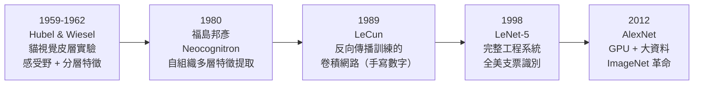
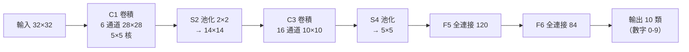

# 5.1 Hubel-Wiesel、Neocognitron 與 LeNet（1998）

## 一、歷史背景：三段接力，四十年一箭

卷積神經網路（CNN）不是發明出來的，而是**接力**出來的：神經生理學發現視覺計算的原理（1959-1962）→ 日本工程師把它變成網路架構（1980）→ 美國法國的研究者配上反向傳播與資料，做出可訓練的實用系統（1989-1998）。這一章的每一環都完美演示了「基礎科學如何在三十年後變成工程革命」。



## 二、Hubel 與 Wiesel：大腦怎麼「看」

### 2.1 實驗與發現

David Hubel 與 Torsten Wiesel 在 1959-1962 年間以微電極記錄麻醉貓的初級視覺皮層（V1）單個神經元，發現了顛覆性的組織原理（1981 年諾貝爾獎）：

1. **感受野（receptive field）**：每個 V1 神經元只對視野中**一小塊區域**的刺激有反應——大腦用「局部視窗」處理影像，而非全圖。
2. **簡單細胞與方向選擇性**：V1 神經元對特定方向的邊緣/條紋有最大反應——它們是天生的**邊緣偵測器**。
3. **複雜細胞與平移不變性**：複雜細胞對同一方向刺激的反應不隨位置劇變——即「**平移不變性**」的雛形。
4. **分層組織**：簡單細胞匯聚成複雜細胞、複雜細胞再匯聚成超複雜細胞——**特徵逐層抽象**：從邊緣 → 角與紋理 → 形狀 → 物體。

這四點恰好是 CNN 的四大設計原則的生物藍本：局部感受野 = 卷積核、方向選擇性 = 學到的濾波器、平移不變性 = 池化、分層抽象 = 深層架構。

## 三、福島邦彥的 Neocognitron（1980）

福島邦彥（Kunihiko Fukushima）直接以 Hubel-Wiesel 模型為藍本，提出 Neocognitron——第一個嚴格模仿視覺皮層分層結構的多層網路：

- **S 層（simple cells）**：對局部特徵做加權整合（相當於卷積）；
- **C 層（complex cells）**：對 S 層輸出做局部模糊/取最大（相當於池化），提供位置容差；
- 反覆堆疊 S-C 對，特徵從邊緣逐層抽象到複雜形狀；
- 權重以**無監督的自組織學習**（改良 Hebb 法則）獲得。

Neocognitron 的歷史地位尷尬而關鍵：**架構上它就是 CNN 的祖先，但學習上它落後了**——自組織學習難以訓練出高精度系統，且 1980 年日本學界與西方交流受限，影響被延遲了十年。它再次印證了第 2 章的教訓：**表示 ≠ 學習；有好架構還要有好學習演算法。**

## 四、LeCun 的卷積網路（1989-1998）：架構與數學

### 4.1 卷積層：三個先驗的參數化

Yann LeCun 在 1989 年將反向傳播應用於卷積架構（與 Bell Labs 團隊，用於郵政編碼識別），1998 年的 LeNet-5 論文（*Proceedings of the IEEE*）成為 CNN 的經典文獻。卷積層相對全連接層引入**三個歸納偏置（inductive biases）**：

$$
S_{i}^{(l)}(u, v) = \phi\Big(\sum_{c}\sum_{a}\sum_{b} K_{i,c}^{(l)}(a, b)\, S_{c}^{(l-1)}(u + a, v + b) + b_i\Big)
$$

1. **局部連接**：每個輸出只看局部窗口（感受野）——影像的鄰近像素相關性高、遠處相關性低；
2. **權重共享**：同一個核 $K_i$ 掃過整張圖——「邊緣偵測器」應該在圖的任何位置都一樣，這是**平移等變性**的編碼，同時把參數量從 $O(HW \cdot H_{in}W_{in})$ 壓到 $O(k^2)$；
3. **池化**：對局部區域取平均/最大——給予小幅**平移不變性**，並縮小特徵圖尺寸。

「參數預算」的直覺極有說服力：對 $1000^2$ 輸入的圖像，全連接第一層（隱層 $10^5$）需要 $10^{11}$ 參數，不可訓練；$5 \times 5$ 卷積核只需 25 個參數（每通道），小到能從幾萬張樣本中學出來。**CNN 不是更強的函數族，而是更聰明的約束——用正確的先驗換取可學習性。**

### 4.2 LeNet-5 架構



今日看來平凡，1998 年它已包含現代 CNN 的全部要素：卷積-池化堆疊、多通道、tanh 非線性、RBF 輸出層，以及一整套工程系統（圖像預處理、失真增強）。LeNet 系列被美國銀行界採用，讀取了全美**約 10-20% 的支票**——神經網路在寒冬後第一次創造了真正的商業價值。

### 4.3 程式碼：手寫一個 LeNet

```python
import torch, torch.nn as nn, torchvision

class LeNet5(nn.Module):
    def __init__(self):
        super().__init__()
        self.feat = nn.Sequential(          # 原始用 tanh/池化，此處用 ReLU/MaxPool 的現代版
            nn.Conv2d(1, 6, 5),  nn.ReLU(), nn.MaxPool2d(2),
            nn.Conv2d(6, 16, 5), nn.ReLU(), nn.MaxPool2d(2),
        )
        self.cls = nn.Sequential(
            nn.Flatten(), nn.Linear(16*4*4, 120), nn.ReLU(),
            nn.Linear(120, 84), nn.ReLU(), nn.Linear(84, 10),
        )
    def forward(self, x):
        return self.cls(self.feat(x))

tf = torchvision.transforms.ToTensor()
tr = torchvision.datasets.MNIST("./data", train=True, download=True, transform=tf)
te = torchvision.datasets.MNIST("./data", train=False, download=True, transform=tf)
tl = torch.utils.data.DataLoader(tr, batch_size=128, shuffle=True)
vl = torch.utils.data.DataLoader(te, batch_size=256)

net = LeNet5()
opt = torch.optim.SGD(net.parameters(), lr=0.1, momentum=0.9)
for epoch in range(3):
    net.train()
    for x, y in tl:
        loss = nn.functional.cross_entropy(net(x), y)
        opt.zero_grad(); loss.backward(); opt.step()

net.eval(); correct = 0
with torch.no_grad():
    for x, y in vl:
        correct += (net(x).argmax(1) == y).sum().item()
print(f"LeNet-5 MNIST 準確率 = {correct/len(te):.4f}")   # 約 0.99

# 觀察第一層卷積核：是否自發學出「方向性邊緣偵測器」？
k = net.feat[0].weight.data
print("第一層核形狀:", k.shape)   # (6, 1, 5, 5)
# 視覺化（matplotlib）可見 Gabor 狀的邊緣/條紋感受野
# —— 網路無監督地重新發現了 Hubel-Wiesel 的簡單細胞！
```

最後一段值得反覆玩味：**僅用監督學習（梯度 + 標籤），第一層卷積核就自發演化出方向選擇性的邊緣偵測器**，與貓視覺皮層的簡單細胞驚人相似。這是「表示學習」（第 9 章）最有力的經驗證據之一。

## 五、1998-2012：CNN 的十四年蟄伏與等待

LeNet 成功之後，CNN 並未立即統治世界，反而沉寂了十四年。原因值得細究，因為它們指出了 AlexNet（5.2）革命的真正組成：

1. **資料不足**：MNIST 規模（6 萬張小圖）養不大 CNN；識別「自然影像中的一般物體」需要百萬級標註——ImageNet（2009）正是為此而生。
2. **算力不足**：LeNet 的 6 萬參數用 CPU 可訓；VGG 級的億級參數乘法必須等 GPU（第 8 章）。
3. **演算法邊際不足**：tanh 飽和、無 ReLU、無 Dropout、初始化粗糙——深 CNN 在當時訓練不動。
4. **主流對抗**：1990 年代末 SVM 當道，「神經網路已死」的印象仍在；CNN 被視為手寫數字的特化技巧而非通用方法。

這段歷史再次展示了深度學習的「三元共振」結構：**架構（CNN）× 資料（ImageNet）× 算力（GPU）缺一不可**。架構在 1998 年就緒，等的是另外兩塊。

## 六、本節重點

- CNN 的四大設計原則直接源自 Hubel-Wiesel 的神經科學：局部感受野、方向選擇性、平移不變性、分層特徵抽象。
- Neocognitron（1980）完成了架構層的複製，但自組織學習不給力；LeCun 的突破是**用反向傳播訓練卷積架構**——架構與學習演算法終於會師。
- 卷積的三個歸納偏置（局部連接、權重共享、池化）把參數量壓低數個數量級，把「不可學」變成「可學」——CNN 的本質是**用正確的先驗換取可學習性**。
- LeNet-5（1998）是完整工程系統，讀取全美約一成支票，是神經網路第一次大規模商業應用；第一層核自發學出邊緣偵測器，重現了 V1 簡單細胞。
- 1998-2012 的蟄伏說明：架構就緒不足以革命，需要**資料（ImageNet）與算力（GPU）**同時就位——這為 5.2 與第 8 章埋下伏筆。

## 七、思考問題

1. 權重共享假設「平移等變性」。哪些視覺任務違反這個假設？（提示：圖像中物體的絕對位置有意義的場景，如醫學影像的器官位置。）如何在 CNN 中引入位置資訊？
2. 池化提供小幅平移不變性，但也丟失精確位置。請分析「不變性-可辨性權衡」：什麼任務需要減少池化？（提示：細粒度分類、目標定位。）
3. Neocognitron 的自組織學習與 LeCun 的監督 BP 各有何優劣？現代自監督學習（如 MAE、DINO）算不算「回到福島的路線」？
4. 第一層卷積核自發學出邊緣偵測器，第二層、第三層學到什麼？（提示：查 Zeiler & Fergus 2014 的視覺化。）「逐層抽象」在多大程度上得到證實？
5. 若 1998 年就有 GPU 與 ImageNet，你認為深度學習革命會提前到來嗎？請論證「架構、資料、算力」三者中哪個是 1998-2012 年間的真正瓶頸。

## 八、延伸閱讀與時代註腳

- **原始文獻**：Hubel & Wiesel, *Receptive fields of single neurones in the cat's striate cortex* (J. Physiol., 1959)；Fukushima, *Neocognitron: A self-organizing neural network model* (Biological Cybernetics, 1980)；LeCun et al., *Gradient-based learning applied to document recognition* (Proc. IEEE, 1998)。
- **接力史的啟示**：從神經生理發現（1959）到工業落地（1998）歷經近四十年，跨越神經科學、日本工程界、美國貝爾實驗室三個社群。科學思想的轉移常以「被遺忘—重新發現—追溯致謝」的方式完成，福島邦彥直到 2010 年代才獲得遲來的承認。
- **對後續章節的鉤子**：本節的「三個先驗」思想在 5.2 的 ResNet 中被部分反轉（殘差連接反而讓網路更接近「什麼都不做」的預設）；而「用先驗換可學習性」的哲學，在 7.2 的 Transformer 中達到另一極端——用位置編碼這個最小先驗取代全部空間結構假設。讀者帶著這條線索進入後續章節，將看到架構設計的鐘擺如何在「強先驗（CNN）」與「弱先驗（Transformer）」之間擺動，以及為什麼最終是弱先驗 + 大資料的組合勝出。
- **一句話總結**：CNN 的故事告訴我們——好的架構不是更強的函數族，而是更聰明的約束；而好的約束，來自對問題本質（這裡是視覺計算的生理結構）的深刻理解。
