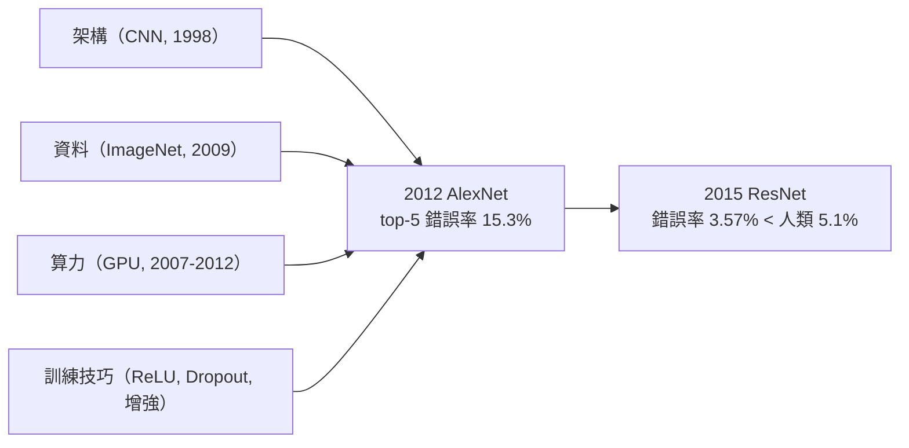
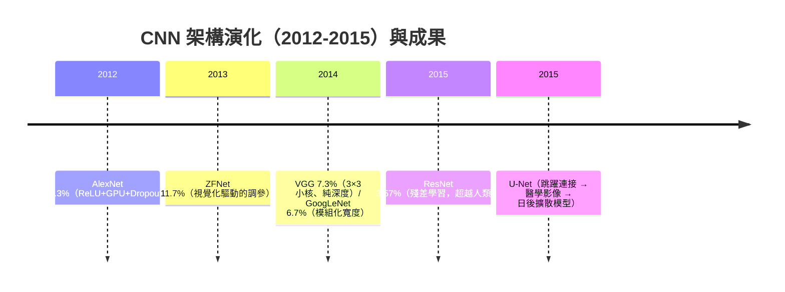

# 5.2 AlexNet 與 ImageNet 革命（2012）、CNN 架構演化 VGG/ResNet（2014-2015）

## 一、歷史背景：十四年等待後的總爆發

2009 年，李飛飛團隊發布 ImageNet：**1400 萬張、2.2 萬類、人工標註**的網路圖像資料庫，並自 2010 年起舉辦 ILSVRC 競賽（1000 類、120 萬張訓練圖）。2010-2011 年的冠軍仍是傳統方法（特徵工程 + SVM），top-5 錯誤率約 25-26%。2012 年，Hinton 團隊的 Alex Krizhevsky、Ilya Sutskever、Geoffrey Hinton 以 **AlexNet** 參賽，將錯誤率一舉壓到 **15.3%**（領先第二名 10 個百分點以上），震動整個領域。這是深度學習時代的正式開端。

AlexNet 的成功不是單點突破，而是**多重技術的首次同框**：

| 要素 | 內容 | 解決的問題 |
|------|------|-----------|
| GPU 訓練 | 兩塊 GTX 580、cuda-convnet | 億級乘法從數月變數天（第 8 章） |
| ReLU | 取代 tanh | 深層梯度消失緩解、訓練加速數倍 |
| Dropout | 0.5 失活於全連接層 | 6000 萬參數在小資料上的過擬合 |
| 資料增強 | 平移、翻轉、色彩抖動 | 注入不變性先驗、等效擴充資料 |
| 分層訓練策略 | LR schedule、momentum 0.9、weight decay 5e-4 | 穩定收斂 |



## 二、AlexNet 之後的架構軍備競賽

### 2.1 ZFNet（2013）與可解釋性

ZFNet 主要貢獻是**視覺化**：以反卷積（deconvnet）把每層激活映射回像素空間，證實「第一層學邊緣、中層學紋理/部件、深層學物體」的逐層抽象（部分回應了 5.1 的思考題 4），並據此調整核大小與步長。表示學習開始有微觀證據。

### 2.2 VGG（2014）：小核與深度的純粹主義

Oxford VGG 組提出極簡設計哲學：**全部使用 $3\times3$ 卷積、每兩層做一次 2 倍下採樣、深度 16-19 層**。其理論根據值得計算：兩個 $3\times3$ 核疊加的感受野等於一個 $5\times5$ 核，但參數從 $25C^2$ 降到 $18C^2$ ，且**多了一次非線性變換**——「用深度換感受野」更省參數、更有表達力。VGG 證明：**在固定的架構語法下，加深就是進步的主軸**。代價：VGG-16 有 1.38 億參數，深到 19 層後再加深就**訓練不動了**。

### 2.3 GoogLeNet/Inception（2014）：寬度方向的探索

以 Inception 模組（並聯 $1\times1$ 、 $3\times3$ 、 $5\times5$ 、池化再拼接）在**寬度**上做文章，用 $1\times1$ 卷積降維壓參數（680 萬參數達到 6.7% 錯誤率）。它與 VGG 一起把 top-5 推進到 7% 以內，但深度天花板問題依舊。

### 2.4 退化問題：加深為何反而更差？

按 VGG 邏輯，56 層應優於 20 層。He 等人的實驗卻顯示：**56 層普通網路的訓練損失比 20 層還高**——這不是過擬合（訓練集上也差），而是**優化退化（degradation）**。理論上深網至少可以複製淺網的行為（多餘層學恆等映射即可），但實驗證明 SGD **學不好恆等映射**：非線性層要表達「什麼都不做」反而困難。這是一個純粹的優化問題，卻卡死了深度——**構成本書最清晰的「問題驅動發明」案例**。

## 三、ResNet（2015）：殘差學習的理論與實踐

### 3.1 核心思想：學殘差，不學原函數

He Kaiming 等人（*Deep Residual Learning*, CVPR 2016）重新表述層的學習目標。設目標映射為 $H(x)$ ，與其讓堆疊層直接擬合 $H(x)$ ，不如讓它們擬合**殘差**：

$$
F(x) = H(x) - x \quad\Longrightarrow\quad y = F(x; \{W_i\}) + x
$$

「捷徑連接（shortcut connection）」把輸入 $x$ 直接加到輸出上。若某層塊最好什麼都不做，只需把 $F \to 0$ （權重趨零即可），**恆等映射變成了平凡解**——直擊退化問題的要害。

### 3.2 梯度視角：捷徑是梯度的高速公路

對殘差塊求梯度：

$$
\frac{\partial y}{\partial x} = \frac{\partial F}{\partial x} + I
$$

反向傳播時，梯度總有一條**不經過任何權重矩陣的恆等通路**（ $+I$ 項）。即使所有 $F$ 的梯度趨零，梯度仍能直達深層——**梯度消失被結構性地緩解**。這與 3.2 節的連乘公式對照一目了然：ResNet 把 $\prod_k W^{(k)}$ 的連乘變成 $\prod_k (I + \partial F^{(k)})$ 的連乘，只要 $\partial F$ 適當小，乘積便不會指數衰減。2016 年後的理論（如「ResNet 是離散化的常微分方程」觀點）更把恆等捷徑與動力系統的穩定性聯繫起來（預告 9.2）。

### 3.3 成績與歷史意義

ResNet-152 達 top-5 錯誤率 **3.57%**（ILSVRC 2015 冠軍），首次超越人類（約 5.1%）。更深的意義：殘差連接成為此後幾乎一切架構（Transformer 的每個子層都有殘差）的標配；「跳躍連接」也催生了 U-Net（2015，醫學影像與日後擴散模型的骨幹）與 DenseNet。

## 四、程式碼實作

### 4.1 AlexNet 風格的網路（PyTorch 內建 vs 手寫要點）

```python
import torch, torch.nn as nn, torchvision

# torch 內建的 AlexNet（為 ImageNet 224×223 設計）；重點看結構語法
net = torchvision.models.alexnet(weights=None)
print(net.features)   # 卷積堆疊：Conv-ReLU-MaxPool ×5
print(net.classifier) # Dropout + 全連接 ×3 —— Dropout 只用在 FC 層（AlexNet 原文設計）

# AlexNet 的訓練配方（歷史性的超參數）：
opt = torch.optim.SGD(net.parameters(), lr=0.01, momentum=0.9, weight_decay=5e-4)
sched = torch.optim.lr_scheduler.StepLR(opt, step_size=30, gamma=0.1)  # 每 30 輪除以 10
```

### 4.2 手寫殘差塊與 ResNet-18，驗證退化與解藥

```python
import torch, torch.nn as nn

class ResidualBlock(nn.Module):
    """兩層 3×3 卷積 + 捷徑；通道數不符時以 1×1 卷積匹配維度"""
    def __init__(self, cin, cout, stride=1):
        super().__init__()
        self.conv = nn.Sequential(
            nn.Conv2d(cin, cout, 3, stride, 1, bias=False), nn.BatchNorm2d(cout), nn.ReLU(),
            nn.Conv2d(cout, cout, 3, 1, 1, bias=False), nn.BatchNorm2d(cout),
        )
        self.short = (nn.Identity() if cin == cout and stride == 1
                      else nn.Conv2d(cin, cout, 1, stride, bias=False))
        self.relu = nn.ReLU()
    def forward(self, x):
        return self.relu(self.conv(x) + self.short(x))   # y = F(x) + x

class ResNet18(nn.Module):
    def __init__(self, n_class=10):
        super().__init__()
        self.stem = nn.Sequential(nn.Conv2d(3, 64, 3, 1, 1, bias=False),
                                  nn.BatchNorm2d(64), nn.ReLU())
        ch, self.widths = 64, [64, 128, 256, 512]
        blocks = []
        for w in self.widths:
            blocks += [ResidualBlock(ch, w, stride=2 if w != 64 else 1),
                       ResidualBlock(w, w)]
            ch = w
        self.blocks = nn.Sequential(*blocks)
        self.head = nn.Linear(512, n_class)
    def forward(self, x):
        return self.head(self.blocks(self.stem(x)).mean((2, 3)))  # 全域平均池化

# 小規模驗證（CIFAR-10 縮減版）：
import torchvision
tf = torchvision.transforms.Compose([torchvision.transforms.ToTensor()])
tr = torchvision.datasets.CIFAR10("./data", train=True, download=True, transform=tf)
tl = torch.utils.data.DataLoader(torch.utils.data.Subset(tr, range(10000)),
                                 batch_size=128, shuffle=True)
net = ResNet18()
opt = torch.optim.SGD(net.parameters(), lr=0.05, momentum=0.9, weight_decay=5e-4)
for epoch in range(3):
    net.train()
    for x, y in tl:
        loss = nn.functional.cross_entropy(net(x), y)
        opt.zero_grad(); loss.backward(); opt.step()
print("訓練正常進行，梯度經恆等捷徑穩定流向深層")

# 梯度健康檢查：比較有無捷徑的逐層梯度範數
x, y = next(iter(tl))
loss = nn.functional.cross_entropy(net(x), y); loss.backward()
norms = [p.grad.norm().item() for p in net.parameters() if p.grad is not None]
print("首末層梯度範數比（越接近 1 越健康）:", round(norms[0]/norms[-1], 4))
```

### 4.3 用 ResNet 做遷移學習：革命的第二波紅利

```python
import torch, torch.nn as nn, torchvision

# ImageNet 預訓練的 ResNet-18，只訓練最後一層
net = torchvision.models.resnet18(weights=torchvision.models.ResNet18_Weights.IMAGENET1K_V1)
for p in net.parameters(): p.requires_grad = False      # 凍結骨幹
net.fc = nn.Linear(512, 5)                               # 換成自己的 5 類頭

# 100 張訓練圖即可達到 90%+ 準確率 ——
# 「預訓練 + 微調」範式自此成為 CV 標準，並最終演化為 NLP 的預訓練時代（9.2）
```

## 五、架構演化的總結與思想的轉移



三條長期影響值得銘記：

1. **深度成為一等公民**：ResNet 之後「100 層以上」隨手可訓，架構設計從「能不能深」轉向「怎麼深才高效」（此後的 MobileNet、EfficientNet）。
2. **預訓練範式的起點**：ImageNet 預訓練 + 下游微調證明了「通用表示可以遷移」——這一思想在 NLP 中被 Word2Vec、ELMo、BERT 逐級放大，最終通向大型語言模型（9.2）。
3. **競賽時代的終結**：2015 年後錯誤率已超人類，ImageNet 競賽於 2017 年停辦；研究重心轉向序列建模與語言——Attention 正在另一條戰線上醞釀（第 7 章）。

## 六、本節重點

- AlexNet（2012）的勝利是**架構 × 資料 × 算力 × 技巧**的四重共振：GPU、ReLU、Dropout、資料增強首次同框，top-5 錯誤率從 26% 跳到 15.3%。
- VGG 以 $3\times3$ 小核證明「疊小核 = 大感受野 + 更多非線性 + 更少參數」，確立深度主軸；Inception 展示寬度路線；兩者共同暴露**退化問題**（深層網路訓練損失反而更高）。
- ResNet（2015）以殘差學習 $y = F(x) + x$ 化解退化：恆等映射成為平凡解，捷徑為梯度提供無權重的高速通道，ResNet-152 達 3.57% 超越人類。
- 殘差連接成為後續一切架構的標配（Transformer 的殘差流）；跳躍連接思想延伸出 U-Net，滋養了醫學影像與生成模型。
- ImageNet 預訓練 + 微調確立了「遷移學習」範式，是通往現代預訓練時代（9.2）的第一步。

## 七、思考問題

1. 兩個 $3\times3$ 卷積的感受野等於一個 $5\times5$ ，但參數 $18C^2 < 25C^2$ 且非線性多一個。請再算三個 $3\times3$ 的情況，並討論「小核深堆」何時會因優化問題而得不償失。
2. 退化問題為什麼不是過擬合？請從「訓練損失」與「驗證損失」的角度區分兩者，並解釋為何 SGD 難以學出恆等映射。
3. 殘差塊的梯度公式 $\partial y/\partial x = \partial F/\partial x + I$ 中，若把捷徑改為帶權重的 $y = F(x) + \lambda x$ （ $\lambda < 1$ ），梯度流會怎樣？這與 LSTM 遺忘門（6.2）有何結構相似性？
4. AlexNet 用了 Dropout，ResNet 卻基本不用（靠 BatchNorm + 增強）。請推測原因：殘差連接本身是否具有正則化效果？
5. 預訓練 + 微調在 2014-2015 年已是 CV 常態。為何 NLP 要等到 2018 年 BERT 才迎來同等革命？（提示：詞表示的離散性、標註資料規模、序列架構的成熟度——連接第 6、7 章。）
