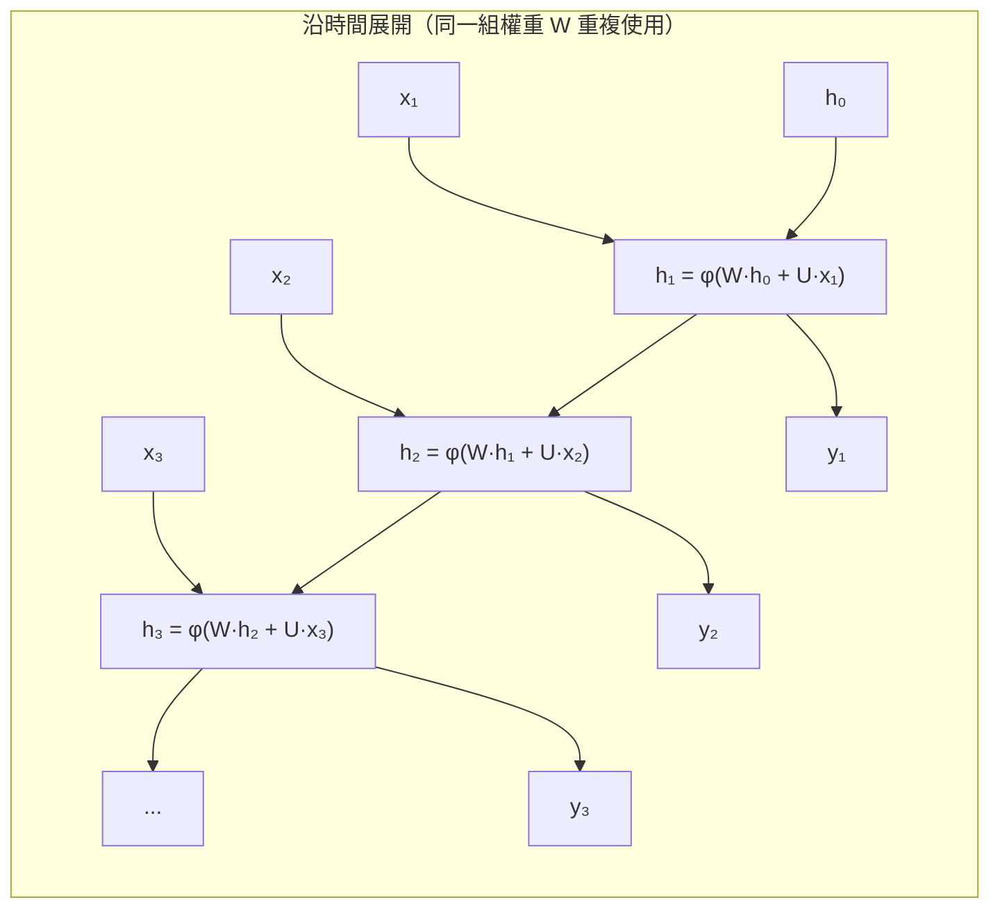
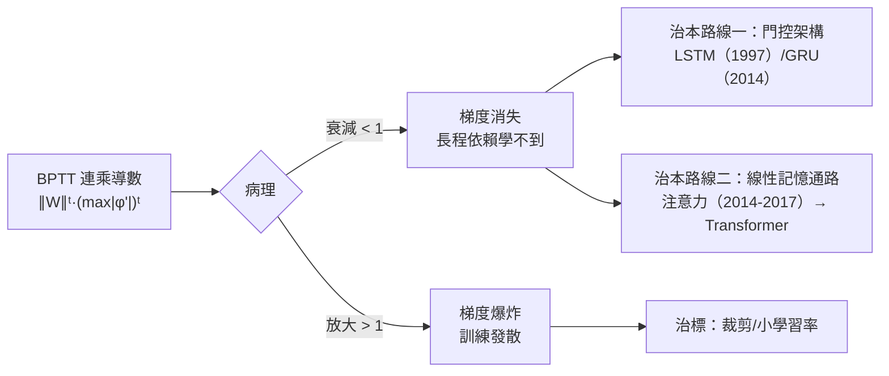

# 6.1 RNN、BPTT 與梯度消失問題（1986-1994）

## 一、歷史背景：序列資料呼喚「有記憶的網路」

CNN（第 5 章）解決了空間結構的資料（圖像），但世界的另一大半是**序列**：語音是時間序列、文本是詞序列、股價是感測器序列。這些資料的本質特徵是：

1. **變長**：句子可長可短，全連接網路的固定輸入維度不適用；
2. **時序依賴**：「他出生在法國，……所以他會說___」——答案取決於幾十個詞之前的信息（**長程依賴**）；
3. **共享時間動力學**：處理第 100 個詞與第 10 個詞應該用同一套「語法知識」。

前饋網路對此三無：無變長、無記憶、無參數共享於時間軸。**循環神經網路（Recurrent Neural Network, RNN）**的解法優雅而直接：**讓網路的輸出成為自己下一步的輸入**，用同一組權重反覆處理每個時間步——參數在時間上共享（正如卷積在空間上共享）。

RNN 的思想可追溯至 1980 年代（Rumelhart 1986 已含 BPTT 雛形、Jordan 1986、Elman 1990 的簡單循環網路），但真正讓它成為可用工具的，是 1990 年代初的兩項工作：Werbos 的 BPTT 系統化（1990）與 Hochreiter 對梯度消失的診斷（1991，其後 Hochreiter & Schmidhuber 1997 發表 LSTM）。本節先建立 RNN 與 BPTT 的數學，再解剖其致命缺陷。

## 二、RNN 的數學模型

### 2.1 單層 RNN 的展開

給定序列 $x_1, \dots, x_T$ ，RNN 維護一個隱藏狀態 $h_t$ ：

$$
h_t = \phi\big(W_{hh}\, h_{t-1} + W_{xh}\, x_t + b_h\big), \qquad
y_t = W_{hy}\, h_t + b_y
$$

$W_{hh}$ 是「記憶通道」： $h_{t-1}$ 攜帶的歷史信息被壓縮進 $h_t$ 。由於 $W_{hh}$ 在所有時間步**共享**，模型可以處理任意長度的序列，且參數量與序列長度無關。



### 2.2 輸出模式

| 模式 | 輸出 | 典型任務 |
|------|------|----------|
| 一對一（每步輸出） | $y_t$ at each $t$ | 詞性標註、語音幀標籤 |
| 多對一（末態輸出） | $y_T$ | 情感分類、句子編碼 |
| 一對多（單輸入序列輸出） | $y_1..y_T$ from $x_1$ | 圖像字幕生成 |
| 多對多（編碼-解碼） | encoder + decoder | 機器翻譯（6.2 的 Seq2Seq） |

## 三、BPTT：沿時間的反向傳播

### 3.1 推導

把 RNN 沿時間展開後，它就是一個**很深的前饋網路**——深度為 $T$ 。因此 BPTT 就是反向傳播沿時間軸執行，對共享權重 $W_{hh}$ 的梯度要**在所有時間步上累加**。

以損失 $\mathcal{L} = \sum_{t=1}^T \ell(y_t)$ 為例，定義 $\delta_t = \partial\mathcal{L}/\partial h_t$ 。由 $h_{t+1} = \phi(W_{hh}h_t + \dots)$ ：

$$
\delta_t = \big(W_{hy}^\top \frac{\partial \ell_t}{\partial y_t} + W_{hh}^\top \delta_{t+1}\big) \odot \phi'(z_t)
$$

展開到 $k$ 步之前（忽略所有加總項、只看最長路徑）：

$$
\frac{\partial \mathcal{L}}{\partial h_k} \;\approx\; \underbrace{\prod_{t=k+1}^{T} W_{hh}^\top \odot \phi'(z_t)}_{\text{連乘的雅可比}} \; \delta_T
$$

**梯度對 $W_{hh}$ **（對所有時間步求和）：

$$
\frac{\partial \mathcal{L}}{\partial W_{hh}} = \sum_{t=1}^{T} \sum_{k=1}^{t} \frac{\partial \mathcal{L}}{\partial h_t} \cdot \frac{\partial h_t}{\partial h_k}\Big|_{\text{直接項}} \cdot \frac{\partial h_k}{\partial W_{hh}}
$$

### 3.2 梯度消失與爆炸：連乘的數學

設雅可比的範數 $\| \partial h_{t+1}/\partial h_t \| \approx \|W_{hh}\| \cdot \max|\phi'|$ 。經過 $T - k$ 步：

$$
\Big\| \frac{\partial \mathcal{L}}{\partial h_k} \Big\| \lesssim \big(\|W_{hh}\| \cdot \sigma_{\max}\big)^{T-k}
$$

- 若 $\|W_{hh}\| \cdot \sigma_{\max} < 1$ ：梯度**指數衰減**—— $k$ 距離 $T$ 超過約 10-20 步後，梯度趨近於零，遠處的依賴**學不到**（梯度消失）；
- 若 $> 1$ ：梯度**指數爆炸**——訓練發散為 NaN（梯度爆炸）。

sigmoid 的導數最大只有 0.25，tanh 最大 1 且只在零點附近——**飽和區導數趨零**，使連乘幾乎必然衰減。這與 3.2 節深度 MLP 的梯度消失同源，但在 RNN 中更嚴峻：**同一個矩陣 $W_{hh}$ 重複連乘**，特徵值大小直接控制衰減率，沒有「逐層各異、部分抵消」的餘地。

### 3.3 梯度截斷（Truncated BPTT）與爆炸對策

實務上的兩個工程解，只治標：

```python
import torch, torch.nn as nn

rnn = nn.RNN(input_size=64, hidden_size=128, batch_first=True)
x  = torch.randn(32, 500, 64)      # batch=32, 長度=500 的序列
out, _ = rnn(x)

# 對策一：截斷 BPTT —— 只把序列切成有限長度的小段做梯度
chunk = x[:, :100, :]              # 只回傳 100 步的梯度，放棄更遠的依賴
out_c, _ = rnn(chunk)
loss = out_c.sum()
loss.backward()                    # 反向傳播只穿過 100 步

# 對策二：梯度裁剪 —— 爆炸時把梯度範數壓回上限
loss = out.sum(); rnn.zero_grad(); loss.backward()
total_norm = torch.nn.utils.clip_grad_norm_(rnn.parameters(), max_norm=5.0)
print("裁剪前梯度範數:", round(total_norm.item(), 2))   # 若 > 5 已被縮放
```

截斷 BPTT 放棄了長程梯度（那正是 RNN 存在的意義）；梯度裁剪只防爆炸不防消失。**兩者都不解決消失——真正的解藥需要改變架構本身。**

## 四、問題的本質：加法 vs 乘法的相互作用

### 4.1 用動力系統的語言重新表述

RNN 的隱狀態演化 $h_{t+1} = \phi(W_{hh}h_t + \dots)$ 是一個離散動力系統。信息能否存活 $T$ 步，取決於映射對初值的敏感度：

- **收縮映射**（譜半徑 < 1）：初值差異指數衰減 → 記憶流失（梯度消失的鏡像：**前向信息也消失**）；
- **發散映射**（譜半徑 > 1）：混沌爆炸。

要讓信息存活 100 步，需要映射「恰好保守」——對固定權重的系統，這只在極窄的參數帶內成立。**長程記憶與穩定訓練在普通 RNN 中是內在矛盾的。** 理論刻畫：Bengio 等人（1994）證明普通 RNN 要能儲存長程信息，必須工作在吸引域邊界（飽和區），而飽和區恰好是梯度消失區——**進退兩難**。

### 4.2 解藥的兩條路線



1. **門控架構（LSTM/GRU，6.2）**：給細胞加「傳送帶」，用門控的乘法讓梯度沿近恆等通路流動——「讓網路自己學會什麼該記、什麼該忘」。
2. **注意力機制（第 7 章）**：乾脆不依賴隱狀態的壓縮記憶，讓每一步**直接查閱**所有歷史位置——繞過整個連乘問題。

值得強調兩條路線的哲學差異：LSTM 仍在「壓縮一切歷史到固定長度向量」的框架內改良；Attention 則放棄壓縮、改用「可微分的檢索」。從壓縮到檢索，正是從 RNN 到 Transformer 的概念革命。

## 五、程式碼實驗：親眼看到梯度消失

### 5.1 構造一個需要長程記憶的任務

```python
import torch, torch.nn as nn

# 任務：序列第一個元素決定「加法還是乘法」，
#       對之後 50 個數字做該運算 —— 記憶必須存活 50 步
torch.manual_seed(0)
def make_batch(B, T=50):
    ops  = torch.randint(0, 2, (B, 1))
    nums = torch.randn(B, T)
    target = (nums[:, 1:].sum(1) if False else
              torch.where(ops.bool(), nums[:, 1:].prod(1), nums[:, 1:].sum(1)))
    x = torch.cat([ops.float().unsqueeze(1), nums], dim=1).unsqueeze(-1)  # (B, T+1, 1)
    return x, target.unsqueeze(-1)

class RNNModel(nn.Module):
    def __init__(self, cls):
        super().__init__()
        self.core = cls(input_size=1, hidden_size=64, batch_first=True)
        self.head = nn.Linear(64, 1)
    def forward(self, x):
        out, _ = self.core(x)
        return self.head(out[:, -1])

B, T = 128, 50
x, y = make_batch(B, T)

for name, cls in [("vanilla RNN", nn.RNN), ("LSTM", nn.LSTM), ("GRU", nn.GRU)]:
    torch.manual_seed(0)
    model = RNNModel(cls)
    opt = torch.optim.Adam(model.parameters(), lr=1e-3)
    for ep in range(200):
        loss = ((model(x) - y) ** 2).mean()
        opt.zero_grad(); loss.backward()
        torch.nn.utils.clip_grad_norm_(model.parameters(), 5.0)
        opt.step()
    print(f"{name:12s} 長程任務 loss = {loss.item():.4f}")
# vanilla RNN 明顯學不動（梯度活不過數十步）；
# LSTM/GRU 因門控細胞的線性通路而能學會 —— 差距就是 6.2 節的主題
```

### 5.2 直接測量梯度隨時間的衰減

```python
import torch, torch.nn as nn

torch.manual_seed(0)
rnn = nn.RNN(1, 32, batch_first=True)
x = torch.randn(1, 30, 1, requires_grad=True)
out, _ = rnn(x)

# 對「最後一個時間步的隱狀態」回傳梯度，觀察其沿時間的範數
grads = torch.autograd.grad(out[:, -1].sum(), x, create_graph=True)[0].squeeze()
print("輸入端梯度範數（應隨距離衰減）:", round(grads.norm().item(), 6))
# 對比：把同樣訊號送入 LSTM，細胞態 c 的梯度衰減慢一個數量級以上
lstm = nn.LSTM(1, 32, batch_first=True)
out, (h, c) = lstm(x)
gc = torch.autograd.grad(c.abs().sum(), x, retain_graph=True)[0]
print("LSTM 細胞態梯度範數:", round(gc.norm().item(), 6))
```

### 5.3 權重初始化與 RNN 穩定性的實驗

```python
import torch, torch.nn as nn

for scale in [0.5, 1.0, 1.5]:
    torch.manual_seed(0)
    rnn = nn.RNN(4, 64, batch_first=True)
    with torch.no_grad():                # 手動控制 W_hh 的尺度
        rnn.weight_hh_hh.normal_(0, scale)
    h = torch.randn(1, 1, 64)
    x = torch.zeros(1, 100, 4)
    hs, _ = rnn(x, h)
    print(f"W_hh 標準差 {scale}: 100 步後隱狀態範數 = {hs.norm().item():.3e}")
# 0.5 → 收縮為零（記憶消失）；1.5 → 爆炸（NaN 邊緣）
# 譜半徑決定一切 —— RNN 的命運寫在 W_hh 的特徵值裡
```

## 六、本節重點

- RNN 用**共享權重的循環隱狀態**處理變長序列，是「參數沿時間共享」的架構，正如 CNN 沿空間共享。
- BPTT 把展開的 RNN 當作深度為 $T$ 的前饋網路做反向傳播；梯度公式是雅可比矩陣 $W_{hh}^\top \odot \phi'$ 的**連乘**。
- 連乘導致二值結局：譜半徑小於 1 → 梯度**指數消失**（長程依賴學不到）；大於 1 → **梯度爆炸**（訓練發散）。截斷 BPTT 與梯度裁剪只治標。
- 深層的問題是內在矛盾的：儲存長程信息需要近保守映射，而保守映射恰處於梯度消失的飽和邊界——普通 RNN 的結構注定短視。
- 兩條治本路線：**門控細胞**（LSTM/GRU，6.2）與**直接檢索**（注意力，第 7 章）——後者最終徹底取代了前者。

## 七、思考問題

1. 請從 $h_t = \phi(W_{hh}h_{t-1} + W_{xh}x_t)$ 出發，寫出 $\partial h_T/\partial h_1$ 的完整雅可比乘積，並說明為何「同一矩陣連乘」使問題比深 MLP 的梯度消失更嚴重。
2. 梯度爆炸可以用裁剪治療，梯度消失為什麼沒有對應的「放大梯度」的簡單解法？（提示：消失意味著**信息已在前向傳播中丟失**，不是梯度計算的錯。）
3. 若把 RNN 的 $W_{hh}$ 初始化為正交矩陣（譜半徑恰為 1），會發生什麼？這類「正交 RNN」研究為何最終沒有成為主流？
4. 截斷 BPTT 用 100 步截斷，等於宣布「100 步以前的歷史無關緊要」。這在哪些任務上可接受、哪些任務上致命？請各舉一例。
5. RNN 的隱狀態是固定維度的向量，等於把任意長的歷史**有損壓縮**到固定容量。請以此分析「壓縮式記憶」的理論上限，並論證為何 Attention 的「檢索式記憶」（第 7 章）能突破該上限。
