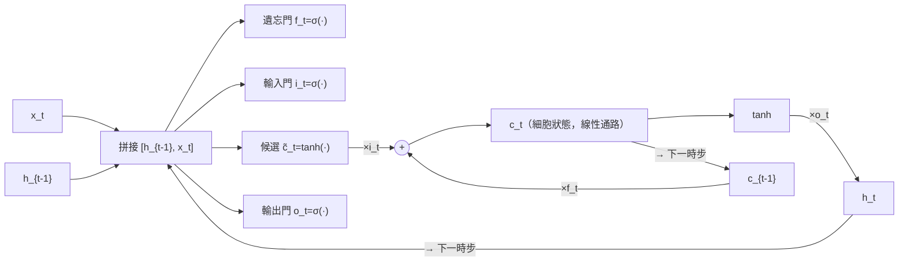
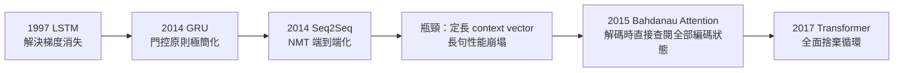

# 6.2 LSTM（1997）與 GRU、Seq2Seq（2014）

## 一、歷史背景：為「長記憶」而設計的細胞

6.1 節診斷出普通 RNN 的絕症：雅可比連乘使長程梯度指數消失，且儲存記憶與梯度穩定在結構上互斥。Sepp Hochreiter（1991 年的文憑論文即診斷此問題）與 Jürgen Schmidhuber 於 1997 年發表 **LSTM（Long Short-Term Memory，長短期記憶網路）**，給出第一個系統性的解法。其核心思想可以一句話概括：

> **與其讓梯度在非線性迷宮中連乘，不如修一條「近恆等」的線性高速公路，再用可學習的門控制它的開關。**

LSTM 自 1997 年發表後沉寂多年，2000 年代中期起在語音辨識（Google 2015 年起用於語音搜尋）、機器翻譯中大量落地；2014 年 Cho 等人的 **GRU**（簡化版）與 **Seq2Seq**（編碼器-解碼器）把循環網路推到神經機器翻譯的舞台中心——同時也暴露出固定向量瓶頸，直接催生了下一章的注意力革命。本章是 RNN 時代的黃金與黃昏。

## 二、LSTM：數學架構全解

### 2.1 細胞狀態：梯度的高速公路

LSTM 引入兩條狀態線：細胞狀態 $c_t$ （長期記憶）與隱狀態 $h_t$ （短期輸出）。**細胞狀態的更新以加法為主**：

$$
c_t = f_t \odot c_{t-1} + i_t \odot \tilde{c}_t
$$

梯度沿 $c$ 的回傳路徑為：

$$
\frac{\partial c_t}{\partial c_{t-1}} = f_t \quad(\text{逐元素的門值，接近 1 時近似恆等})
$$

**這就是解藥的全部數學**：梯度不再經過 $W_{hh}$ 的矩陣連乘與飽和非線性，而是乘以一個**每步可學習、通常趨近 1 的標量**（門值）。當 $f_t \approx 1$ ，梯度像流過恆等映射一樣存活——遺忘門學到「忘記」（ $f\to 0$ ）或「銘記」（ $f\to 1$ ）的時間模式。連乘問題被轉化為「門值是否保持接近 1」的學習問題。

### 2.2 三個門的完整公式

輸入 $x_t$ 與上一隱狀態 $h_{t-1}$ 先拼接，經線性變換產生各門：

$$
\begin{aligned}
f_t &= \sigma\big(W_f [h_{t-1}, x_t] + b_f\big) &\text{（遺忘門：舊記憶保留多少）}\\
i_t &= \sigma\big(W_i [h_{t-1}, x_t] + b_i\big) &\text{（輸入門：新信息寫入多少）}\\
\tilde{c}_t &= \tanh\big(W_c [h_{t-1}, x_t] + b_c\big) &\text{（候選記憶：要寫入的內容）}\\
c_t &= f_t \odot c_{t-1} + i_t \odot \tilde{c}_t &\text{（更新細胞：舊的×保留 + 新的×寫入）}\\
o_t &= \sigma\big(W_o [h_{t-1}, x_t] + b_o\big) &\text{（輸出門：細胞暴露多少）}\\
h_t &= o_t \odot \tanh(c_t) &\text{（輸出隱狀態）}
\end{aligned}
$$



設計的三個精妙之處：

1. **乘法門控 + 加法更新**：記憶的寫入/清除是**乘性的、逐元素的、由 sigmoid 平滑控制**——「門」是可微的開關，整體仍可反向傳播。
2. **讀寫分離**：寫入細胞（ $i_t \tilde{c}_t$ ）與讀出細胞（ $o_t \tanh(c_t)$ ）由不同門控制，記憶可以被「保管而不暴露」。
3. **候選記憶的獨立性**： $\tanh$ 候選 $\tilde c_t$ 與門值解耦，避免「內容與開關互相干擾」。

（2000 年 Gers 加入的窺視孔連接（peephole）讓門直接看到 $c$ ，進一步提升精確計時能力；實務上常省略。）

## 三、GRU（2014）：極簡主義的門控

Cho 等人在機器翻譯工作中提出**門控循環單元（GRU）**，把 LSTM 的三門兩態簡化為兩門一態：

$$
\begin{aligned}
z_t &= \sigma\big(W_z [h_{t-1}, x_t]\big) &\text{（更新門 = 遺忘門與輸入門合體）}\\
r_t &= \sigma\big(W_r [h_{t-1}, x_t]\big) &\text{（重置門）}\\
\tilde{h}_t &= \tanh\big(W [r_t \odot h_{t-1},\, x_t]\big) &\\
h_t &= (1 - z_t) \odot h_{t-1} + z_t \odot \tilde{h}_t &\text{（凸組合式更新）}
\end{aligned}
$$

與 LSTM 的對比：

| 維度 | LSTM | GRU |
|------|------|-----|
| 參數量 | 較多（3 門 + 2 態） | 少約 25% |
| 記憶/輸出分離 | 有（ $c$ 與 $h$ ） | 無（ $h$ 一態兩用） |
| 表現 | 大資料、長依賴略優 | 多數任務與 LSTM 相當 |
| 定位 | 工業長序列主力 | 資源受限與快速原型 |

GRU 的哲學意義：它證明「**加法式狀態更新 + 可學習門控**」這一原則才是本質，LSTM 的其他結構是可精簡的細節。這種「把架構歸約到最小充分原則」的方法論，也是日後 Transformer 精簡 Seq2Seq 的精神。

## 四、Seq2Seq（2014）：循環網路的巔峰與瓶頸

### 4.1 編碼器-解碼器架構

Sutskever、Vinyals、Le（2014，Google）與 Cho 等（2014）同時提出**序列到序列（Seq2Seq）**框架解決機器翻譯：

$$
\text{encoder: } h_t = \text{RNN}(x_t, h_{t-1}) \;\longrightarrow\; s = h_T;
\qquad
\text{decoder: } p(y_t \mid y_{<t}, s) = \text{softmax}(W\,\text{RNN}(y_{t-1}, d_{t-1}))
$$

- **編碼器**把源句壓縮成一個固定向量 $s$ （**context vector**）；
- **解碼器**以 $s$ 為初始條件，自回歸地生成目標句；
- 訓練目標是整個目標句的對數似然，用 BPTT 端到端學習。

這是神經機器翻譯（NMT）的起點：翻譯第一次成為「一個可微的端到端模型」，取代了數十年的「對齊 + 短語表 + 語言模型」流水線工程。

### 4.2 固定向量瓶頸

架構的優雅掩不住它的死穴：**無論源句多長多複雜，全部信息必須擠進固定維度的向量 $s$ **。長句翻譯時編碼器的記憶被沖刷，BLEU 分數隨句長顯著下滑（Bahdanau 2015 論文的圖 1 正是這條曲線）。理論上，把任意長序列**無損**壓縮到定長向量，資訊論上不可能。

**這個瓶頸是本章與下一章的臨界點**：它不是訓練技巧能解的（LSTM 已把梯度問題解決），而是**表示架構**的天花板。解法呼之欲出——解碼器不該只看一個壓縮向量，而應該**隨時回頭查閱編碼器的全部隱狀態**。這就是注意力（第 7 章）。



## 五、程式碼實作

### 5.1 從零實作 LSTM 單元

```python
import torch, torch.nn as nn

class MyLSTMCell(nn.Module):
    def __init__(self, input_dim, hidden_dim):
        super().__init__()
        # 四個門的線性變換合成一個大矩陣（效率慣例）
        self.W = nn.Linear(input_dim + hidden_dim, 4 * hidden_dim)
        self.h_dim = hidden_dim

    def forward(self, x, state):
        h, c = state
        gates = self.W(torch.cat([h, x], dim=-1))
        f, i, o, c_tilde = gates.chunk(4, dim=-1)
        f, i, o = torch.sigmoid(f), torch.sigmoid(i), torch.sigmoid(o)
        c_tilde = torch.tanh(c_tilde)
        c_new = f * c + i * c_tilde      # ← 加法高速公路：梯度在此存活
        h_new = o * torch.tanh(c_new)
        return h_new, c_new

# 驗證與官方實作等價：
torch.manual_seed(0)
cell = MyLSTMCell(4, 8)
ref  = nn.LSTMCell(4, 8)
with torch.no_grad():
    W = torch.cat([ref.weight_hh, ref.weight_ih], dim=1).T
    cell.W.weight.copy_(W)
    cell.W.bias.copy_(ref.bias_ih + ref.bias_hh)
x = torch.randn(2, 4); h = torch.zeros(2, 8); c = torch.zeros(2, 8)
mine = cell(x, (h, c)); theirs = ref(x, (h, c))
print(torch.allclose(mine[0], theirs[0], atol=1e-6),
      torch.allclose(mine[1], theirs[1], atol=1e-6))   # True True
```

### 5.2 手寫 Seq2Seq 翻譯器（玩具版）

```python
import torch, torch.nn as nn

class Encoder(nn.Module):
    def __init__(self, vocab, emb=32, hid=64):
        super().__init__()
        self.emb = nn.Embedding(vocab, emb)
        self.rnn = nn.GRU(emb, hid, batch_first=True)
    def forward(self, src):
        _, h = self.rnn(self.emb(src))
        return h                       # context vector（瓶頸所在！）

class Decoder(nn.Module):
    def __init__(self, vocab, emb=32, hid=64):
        super().__init__()
        self.emb = nn.Embedding(vocab, emb)
        self.rnn = nn.GRU(emb, hid, batch_first=True)
        self.out = nn.Linear(hid, vocab)
    def forward(self, tgt, h):
        out, _ = self.rnn(self.emb(tgt), h)
        return self.out(out)           # 每步對詞表打分

class Seq2Seq(nn.Module):
    def __init__(self, src_v, tgt_v, **kw):
        super().__init__()
        self.enc, self.dec = Encoder(src_v, **kw), Decoder(tgt_v, **kw)
    def forward(self, src, tgt):
        return self.dec(tgt[:, :-1], self.enc(src))    # teacher forcing

# 訓練迴圈（真實翻譯需要單詞表與語料；此處示範張量流）
V = 100
model = Seq2Seq(V, V)
src = torch.randint(0, V, (16, 10)); tgt = torch.randint(0, V, (16, 12))
loss = nn.functional.cross_entropy(
    model(src, tgt).reshape(-1, V), tgt[:, 1:].reshape(-1))
loss.backward()
print("Seq2Seq 端到端梯度已回傳；注意 context vector 維度 = hid = 64")
print("→ 無論 src 多長，全部語義被壓進這 64 維 —— 瓶頸即將引爆注意力革命")
```

### 5.3 測量瓶頸：句長 vs 性能

```python
import torch, torch.nn as nn

# 以「回聲任務」模擬：編碼長度 L 的隨機序列，解碼復述其中第 k 個符號
model = Seq2Seq(20, 20)
model.eval()
with torch.no_grad():
    for L in [5, 10, 20, 40]:
        src = torch.randint(0, 20, (64, L))
        correct = 0
        for k in range(L):
            tgt_in  = torch.full((64, 2), 0)          # 簡化：直接問第 k 位
            logits = model(src, torch.cat([src[:, :k+1], torch.zeros(64,1,dtype=torch.long)], 1))
            correct += (logits.argmax(-1)[:, k] == src[:, k]).sum().item()
        print(f"句長 {L:3d}: 重建準確率 = {correct / (64*L):.3f}")
# 準確率隨句長單調下降 —— 定長向量的信息容量天花板，Bahdanau 圖 1 的玩具重現
```

## 六、LSTM 時代的遺產與黃昏

2015-2017 年，LSTM/GRU + Attention 的組合統治了 NLP：Google 翻譯 2016 年上線神經機器翻譯（GNMT，8 層 LSTM 編碼器 + 注意力），語音識別全面循環化。但黃昏已至，三個結構性缺陷註定被取代：

1. **無法並行**： $h_t$ 依賴 $h_{t-1}$ ，訓練必須串行；GPU 的萬核平行能力（第 8 章）在 RNN 上浪費殆盡。資料量增大時，**訓練時間線性增長且無法用硬體抵消**。
2. **記憶的乘性脆弱**：即使有門控，超長依賴（數百步以上）仍逐漸衰減；注意力可以直接連接任意兩位置。
3. **路徑長度 $O(n)$ **：位置 $i$ 與 $j$ 的信息交換需 $|i-j|$ 步；Transformer 的自注意力把路徑縮為 $O(1)$ 。

2017 年《Attention Is All You Need》以「**捨棄循環，純注意力**」宣告 RNN 時代的終結——但 LSTM 的思想遺產深刻存續：門控（Transformer 中的殘差與歸一化承擔類似的梯度保護功能）、加法式狀態更新（近年狀態空間模型 Mamba 的選擇性掃描可視為 LSTM 原則在線性注意方向的復活）。

## 七、本節重點

- LSTM 的本質是**加法式細胞狀態 + 乘法門控**：梯度沿 $c_t = f_t \odot c_{t-1} + i_t \odot \tilde c_t$ 回傳時只需乘以門值（可學習、趨近 1），把連乘消失問題轉化為可學習的記憶管理問題。
- 遺忘/輸入/輸出三門實現「寫入、保留、暴露」的解耦控制；GRU 證明最小充分架構是「更新門 + 重置門 + 凸組合更新」，參數省 25% 而效能多數相當。
- Seq2Seq（2014）以編碼器-解碼器把翻譯端到端化，開啟神經機器翻譯時代，但其**定長 context vector 瓶頸**使長句性能崩塌——瓶頸是表示層面的，訓練技巧無解。
- 瓶頸的直接解法是讓解碼器查閱全部編碼狀態（Bahdanau Attention，2015，7.1），最終演化為捨棄循環的 Transformer（2017，7.2）。
- RNN 輸給 Transformer 的三個結構性原因：串行不可並行、長路徑依賴、乘性記憶脆弱；其門控與加法更新思想在 Mamba 等新架構中復活。

## 八、思考問題

1. 請推導 LSTM 中 $\partial c_t/\partial c_{t-1} = f_t$ （對角陣），並與普通 RNN 的 $W_{hh}^\top \odot \phi'$ 對比，說明「近恆等梯度通路」的條件是什麼。遺忘門偏置 $b_f$ 初始化為 1（或 2）的慣例有何理論根據？
2. GRU 的更新 $h_t = (1-z_t)h_{t-1} + z_t\tilde h_t$ 是凸組合。這種「插值式」更新與 LSTM 的「加法式」 $c_t = f_t c_{t-1} + i_t \tilde c_t$ 有何表達能力差異？
3. Seq2Seq 的瓶頸在資訊論上為何不可繞過？給出資訊論論證（提示：定長向量的互資訊上限）。什麼樣的任務對瓶頸不敏感？
4. 若你是 2016 年的工程師，GPU 預算固定，面對 10 倍增長的訓練語料：LSTM 的串行訓練與 Transformer 的可並行訓練各意味什麼？請從「算力擴展性」角度論證架構選擇。
5. 門控思想（可微開關）在 Transformer 中以何種形式存續？請比較殘差連接、LayerNorm 與門控在「保護梯度流」上的異同。
