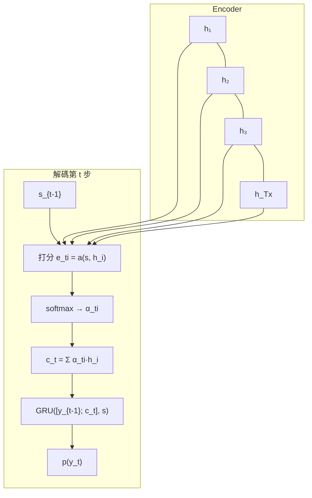
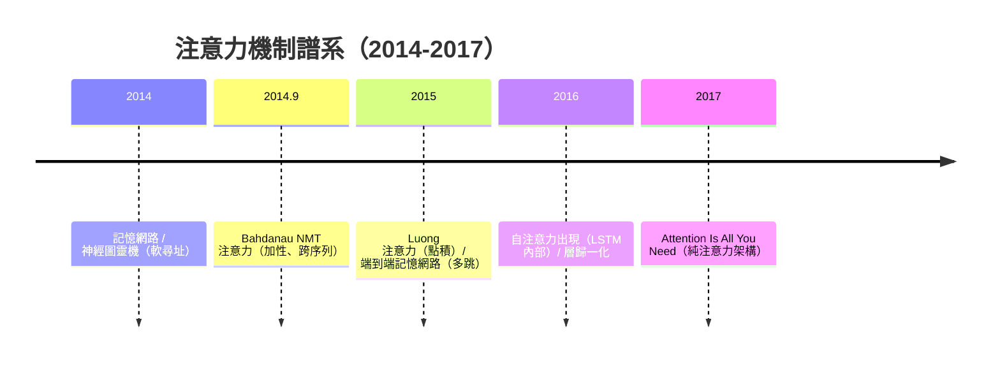

# 7.1 注意力機制的誕生：從對齊模型到 Bahdanau Attention（2014-2015）

## 一、歷史背景：一個翻譯工程問題引發的革命

2014-2015 年，注意力機制誕生於一個非常具體的工程煩惱：**Seq2Seq 的固定向量瓶頸**（6.2）。長句翻譯性能隨句長崩塌，原因是源句的全部信息被壓縮到一個定長向量。Bahdanau、Cho、Bengio（2014 年 9 月提交、2015 年 ICLR 發表《Neural Machine Translation by Jointly Learning to Align and Translate》）給出的解法樸素得近乎顯然：

> **與其把源句壓縮成一個向量，不如讓解碼器在每一步直接「參考」編碼器的全部隱狀態——而且要學會該參考哪一部分。**

「該參考哪一部分」就是**注意力（attention）**。這個術語借自認知科學（人類視覺與語言處理本來就是選擇性聚焦的），但它的數學本質更古老：**可微分的、按內容尋址的軟性檢索（soft, content-based addressing）**。本章梳理從「硬對齊」到「軟注意力」再到「自注意力」的前夜，為 7.2 的 Transformer 鋪路。

## 二、思想前史：對齊與檢索的可微化

### 2.1 統計機器翻譯的對齊遺產

在 NMT 之前，統計機器翻譯（SMT）的核心概念是**詞對齊（word alignment）**：目標詞「法國」對應源詞「France」。對齊是離散的、難以微分。記憶網路（Memory Networks, Weston et al. 2014）與神經圖靈機（Graves et al. 2014）則已示範了**軟性尋址**：對記憶槽計算相似度權重、加權讀取——讀取是可微的，只是權重分散在所有槽上。Bahdanau 的貢獻是把「軟尋址」嫁接到 Seq2Seq 上，並讓**對齊權重本身由網路端到端學出**。

### 2.2 Bahdanau Attention 的數學

設編碼器（雙向 GRU）輸出註解序列 $h_1, \dots, h_{T_x}$（每個 $h_i$ 已含前後文信息）。解碼器在第 $t$ 步計算：

**（1）打分：** 當前解碼狀態 $s_{t-1}$ 與每個源位置比對：

$$
e_{ti} = a(s_{t-1}, h_i) = v_a^\top \tanh\big(W_a s_{t-1} + U_a h_i\big) \qquad \text{（加性注意力）}
$$

**（2）歸一化：** softmax 變成機率分布：

$$
\alpha_{ti} = \frac{\exp(e_{ti})}{\sum_{j} \exp(e_{ti})}
$$

**（3）加權彙總：** 得到本步的上下文向量：

$$
c_t = \sum_{i=1}^{T_x} \alpha_{ti}\, h_i
$$

**（4）參與解碼：**

$$
s_t = \text{GRU}\big([y_{t-1};\, c_t],\; s_{t-1}\big), \qquad p(y_t) = \text{softmax}\big(W_o [s_t; c_t]\big)
$$

三個革命性性質：

1. **無壓縮瓶頸**：上下文信息以 $O(1)$ 路徑直接從每個源位置流向解碼步——長程依賴不再是 $O(n)$ 步的隱狀態接力，梯度也不再連乘（對照 6.1 的連乘公式）。
2. **內容尋址、動態對齊**：每個解碼步有**自己的**注意力分布——翻譯到動詞時聚焦源句動詞。對齊從 SMT 的獨立模組變成端到端學習的副產品。
3. **可解釋**：$\alpha_{ti}$ 矩陣可以直接視覺化，呈現出與人工標註高度一致的對齊圖——神經網路少有的「自帶解釋」時刻。



### 2.3 加性 vs 乘性：打分函數的演化

| 打分方式 | 公式 | 出處 |
|----------|------|------|
| 加性（concat） | $v^\top \tanh(W_1 s + W_2 h)$ | Bahdanau 2015 |
| 乘性（dot） | $s^\top h$ | Luong 2015 |
| 縮放點積 | $\dfrac{Q K^\top}{\sqrt{d_k}}$ | Vaswani 2017（7.2） |

Luong 等人（2015）證明簡單點積即可（且更省參數）；Vaswani 等人加上縮放因子 $\sqrt{d_k}$——當維度 $d_k$ 大時，點積的方差 $\approx d_k$ 會把 softmax 推入飽和區（梯度趨零），除以 $\sqrt{d_k}$ 使方差回到 $O(1)$。這個看似微小的歸一化，是純注意力架構能穩定訓練的必要條件，也預示了 7.2 的多頭設計。

## 三、自注意力的前夜：從「查別人」到「查自己」

Bahdanau 的注意力是**跨序列**的（解碼器查編碼器）。通往 Transformer 的最後一步是意識到：**序列也可以查自己**。

- **Cheng et al. 2016（Depthwise LSTM）**與 **Parikh et al. 2016（可分解注意力）**率先在序列內部使用自注意力；
- 記憶網路與端到端記憶網路（Sukhbaatar 2015）示範了「多跳（multi-hop）軟檢索」：連續多次加權讀取記憶，每跳之後用上一跳的結果重新尋址；
- 關鍵的理論領悟：**注意力層本身不需要 RNN**。如果每個位置對每個位置直接打分，序列順序可以用「位置編碼」另外注入——循環結構對「知道順序」而言是冗餘的。

到 2016 年底，積木已齊：軟尋址（記憶網路）、跨序列注意力（Bahdanau/Luong）、縮放點積（穩定性）、殘差連接（ResNet 2015）、層歸一化（2016）、可並行的意識（LSTM 的串行痛點，6.2）。缺的只是一次大膽的重組——那就是 7.2 的 Transformer。

## 四、程式碼實作

### 4.1 從零實作 Bahdanau 加性注意力

```python
import torch, torch.nn as nn

class BahdanauAttention(nn.Module):
    def __init__(self, enc_dim, dec_dim, attn_dim):
        super().__init__()
        self.Wa = nn.Linear(dec_dim, attn_dim, bias=False)
        self.Ua = nn.Linear(enc_dim, attn_dim, bias=False)
        self.va = nn.Linear(attn_dim, 1, bias=False)

    def forward(self, s_prev, enc_hiddens, mask=None):
        # s_prev: (B, dec_dim)   enc_hiddens: (B, T, enc_dim)
        score = self.va(torch.tanh(                  # (B, T, 1)
            self.Wa(s_prev).unsqueeze(1) + self.Ua(enc_hiddens)))
        score = score.squeeze(-1)                    # (B, T)
        if mask is not None:
            score = score.masked_fill(mask == 0, -1e9)   # 遮蔽 padding 位
        alpha = torch.softmax(score, dim=-1)         # (B, T)
        context = torch.bmm(alpha.unsqueeze(1), enc_hiddens).squeeze(1)  # (B, enc_dim)
        return context, alpha

att = BahdanauAttention(enc_dim=64, dec_dim=64, attn_dim=32)
s = torch.randn(2, 64)
h = torch.randn(2, 7, 64)                 # 編碼器輸出 7 個位置
c, alpha = att(s, h)
print("注意力權重（和為 1）:", alpha.sum(-1).tolist())       # [1.0, 1.0]
print("每個解碼步有獨立的對齊分布 → 動態對齊")
```

### 4.2 縮放點積注意力：通往 Transformer 的直接前體

```python
import torch, torch.nn as nn
import math

def scaled_dot_product_attention(Q, K, V, mask=None):
    d_k = Q.size(-1)
    scores = Q @ K.transpose(-2, -1) / math.sqrt(d_k)   # (..., T_q, T_k)
    if mask is not None:
        scores = scores.masked_fill(mask == 0, -1e9)
    alpha = torch.softmax(scores, dim=-1)
    return alpha @ V, alpha

B, T, d = 2, 8, 64
Q, K, V = (torch.randn(B, T, d) for _ in range(3))
out, alpha = scaled_dot_product_attention(Q, K, V)

# 為什麼要除以 √d_k？—— 點積方差的統計
q, k = torch.randn(10000, 64), torch.randn(10000, 64)
print("raw dot 標準差:", (q * k).sum(-1).std().item())        # ≈ √64 = 8
print("縮放後標準差:", ((q * k).sum(-1) / 8).std().item())    # ≈ 1
# 未縮放時 score 落在 ±20 之外 → softmax 飽和成 one-hot → 梯度消失
```

### 4.3 對齊視覺化：注意力的「解釋力」

```python
import numpy as np, torch, torch.nn as nn

# 構造一個玩具翻譯（恆等任務），觀察學到的對齊矩陣
enc = nn.GRU(16, 32, batch_first=True)
dec_cell = nn.GRUCell(16, 32)
att = BahdanauAttention(32, 32, 32)

src = torch.randn(1, 6, 16)                 # 「源句」6 個詞
H, _ = enc(src); H = H[0]                   # (6, 32)
s = torch.zeros(1, 32)
alignments = []
for t in range(6):                          # 逐解碼步記錄注意力
    c, alpha = att(s, H.unsqueeze(0))
    alignments.append(alpha.detach().squeeze().tolist())
    s = dec_cell(torch.randn(1, 16), s)

A = np.array(alignments)
print("對齊矩陣（行=解碼步, 列=源位置）:")
print(np.round(A, 2))
# 若訓練充分，此矩陣趨近近似對角 —— 與 Bahdanau 論文圖 3 的法英對齊同構
# 「神經網路自己學會了對齊」是 2015 年最有說服力的端到端證據之一
```

### 4.4 注意力 vs RNN：路徑長度的對比實驗

```python
import torch, torch.nn as nn

# 依賴傳遞的最短路徑長度：
# RNN: 位置 i→j 需 |i-j| 步隱狀態接力（O(n) 路徑，每步一次非線性）
# Attention: i→j 一次打分直達（O(1) 路徑）
rnn = nn.RNN(8, 8, batch_first=True)
x = torch.randn(1, 20, 8)
out, _ = rnn(x)
# 反向傳播中，位置 1 的梯度要穿過 19 次雅可比連乘
# Attention 中，位置 1 的梯度只穿過 1 次注意力矩陣乘法
print("RNN 路徑長度 O(n) vs Attention O(1) —— 這就是長程依賴的結構性差別")
```

## 五、注意力的歷史地位：從技巧到範式

Bahdanau Attention 在 2015 年是「Seq2Seq 的補丁」；兩年內它逆轉為主角：

1. **注意力即通用層**：一旦意識到「加權彙總 + softmax 檢索」可以堆疊、可以自引用，RNN 的串行性反而成為唯一的多餘包袱——注意力從「RNN 的附件」升級為「架構的骨架」。
2. **解釋性與內容尋址**：$\alpha$ 權重提供了稀有的可解釋窗口；內容尋址（依相似度檢索）的思想日後以「檢索增強」「外部記憶」等形式反覆回歸。
3. **可並行的曙光**：Bahdanau 的注意力仍嵌在循環解碼器中（解碼仍串行），但它證明了「跨位置直接通信」可行且有效——距離「全部位置同時通信」只差一步。



## 六、本節重點

- 注意力的數學本質是**可微分的軟性檢索**：打分（內容相似度）→ softmax 歸一 → 加權彙總，全流程可微、可端到端學習。
- Bahdanau Attention（2015）以「解碼器每步直接查閱編碼器全部隱狀態」消解 Seq2Seq 的定長向量瓶頸：長程依賴路徑從 $O(n)$ 降為 $O(1)$，對齊成為學習的副產品且可視覺化。
- 打分函數從加性（Bahdanau）演化到點積（Luong）再到縮放點積（Vaswani）；$\sqrt{d_k}$ 縮放防止 softmax 飽和，是純注意力可訓練的必要條件。
- 自注意力（序列查自己）的可行性由 2016 年前後的工作驗證；配合殘差、層歸一化，純注意力架構的全部積木在 2017 年前已經就位。
- 注意力的歷史軌跡展示了「附件升級為範式」的典型路徑：先作為補丁解決瓶頸，再暴露舊骨架（RNN 串行性）成為新的多餘負擔。

## 七、思考問題

1. 軟注意力對**所有**位置計算加權平均，硬注意力（取 argmax）更接近人類的選擇性聚焦卻不可微。請分析軟注意力「平均化」造成的模糊問題，以及 Transformer 如何用多頭與稀疏化緩解。
2. 縮放點積中除以 $\sqrt{d_k}$：請從 $Q,K$ 各維獨立同分布的假設出發，計算點積的方差，證明縮放的必要性。若 $Q,K$ 相關性很強，此分析還成立嗎？
3. Bahdanau 的對齊矩陣可視覺化曾被視為可解釋性的勝利。後續研究發現注意力權重未必反映真實的「解釋」（如捷徑學習、權重與梯度歸因不一致）。你如何評價「注意力 = 解釋」這一命題？
4. 注意力解決了長程依賴，卻帶來 $O(n^2)$ 的計算與記憶成本。這在 2017 年（句長 ~100）無關痛癢，在 2026 年（上下文百萬詞）成為核心矛盾。請梳理由此催生的稀疏注意力、線性注意力、滑動窗口等路線的取捨。
5. 「內容尋址的軟檢索」與傳統資料庫的索引檢索有何本質異同？這個視角如何幫助理解 Transformer 的記憶能力（鍵值對 = 參數化的記憶表）？
