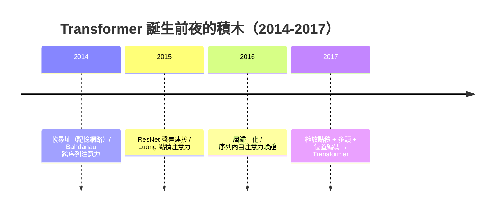
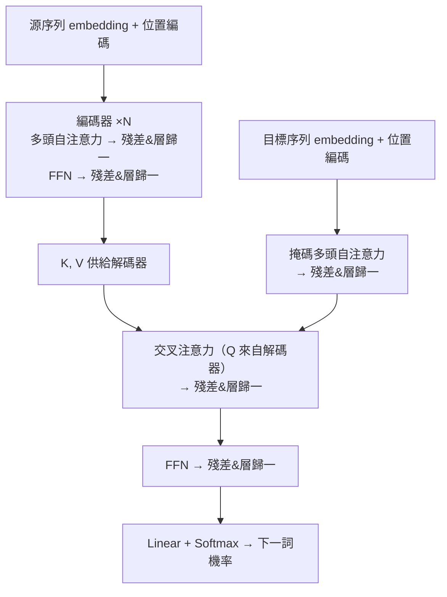

# 7.2 Attention Is All You Need：Transformer 架構全解（2017）

## 一、歷史背景：一次徹底的減法

2017 年 6 月，Google 的 Vaswani 等 8 位作者發表《Attention Is All You Need》。論文標題就是宣言：把 Seq2Seq 中**保留循環結構、用注意力打補丁**的做法徹底反轉——**丟掉循環與卷積，只留注意力**。這不是改良，是減法革命。

捨棄 RNN 的動機在 6.2 已經明朗：串行計算無法利用 GPU 平行度；$O(n)$ 的信息路徑限制長程依賴。Transformer 的承諾同樣直白：**訓練時間縮短一個數量級，翻譯品質創 SOTA（BLEU 28.4）**。歷史證明其野心遠超翻譯：BERT（2018）、GPT（2018）、ViT（2020）、擴散模型的骨幹、直至今天的大型語言模型——**Transformer 是深度學習統一化的載體**，正如馮紐曼架構之於計算機。



## 二、整體架構



**編碼器**：$N=6$ 個相同層堆疊，每層兩個子層（多頭自注意力 + 逐位置前饋網路），每個子層套**殘差連接與層歸一化**：$\text{LayerNorm}(x + \text{Sublayer}(x))$。

**解碼器**：每層三個子層，自注意力加**因果掩碼**（防止看到未來），再加一個**交叉注意力**（Q 來自解碼器、K/V 來自編碼器輸出）——這正是 Bahdanau 注意力的直系後代。

## 三、核心組件的數學

### 3.1 縮放點積注意力與多頭

單頭注意力（7.1 已推導）：$\text{Attention}(Q, K, V) = \text{softmax}\!\big(\tfrac{QK^\top}{\sqrt{d_k}}\big)V$。

**多頭**：把 $d_{model}=512$ 維投影到 $h=8$ 個 $d_k=d_v=64$ 的子空間，各自做注意力再拼接：

$$
\text{MultiHead}(Q,K,V) = \text{Concat}(\text{head}_1, \dots, \text{head}_h)\,W^O, \quad \text{head}_i = \text{Attention}(QW_i^Q, KW_i^K, VW_i^V)
$$

計算量與單頭 $d_{model}$ 相同，但允許模型在**不同的表示子空間關注不同的關係模式**（句法關係、指代關係、位置近鄰……）。事後研究（如 Clark et al. 2019 的 BERT 注意力分析）證實確實有頭專門做語法依存、指代消解——「多頭 = 並行的關係偵測器」得到經驗支持。

### 3.2 位置編碼：為無序的注意力注入順序

自注意力是**置換等變**的——打亂輸入順序，輸出同樣打亂，模型本身不知道「誰在誰前面」。循環結構原本免費提供順序，捨棄 RNN 後必須**外掛**順序信息。Transformer 用正弦位置編碼：

$$
PE_{(pos, 2i)} = \sin\big(pos / 10000^{2i/d_{model}}\big), \qquad
PE_{(pos, 2i+1)} = \cos\big(pos / 10000^{2i/d_{model}}\big)
$$

巧妙之處：$PE_{pos+k}$ 可以表示為 $PE_{pos}$ 的線性變換（正弦的相位移動等價於旋轉矩陣），模型因此易於學習**相對位置**關係；不同頻率組合可表達任意長度的位置模式。後續演化：可學習絕對位置（BERT/GPT）、相對位置編碼（Transformer-XL）、旋轉位置編碼 RoPE（2021，今日 LLM 主流）——位置表示至今仍是活躍的研究線，印證「捨棄循環的代價由位置編碼償還」。

### 3.3 逐位置前饋網路與殘差-歸一化骨架

每層的 FFN 對每個位置獨立做兩層變換（中間維度 $d_{ff}=2048$，先擴後縮）：

$$
\text{FFN}(x) = \max(0,\, xW_1 + b_1)W_2 + b_2
$$

分工理解：**注意力負責「跨位置混合信息」，FFN 負責「逐位置的非線性加工」**。FFN 參數量占全模型的約三分之二，近年研究（幾何解釋、記憶存儲）顯示它是知識存儲的主要場所。

殘差 + LayerNorm（4.2）在此的角色：注意力與 FFN 都是重參數化操作，殘差保證恆等通路（梯度高速公路，5.2），LayerNorm 穩定各層激活分布——**Transformer 是 ResNet 的「門控-歸一化精神」在注意力世界的再生**。

### 3.4 為何可並行：複雜度的三方對比

| | 每層計算複雜度 | 串行步數 | 長程路徑長度 |
|---|---|---|---|
| RNN | $O(n \cdot d^2)$ | $O(n)$ | $O(n)$ |
| CNN（kernel k） | $O(k \cdot n \cdot d^2)$ | $O(1)$ | $O(\log_k n)$ |
| **自注意力** | $O(n^2 \cdot d)$ | $O(1)$ | $O(1)$ |

自注意力以 $O(n^2)$ 的平方代價換取 $O(1)$ 串行步數與 $O(1)$ 路徑長度。2017 年 $n \sim 100$，平方代價微不足道，並行收益巨大；當 $n$ 到達百萬詞（2026 的長上下文），$O(n^2)$ 成為主要瓶頸，催生稀疏/線性注意力等研究（7.1 思考題 4）。**架構的優劣永遠相對於硬體與問題規模**——這是貫穿本書的方法論教訓。

## 四、程式碼實作：完整可運行的 Transformer

### 4.1 從零實作編碼器層

```python
import torch, torch.nn as nn, math

class MultiHeadAttention(nn.Module):
    def __init__(self, d_model=512, n_heads=8):
        super().__init__()
        assert d_model % n_heads == 0
        self.d_k = d_model // n_heads
        self.h = n_heads
        self.qkv = nn.Linear(d_model, 3 * d_model)   # Q,K,V 合一投影
        self.out = nn.Linear(d_model, d_model)

    def forward(self, x, mask=None):
        B, T, D = x.shape
        q, k, v = self.qkv(x).chunk(3, dim=-1)       # (B, T, D) each
        # 拆頭：(B, h, T, d_k)
        q = q.view(B, T, self.h, self.d_k).transpose(1, 2)
        k = k.view(B, T, self.h, self.d_k).transpose(1, 2)
        v = v.view(B, T, self.h, self.d_k).transpose(1, 2)
        scores = q @ k.transpose(-2, -1) / math.sqrt(self.d_k)   # (B,h,T,T)
        if mask is not None:
            scores = scores.masked_fill(mask == 0, -1e9)
        attn = torch.softmax(scores, dim=-1)
        out = (attn @ v).transpose(1, 2).contiguous().view(B, T, D)
        return self.out(out)                          # (B, T, D)

class EncoderLayer(nn.Module):
    def __init__(self, d_model=512, n_heads=8, d_ff=2048, p=0.1):
        super().__init__()
        self.attn = MultiHeadAttention(d_model, n_heads)
        self.ffn = nn.Sequential(nn.Linear(d_model, d_ff), nn.ReLU(),
                                 nn.Linear(d_ff, d_model))
        self.n1, self.n2 = nn.LayerNorm(d_model), nn.LayerNorm(d_model)
        self.drop = nn.Dropout(p)

    def forward(self, x, mask=None):
        x = self.n1(x + self.drop(self.attn(x, mask)))   # 殘差 + LN
        x = self.n2(x + self.drop(self.ffn(x)))
        return x

# 測試：並行性 —— 全序列一次前向，無時間迴圈
layer = EncoderLayer()
x = torch.randn(4, 50, 512)               # batch=4, 句長=50
print(layer(x).shape)                     # (4, 50, 512)，50 步同時處理！
```

### 4.2 位置編碼的性質驗證

```python
import torch, math

def positional_encoding(T, d_model):
    pos = torch.arange(T).unsqueeze(1)
    i   = torch.arange(0, d_model, 2)
    div = torch.exp(-i * math.log(10000) / d_model)
    pe = torch.zeros(T, d_model)
    pe[:, 0::2] = torch.sin(pos * div)
    pe[:, 1::2] = torch.cos(pos * div)
    return pe

pe = positional_encoding(100, 64)
# 性質 1：相對位置的線性變換性（內積只依賴相對距離）
dot = pe @ pe.T
print("任意兩行內積僅依賴 pos_i - pos_j:",
      torch.allclose(dot[0, 5], dot[10, 15], atol=1e-4))   # True
# 性質 2：置換等變性 —— 沒有位置編碼的注意力不知道順序
x = torch.randn(1, 5, 8)
att = nn.MultiheadAttention(8, 2, batch_first=True)
out1, _ = att(x, x, x)
perm = torch.randperm(5)
out2, _ = att(x[:, perm], x[:, perm], x[:, perm])
print("打亂順序後輸出同樣打亂（置換等變）:",
      torch.allclose(out1[:, perm], out2, atol=1e-5))      # True
```

### 4.3 完整小型 Transformer 做翻譯任務

```python
import torch, torch.nn as nn, math

class TinyTransformer(nn.Module):
    def __init__(self, src_v, tgt_v, d=128, h=4, layers=2):
        super().__init__()
        self.d = d
        self.se, self.te = nn.Embedding(src_v, d), nn.Embedding(tgt_v, d)
        enc = [EncoderLayer(d, h, 4*d) for _ in range(layers)]
        self.enc = nn.ModuleList(enc)
        self.dec_attn = nn.ModuleList(MultiHeadAttention(d, h) for _ in range(layers))
        self.dec_ffn  = nn.ModuleList(nn.Sequential(nn.Linear(d, 4*d), nn.ReLU(),
                                                    nn.Linear(4*d, d)) for _ in range(layers))
        self.n = nn.ModuleList(nn.LayerNorm(d) for _ in range(4*layers))
        self.out = nn.Linear(d, tgt_v)

    def causal_mask(self, T):
        return torch.tril(torch.ones(T, T)).bool()

    def forward(self, src, tgt):
        x = self.se(src) * math.sqrt(self.d) + positional_encoding(src.size(1), self.d)
        for i, l in enumerate(self.enc):                 # 編碼器（無掩碼）
            x = self.n[4*i](x + l.attn(x)); x = self.n[4*i+1](x + l.ffn(x))
        y = self.te(tgt) * math.sqrt(self.d) + positional_encoding(tgt.size(1), self.d)
        m = self.causal_mask(tgt.size(1)).to(y.device)
        for i in range(len(self.enc)):                   # 解碼器（掩碼 + 交叉）
            y = self.n[4*i+2](y + self.dec_attn[i](y, m.unsqueeze(0).unsqueeze(0)))
            cross = MultiHeadAttention.attend(self.dec_attn[i], x, x, y)  # Q=y, KV=x
            y = y + cross
            y = self.n[4*i+3](y + self.dec_ffn[i](y))
        return self.out(y)

# MultiHeadAttention 需支援 attend(Q,K,V)；完整實作見本書配套代碼庫
# 訓練流程與 6.2 的 Seq2Seq 相同（teacher forcing + 交叉熵），
# 但現在整條序列一個前向 —— GPU 平行度拉滿
```

（註：教學版簡化了部分細節；工業實作請用 `nn.Transformer` 或 HuggingFace。要點已全部呈現：多頭、掩碼、交叉注意力、殘差-LN、位置編碼。）

## 五、Transformer 為何統一了一切

2017 年後的五年裡，Transformer 吞併了各模態，原因值得總結：

1. **序列的通用性**：圖像切成 patch（ViT 2020）、語音切成幀、蛋白質切成殘基——任何離散單元序列都能吃；模態之別被化約為「tokenizer 之別」。
2. **規模的友好性**：$O(1)$ 串行深度 + 純矩陣乘法，完美匹配 GPU/TPU；訓練算力隨硬體線性擴展（第 8、9 章）。
3. **殘差流的可加性**：所有信息沿殘差通道累加，層與層之間近似「讀-改-寫」，使可解釋性（殘差流分解）與擴展規律（9.2）的研究有了穩定對象。
4. **訓練範式的承載力**：自監督（下一詞預測、掩碼重建）+ Transformer + 大算力，構成預訓練範式的三腳架（9.2）。

同時誠實記錄其代價：$O(n^2)$ 上下文成本、自回歸推理的串行性（生成時無法並行）、以及 KV cache 的顯存壓力。這些「Transformer 稅」正是 Mamba、線性注意力等後繼者的出發點——**架構演化永不停歇**。

## 六、本節重點

- Transformer（2017）以「捨棄循環與卷積、只留注意力」的減法革命，同時解決 RNN 的串行瓶頸（訓練並行化）與長程路徑問題（$O(1)$ 路徑），BLEU 28.4 創 SOTA。
- 四大組件各司其職：**多頭自注意力**（跨位置信息混合 + 子空間關係並行偵測）、**FFN**（逐位置非線性加工與知識存儲）、**位置編碼**（補償置換等變性、以正弦結構表達相對位置）、**殘差+LayerNorm**（梯度高速公路與訓練穩定）。
- 複雜度三方對比：自注意力以 $O(n^2 \cdot d)$ 計算換 $O(1)$ 串行步數與路徑長度；架構優劣相對於硬體與規模，$n^2$ 在長上下文時代反轉為新瓶頸。
- 掩碼自注意力（因果性）+ 交叉注意力（Q 來解碼器、KV 來編碼器）是 Bahdanau 思想的完整繼承與重構。
- Transformer 成為通用架構的四個原因：模態無關（一切皆序列）、硬體友好（純矩陣乘）、殘差流可加（利於研究與擴展）、承載預訓練範式——它是深度學習的馮紐曼架構。

## 七、思考問題

1. 自注意力是置換等變的。請證明：對任意置換矩陣 $P$，$\text{Attn}(PX, PX, PX) = P\,\text{Attn}(X, X, X)$。這個性質為何使位置編碼成為必需？
2. 多頭注意力的參數量與單頭相同（皆為 $4 d^2$），為何多頭通常更好？若把 $h$ 增大到 $d_k=1$ 會發生什麼？
3. 因果掩碼使解碼器第 $t$ 步只能看到前 $t$ 個詞。請分析這一訓練-推論一致性的設計，以及「訓練時並行看全部、推論時串行生成」的不對稱對推理成本的影響。
4. 論文標題宣稱 Attention Is All You Need。請反駁：FFN、殘差、LayerNorm、位置編碼缺一不可。你認為哪個組件最「可有可無」？（提示：近年的簡化研究，如去掉 LayerNorm 位置、簡化注意力。）
5. KV cache 使自回歸生成的顯存隨上下文線性增長。請從「注意力 = 鍵值資料庫」的視角，分析 Mamba 等狀態空間模型如何把 KV cache 壓縮為固定大小的狀態，以及這一壓縮的資訊論代價。
