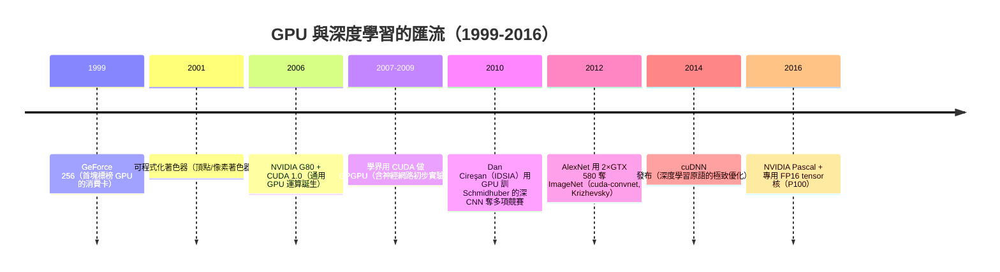
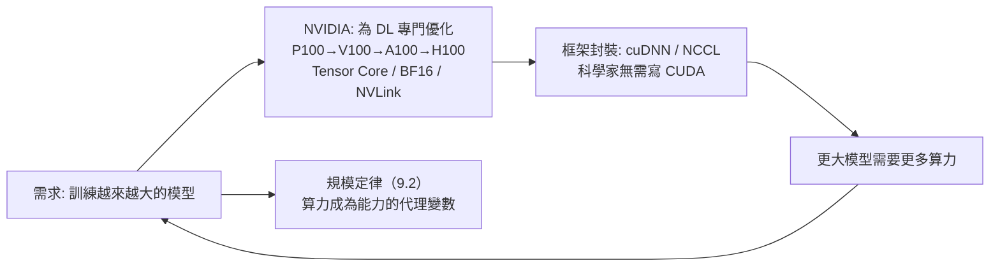

# 8.1 GPU 運算與 CUDA：算力如何驅動深度學習（2007-2012）

## 一、歷史背景：思想早已就位，等待的是算力

回顧前七章會發現一個規律：反向傳播（1986）、CNN（1989）、LSTM（1997）的核心思想都在 1998 年前就緒，但神經網路的實用化卻等到 2012 年之後。缺失的不是智慧，而是**每秒一億億次乘加**的原始算力。本章講述 GPU（圖形處理器）如何從「畫像素的晶片」變成「深度學習的心臟」，以及這場硬體革命如何反向塑造了神經網路架構的形狀。



## 二、為什麼是 GPU：神經網路計算的本質

### 2.1 神經網路 = 大規模稠密線性代數

回顧各章的計算核心：

- 前向傳播：一連串矩陣乘法 $z = Wx + b$（3 章）；
- 卷積：可展開（im2col）為矩陣乘法（5 章）；
- 反向傳播：$W^\top \delta$ 與 $\delta a^\top$——還是矩陣乘法（3.2）；
- 注意力：$QK^\top$、$\text{softmax}(\cdot)V$——矩陣乘法（7 章）。

**深度學習的 90% 以上浮點運算是矩陣乘法（GEMM）**，而 GEMM 的特徵是：計算量巨大（$O(n^3)$ 乘加）、**數據重用率極高**（每個元素被反覆使用）、各計算單元之間**相互獨立**。這正是平行計算的理想形態。

### 2.2 CPU 與 GPU 的設計哲學差異

| 維度 | CPU | GPU |
|------|-----|-----|
| 核心數 | 數個-數十個（複雜核） | 數千個（簡單核） |
| 設計目標 | 低延遲（儘快完成單線程） | 高吞吐（儘快完成海量同質任務） |
| 電晶體用途 | 分支預測、亂序執行、大 cache | 大量 ALU |
| 適合 | 邏輯分支、串行依賴 | 稠密線性代數、SIMT 模式 |

神經網路訓練恰好是「海量獨立的乘加、幾乎沒有分支」——CPU 的電晶體花在分支預測上是浪費，GPU 的數千簡單核正中要害。量化感受：2012 年 GTX 580 的單精度峰值約 1.6 TFLOPS，同代頂級 CPU 約 0.15 TFLOPS——**一個數量級的差距，且 GPU 可以插多塊**。

### 2.3 為什麼是 CUDA 而非圖形 API

GPU 平行計算並非新事——學界在 2004 年前後曾用圖形著色語言（OpenGL/DirectX shader）「欺騙」GPU 做通用計算，如 BrookGPU（2003）。但著色器程式模型扭曲（沒有真正的隨機寫入、缺乏通用記憶體抽象），開發極痛苦。2006-2007 年 NVIDIA 的 G80 架構與 CUDA 1.0 改變一切：

- **統一著色器架構**：流式處理器（SM）不再區分頂點/像素單元，成為通用可程式化核心；
- **C 語言介面**：科學家不需要懂圖形學即可寫平行程式；
- **真正的記憶體模型**：全域記憶體、共享記憶體（片上快取）、任意讀寫。

CUDA 的歷史意義堪比馮紐曼架構之於計算機：**它把平行硬體變成普通科學家可用的程式設計平台**。NVIDIA 冒了巨大商業風險（華爾街當年普遍認為 GPGPU 是不務正業），而這場豪賭最終以市值萬億回報——硬體與演算法共同演化的最佳案例。

## 三、CUDA 程式設計模型與 AlexNet 的算力帳

### 3.1 CUDA 的核心抽象

CUDA 模型的三層結構：**執行緒（thread）→ 區塊（block）→ 網格（grid）**。同一區塊內的執行緒共享片上共享記憶體，可同步；區塊間由硬體調度器自動分配到各 SM。寫法是「單執行緒的視角 + 自動的千倍複製」：

```c
// 一個最簡單的 CUDA 核：向量加法 c = a + b（每個執行緒算一個元素）
__global__ void vec_add(const float* a, const float* b, float* c, int n) {
    int i = blockIdx.x * blockDim.x + threadIdx.x;
    if (i < n) c[i] = a[i] + b[i];
}
// 啟動：n 個元素由 (n+255)/256 個區塊、每區塊 256 執行緒處理
// vec_add<<<(n+255)/256, 256>>>(da, db, dc, n);
```

效能的關鍵不在啟動多少執行緒，而在**記憶體存取模式**：GPU 全域記憶體延遲極高（數百週期），必須用「合併存取（coalescing，相鄰執行緒讀相鄰位址，合併為一次事務）」與共享記憶體分攤延遲。矩陣乘法的分塊（tiling）演算法正是圍繞共享記憶體設計的——深度學習框架的性能魔法，本質是這些記憶體層級技巧。

### 3.2 AlexNet 的算力帳

用 AlexNet（5.2）做一次具體的算力核算：

- 前向約 7 億 FLOPs/圖；反向約 2 倍；共約 2.1 GFLOPs/樣本更新；
- 120 萬張圖 × 90 輪 ≈ 1.08 億樣本更新 ≈ **$2.3 \times 10^{17}$ FLOPs**；
- 2 塊 GTX 580 有效吞吐約 0.5 TFLOPS（峰值 3.2）→ **約 5-6 天**。

若用 2012 年的 CPU 叢集，同樣訓練需要**數月**——競賽週期內根本不可能迭代。AlexNet 的勝利公式因此可以寫成：**構想（1989 的 CNN）+ 資料（2009 的 ImageNet）+ 算力（2007-2012 的 CUDA）**。2012 年論文的致謝明確感謝 Krizhevsky 自寫的 cuda-convnet——那兩千行 CUDA 代碼與演算法同等重要。

### 3.3 之後的算力軍備競賽



- **cuDNN（2014）**：把卷積、池化、歸一化等原語做到硬體極致，框架呼叫即可，科學家從此不碰 CUDA；
- **Tensor Core（2017-）**：專門的 $4\times4$ 矩陣乘法電路 + 半精度（FP16/BF16），吞吐再上一個數量級——**硬體開始為神經網路量身定製**（而非反向）；
- **多卡擴展**：資料並行（每卡一份模型副本、同步梯度，NCCL 實作 all-reduce）→ 模型並行、流水線並行（9.2 的大模型時代三件套）。

值得注意的正回饋環：**演算法的架構選擇開始迎合硬體**。ReLU 之於 sigmoid 的勝利、Transformer 之於 RNN 的勝利，都部分因為它們更「矩陣乘法友好」、更可並行。硬體不只是跑演算法的馬車，而是**參與了演算法的演化選擇**。

## 四、程式碼實作：從感知算力差距

### 4.1 CPU vs GPU 的矩陣乘法對決

```python
import torch, time

def bench(device, n=4096, reps=20):
    a = torch.randn(n, n, device=device)
    b = torch.randn(n, n, device=device)
    (a @ b).item()                      # 預熱
    t0 = time.time()
    for _ in range(reps):
        c = a @ b
        if device != "cpu": torch.cuda.synchronize()
    dt = (time.time() - t0) / reps
    tflops = 2 * n**3 / dt / 1e12       # 2n³ = 每次 GEMM 的浮點運算數
    return dt, tflops

dev = "cuda" if torch.cuda.is_available() else ("mps" if torch.backends.mps.is_available() else "cpu")
for d in ["cpu", dev]:
    if d == dev or d == "cpu":
        dt, tf = bench(d)
        print(f"{d:5s}: {dt*1000:7.2f} ms / 4096² GEMM  = {tf:6.2f} TFLOPS")
# 典型結果：CPU ~0.1-0.5 TFLOPS，GPU ~30-300 TFLOPS —— 兩到三個數量級
# 這個差距 × 20 年硬體進步 × 多卡擴展 = 深度學習革命的物質基礎
```

### 4.2 自訂 CUDA 核（torch 的 C++/CUDA 擴展示意）

```python
# 用 PyTorch 自訂運算的兩個層次：
# （1）用張量操作組合（無 CUDA 知識）：
def swish(x):
    return x * torch.sigmoid(x)          # 三個原語，框架自動並行

# （2）真正手寫 CUDA（高階用法，示意 Triton 語言——OpenAI 讓 GPU 程式設計再次大眾化）：
# import triton, triton.language as tl
# @triton.jit
# def swish_kernel(x_ptr, y_ptr, n, BLOCK: tl.constexpr):
#     pid = tl.program_id(0)
#     offs = pid * BLOCK + tl.arange(0, BLOCK)
#     mask = offs < n
#     x = tl.load(x_ptr + offs, mask=mask)
#     tl.store(y_ptr + offs, x * tl.sigmoid(x), mask=mask)
# Triton（2019）以 Python 語法寫 GPU 核，是「CUDA 大眾化」的當代故事
print("Triton 示意：GPU 程式設計的門檻從 C/CUDA 降到 Python")
```

### 4.3 資料並行的梯度同步（多卡訓練的原理）

```python
import torch, torch.nn as nn

# 資料並行的手寫原理（單機示範；實務用 DDP）：
model = nn.Linear(1000, 10)
optimizer = torch.optim.SGD(model.parameters(), lr=0.1)

def data_parallel_step(batch, n_gpus=4):
    """每 GPU 獨立算子集梯度，再 all-reduce 平均 —— DDP 的本質"""
    micro = len(batch) // n_gpus
    grads = []
    for g in range(n_gpus):                       # （真實中各 GPU 並行執行）
        sub = batch[g*micro:(g+1)*micro]
        loss = nn.functional.cross_entropy(model(sub), sub.new_zeros(len(sub)))
        loss.backward()                           # 各自累積梯度
        grads.append([p.grad.clone() for p in model.parameters()])
        model.zero_grad()
    for pi, p in enumerate(model.parameters()):   # ← all-reduce：梯度平均
        p.grad = torch.stack([g[pi] for g in grads]).mean(0)
    optimizer.step()

print("資料並行 = 複製模型 + 切資料 + all-reduce 梯度")
print("把 N 張卡的吞吐變成 N 倍 —— 大模型時代的擴展基石")
```

## 五、算力、演算法與資料的共同演化

回望歷史，算力與深度學習不是「平台與應用」的簡單關係，而是**共同演化**：

1. **1986-2006 的黑暗等待**：BP 演算法有了，但 CPU 時代一個epoch要數天，實驗迭代慢到無法積累洞見；
2. **2007-2012 的解鎖**：CUDA 讓訓練提速一個數量級，ImageNet 提供了「值得提速的問題」——AlexNet 證明組合威力；
3. **2012-2016 的軍備競賽**：架構（更深、更大）與硬體（更專、更快）互相拉動，cuDNN/Tensor Core 把「神經網路專用晶片」變成主流；
4. **2017- 的規模時代**：算力成為模型能力的**代理變數**（scaling laws，9.2），NVIDIA 從晶片公司變成 AI 時代的基礎設施壟斷者。

方法論的教訓同樣深刻：**當一個好想法（BP、CNN、Transformer）被埋沒時，先問「是想法的問題還是算力的問題」**。深度學習史多次證明，等待正確的硬體比等待正確的數學更划算。

## 六、本節重點

- 神經網路訓練的計算本質是**大規模稠密矩陣乘法**（GEMM），計算密集、數據重用高、可並行——與 GPU 的 SIMT 高吞吐設計完美匹配，與 CPU 的低延遲設計失配。
- CUDA（2006-2007）以 C 語言介面 + 統一著色器架構把平行硬體大眾化，是深度學習復興的物質前提；其核心抽象是「執行緒-區塊-網格」與記憶體層級（合併存取、共享記憶體）。
- AlexNet 的算力帳：$2.3\times10^{17}$ FLOPs 在 2 塊 GTX 580 上約一週，CPU 則需數月——**算力不是加速器，而是使實驗迭代成為可能的存在條件**。
- cuDNN、Tensor Core、多卡 all-reduce 把「科學家不碰 CUDA」變成現實；硬體為神經網路專門定製，演算法也反向迎合硬體（ReLU、Transformer 的勝利部分是並行友好性的勝利）。
- 算力、資料、架構三元共振的歷史規律：缺任何一角都不會有 2012；規模時代算力更成為能力的代理變數。

## 七、思考問題

1. 神經網路訓練「分支少、同質性高」，請再列舉兩個與 GPU 失配的計算特徵（提示：稀疏注意力、動態控制流、圖演算法），並說明它們為何讓某些模型架構吃虧。
2. AlexNet 若晚三年出現（2015 年才有 K80/cuDNN），深度學習歷史會如何改寫？請論證「思想等待硬體」與「硬體等待思想」哪個是當時的瓶頸。
3. CUDA 開放 C 介面但封閉生態（綁定 NVIDIA 硬體）。請從「平台壟斷」與「開源替代」（ROCm、Triton、TPU 的 XLA）角度分析 AI 算力供應鏈的競爭格局。
4. 資料並行的 all-reduce 有 Ring、Tree 等演算法，通信量 $O(\text{模型大小})$ 與卡數無關（Ring）。當模型大到單卡放不下時，資料並行失效，需要哪些替代方案？（連接 9.2 的 ZeRO、流水線、張量並行。）
5. 「演算法迎合硬體」是否威脅研究的多樣性？例如稀疏模型、類比計算、神經形態晶片在「稠密 GEMM 主義」下處於劣勢。你如何評價這種生態選擇壓力？
