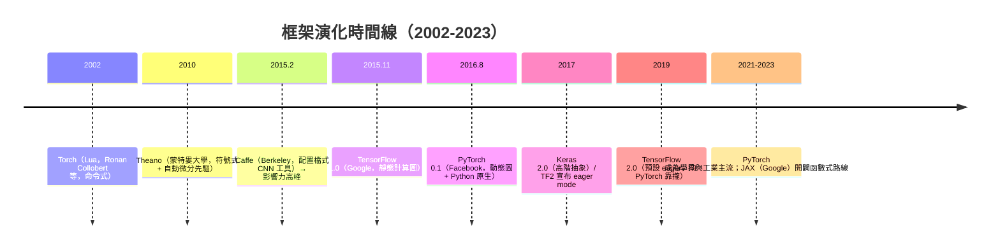
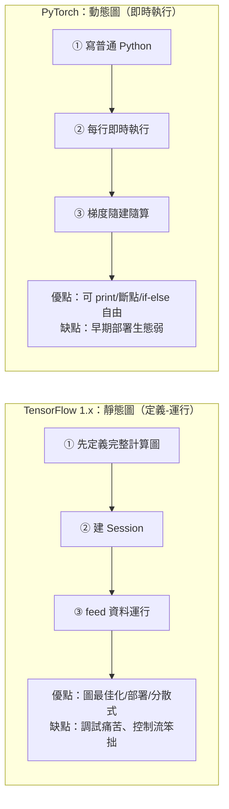

# 8.2 框架演化：Theano、TensorFlow 與 PyTorch（2010-2023）

## 一、歷史背景：誰來替科學家寫反向傳播？

反向傳播（1986）確立後，每個研究者都面臨相同的苦役：**手寫每一層的前向與反向代碼**。3.2 節的手寫 BP 有 60 行，而一個複雜模型（ResNet、Transformer）手寫梯度是數千行的雷區——任何一個導數錯誤都讓訓練靜默失敗。**深度學習框架**要解決的正是這個問題：

> **讓研究者只描述前向計算，框架自動推導反向傳播、自動分配 GPU 記憶體、自動並行。**

框架的理論基礎就是 3.2 節的鏈鎖律系統化——**自動微分（autodiff）**。本章以三個標誌性框架的興衰為線索，講述「抽象層次的軍備競賽」，並揭示一個深刻的工程學規律：**框架之爭的勝負手，往往不是功能，而是開發體驗與生態位**。



## 二、Theano（2010）：符號式自動微分的先驅

### 2.1 設計思想

Theano（Bergstra、Bastien、Goodfellow 等人在 Yoshua Bengio 的 MILA 實驗室開發）是第一個把「**符號計算圖 + 自動微分 + 編譯到 GPU**」三合一的框架：

1. 用者以符號變數描述數學表達式（不立即計算）；
2. Theano 對表達式做**符號微分**，生成 C/CUDA 代碼，編譯後執行；
3. GPU 的啟用只需一個 flag——2010 年這是革命性的。

```python
# Theano 風格的示意（Theano 已於 2017 停止開發，代碼為歷史重現）
# import theano, theano.tensor as T
# x = T.matrix('x'); y = T.matrix('y')
# w = theano.shared(np.random.randn(2, 1).astype('float32'))
# loss = ((x.dot(w) - y) ** 2).mean()
# gw = T.grad(loss, wrt=w)                      # ← 符號微分，核心魔法
# train = theano.function([x, y], loss, updates=[(w, w - 0.1 * gw)])
```

### 2.2 貢獻與局限

Theano 培養了整整一代深度學習研究者（GAN、VAE、注意力機制的原始實驗都在 Theano 上完成），其符號微分思想是所有後繼者的直接祖先。但它的痛點同樣明顯：**調試如同盲射**（編譯期錯誤與執行期錯誤的堆疊訊息脫離 Python 語境）、**圖結構固定**（變長序列需手工技巧）、**社群小**（2016 年 TensorFlow/PyTorch 興起後人才流失）。2017 年 MILA 宣布停止開發——但它的 DNA 已轉移到 TensorFlow 與 JAX。

## 三、TensorFlow 與 PyTorch：兩種哲學的對決

### 3.1 靜態圖 vs 動態圖

兩大框架的根本分歧在於**計算圖的構建時機**：



**靜態圖（define-and-run）**：先把整個計算圖描述為符號圖，再餵資料執行。好處是圖在執行前完整可見——可做全域最佳化（算子融合、常數折疊）、可序列化部署到手機/伺服器、適合分散式。壞處是**與 Python 的互動被切斷**：迴圈要寫成 `tf.while_loop`、條件要 `tf.cond`、除錯不能 print 張量——開發體驗被符號抽象綁架。

**動態圖（define-by-run）**：每一行 Python 立即執行真實張量，計算圖在執行中隱式記錄（tape）。好處是**代碼即圖**：普通 Python 控制流、pdb 斷點、`print(x.shape)` 全部可用。壞處是早期缺少圖最佳化與部署工具。

### 3.2 PyTorch 的「研究優先」路線

PyTorch（2016，Facebook AI Research，Soumith Chintala 等）繼承 Torch 的 GPU 張量庫，但做出三個關鍵決策：

1. **動態圖 + autograd tape**：`loss.backward()` 即時回傳，使用者零心智負擔；
2. **Python 原生**：不做自己的 DSL，就是好用的 NumPy + GPU + 梯度；
3. **研究社群經營**：論文代碼用 PyTorch 發布成為慣例，新演算法可複現性反哺生態。

結果是滾雪球：2018 年起學界論文代碼 PyTorch 占比超過 TensorFlow（Papers with Code 統計 2019 年反超），2020 年後絕大多數新模型（GPT、Stable Diffusion、LLaMA 的訓練生態）基於 PyTorch。

### 3.3 TensorFlow 的「部署優先」路線與反轉

TensorFlow（2015，Google Brain）延續 Theano/DistBelief 的靜態圖血統，初衷是 Google 內部超大規模生產系統。它的學習曲線在研究端是災難（TF1 的 session/placeholder 成為一代人的集體記憶創傷），在部署端是黃金（TF Serving、TF Lite、TPU 原生支援）。2019 年 TF2.0 不得不**預設改為 eager mode**——等於承認動態圖的研究體驗是硬需求；再以 `tf.function` 追蹤（tracing）把 Python 代碼編譯回圖，取得兩者折衷。

這段歷史的教訓值得銘刻：**抽象的價值取決於它服務的用戶循環**。研究者的核心循環是「改代碼→看結果→再改」（高頻、探索性），部署工程師的循環是「穩定運行已驗證的模型」（低頻、確定性）。TF 為後者優化卻向前者推銷，PyTorch 為前者優化再補足後者（TorchScript、torch.compile、ONNX 匯出）——**後發者先贏得實驗循環，再侵蝕生產場景**。

### 3.4 JAX：函數式純化的路線

JAX（2018，Google）代表另一種極端：**純函數式 + 顯式轉換**。核心是四個組合子：

```python
import jax, jax.numpy as jnp

def loss_fn(params, x, y):
    pred = x @ params["w"] + params["b"]
    return ((pred - y) ** 2).mean()

params = {"w": jnp.zeros((2, 1)), "b": jnp.zeros(1)}
grad_fn   = jax.grad(loss_fn)                # 自動微分
jit_fn    = jax.jit(grad_fn)                 # XLA 編譯最佳化
# vmap = 自動向量化, pmap/shard_map = 自動並行 —— 可組合的「函數變換」
g = jit_fn(params, jnp.ones((4, 2)), jnp.ones((4, 1)))
print(g["w"])
```

JAX 的哲學：不藏抽象，把「微分、編譯、向量化、並行」做成**可組合的函數變換**（transformations）。它成為大型科學計算與部分 LLM 訓練棧（如 TPU 叢集）的選擇，並影響了 PyTorch 2.0 的 `torch.compile` 設計。

## 四、框架的共同核心：autograd 的實現

### 4.1 動態圖 autograd 的原理

PyTorch 的核心機制值得拆解（與 3.2 的數學直接對應）：

1. **Tensor 記錄**：每個需要梯度的張量在參與運算時，把「產生它的運算與輸入」記錄成一個節點，鏈結成動態有向無環圖；
2. **反向遍歷**：`backward()` 沿圖反向拓撲序執行，每個運算註冊自己的 `grad_fn`（即 3.2 的 $\phi'$ 與局部雅可比）；
3. **梯度累積**：結果寫入 `.grad`，多次 `backward()` 會累加（這也是為何每步要 `zero_grad()`）。

### 4.2 手寫一個微型 autograd 引擎

```python
import math

class Tensor:
    """微型自動微分引擎（micrograd 風格，Karpathy 2022）—— 框架的本質就這麼小"""
    def __init__(self, data, parents=(), op=""):
        self.data = data; self.grad = 0.0
        self._prev = parents; self._op = op
        self._backward = lambda: None

    def __add__(self, other):
        other = other if isinstance(other, Tensor) else Tensor(other)
        out = Tensor(self.data + other.data, (self, other), "+")
        def _backward():                        # d(a+b)/da = 1, /db = 1
            self.grad += out.grad; other.grad += out.grad
        out._backward = _backward
        return out

    def __mul__(self, other):
        other = other if isinstance(other, Tensor) else Tensor(other)
        out = Tensor(self.data * other.data, (self, other), "*")
        def _backward():                        # 乘法法則：交叉相乘
            self.grad += other.data * out.grad
            other.grad += self.data * out.grad
        out._backward = _backward
        return out

    def tanh(self):
        out = Tensor(math.tanh(self.data), (self,), "tanh")
        def _backward():                        # φ' = 1 - tanh²
            self.grad += (1 - out.data ** 2) * out.grad
        out._backward = _backward
        return out

    def backward(self):
        topo, visited = [], set()               # 拓撲排序 = 反向計算圖
        def build(v):
            if v not in visited:
                visited.add(v)
                for p in v._prev: build(p)
                topo.append(v)
        build(self)
        self.grad = 1.0
        for node in reversed(topo):
            node._backward()                    # ← 這就是反向傳播！

# 驗證：與 3.2 節手寫 BP 完全同構
a = Tensor(2.0); b = Tensor(-3.0); c = Tensor(0.5)
d = (a * b + c).tanh()
d.backward()
print(f"f = tanh(2×(-3)+0.5) = {d.data:.4f}")
print(f"∂f/∂a = {a.grad:.4f}（應為 (1-f²)·b = (1-0.65²)×(-3) ≈ {-3*(1-d.data**2):.4f}）")
# 30 行代碼 = 神經網路訓練的全部底層 —— 剩下的都是工程規模
```

### 4.3 現代框架的日常形態

```python
import torch, torch.nn as nn

# 2026 年研究者的標準訓練迴圈 —— 對比 Theano 時代的繁瑣
model = nn.Sequential(nn.Linear(784, 256), nn.ReLU(), nn.Linear(256, 10)).to("cuda")
opt = torch.optim.AdamW(model.parameters(), lr=3e-4, weight_decay=0.01)
scaler = torch.amp.GradScaler("cuda")            # 混合精度：FP16 加速 + FP32 穩定
sched = torch.optim.lr_scheduler.OneCycleLR(opt, max_lr=3e-3, total_steps=1000)

for step, (x, y) in enumerate(loader):
    x, y = x.to("cuda"), y.to("cuda")
    with torch.autocast("cuda", dtype=torch.float16):   # AMP 自動混合精度
        loss = nn.functional.cross_entropy(model(x.flatten(1)), y)
    scaler.scale(loss).backward()                       # 縮放損失防 FP16 下溢
    scaler.step(opt); scaler.update(); opt.zero_grad()
    sched.step()
# 框架已把「GPU 記憶體管理 + 自動微分 + 混合精度 + 調度」全部抽象掉
# 研究者只需描述模型與損失 —— 這就是二十年框架演化換來的自由
```

## 五、框架史的方法論教訓

1. **抽象層次的鐘擺**：符號圖（Theano/TF1）→ 動態圖（PyTorch）→ 「動態編寫、靜態編譯」折衷（TF2、torch.compile、JAX jit）。鐘擺終點是**二象性**：研究時動態、部署時編譯。
2. **生態位決定勝負**：論文複現（PyTorch）、大規模生產（TF）、TPU 科學計算（JAX）各有地盤；「開發者體驗」被證明比「功能完備」更具傳染性。
3. **自動微分是永恆的底座**：無論 API 如何演化，「描述前向、免費獲得反向」的不變量自 Theano 起從未改變——框架史是**同一個數學（鏈鎖律）的不同產品化**。
4. **硬體與框架共同演化**：混合精度、torch.compile、分片並行（FSDP）都是「為特定硬體形態而生」的抽象；框架是演算法與硬體之間的翻譯官（連接 8.1）。

## 六、本節重點

- 框架的本質是**自動微分 + 資源調度**：讓研究者只寫前向、免費獲得反向，其數學根基是 3.2 節的反向模式鏈鎖律。
- Theano（2010）開創「符號圖 + 符號微分 + 編譯 GPU」範式，培養了復興一代的研究者，但調試體驗與社群規模使其被後繼者取代。
- TensorFlow 1.x（靜態圖，部署與分散式優先）與 PyTorch（動態圖，研究體驗優先）的對決以 PyTorch 勝出告終：TF2.0 改預設 eager 承認了「研究循環」的價值；PyTorch 再以 TorchScript/compile 補足部署。
- 動態圖 autograd 的原理：執行時記錄運算節點構成 DAG，backward() 沿拓撲反向執行各運算的局部梯度函數；微型引擎（micrograd）僅 30 行即可復現本質。
- JAX 以「函數變換可組合」（grad/jit/vmap/pmap）開闢函數式路線；框架終局的二象性是「動態編寫 + 靜態編譯」。
- 方法論教訓：抽象的價值取決於服務的用戶循環；生態與可複現性比功能清單更具傳染性。

## 七、思考問題

1. 4.2 的微型 autograd 只支援標量。請擴展它支援向量並實作矩陣乘法的 `_backward`（提示： $\partial (AX)/\partial A = \delta X^\top$ ，與 3.2 的 $\delta a^\top$ 對照）。
2. 靜態圖的全域最佳化（算子融合）為何在動態圖中難做？torch.compile 用「追蹤 + 編譯」折衷，請分析這種做法在哪些代碼模式（如資料依賴的控制流）下會失效。
3. PyTorch 的 `zero_grad()` 慣例反映了「梯度累積」設計。這個設計的害處（忘記清零的經典 bug）與好處（梯度累積模擬大 batch、多任務梯度疊加）各是什麼？
4. JAX 的純函數要求（無副作用、顯式狀態）使 vmap/pmap 成為可能。請分析「狀態隱藏在物件裡」的物件導向設計（PyTorch nn.Module）為何阻礙自動並行。
5. 框架史常被類比為作業系統史（Theano=大型機時代、TF/PyTorch=PC 雙雄、JAX=雲原生？）。你認為下一代的抽象會是什麼？（提示：大模型時代的編排層——分散式訓練、KV cache 管理、推理服務。）
