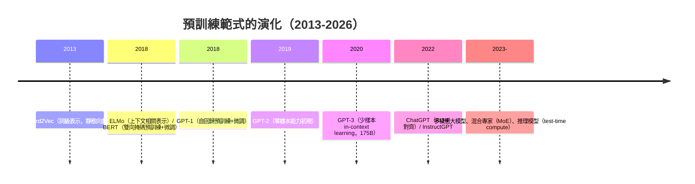

# 9.2 縮放時代的深度學習：殘差、預訓練範式與未來方向

## 一、歷史背景：三條線匯成規模時代

2015-2026 年的深度學習史可以概括為**三條線的匯流**：

1. **殘差與深度解鎖**（ResNet 2015，5.2）：網路深度不再受限，架構創新轉向「怎麼讓規模有效轉化為能力」；
2. **預訓練範式**（Word2Vec 2013 → ELMo 2018 → BERT/GPT 2018 → GPT-3 2020）：從「為每個任務訓練模型」轉變為「先學通用表示、再遷移/提示」；
3. **算力與規模定律**（8.1 + 2020 年的 scaling laws）：算力成為能力的可預測代理變數，訓練出超越設計者理解的系統。

本章把這三條線收攏，並誠實地審視深度學習理論的欠賬與未來的開放戰場。

## 二、殘差連接的深遠迴響：從 ResNet 到動力系統

### 2.1 殘差流：現代架構的血液

ResNet 的 $y = F(x) + x$ 在 Transformer 中演化為統一的**殘差流（residual stream）**圖像（7.2）：模型是一條貫穿所有層的「信息總線」，每個子層以「讀取-計算-**加回**」的方式貢獻增量：

$$
x^{(l+1)} = x^{(l)} + F^{(l)}\big(\text{norm}(x^{(l)})\big)
$$

這個視角帶來三個紅利：**梯度直通**（每層恆等通路）、**可解釋性**（殘差流可分解為可加的語義子空間，9.1 的線性表示）、**理論聯繫**——

### 2.2 ResNet 作為常微分方程的離散化

把殘差塊看成連續動力學的離散步：

$$
x^{(l+1)} = x^{(l)} + F(x^{(l)}, \theta_l) \quad\Longleftrightarrow\quad \frac{dx}{dt} = F(x, \theta)
$$

- **Neural ODE**（Chen et al. 2018）：把「深度」連續化為時間，用 ODE 求解器自適應地「跑多深」，顯式建立了深度網路與動力系統的等價；
- **穩定性分析**：殘差結構使逐層映射接近恆等，訓練動力學在譜意義上受控——這解釋了為何 ResNet 可以深至上千層；
- **連續化的反哺**：狀態空間模型（S4、Mamba）直接從連續動力系統出發設計序列架構，是這條理論線的工程果實。

## 三、預訓練範式：表示學習的最終形態

### 3.1 範式演化鏈



範式的本質變化值得逐一標註：

1. **監督 → 自監督**：標籤從人類標註變為資料自身（下一詞預測）——資料量的天花板從「標註預算」變為「人類文字總量」，解放了規模（9.1 的流形假說是理論根基）；
2. **微調 → 提示**：GPT-3（2020）發現**情境學習（in-context learning）**——不用改參數，在輸入中給幾個例子即可完成新任務。模型變成「可程式化的通用介面」；
3. **訓練 → 對齊**：預訓練之後加上 RLHF（人類回饋強化學習）與指令微調，把「會說話的補全器」塑造成「有幫助、無害、誠實的助手」——訓練管線三段式（預訓練/監督微調/偏好對齊）成為 2023 年後的標準。

### 3.2 規模定律：能力的可預測性

Kaplan et al.（2020）與 Chinchilla（Hoffmann et al. 2022）給出震撼的經驗規律：損失隨模型參數 $N$ 、資料量 $D$ 、算力 $C$ 呈**冪律下降**：

$$
L(N, D) \approx E + \frac{A}{N^{\alpha}} + \frac{B}{D^{\beta}}, \qquad
C \approx 6ND \;(\text{FLOPs 近似})
$$

- Kaplan：給定算力預算，模型應該「大而資料相對少」（ $N$ 主導）；
- Chinchilla 修正：**參數與資料應等比擴展**（每參數約 20 tokens）——同算力下用 70B 模型 + 1.4T tokens 勝過 280B + 300B tokens；
- 深意：**能力不再玄學，而成為可投資的工程量**——「訓練更大模型」從研究賭注變成資本決策，直接驅動了 2020 年代的算力軍備競賽（8.1 的正回饋環的終極形態）。

### 3.3 湧現與雙下降：規模的兩個反直覺現象

**湧現能力（emergent abilities, Wei et al. 2022）**：某些能力（多步推理、指令遵循）在模型小於某閾值時接近零，跨過閾值後陡然出現——規模不僅量變而且似乎質變。（爭議：Schaeffer et al. 2023 論證部分「湧現」是**不連續評測指標**的統計假象，換成連續指標後能力平滑增長——度量選擇本身參與建構了理論。）

**雙下降（double descent, Belkin et al. 2019；Nakkiran et al. 2019）**：泛化誤差隨模型規模先降後升（經典 U 型）再**二次下降**——插值閾值（模型恰好能背下訓練集）之後，越大越好。這直接違反經典偏差-方差權衡，宣告：**傳統統計學習理論的「控制複雜度」處方在過參數化區域失效**，泛化的新機制（隱式正則、平坦極小值、核方法的 NN-GP 對應）成為理論前沿。

## 四、大模型時代的訓練工程（8.1 的續章）

規模時代把工程問題推到極限，形成新的「並行三件套」：

| 技術 | 切分什麼 | 解決什麼 |
|------|---------|----------|
| 資料並行（DDP/ZeRO） | 資料 | 吞吐線性擴展；ZeRO 把優化器狀態分片到各卡 |
| 張量並行（Megatron） | 單層的矩陣 | 單層大到一卡放不下 |
| 流水線並行 | 按層 | 深度方向切分，微批次流水填滿空泡 |

再加上**混合精度**（BF16）、**梯度檢查點**（以算力換顯存）、**混合專家 MoE**（稀疏激活：千億參數中每 token 只激活十分之一，容量與算力解耦）——訓練一個前沿大模型是本書前八章全部技術的總集成：反向傳播（3.2）+ 優化（4.1）+ 正則化（4.2）+ 注意力（7）+ CUDA 與框架（8）。

```python
# 混合專家（MoE）的原理示意：稀疏激活 = 容量與計算解耦
import torch, torch.nn as nn

class MoELayer(nn.Module):
    def __init__(self, d=512, n_experts=8, top_k=2):
        super().__init__()
        self.experts = nn.ModuleList(nn.Sequential(
            nn.Linear(d, 4*d), nn.GELU(), nn.Linear(4*d, d)) for _ in range(n_experts))
        self.gate = nn.Linear(d, n_experts)
        self.top_k = top_k
    def forward(self, x):                       # x: (B, T, d)
        scores = self.gate(x)                    # (B, T, n_experts)
        topv, topi = scores.topk(self.top_k, dim=-1)
        gate_w = torch.softmax(topv, dim=-1)     # 只激活 top-k 個專家
        out = torch.zeros_like(x)
        flat = x.view(-1, x.size(-1)); outf = out.view(-1, x.size(-1))
        g = gate_w.view(-1, self.top_k); idx = topi.view(-1, self.top_k)
        for e, expert in enumerate(self.experts):
            mask = (idx == e)                    # 該專家被哪些 token 選中
            if mask.any():
                sel = flat[mask.any(-1)]
                w = (g * mask.float()).sum(-1)[mask.any(-1)].unsqueeze(-1)
                outf[mask.any(-1)] += w * expert(sel)
        return out.view_as(x)
# 每 token 只過 2/8 個專家：總容量 8 倍，計算量 2 倍 —— 稀疏性的規模紅利
```

## 五、未來方向與開放戰場（2026 視角）

誠實盤點深度學習的未盡之事：

1. **架構層**：注意力的 $O(n^2)$ 與 KV cache 之稅 → 線性注意力、狀態空間模型（Mamba）、稀疏/檢索增強混合架構；長上下文的記憶分層（工作記憶 vs 參數化長期記憶）；
2. **理論層**：過參數化泛化（雙下降之謎）、情境學習的機制（誘導頭 induction heads、隱式梯度下降解釋）、表示的動態理論——理論仍大幅滯後於實踐（貫穿全書的主旋律）；
3. **對齊與安全層**：RLHF 之外的技術路線（RLAIF、憲法式 AI、過程監督）、欺騙性對齊、可解釋性作為安全基礎設施（9.1 的表示分析是工具箱）；
4. **資料與計算層**：高品質網路文本趨近耗盡 → 合成資料、自我博弈式自我提升（self-play）、**推理時計算擴展**（test-time compute：讓模型「想更久」替代「訓練更大」，2024-2026 推理模型的核心理念）；
5. **智能體與多模態層**：從「回答問題」到「完成任務」——工具使用、長程規劃、世界模型的隱式學習。

方法論的收束：本書九章的歷史規律可以壓縮為三句話——**瓶頸驅動發明**（XOR→BP、退化→ResNet、瓶頸→Attention）、**理論滯後實踐**（收斂定理→泛化理論的百年時間差）、**三元共振**（架構×資料×算力缺一不可）。下一個十年，這三條規律大概率仍然有效。

## 六、本節重點

- **殘差連接演化為殘差流**：現代架構是「信息總線 + 逐層增量寫入」，帶來梯度直通、可解釋分解與動力系統理論聯繫（Neural ODE；Mamba 是其工程後裔）。
- **預訓練範式三次躍遷**：監督→自監督（資料天花板解放）、微調→提示（情境學習）、訓練→對齊（RLHF 三段管線）；其理論根基是 9.1 的表示學習與流形假說。
- **規模定律**使能力冪律可預測、可投資；Chinchilla 修正參數-資料配比；「湧現」與「雙下降」揭示規模的兩個反直覺現象，後者宣告經典複雜度理論在過參數化區域失效。
- 大模型訓練是全書技術的總集成：資料/張量/流水線並行、混合精度、MoE 稀疏激活（容量與算力解耦）。
- 未來的開放戰場：架構（線性注意力、記憶分層）、理論（泛化與 ICL 機制）、對齊與安全、資料耗盡與推理時計算、智能體化。

## 七、思考問題

1. 殘差流的「讀-改-寫」視角使層的功能可分解。請設計一個實驗，驗證「某些層主要做特徵移動（move info）、某些層主要做表示加工（transform info）」的假說。
2. Chinchilla 用 $C \approx 6ND$ 估算算力。請推導這個係數（對 Transformer 每參數每 token 的前向/反向 FLOPs），並討論 MoE、KV cache、推理時計算如何改寫「最優配比」。
3. 湧現現象可能是不連續指標的假象。請設計一個評測協議，區分「真湧現」與「度量假象」（提示：固定任務、掃描指標的連續性、樣本量效應）。
4. 情境學習不改參數卻能學新任務。對比（a）「模型在前向中隱式執行梯度下降」與（b）「誘導頭實現的檢索複製」兩種機制解釋，設計可判別的實驗。
5. 網路文本資料耗盡後，合成資料與自我提升存在「模型崩塌」（model collapse，遞迴訓練於自身輸出導致分佈收縮）風險。請分析崩塌的資訊論機制，並提出緩解策略。
6. 回顧全書：從 M-P 神經元到萬億參數模型，哪一步是你認為「思想貢獻最大」的？哪一步是「算力紅利最大」的？請用本書的「瓶頸驅動發明」框架論證你的排序。

## 六、延伸閱讀與結語

- **原始文獻**：He et al., *Deep Residual Learning* (CVPR 2016)；Kaplan et al., *Scaling Laws for Neural Language Models* (2020)；Hoffmann et al., *Training Compute-Optimal Large Language Models* (2022)；Wei et al., *Emergent Abilities of Large Language Models* (2022)；Schaeffer et al., *Are Emergent Abilities a Mirage?* (2023)。
- **結語**：本書從 1943 年一個十九歲青年的邏輯神經元出發，走到 2026 年以萬億 token 訓練的對話系統。八十年間，這門學科三次被判死刑（1969、Lighthill 報告、SVM 時代），三次靠「瓶頸驅動的發明 + 跨領域的移花接木 + 算力的指數增長」死而復生。今天它面臨的理論欠賬（為何泛化、為何湧現、對齊能否被保證）與當年 XOR 危機在結構上驚人相似：**實踐已經跑到了理論前面，等待的是下一次鏈鎖律式的系統化**。本書的讀者，或許正是寫下下一章的人。
