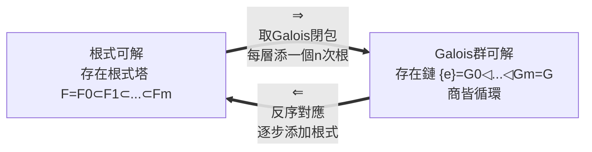

# 6.3 GALOIS 大定理的證明思想

## 本章導言

上一節我們陳述了判準：**方程根式可解 $\iff$ 其 Galois 群可解**。這一節拆開這個定理，看兩個方向如何證明。Galois 在 1832 年決鬥前夜的手稿裡給出了證明骨架，但太壓縮，直到 1846 年 Liouville 校訂發表、其後 Jordan（1870）的《置換論》系統化、再到 Artin（1930s）的現代重述，證明才成為今日教科書的形態。這一節的目標不是堆砌細節，而是展示**根式塔與群的可解鏈如何逐層咬合**——這是全書前六章的總收束。

### 兩個方向的策略總覽

核心工具只有三件：Galois 對應（6.1）、循環擴張的刻畫、以及單位根。證明困難之處在於單位根的技術處理——我們按 Artin 的辦法，先假設 $F$ 已含足夠的單位根，最後說明這個假設可以去掉。

### 工具一：循環擴張的刻畫

**命題 6.3.1**：設 $F$ 含 $n$ 次本原單位根 $\zeta$ （即 $\zeta^n = 1$ 且 $\zeta$ 生成全部 $n$ 次單位根）， $a \in F$ 。若 $x^n - a$ 在 $F$ 上不可約，則 $E = F(\sqrt[n]{a})$ 的 Galois 群是循環群 $\mathbb{Z}/n$ 。

**證明思想**： $E$ 是 $x^n - a$ 的分裂體（因 $F$ 已含全部根 $\zeta^k \sqrt[n]{a}$ 所需的 $\zeta$ ）。自同構 $\sigma$ 由 $\sqrt[n]{a} \mapsto \zeta^k \sqrt[n]{a}$ 決定， $k \in \mathbb{Z}/n$ ，映射 $\sigma \mapsto k$ 是 $\mathrm{Gal}(E/F) \to \mathbb{Z}/n$ 的同構。故 Galois 群循環。 $\blacksquare$

關鍵在「 $\zeta$ 已在 $F$ 中」這個假設：它使單純添加一個根就自動補齊所有根，擴張立即成為 Galois 且循環。這是單位根的角色——**為開方提供「旋轉對稱」的舞台**。

**Kummer 理論**：上述刻畫的完整版本（Kummer，1850s）說，含 $\zeta$ 的 $F$ 上，所有循環 $n$ 次擴張都形如添加 $\sqrt[n]{a}$ 。這就是「根式」與「循環 Galois 群」的等價證書。

### 工具二：Galois 對應的翻譯

有了工具一，翻譯機器就緒：

- 添加一個 $n$ 次根式（在有單位根的前提下） $\iff$ Galois 群換成一個商為循環群的擴張；
- 根式塔 $F = F_0 \subset F_1 \subset \cdots \subset F_m$ 對應 Galois 群的一條**下降鏈**；

$$
G = G_0 \twoheadrightarrow G_1 \twoheadrightarrow \cdots \twoheadrightarrow G_m = \{e\},
$$

每一步的核給出商群 $G_{i}/G_{i+1} \cong \mathbb{Z}/n_i$ ，循環。這正是**可解群**的定義（6.2 節）。

反過來，若 $\mathrm{Gal}(E/F)$ 有可解鏈 $\{e\} = G_m \trianglelefteq \cdots \trianglelefteq G_0 = G$ ，由 Galois 對應（注意**正規子群恰好對應「相對 $F$ 正規的中間體」**，6.1 節的關鍵補充）得到中間體鏈

$$
F = E^{G_0} \subseteq E^{G_1} \subseteq \cdots \subseteq E^{G_m} = E,
$$

每步 $E^{G_i}/E^{G_{i+1}}$ 的 Galois 群是 $G_{i+1}/G_i$ ，循環，故由工具一可添加根式逐層到達 $E$ 。兩個方向合攏。 $\blacksquare$

技術上還需處理：塔的每層未必 Galois、單位根未必在 $F$ 中。辦法是（1）取 Galois 閉包，把塔「 Galois 化」（證明可解性對商與子群封閉，閉包的群是原群的商）；（2）先添加本原單位根 $\zeta$ ——添加 $\zeta$ 的擴張的 Galois 群是 $(\mathbb{Z}/n)^\times$ 的子群，**交換群必可解**，故添加單位根不破壞可解性。這兩步補丁正是 1846–1930 年間證明逐步嚴格化的內容。

### 具體例題：三次方程的群層解剖

**例題 6.3.1**：設 $f(x) = x^3 - 3x + 1 \in \mathbb{Q}[x]$ 。求其分裂體的 Galois 群，並據此寫出根式解的塔。

**解**：

**第一步**： $f$ 無有理根（候選 $\pm1$ 代入： $-1$ 、 $3$ ，皆不為 $0$ ），故不可約。判別式（ $x^3 + px + q$ 型， $p=-3, q=1$ ）：

$$
\Delta = -4p^3 - 27q^2 = -4(-27) - 27 = 81 > 0,
$$

三實根，且 $\sqrt{\Delta} = 9 \in \mathbb{Q}$ 。由 Galois 理論標準結果： $\sqrt{\Delta} \in F \iff$ Galois 群 $\subseteq A_3$ 。不可約三次的 Galois 群是 $S_3$ 或 $A_3$ ，此處只能是 $A_3 \cong \mathbb{Z}/3$ 。

**第二步**： $\mathbb{Z}/3$ 可解（鏈 $\{e\} \trianglelefteq \mathbb{Z}/3$ ），故方程根式可解，塔為：

$$
\mathbb{Q} \;\subset\; \mathbb{Q}(\zeta_3) \;\subset\; \mathbb{Q}(\zeta_3, \sqrt[3]{\theta}),
$$

其中 $\zeta_3 = \frac{-1+\sqrt{-3}}{2}$ ， $\theta$ 是某個根的有理函數（Lagrange 解決式；對本題可算出 $\theta = \frac{-1 + 3\sqrt{-3}}{2}$ 型的量，細節從略）。Galois 群逐層：

$$
\mathrm{Gal}(\mathbb{Q}(\zeta_3)/\mathbb{Q}) \cong \mathbb{Z}/2, \qquad \mathrm{Gal}(\mathbb{Q}(\zeta_3,\sqrt[3]{\theta})/\mathbb{Q}(\zeta_3)) \cong \mathbb{Z}/3,
$$

群鏈 $\{e\} \trianglelefteq \mathbb{Z}/3 \trianglelefteq S_3$ （本題實際群是 $A_3 \subset S_3$ 的情形，塔在 $\mathbb{Q}(\zeta_3)$ 層已分裂）與 Cardano 公式結構吻合。 $\blacksquare$

這個例題展示定理「⇐」方向的全流程：**群的可解鏈 → 反序的中間體鏈 → 每層一個根式**。

### 大定理的完整陳述

**定理 6.3.2（Galois 大定理）**：設 $f \in F[x]$ ， $\mathrm{char}(F) = 0$ ， $E$ 為其分裂體。則：

$$
f \text{ 根式可解} \iff \mathrm{Gal}(E/F) \text{ 可解}.
$$

**證明骨架**（已如上述，匯總）：

1. （⇒）根式塔存在 → 加單位根、取 Galois 閉包 → 對應的群鏈商皆循環 → 可解。
2. （⇐）可解鏈存在 → Galois 對應給中間體鏈，每步循環 → Kummer 理論每步添加根式 → 分裂體含於根式塔頂。

再配上 6.2 節的 $A_5$ 單性，五次方程的命運塵埃落定：

$$
\text{一般五次} \longrightarrow \mathrm{Gal} = S_5 \longrightarrow A_5 \text{ 單} \longrightarrow \text{不可解} \longrightarrow \text{無根式解}.
$$

### 證明思想的深層意義

回顧這條鏈，可以看到 Galois 理論的方法論革命：

1. **對象的層次躍遷**：方程（舊對象）→ 根的集合 → 體（根生活在其中）→ 群（體的對稱）。每個躍遷都把問題變得更抽象、也更可解。
2. **障礙的精確化**：「無解」不再是失敗的嘆息，而是可計算的陳述（ $A_5$ 的共軛類結構）。這與 5.3 節的次數障礙一脈相承，並且更強：次數障礙只對尺規，可解性障礙對所有根式。
3. **對應作為引擎**：整個證明在體與群之間來回穿梭，Galois 對應是唯一的渡船。這種「兩個範疇間的字典」模式，將在 9.2 節範疇論中被命名為「伴隨」與「等價」的先聲。

### 與其他領域的關聯

- **往 5.2**： $\mathbb{F}_{p^n}/\mathbb{F}_p$ 的 Galois 群 $\mathbb{Z}/n$ 循環，故有限體擴張總是「一步根式」型——最小的活標本。
- **往 5.3**：尺規可作性的完整刻畫（Galois 閉包的群是 2-群）正是本定理的特例： $2$ -群必有鏈，商皆 $\mathbb{Z}/2$ ，對應平方根塔。
- **往 7.2**：可解群與單群的概念預示了表示論的問題——複雜的群如何拆成「積木」（不可約表示）？Jordan 的《置換論》正是兩者共同的搖籃。
- **往 8.3**：單群 $A_5$ 是 ADE 分類中 $I =$ 二十面體群的成員；Galois 的一生只發表了一頁論文，他的名字卻進入了二十世紀最深的分類定理。
- **數論**：Kummer 理論是 Fermat 大定理研究的起點，最終通向類域論與 Wiles 的證明——根式塔的思想至今活躍。

### 結語

Galois 大定理的證明是一場**翻譯的勝利**：把「解方程」這個有三千年歷史的問題，翻譯成「群的子群結構」這個誕生不到百年的問題，並立即得到答案。翻譯之所以有效，是因為 Galois 對應保證了兩側結構完全同調。前六章至此完成了它們的使命——從 al-Khwarizmi 的移項補項，到 Galois 的對應原理，代數完成了從「運算技藝」到「結構科學」的蛻變。第七章起，我們看看這門新的結構科學如何處理更廣的對象：模、表示、連續對稱。

---

*（本節核心一句：數學的進步，常常不是算出新答案，而是把舊問題翻譯成更易懂的語言。）*
