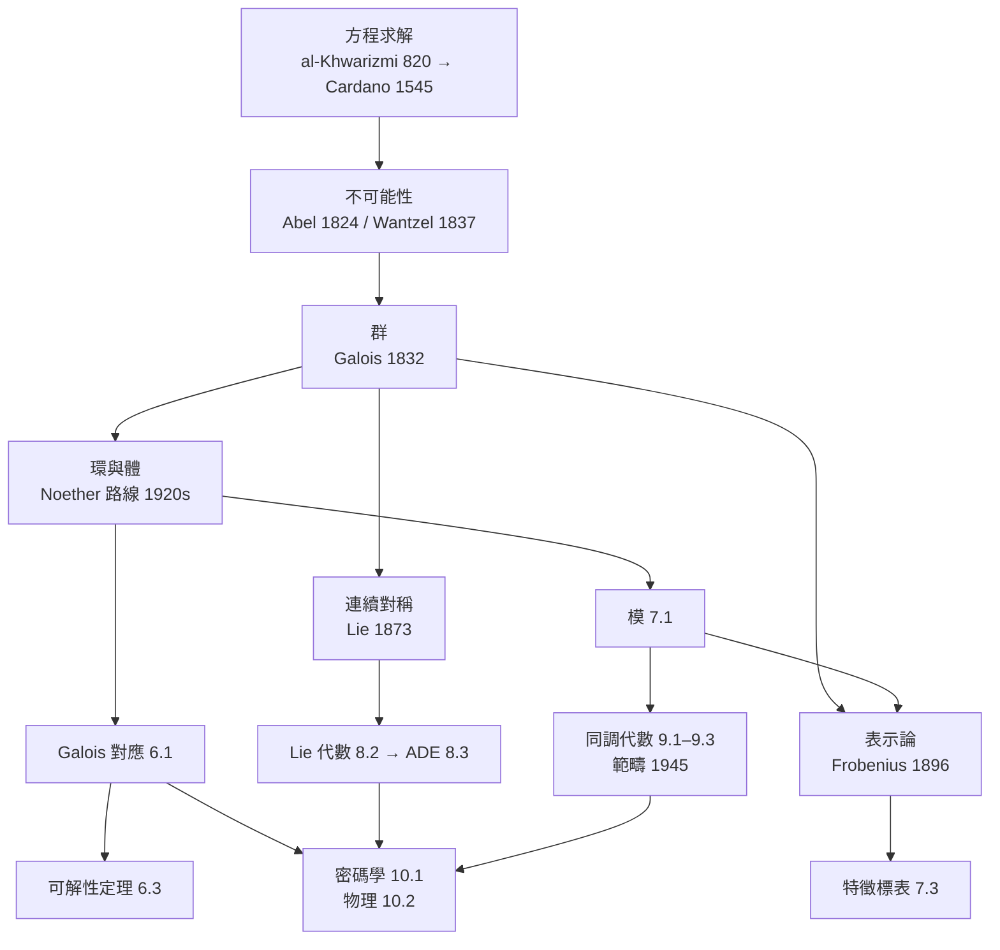
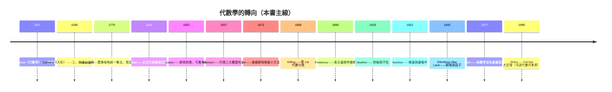

# 10.3 迴顧 從解方程到結構之眼

## 本章導言

本書從 820 年 al-Khwarizmi 的《代數學》出發，走到 2020 年代的後量子密碼與標準模型。回頭看，這條路線不是直線累積，而是**三次目標的轉向**：從「解方程」（文藝復興–十八世紀），到「理解方程為何可解」（Galois–Abel），到「研究結構本身」（Noether 以降）。最後一節做三件事：梳理這三次轉向的因果鏈；畫出全書概念的關係圖；把「結構之眼」——本書希望讀者帶走的那種視角——完整陳述。

### 三次轉向

**第一次轉向：從公式到不可能（1545 → 1824）**

Cardano 與 Ferrari 的三、四次公式（1.2、1.3）是技藝的頂點，也撞上了五次方程之牆。Lagrange 1770 年的統一檢視把「為何失敗」變成可陳述的問題；Ruffini、Abel（6.2）證明了一般五次方程**無根式解**。關鍵的概念跳躍：**「沒有解法」可以是一個定理**。與之平行，尺規三大難題（5.3）被 Wantzel 用次數障礙判死。不可能性的證明需要新對象：置換群、體擴張——結構概念的第一次催生。

**第二次轉向：從對象到對稱（1832 → 1897）**

Galois（2.1、6.1、6.3）把方程的秘密翻譯成群 $\mathrm{Gal}(E/F)$ 的結構：可解性定理把根式塔對應到群的可解鏈。Frobenius（7.2）進一步把群翻譯成矩陣，特徵標表（7.3）讓對稱可計算。Lie（8.1–8.2）把對稱推廣到連續世界並完成分類（8.3）。關鍵的概念跳躍：**研究一個對象，等價於研究保持它的變換**——Galois 對應是這句話的第一個嚴格實現，Yoneda 引理（9.2）是它的極限形態。

**第三次轉向：從結構到結構之間的結構（1890s → 1950s）**

Noether 的模論（7.1）把「作用於結構的環」變成通用載體；同調群（9.3）把「拼裝的偏差」變成可計算的對象；Eilenberg–Mac Lane 的範疇論（9.2）把「結構之間的映射」變成一等公民。關鍵的概念跳躍：**映射本身也是對象；關係可以比實體更基本**。這一步的直接後代是 Grothendieck 的代數幾何與 Fermat 大定理（10.1 節提及）。

### 全書概念地圖

### 五個貫穿全書的模式

**模式一：商與同構定理的通用語法。** 正規子群/理想/子模 + 商對象 + 同構定理（3.2、4.2、7.1），在三種結構中逐字重演。抽象代數的「文法」由這組三件套構成，正合序列（9.1）是它的最終格式。

**模式二：障礙即定理。** 次數不是 2 的冪 → 尺規不可能（5.3）；群不可解 → 無根式解（6.2、6.3）；離散對數難 → 密碼安全（10.1）。**「不能」的精確陳述，是十九世紀以來代數最重要的產品之一。**

**模式三：翻譯的勝利。** 方程 → 群（Galois）；群 → 矩陣（Frobenius）；連續群 → Lie 代數（Lie）；拓撲 → 同調（Poincaré–Noether）。每次翻譯都把問題搬到機器更發達的岸邊。翻譯的制度化語言就是函子（9.2）。

**模式四：抽象因阻塞而生。** 自然變換因同調論無法陳述協調性而生（9.2）；模論因 Jordan 標準形的統一而生（7.1）；鏈條件因 Hilbert 基定理的具體需求而生。**抽象的合法性由具體問題授予。**

**模式五：數學先備貨，應用後提領。** Galois 體（5.2）等了 150 年成為 QR 碼與 RSA 的地基；Frobenius 特徵標等了 30 年成為光譜學；Killing 名單等了 70 年成為標準模型。純數學的「無用」是一種期貨。

### 具體例題：一次全景式的複習演算

**例題 10.3.1**：以方程 $x^4 - 2 = 0$ 為線索，把全書的主要概念各「用一次」。

**解**：

1. **多項式環（4.3）**： $x^4 - 2 \in \mathbb{Q}[x]$ ，Eisenstein 判別法（ $p=2$ ）證明不可約。
2. **分裂體（5.1）**：根為 $\pm\sqrt[4]{2}, \pm i\sqrt[4]{2}$ ，分裂體 $E = \mathbb{Q}(\alpha, i)$ ， $[\mathbb{Q}(\alpha):\mathbb{Q}] = 4$ ， $[E:\mathbb{Q}(\alpha)] = 2$ ，故 $[E:\mathbb{Q}] = 8$ 。
3. **Galois 群（6.1）**：自同構由 $\alpha \mapsto \pm\alpha, \pm i\alpha$ 與 $i \mapsto \pm i$ 決定， $\mathrm{Gal}(E/\mathbb{Q})$ 是 8 階群，即**二面體群 $D_4$ **（正方形的對稱群——2.3 節的舊朋友）。
4. **Galois 對應（6.1）**： $D_4$ 的子群有 10 個，對應 10 個中間體，包括三個二次子域 $\mathbb{Q}(i)$ 、 $\mathbb{Q}(\sqrt2)$ 、 $\mathbb{Q}(i\sqrt2)$ ——對應的三個指數 4 正規子群。
5. **可解性（6.3）**： $D_4$ 有鏈 $\{e\} \trianglelefteq \mathbb{Z}/2 \trianglelefteq \mathbb{Z}/4 \trianglelefteq D_4$ ，商皆循環，可解——所以 $x^4 - 2$ **有根式解**： $x = \sqrt[4]{2}$ 本身就是（四次根式）。塔 $\mathbb{Q} \subset \mathbb{Q}(\sqrt2) \subset \mathbb{Q}(\sqrt[4]{2}) \subset E$ 逐層對應群鏈的反序。四次方程（1.3 Ferrari）可解的群論原因正在於 $D_4$ 可解。
6. **尺規作圖（5.3）**： $\sqrt[4]{2}$ 的次數是 $4 = 2^2$ ，**倍兩次立方**可作；但注意這不與 5.3 的倍立方矛盾（那是 $\sqrt[3]{2}$ ，次數 3）。
7. **數論接口（10.1）**： $x^4 - 2$ 在 $\mathbb{F}_p$ 上分解的方式由 $p$ 模 8 的剩餘決定——素數在數域中的分解律，是代數數論的入口。
8. **表示論接口（7.2）**： $D_4$ 的特徵標表（5 個不可約表示）可由 7.3 的正交關係完整算出；其四維表示正是正方形對稱的幾何實現。

一個方程，八個章節的機器全部上場。**這就是「結構之眼」的操作含義：同一個對象，在多個結構層次上同時可讀。** $\blacksquare$

### 給讀者的結構之眼

最後，把本書希望留下的視角壓縮成四條：

1. **問「誰保持它」，而不只問「它是什麼」**。Galois 對應、表示論、Yoneda 引理是這一問法的三個高度。
2. **對「失敗」做結構分析**。不可解、不可作、不可分解，都可以變成定理——障礙的形狀就是知識。
3. **尋找通用格式**。當同一個證明在群、環、模中重複三次時，把它抽出來（範疇論的路徑）。
4. **尊重抽象的期貨屬性**。今天無用的結構理論，可能是三十年後物理或工程的主語言。

### 常見誤區與閱讀建議

複習時最容易犯的三個混淆，值得在此固定下來：

1. **「Galois 群是置換根的群」與「Galois 群是體的自同構群」**。前者是 Galois 的原始視角（置換論），後者是 Artin 的現代視角（不動體）。兩者在分裂體上等價，但現代視角能處理分裂體之外的擴張（如 5.2 的有限體）。讀古典文獻與現代教材時注意切換。
2. **「可解群」與「解方程」**。可解群是群有循環商鏈的內部性質；「方程可根式解」是其外部語義。二者的橋樑是 Galois 對應，不是定義上的同義反覆。
3. **「同構」與「相等」**。本書反覆說「在至多差一個同構下唯一」（如 9.2 例題的自由群）。範疇論之後，數學的等號幾乎都是「存在典範同構」——這是現代數學的書寫慣例，也是理解結構主義的關鍵。

延伸閱讀的建議路徑：想深入方程論讀 Artin《Galois Theory》（最薄的經典）；想深入表示論讀 Serre《Linear Representations of Finite Groups》；想深入同調代數讀 Weibel《An Introduction to Homological Algebra》；想看大圖景讀 Mac Lane《Mathematics: Form and Function》。

### 一張時間軸：全書事件的因果鏈

把驅動關係壓成一條時間軸，供複習時速查：

注意時間軸的「密度變化」：前三百年一個節點，後兩百年節點爆炸。這不是史料的偏倚，而是**結構概念一旦成形，開發速度指數增長**的實錄——Galois 的 60 頁遺稿在 1900 年代的分岔目錄中繁殖出整個現代代數。

### 結語

820 年，al-Khwarizmi 在巴格達寫下「還原與對消」；1832 年，Galois 在決鬥前夜寫下「群」；1918 年，Noether 寫下「對稱與守恆」；1945 年，Eilenberg 與 Mac Lane 寫下「範疇」。一千二百年間，「代數」這個詞的內涵從**運算的技藝**變成**關係的科學**。這本書的路線是一次導覽，不是終點：代數數論、代數幾何、表示論的深海都在前方。但導覽的承諾已兌現——讀者現在擁有一雙眼睛，能在方程、對稱、結構之間自由切換視角。數學的結構是不變的，看見它的方式可以無窮翻新。這正是結構之眼的饋贈。

---

*（本節核心一句：數學的進步，常常不是算出新答案，而是把舊問題翻譯成更易懂的語言。）*
