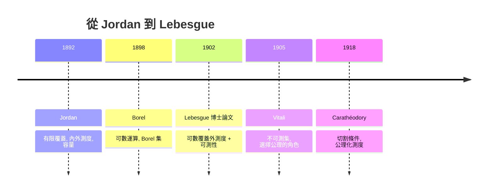

# 4.2 Lebesgue測度1902

## 本章導言

上一節我們看到 Peano 與 Jordan 用「有限覆蓋的內外包」嘗試定義面積，結果碰壁：即使是 Dirichlet 函數這樣的簡單對象，Jordan 外測度與內測度也不相等。問題的根源不在對象本身，而在「有限」二字。1902 年，Henri Lebesgue（1875–1941）在他的博士論文《積分、長度與面積》（Intégrale, longueur, aire）中做了一件看似微小卻翻天覆地的事：**把覆蓋從有限個改為可數無限個**。這一步讓「長度」的理論突然變得無所不能。本節講述這個定義的來龍去脈、技術細節，以及它為何成為二十世紀分析學的地基。

### 歷史背景：危機的累積

Lebesgue 並非憑空發明。十九世紀末，分析學累積了三個無法在 Jordan 理論內解決的問題：

| 年代 | 人物 | 問題 |
|------|------|------|
| 1872 | Weierstrass | 處處連續處處不可微函數——積分理論必須處理病態函數 |
| 1881 | Volterra | 有界函數其導函數存在卻不 Riemann 可積 |
| 1890s | Stolz、Cantor | 「可數個區間的並」的長度該是什麼？ |
| 1898 | Borel | 《Leçons sur la théorie des fonctions》先建立 Borel 集的測度 |

Borel 是 Lebesgue 的老師輩（兩人後來因優先權問題交惡三十年）。Borel 已經意識到：從開區間出發，對**可數**的運算（可數並、補集）封閉的最小集族——後來稱為 Borel σ-代數——上面的「長度」應該用可數可加性定義。Borel 甚至證明了可數個兩兩不交區間的並的長度等於長度之和。但他停在這裡：他沒有定義一般點集的外測度，更沒有建立積分。Lebesgue 的功勞是完成整座建築。

### Lebesgue 外測度的定義

**定義 4.2.1（Lebesgue 外測度）**：對 $A \subseteq \mathbb{R}$ ，定義

$$
m^*(A) = \inf\left\{ \sum_{n=1}^{\infty} \ell(I_n) \;:\; A \subseteq \bigcup_{n=1}^{\infty} I_n,\ I_n \text{ 為開區間} \right\},
$$

其中 $\ell(I)$ 是區間 $I$ 的長度。覆蓋允許**可數無限多**個區間，且要求和可以發散到 $\infty$ 。

外測度的基本性質：

1. **空集與區間**： $m^*(\emptyset)=0$ ，且 $m^*(I) = \ell(I)$ 對任意區間成立。
2. **單調性**： $A \subseteq B \Rightarrow m^*(A) \le m^*(B)$ 。
3. **平移不變**： $m^*(A+x) = m^*(A)$ 。
4. **可數次可加**： $m^*\left(\bigcup_n A_n\right) \le \sum_n m^*(A_n)$ 。

**證明思想（可數次可加）**：給每個 $A_n$ 一個覆蓋 $\{I_{n,k}\}_k$ 使 $\sum_k \ell(I_{n,k}) \le m^*(A_n) + \varepsilon/2^n$ 。把所有區間合併成對 $\bigcup_n A_n$ 的可數覆蓋，總和不超過 $\sum_n m^*(A_n) + \varepsilon$ 。讓 $\varepsilon \to 0$ 即得。這裡「 $\varepsilon/2^n$ 」的技巧是 Lebesgue 論文的標誌性手法，之後會反覆出現。

**關鍵對比**：Jordan 外測度用有限覆蓋，只有次可加（有限次）；Lebesgue 用可數覆蓋，得到可數次可加。單看定義只是把「有限」換成「可數」，但後果是：可數集的測度變成 $0$ 。

**例題 4.2.1**：證明 $\mathbb{Q} \cap [0,1]$ 的 Lebesgue 外測度為 $0$ 。

**解**：可數集 $A = \{q_1, q_2, \dots\}$ 。給定 $\varepsilon > 0$ ，用區間 $I_n$ 覆蓋 $q_n$ ，其中 $\ell(I_n) = \varepsilon/2^{n+1}$ 。則

$$
m^*(A) \le \sum_{n=1}^\infty \frac{\varepsilon}{2^{n+1}} = \frac{\varepsilon}{2} < \varepsilon.
$$

由 $\varepsilon$ 任意， $m^*(A) = 0$ 。注意在 Jordan 理論下這個集合的內外測度分別是 $0$ 和 $1$ ——可數稠密集是 Jordan 理論的死角，卻是 Lebesgue 理論的平凡情形。這正是革命的本錢：**零測集可以從積分中被「忽略」**。

### 可測性：Carathéodory 的切割條件

外測度 $m^*$ 只滿足次可加，不滿足可加性——除非限制在「好集合」上。1918 年 Carathéodory 找到最優雅的判準（Lebesgue 原始定義用內外測度相等，較繁瑣；Carathéodory 條件現在是標準）：

**定義 4.2.2（可測集）**： $E \subseteq \mathbb{R}$ 稱為 **Lebesgue 可測**，若對任意 $A \subseteq \mathbb{R}$ ，

$$
m^*(A) = m^*(A \cap E) + m^*(A \cap E^c).
$$

直觀： $E$ 把任何集合「乾淨地切開」，兩塊的測度恰好相加。這條件把「可加性失效」的責任精確地推給不可測的集合。

**定理 4.2.3（可測集的結構）**：可測集全體 $\mathcal{M}$ 是一個 **σ-代數**：對補集、可數並、可數交封閉，且 $m^*$ 限制在 $\mathcal{M}$ 上是**可數可加測度**。

**證明思想**：
- *補集封閉*：切割條件對 $E$ 與 $E^c$ 完全對稱。
- *可數並封閉*：先證有限並（歸納法 + 條件的遞迴代入），再對不交集序列 $\{E_n\}$ 用

$$
m^*\left(\bigcup_{k=1}^{n} E_k \cap A\right) = \sum_{k=1}^{n} m^*(E_k \cap A)
$$

取極限並用次可加夾逼，得可數可加。
- *Borel 集可測*：任何開集可寫成可數個不交開區間之並，逐項檢驗條件即得。

於是我們得到（ $G_\delta$ 集、 $F_\sigma$ 集都包含在內）：

$$
\text{Borel 集} \subsetneq \text{Lebesgue 可測集} \subsetneq \text{全體子集}.
$$

第一個真包含：任何零測集的子集都可測（完備性），Cantor 集的某些非 Borel 子集即為例子。第二個真包含：見下節的 Vitali 集。

**定理 4.2.4（正則性）**：對任意可測集 $E$ ：

$$
m(E) = \inf\{m(O) : E \subseteq O,\ O \text{ 開}\} = \sup\{m(K) : K \subseteq E,\ K \text{ 緊}\}.
$$

**證明思想（外正則）**：用定義取總長不超過 $m^*(E)+\varepsilon$ 的可數開覆蓋，其並為開集。內正則需用到 $\mathbb{R}$ 的 $\sigma$ -緊性（寫成 $\bigcup [-n,n]$ ）。正則性是「測度與拓撲握手」的地方，也是 Radon 測度理論（第 9 章）的起點。

### 完備性、Cantor 集與不可測集

**例題 4.2.2**：計算 Cantor 三分集 $C$ 的測度，並證明存在測度為零的不可數集。

**解**：構造的第 $n$ 步留下 $2^n$ 個長度 $3^{-n}$ 的閉區間，總長 $(2/3)^n \to 0$ 。 $C$ 是這些閉集的交，故

$$
m(C) \le \lim_{n\to\infty} (2/3)^n = 0.
$$

但 $C$ 與 $[0,1]$ 等勢（三進位展開只用數字 $0,2$ 的點），不可數。這回答了一個 1880 年代的謎題：**不可數集可以「沒有長度」**。在 Jordan 框架下 $C$ 的外測度是 $1$ ，內測度是 $0$ ，根本無法賦值。

反方向，Vitali 在 1905 年證明不可測集存在：在 $[0,1]$ 上以「 $x - y \in \mathbb{Q}$ 」分等價類，用選擇公理取代表元集 $V$ 。 $V$ 的有理平移（在適當範圍內）兩兩不交且覆蓋一個區間；若 $V$ 可測，可數可加性會迫使 $m(V)$ 同時等於 $0$ 與正數，矛盾。結論：**放棄「所有子集都可測」，或放棄平移不變 + 可數可加，二者必居其一**。Lebesgue 選擇犧牲前者，換來一個在幾乎所有用途上都完美的理論。

### 高維與一般情形

同樣的定義在 $\mathbb{R}^n$ 上以方塊（或球）覆蓋進行，得到 $n$ 維 Lebesgue 測度。Fubini 定理（第 8 章）將證明 $n$ 維測度可由一維測度迭代重建，解決了「面積 = 長 × 寬」在一般集合上的嚴格意義。Carathéodory 的公理化觀點——「在 σ-代數上可數可加、取值於 $[0,\infty]$ 的函數」——則把測度從幾何直覺中解放出來，直接通往第 9 章的抽象測度與 Kolmogorov 的機率論。

### 與其他章節的關聯

- **承 4.1**：Jordan 容量的失敗案例（Dirichlet 函數的示性函數）在 Lebesgue 測度下全部通過，因為邊界 $\mathbb{Q}\cap[0,1]$ 是零測集。
- **啟 4.3**：測度定了，下一個問題是「哪些函數可以積分」——答案是「可測函數」。
- **啟 5.1**：Lebesgue 積分的定義直接建構在本節的可測集上，先測水平集再積分。
- **機率論**：Kolmogorov 1933 年把「機率」定義為「總測度為 $1$ 的測度」，Lebesgue 測度在 $[0,1]$ 上就是均勻分佈。第 9 章將展開這條線。
- **調和分析**： $L^p$ 空間（第 6 章）的完備性依賴於測度的可數可加性；沒有 Lebesgue 測度，就沒有 Riesz–Fischer 定理，也沒有現代傅立葉分析。

### 本節要點

1. Lebesgue 外測度 = 可數覆蓋的長度下確界；「有限 → 可數」是決定性的一步。
2. Carathéodory 切割條件挑出可測集，其上 $m^*$ 是可數可加測度。
3. 可測集構成含全體 Borel 集的完備 σ-代數；測度具內外正則性。
4. 零測集可以不可數（Cantor 集）；不可測集必然存在（Vitali）。
5. 這個理論不是為了美，而是為了救積分論——下一章我們看它如何兌現承諾。
