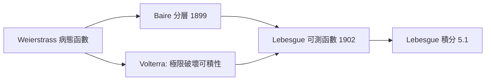

# 4.3 可測函數

## 本章導言

有了可測集（4.2），積分理論的下一塊拼圖是：**哪些函數值得積分？** Riemann 積分對「連續性」有隱含依賴：一個函數 Riemann 可積，若且唯若它的不連續點集是零測集（這正是 Lebesgue 1902 年論文裡證明的判準）。但十九世紀末的極限運算——逐項極限、極限函數的積分——不斷產生連續性被破壞殆盡的函數。Lebesgue 的答案是把「好函數」的標準從拓撲性質（連續）換成測度性質（可測）：**只要「函數在某高度以上的水平集」是可測集，函數就可積**。這個看似寬鬆的條件，威力驚人：它對逐點極限封閉，於是極限運算終於「安全」了。

### 從 Baire 綱要到 Lebesgue 的問題

1899 年，Baire 在博士論文中把函數分層：連續函數是第 0 類，逐點極限是第 1 類，依此類推，並用「綱要」（category）研究這些層次。Lebesgue 在 1905 年證明 Baire 分層是嚴格的。但 Baire 的層級是描述性的；Lebesgue 需要的是**對積分有用的封閉類**。

歷史的驅動鏈是這樣的：

Volterra 在 1881 年造出一個導函數有界但不 Riemann 可積的函數——極限與積分交換在 Riemann 框架內無藥可救。Lebesgue 的賭注：換一個更寬的函數類，積分與極限的交換就自動成立（第 5 章將兌現）。

### 可測函數的定義

**定義 4.3.1**：設 $(X, \mathcal{M})$ 是可測空間， $f: X \to [-\infty, +\infty]$ 。 $f$ 稱為**可測**，若對每個實數 $a$ ，水平集

$$
\{x \in X : f(x) > a\} \in \mathcal{M}.
$$

在 $X = \mathbb{R}$ 、 $\mathcal{M}$ 為 Lebesgue 可測集時稱為 Lebesgue 可測函數。

這個定義用「 $>a$ 」不是偶然——任何一種水平集條件（ $\ge a$ 、 $< a$ 、 $\le a$ ）都彼此等價，因為可數並與補集可用：例如 $\{f \ge a\} = \bigcap_n \{f > a - 1/n\}$ 。

**定理 4.3.2（封閉性）**：可測函數的全體對以下運算封閉：

1. 代數運算： $f+g$ 、 $fg$ （在有限值處）；
2. 數列運算： $\sup_n f_n$ 、 $\inf_n f_n$ 、 $\limsup_n f_n$ 、 $\liminf_n f_n$ ；
3. 複合：若 $g$ 連續且 $f$ 可測，則 $g \circ f$ 可測。

**證明思想**：全部化歸為水平集的集合運算。例如

$$
\left\{ \sup_n f_n > a \right\} = \bigcup_{n=1}^{\infty} \{f_n > a\},
$$

可數個可測集之並仍可測。極限的封閉性由此免費獲得——**這是可測性與連續性的本質差別**：連續函數的逐點極限可以處處不連續，但可測函數的逐點極限仍然可測。

**定義 4.3.3（簡單函數）**：取值於有限個實數的可測函數，即 $f = \sum_{k=1}^{N} a_k \chi_{E_k}$ ，其中 $E_k$ 可測、兩兩不交。

**定理 4.3.4（簡單函數逼近）**：非負可測函數 $f$ 是一列**單調遞增**的簡單函數 $s_n \uparrow f$ 的逐點極限；若 $f$ 有界，收斂還是一致的。

**證明思想**：對 $n$ 把值域切成 $2^n$ 格：

$$
s_n(x) = \sum_{k=0}^{2^{2n}-1} \frac{k}{2^n}\, \chi_{\{k/2^n \le f < (k+1)/2^n\}} + n\,\chi_{\{f \ge n\}}.
$$

每次加密網格， $s_n(x)$ 遞增且趨於 $f(x)$ 。這個構造是第 5 章 Lebesgue 積分定義的引擎：**先對簡單函數定義積分，再用單調極限擴張**。

### 幾乎處處：測度論的等價觀念

**定義 4.3.5**：性質 $P$ 稱為**幾乎處處**（a.e.）成立，若使 $P$ 失效的點集是零測集。

**定理 4.3.6**：若 $f = g$ a.e. 且 $f$ 可測，則 $g$ 可測（在完備測度空間上）。可測性是「忽略零測集」之後仍然保持的性質。

**例題 4.3.1**：證明 Dirichlet 函數 $\chi_{\mathbb{Q}}(x)$ 在 $[0,1]$ 上可測，且與常函數 $0$ 幾乎處處相等。

**解**： $\mathbb{Q} \cap [0,1]$ 可數故可測且零測，因此

$$
\{ \chi_{\mathbb{Q}} > a \} = 
\begin{cases}
[0,1], & a < 0 \\
\mathbb{Q}\cap[0,1], & 0 \le a < 1 \\
\emptyset, & a \ge 1
\end{cases}
$$

皆可測。又 $\{x : \chi_{\mathbb{Q}}(x) \ne 0\} = \mathbb{Q} \cap [0,1]$ 零測，故 $\chi_{\mathbb{Q}} = 0$ a.e.。在 Riemann 世界裡這個函數處處不連續、完全不可積；在 Lebesgue 世界裡它就是 $0$ ，積分為 $0$ （第 5 章正式計算）。**零測集上的行為從此不重要**——這是本節最革命的心理轉變。

### Littlewood 三原則與 Egorov 定理

J. E. Littlewood（1885–1977，Hardy 的合作者）總結 Lebesgue 理論的精神為三句話：

1. 每個可測集「幾乎是」有限個區間的並；
2. 每個 a.e. 有限的可測函數「幾乎是」連續函數；
3. 每個 a.e. 收斂的函數列「幾乎是」一致收斂。

第三條的嚴格形式：

**定理 4.3.7（Egorov, 1911）**：設 $m(E) < \infty$ ， $f_n \to f$ a.e. 於 $E$ ， $f_n$ 、 $f$ a.e. 有限可測。則對任意 $\varepsilon > 0$ ，存在可測子集 $A \subseteq E$ ， $m(E \setminus A) < \varepsilon$ ，使 $f_n \to f$ 在 $A$ 上**一致**。

**證明思想**：對每對 $(n, k)$ 定義「從第 $n$ 項起全在 $f$ 的 $1/k$ 鄰域內」的集合 $E_{n,k} = \bigcap_{m \ge n} \{ |f_m - f| < 1/k \}$ 。a.e. 收斂使 $E_{n,k} \uparrow E \setminus N$ （ $N$ 零測）；由測度的上連續性，對每個 $k$ 可取 $n_k$ 使 $m(E \setminus E_{n_k,k}) < \varepsilon/2^k$ 。取 $A = \bigcap_k E_{n_k,k}$ ，剔除總測度 $\varepsilon$ 的爛攤子後，餘下部分一致收斂。

**例題 4.3.2**：在 $[0,1]$ 上令 $f_n(x) = x^n$ ，則 $f_n \to 0$ a.e.（除了 $x=1$ ）。給出具體的 Egorov 集。

**解**：不收斂點只有 $\{1\}$ ，零測。取 $A_\varepsilon = [0, 1-\delta]$ ：對 $x \le 1-\delta$ ， $x^n \le (1-\delta)^n \to 0$ ，且收斂關於 $x$ 一致。需 $m([0,1] \setminus A_\varepsilon) = \delta < \varepsilon$ ，故取 $\delta = \varepsilon/2$ 即可。注意：若允許 $A = [0,1]$ 全集，一致收斂失敗（在 $1$ 附近永遠有 $x^n > 1/2$ ）——**一致收斂必須「買」，代價是小測度集合**。

### Lusin 定理：可測函數幾乎連續

**定理 4.3.8（Lusin, 1912）**：設 $f$ 在 $E$ （有限測度）上 a.e. 有限可測。則對任意 $\varepsilon > 0$ ，存在緊集 $K \subseteq E$ ， $m(E \setminus K) < \varepsilon$ ，且 $f|_K$ 連續。

**證明思想**：先用簡單函數逼近，再用正則性（4.2 定理 4.2.4）把簡單函數的水平集壓進緊集，在緊集上簡單函數自動連續，最後對逼近序列對角線取交集。Lusin 定理說明：**可測函數不是比連續函數「更壞」，只是「在零測的爛攤子上壞」**。這也反過來說明 Baire 第 1 類函數與可測函數的關係：每個可測函數在一個近全測度緊集上連續。

### 與其他章節的關聯

- **承 4.2**：可測函數的定義完全建立在可測集與 σ-代數之上；「幾乎處處」的概念依賴零測集理論。
- **啟 5.1–5.3**：Lebesgue 積分只對可測函數定義；單調收斂定理需要「非負可測」這個精確前提；Lebesgue 的可積判準（不連續點零測）統一了 Riemann 與 Lebesgue 兩個世界。
- **機率論（第 9 章）**：隨機變數就是「到可測空間的可測函數」；「幾乎處處」就是「幾乎必然」。本節的每個定理在機率論中都有直接對應：Egorov 對應幾乎必然收斂的強化，簡單函數逼近對應離散近似。
- **傅立葉分析（第 6、10 章）**： $L^p$ 空間的元素是「a.e. 相等的可測函數等價類」——沒有本節的等價觀念，範數甚至不會是良定的。

### 本節要點

1. 可測性 = 所有水平集 $\{f > a\}$ 可測；這是「好函數」的測度論標準。
2. 可測函數對極限運算封閉——逐點極限不再破壞可積性的候選資格。
3. 簡單函數單調逼近是積分理論的技術核心。
4. Littlewood 三原則：可測集近區間、可測函數近連續、a.e. 收斂近一致（Egorov、Lusin）。
5. 「幾乎處處相等」是測度論世界的相等關係，Lebesgue 積分與 $L^p$ 空間都建在其上。
