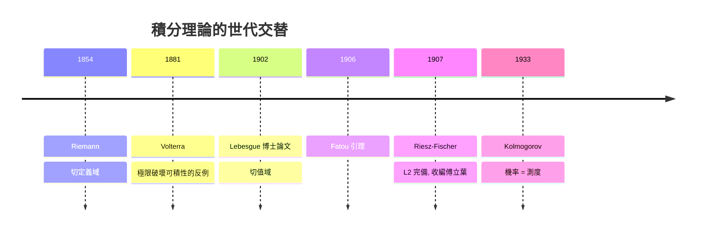

# 5.1 Lebesgue的革命性想法1902

## 本章導言

Lebesgue 造好測度之後，面對的真正目標是積分。Riemann 積分（1854）的做法是**切割定義域**：把 $[a,b]$ 切成小區間，取函數在每段上的值乘以段長求和。這個「自上而下切 x 軸」的策略對病態函數徹底失效。Lebesgue 的想法可以用他自己的比喻說明：**數一堆硬幣，不必一枚一枚數，先按面額分堆，每堆數一次乘以枚數**。翻譯成數學：積分時**切割值域**而非定義域。本節講這個想法如何落地為嚴格定義，以及它在 1902 年博士論文中的歷史位置。

### 歷史：Riemann 積分的極限

Riemann 積分 $\int_a^b f\,dx$ 定義為 Darboux 上和與下和的共同極限。它有兩個致命傷：

1. **對極限不封閉**：一列 Riemann 可積函數的逐點極限可以不可積（如 $\chi_{\mathbb{Q}}$ 是 $\chi_{\{q_n\}}$ 的單調極限）。
2. **沒有完備的收斂定理**：逐項積分需要一致收斂這種過強的條件。

1902 年之前已有補救嘗試：Jordan 的容量理論、Borel 的可數測度、Peano 的內外面積、以及 **Lebesgue 的對手 W. H. Young**（1905 年提出類似但稍晚的積分）。Lebesgue 的論文一次解決：定義、收斂定理、與 Riemann 理論的關係、以及在高維的推廣，全部完成。

### 積分的定義：三層火箭

**第一步：非負簡單函數。** 若 $s = \sum_{k=1}^{N} a_k \chi_{E_k}$ （ $a_k \ge 0$ ， $E_k$ 可測不交），定義

$$
\int_E s\,dm = \sum_{k=1}^{N} a_k\, m(E_k).
$$

這就是「按面額分堆」：值 $a_k$ 乘上集合 $E_k$ 的「長度」。

**第二步：非負可測函數。** 由 4.3 定理 4.3.4，取單調遞增的簡單函數 $s_n \uparrow f$ ，定義

$$
\int_E f\,dm = \sup\left\{ \int_E s\,dm : 0 \le s \le f,\ s \text{ 簡單} \right\} \in [0, \infty].
$$

值允許為 $+\infty$ ——這是與 Riemann 積分的第一個外觀差異，卻是技術上的關鍵自由。

**第三步：一般函數。** 令 $f^+ = \max(f, 0)$ 、 $f^- = \max(-f, 0)$ ，則 $f = f^+ - f^-$ 。若 $\int f^+$ 與 $\int f^-$ **不同時為 $\infty$ **，稱 $f$ **Lebesgue 可積**，定義

$$
\int_E f\,dm = \int_E f^+\,dm - \int_E f^-\,dm.
$$

**例題 5.1.1**：計算 $\int_{[0,1]} \chi_{\mathbb{Q}}\,dm$ ，並解釋為何 Riemann 積分不存在。

**解**： $\chi_{\mathbb{Q}} = 1 \cdot \chi_{\mathbb{Q}\cap[0,1]} + 0 \cdot \chi_{\text{其餘}}$ 是簡單函數，且 $m(\mathbb{Q}\cap[0,1]) = 0$ （4.2 例題 4.2.1），故

$$
\int_{[0,1]} \chi_{\mathbb{Q}}\,dm = 1 \cdot 0 + 0 \cdot 1 = 0.
$$

而 Riemann 上和恆為 $1$ （任何區間內都有有理數）、下和恆為 $0$ ，不可積。**一個處處不連續的函數，積分乾淨地等於零**——零測集被積分「看穿」了。

### 基本性質與 Chebyshev 不等式

積分繼承線性（ $\int (af+bg) = a\int f + b\int g$ ，對可積函數）、單調（ $f \le g \Rightarrow \int f \le \int g$ ）、與**絕對連續性**（ $m(E) \to 0 \Rightarrow \int_E |f| \to 0$ ）。最有用的初等工具是：

**定理 5.1.2（Chebyshev / Markov 不等式）**： $f \ge 0$ 可測，則對任意 $\lambda > 0$ ，

$$
\lambda\, m(\{f \ge \lambda\}) \le \int_{\{f \ge \lambda\}} f\,dm \le \int f\,dm.
$$

**證明**： $\lambda \chi_{\{f \ge \lambda\}} \le f$ ，兩邊積分用單調性即得。 $\blacksquare$

**推論**：若 $f \ge 0$ 且 $\int f = 0$ ，則 $f = 0$ a.e.。這把「積分為零」與「幾乎處處為零」畫上等號，是第 6 章 $L^p$ 範數良定性的基礎。

### Fatou 引理：收斂定理的第一顆螺絲

**定理 5.1.3（Fatou, 1906）**：非負可測函數列 $\{f_n\}$ ，則

$$
\int \liminf_n f_n \le \liminf_n \int f_n.
$$

**證明思想**：令 $g_k = \inf_{n \ge k} f_n$ ，則 $g_k \uparrow \liminf f_n$ ，且對每個 $k$ 、每個 $n \ge k$ ， $g_k \le f_n$ ，故 $\int g_k \le \inf_{n\ge k} \int f_n$ 。對左邊用單調收斂（下一節證明）、右邊取極限即得。 $\blacksquare$

注意不等號可能嚴格： $f_n = \chi_{[n, n+1]}$ 逐點趨於 $0$ 但積分恆為 $1$ 。Fatou 引理是「不假設任何收斂條件時能得到的最好結果」，也是下一節兩大定理的證明原料。

### 一個例題：從下和的視角看 Lebesgue 和

**例題 5.1.2**：用「切割值域」的方法計算 $\int_0^1 x\,dm$ ，並與 Riemann 的做法對照。

**解**：把值域 $[0,1]$ 切成 $N$ 等分， $E_k = \{ x : k/N \le x < (k+1)/N \} = [k/N, (k+1)/N)$ 。下和取每堆的**最小值** $k/N$ ：

$$
\sum_{k=0}^{N-1} \frac{k}{N}\, m(E_k) = \sum_{k=0}^{N-1} \frac{k}{N} \cdot \frac{1}{N} = \frac{N-1}{2N} \longrightarrow \frac{1}{2}.
$$

上和用 $(k+1)/N$ ，同樣趨於 $1/2$ 。本例中兩法答案相同——函數太乖了。差別出現在振盪函數上：Riemann 需要定義域的細分割同時「鎮住」所有振盪；Lebesgue 把振盪的責任交給值域，振盪區只在「值大的那幾堆」出現，而那幾堆的測度可以極小。

### 1902 年論文的接受史

Lebesgue 積分起初遭遇強烈阻力。Hermite 厭惡「長著裂齒的病態函數」；Poincaré 挖苦為「對毫無用處的東西的過度精緻」。Lebesgue 本人在回憶中寫道，他花了多年時間向懷疑者解釋。轉折點是實用性的證明：

- **1907**：Riesz–Fischer 定理證明 $L^2$ 完備（第 6 章），傅立葉級數理論獲得堅實地基；
- **1909–1913**：Lebesgue 積分成為處理奇異積分、微分方程的標準工具；
- **1933**：Kolmogorov 用它奠定機率論（第 9 章）。

### 與其他章節的關聯

- **承 4.2、4.3**：積分的定義逐字使用了可測集的測度與簡單函數逼近；沒有可數可加性，「按面額分堆」會導出矛盾。
- **啟 5.2**：單調收斂與控制收斂定理是本節定義的即時報酬，也是整個理論存在的理由。
- **啟 5.3**：與 Riemann 積分的精確比較（含 Lebesgue 的可積判準）。
- **微分方程與調和分析**：Volterra 型的反例、奇異積分理論、Plancherel 定理都以 Lebesgue 積分為語言。

### 本節要點

1. Lebesgue 積分 = 切值域：簡單函數 → 非負函數（sup）→ 一般函數（正負部相減）。
2. 積分值允許 $\infty$ ；可積要求正負部不同時發散。
3. Chebyshev 不等式連接積分與測度；積分為零 ⟺ 幾乎處處為零。
4. Fatou 引理是收斂定理的底線： $\liminf$ 只能放大積分。
5. 處處不連續函數可以積分良好——零測集在積分中不可見。
