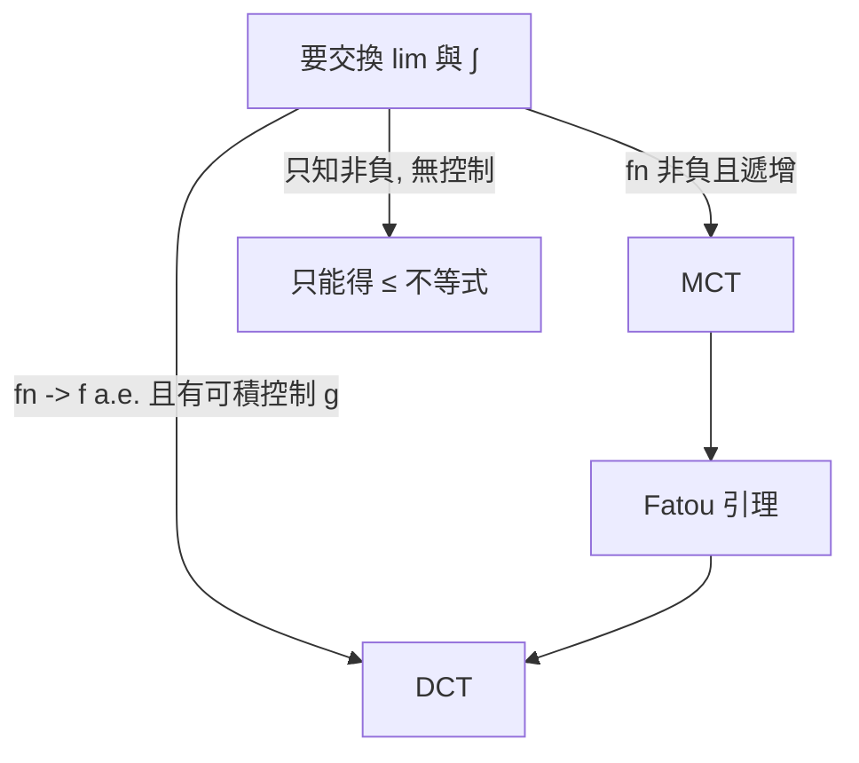

# 5.2 單調收斂與控制收斂定理

## 本章導言

Lebesgue 積分的定義（5.1）本身還只是定義；它真正的價值在**收斂定理**：什麼時候 $\int \lim f_n = \lim \int f_n$ ？在 Riemann 世界裡，答案是「一致收斂」——過強，連 $f_n(x) = x^n$ 這種溫和例子都要在端點出問題。1902 年的博士論文中，Lebesgue 證明了以他命名的**控制收斂定理**（1902 年論文中的形式較受限，今日通行形式歸功於他 1908–1910 年的修訂與 Valée Poussin 的貢獻）；**單調收斂定理**的現代形式則在隨後幾年由 Lebesgue 與 Fatou 整理定型。這兩個定理是整個測度論投資的利息：從此極限與積分幾乎永遠可以交換。

### 為什麼極限交換會失敗

先看失敗模式，才知道定理在防什麼。

**失敗一（質量逃逸）**： $f_n = \chi_{[n, n+1]}$ 於 $\mathbb{R}$ 。逐點 $f_n \to 0$ ，但 $\int f_n = 1$ 恆定。質量跑到無窮遠去了。

**失敗二（集中尖峰）**： $f_n(x) = n\,\chi_{[0,1/n]}$ 。逐點 $f_n \to 0$ ，但 $\int f_n = 1$ 。質量集中到一個收縮的尖峰。

兩種失敗的共同點：**沒有任何一個可積函數能同時壓住所有的 $f_n$ **。這就是控制收斂定理假設的精確動機。

### 單調收斂定理

**定理 5.2.1（Monotone Convergence Theorem, MCT）**： $\{f_n\}$ 非負可測， $f_n \uparrow f$ （逐點，允許 $f$ 取值 $\infty$ ）。則

$$
\int f = \lim_{n\to\infty} \int f_n.
$$

**證明**：由單調性 $\int f_n \le \int f$ ，故 $\lim \int f_n \le \int f$ 。反方向，任取簡單函數 $s \le f$ 、 $0 < \theta < 1$ ，考慮

$$
E_n = \left\{ x : \theta s(x) \le f_n(x) \right\}.
$$

因 $f_n \uparrow f$ ， $E_n \uparrow X$ ；且 $\int \theta s \cdot \chi_{E_n} \le \int f_n$ 。由測度的下連續性（ $\chi_{E_n} \uparrow \chi_X$ ，用 4.2 的可數可加性直接推出 $m(E_n) \uparrow m(X)$ 的加權版本）， $\int \theta s \cdot \chi_{E_n} \to \int \theta s$ 。於是

$$
\theta \int s \le \lim \int f_n.
$$

令 $\theta \uparrow 1$ 再對 $s \le f$ 取 sup，得 $\int f \le \lim \int f_n$ 。夾逼即證。 $\blacksquare$

證明的兩個技術支點——**簡單函數逼近**（4.3）與**測度的下連續性**（4.2 的可數可加性）——全部來自前面兩章。MCT 是測度可數可加性的積分化身。

**例題 5.2.1**：證明 $\sum_{n=1}^{\infty} \int_0^1 \frac{a_n(x)}{n^2}\,dx$ 型的逐項積分，或更具體地：計算 $\int_0^1 \left( \sum_{n=1}^\infty x^{n} (1-x) \right) dx$ 。

**解**：每項非負，部分和單調遞增，MCT 允許逐項積分：

$$
\int_0^1 \sum_{n=1}^{\infty} x^n (1-x)\,dx = \sum_{n=1}^{\infty} \int_0^1 x^n(1-x)\,dx = \sum_{n=1}^{\infty} \left( \frac{1}{n+1} - \frac{1}{n+2} \right) = \frac{1}{2}.
$$

在 Riemann 框架下需要先證級數一致收斂（事實上不收斂得夠好：在 $x=1$ 處每項皆 $0$ 但附近和接近 $1$ ，逐項驗證一致收斂會卡在端點）；MCT 讓我們**直接交換，不驗證任何收斂品質**。注意在 $x=1$ 處逐項和為 $0$ 但左式被積函數的 a.e. 值為 $\frac{1}{1-x}\cdot(1-x) = 1$ 的極限行為——逐點上 $\sum x^n(1-x) = x$ 當 $0\le x<1$ ，故積分 $\int_0^1 x\,dx = 1/2$ ，吻合。

### 控制收斂定理

**定理 5.2.2（Dominated Convergence Theorem, DCT）**： $\{f_n\}$ 可測， $f_n \to f$ a.e.。若存在可積函數 $g$ 使 $|f_n| \le g$ a.e. 對所有 $n$ ，則 $f$ 可積且

$$
\int f = \lim_{n\to\infty} \int f_n, \qquad \text{甚至} \quad \int |f_n - f| \to 0.
$$

**證明思想**：對 $\{f_n + g\}$ （非負，趨於 $f+g$ ）與 $\{g - f_n\}$ （非負，趨於 $g-f$ ）各用一次 Fatou 引理：

$$
\int f + g \le \liminf \int (f_n + g) = \int g + \liminf \int f_n,
$$

$$
\int g - f \le \liminf \int (g - f_n) = \int g - \limsup \int f_n.
$$

兩式整理得 $\limsup \int f_n \le \int f \le \liminf \int f_n$ ，故極限存在且等於 $\int f$ 。把 DCT 用在 $f_n - f$ 上（控制仍為 $2g$ ）得 $L^1$ 收斂。 $\blacksquare$

**注意結構**：DCT 由 Fatou 引理推出，Fatou 由 MCT 推出，MCT 由測度可數可加性推出。整條推理鏈乾淨得沒有一處需要一致收斂。

**例題 5.2.2**：證明 $\displaystyle \lim_{t \to 0} \int_{\mathbb{R}} \frac{\sin(tx)}{x(1+x^2)}\,dx = 0$ （參數極限的交換）。

**解**：令 $f_t(x) = \frac{\sin(tx)}{x(1+x^2)}$ ，當 $t \to 0$ ， $f_t(x) \to 0$ 對每個 $x$ 。控制函數： $|\sin(tx)| \le |tx|$ ，故

$$
|f_t(x)| \le \frac{|t x|}{|x|(1+x^2)} = \frac{|t|}{1+x^2} \le \frac{1}{1+x^2} \quad (|t| \le 1),
$$

而 $g(x) = \frac{1}{1+x^2}$ 可積（ $\int_{\mathbb{R}} g = \pi$ ）。由 DCT，極限與積分交換，原式 $= \int_{\mathbb{R}} 0\,dx = 0$ 。用 Riemann 理論做這題需要處理 $\frac{1}{x}$ 在 $0$ 的假奇異點與無窮區間上的一致收斂，繁瑣得多；DCT 一行收工。

### 定理的使用守則

實務檢查清單：

1. 函數非負又單調遞增？→ MCT，最省事。
2. 有明顯的控制函數？→ 找 $g \in L^1$ ，用 DCT。常見控制： $|f_n| \le \frac{C}{1+x^2}$ 、 $Ce^{-x}$ 、或用 $|f_n| \le |h|$ 的任何一致界。
3. 只有非負？→ Fatou 給單向不等式，別承諾等式。
4. 控制函數不可積？→ 考慮截斷 + 誤差估計（「在 $\{|f_n|\le M\}$ 上用 DCT，補集上用 Chebyshev」），這是實變課程的標準習題套路。

**例題 5.2.3（反例）**：說明 DCT 中的控制條件不可省略： $f_n = n \chi_{(0, 1/n)}$ 在 $(0,1)$ 上逐點趨於 $0$ ， $\int f_n = 1 \ne 0 = \int 0$ 。

**解**：任何候選控制 $g$ 須滿足 $g \ge n$ 於 $(0, 1/n)$ 對所有 $n$ 。於 $\lim_n$ 意義下 $g$ 在 $0$ 附近必須無界到「任意深的次序」：實際上對每個 $n$ ， $\int_0^{1/n} g \ge n \cdot \frac{1}{n} = 1$ ，這與 $g \in L^1$ 的絕對連續性（ $m(E) \to 0 \Rightarrow \int_E g \to 0$ ）矛盾。故不存在可積控制，DCT 不適用——而計算確實顯示交換失敗。**控制條件不是技術冗餘，是交換失敗的精確刻畫**。

### 歷史與人物

| 年代 | 人物 | 貢獻 |
|------|------|------|
| 1902 | Lebesgue | 博士論文，積分定義與初步收斂定理 |
| 1906 | Fatou | Fatou 引理（在複雜的冪級數研究中） |
| 1907 | Riesz, Fischer | $L^2$ 完備性，使收斂定理有了完備空間 |
| 1910 | Riesz | $L^p$ 理論系統化 |
| 1913 | Carathéodory | 變分法中的測度論工具 |

Fatou（1878–1929）在海軍天文台工作，研究 Jupiter–Saturn 攝動時接觸冪級數邊界行為，Fatou 引理原本是他分析 Taylor 級數的工具。這提醒我們：收斂定理不是為了理論美，而是被具體計算（級數、參數積分、級數展開）逼出來的。

### 與其他章節的關聯

- **承 5.1**：MCT 的證明直接用了簡單函數的 sup 定義；Fatou 引理在 5.1 已先行登場。
- **啟 6.1–6.2**：DCT 的 $L^1$ 版結論（ $\int |f_n - f| \to 0$ ）正是 $L^p$ 空間收斂語言的起點；Riesz–Fischer 完備性證明以本節定理為核心引擎。
- **機率論（第 9 章）**：MCT = 單調收斂對期望值；DCT = 控制收斂對期望值（機率論稱 dominated convergence for expectations）。大數定律的某些證明（如截斷法）靠的就是這兩個定理。
- **傅立葉分析（第 10 章）**：Fourier 係數的極限、Plancherel 定理的推導都依賴 DCT。

### 本節要點

1. 極限與積分交換的兩種失敗：質量逃逸、集中尖峰；控制函數正是對兩者的同時防護。
2. MCT：非負遞增列，積分極限永遠可交換，證明核心是可數可加性。
3. DCT：a.e. 收斂 + 可積控制 ⟹ 積分與 $L^1$ 收斂同時成立；由 Fatou 引理推出。
4. 控制條件不可省略： $n\chi_{(0,1/n)}$ 是標準反例。
5. 逐項積分、參數微分、級數求和從此有了統一的許可證。
