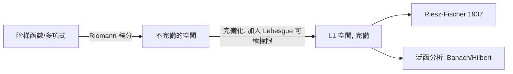

# 5.3 Riemann與Lebesgue積分的比較

## 本章導言

兩種積分並存的時代，必須回答三個問題：**誰涵蓋誰？誰更好用？舊理論還有價值嗎？** 本節給出精確答案。核心是 Lebesgue 在 1902 年論文中證明的判準：一個有界函數在 $[a,b]$ 上 Riemann 可積，**若且唯若**它的不連續點集是零測集。這個定理不僅劃定兩個理論的邊界，更把「Riemann 可積性」從幾何直覺變成測度論命題——舊理論在新框架下獲得了解釋。

### Lebesgue 的可積判準

**定理 5.3.1（Lebesgue 判準, 1902）**：設 $f$ 在 $[a,b]$ 有界。則 $f$ Riemann 可積 $\iff$ $f$ 的不連續點集 $D(f)$ 是（Lebesgue）零測集。

**證明思想**：對 $\varepsilon > 0$ 與 $\delta > 0$ ，定義「振盪超過 $\delta$ 的點集」 $D_\delta$ 。Riemann 上和與下和之差恰為

$$
U - L = \sum_j \omega_j\, \Delta x_j \ \ge\ \delta \cdot (\text{覆蓋 } D_\delta \text{ 的區間總長}),
$$

其中 $\omega_j$ 是第 $j$ 段的振盪。若 Riemann 可積， $U - L$ 可任意小，故 $D_\delta$ 可被總長任意小的開集覆蓋，即 $m^*(D_\delta) = 0$ ；而 $D(f) = \bigcup_{k} D_{1/k}$ 是可數個零測集之並，零測。反方向，把分割取細，使振盪大的段總長 $< \varepsilon$ ，振盪小的段上和下和接近，即得可積。 $\blacksquare$

這個定理的歷史意義：Duhamel（1853）與 Riemann（1854）時代已有人猜測可積性與不連續點的「稀疏性」有關，但「稀疏」需要測度概念才能說清。**Lebesgue 判準是測度論第一次反哺舊理論**——不是取代，而是解釋。

### 兩個理論的系統比較

| 面向 | Riemann | Lebesgue |
|------|---------|----------|
| 切割對象 | 定義域（x 軸） | 值域（y 軸） |
| 可積函數類 | 不連續點零測的有界函數 | 所有合理增長的可測函數 |
| $\chi_{\mathbb{Q}}$ | 不可積 | 可積，積分 $= 0$ |
| 逐點極限 | 可積性可能丟失 | 可測性保持，DCT 保障交換 |
| 逐項積分 | 需一致收斂 | MCT / DCT 直接給 |
| 積分與微分的 Newton–Leibniz | 需要過強假設 | 絕對連續函數上完美（第 7 章） |
| 完備性 | 無自然的 Banach 空間 | $L^p$ 空間完備（第 6 章） |
| 反常積分 | 絕對收斂時相容 | 統一處理 |
| 計算實務 | Newton–Leibniz 公式 | 不變：照舊算 |

最後一行最重要：**Lebesgue 積分沒有改變任何計算**。連續函數的積分兩種理論給同一個值，微積分基本定理照用。改變的是**理論可以安全操作的範圍**。

### 一致收斂枷鎖的解除

**例題 5.3.1**：考慮 $f_n(x) = \sum_{k=1}^{n} \frac{\chi_{[k-1/2, k+1/2]}(x)}{k^2}$ 型，或更經典的：證明在 $[0,1]$ 上 $f_n(x) = x^n$ 的極限交換在 Riemann 框架需額外論證，而 Lebesgue 框架直接通過。

**解**： $f_n \to f$ ，其中 $f(x) = 0$ （ $0 \le x < 1$ ）、 $f(1) = 1$ 。收斂**不是**一致的（在 $1$ 附近 $x^n$ 可超過 $1/2$ ），故 Weierstrass 的逐項積分定理不適用。Riemann 框架的補救：手工驗證 $\int_0^1 x^n dx = \frac{1}{n+1} \to 0 = \int_0^1 f\,dx$ （右端點差一點不影響 Riemann 積分，因為單點零測——用 Lebesgue 語言說的）。Lebesgue 框架： $f_n$ 可測、 $0 \le f_n \le 1$ （ $g \equiv 1$ 在 $[0,1]$ 可積，作為控制），由 DCT 直接得

$$
\lim_n \int_0^1 x^n\,dx = \int_0^1 f\,dm = 0.
$$

每個 Riemann 框架下的「例外的手工處理」，在 Lebesgue 框架下都變成 DCT 的例行公事。這不是單一例子的小勝，而是模式：**十九世紀分析論文中大量「易驗證但繁瑣」的一致收斂檢查，在二十世紀變成了「由 DCT 立得」**。

### 完備化觀點：Lebesgue 是 Riemann 的完備化

現代視角給了兩者關係最漂亮的說法。考慮階梯函數（有限個區間上的常值函數）在 $L^1$ 範數 $\|f\|_1 = \int |f|$ 下的等價類空間 $\mathcal{R}$ 。

**定理 5.3.2**： $\mathcal{R}$ 的 Cauchy 完備化恰好是 $L^1(\mathbb{R})$ 。

也就是說：Lebesgue 積分之於 Riemann 積分，正如 $\mathbb{R}$ 之於 $\mathbb{Q}$ 。這與 1.2 節（Cauchy 序列與完備化）的精神完全平行——**遇到極限運算不完備的空間，就完備化它**。Riemann 積分在「逐點極限」操作下不完備（ $\chi_{\mathbb{Q}}$ 型反例），Lebesgue 恰是把它完備化後得到的對象。這也解釋了為何計算規則不變：完備化不動舊元素，只補新元素。

### 微積分基本定理的分水嶺

Riemann 積分下，Newton–Leibniz 公式 $\int_a^b F' = F(b) - F(a)$ 需要假設 $F'$ 連續（或至少 Riemann 可積）。Volterra 的反例（1881）：存在可微函數 $F$ ， $F'$ 有界，但 $F'$ 不 Riemann 可積——微積分基本定理在 Riemann 框架**有系統性的漏洞**。Lebesgue 框架的答案在第 7 章：Newton–Leibniz 公式對**絕對連續函數**精確成立，而「 $F$ 是某可積函數的不定積分 $\iff$ $F$ 絕對連續」。這是兩個理論在微分學側面的分水嶺，也是第 7 章的主題。

**例題 5.3.2**：Cantor 函數 $F$ （在 Cantor 集上定義三進位到二進位的映射，區間上線性插值）連續、遞增、 $F' = 0$ a.e.。計算 $\int_0^1 F'\,dm$ 並解釋其意義。

**解**： $F' = 0$ a.e.，故 $\int_0^1 F'\,dm = 0$ ，但 $F(1) - F(0) = 1 \ne 0$ 。Newton–Leibniz 公式**失敗**——即使 $F'$ Lebesgue 可積。原因： $F$ 連續遞增但**不**絕對連續（它把零測集 $C$ 映到整個 $[0,1]$ ，違反絕對連續性）。這個例子劃出正確的界線：**Lebesgue 積分修好了可積性問題，但微分學側的完美需要「絕對連續」這個新概念**——第 7 章的出發點。同時注意 $\int_0^1 \chi_{\mathbb{Q}} = 0$ 中 Riemann 積分連函數都裝不下，而這裡函數可積、公式仍敗：兩種失敗的層次不同。

### 更多的交換對照例

**例題 5.3.3**：考慮 $f_n(x) = n\,\chi_{(0, 1/n)}$ 於 $(0,1)$ （5.2 的反例）。說明為何它是「Riemann 逐項積分也失敗、Lebesgue DCT 也擋不住」的極限型反例，並指出哪個定理仍然可用。

**解**： $f_n \to 0$ 逐點， $\int f_n = 1 \ne 0$ 。Riemann 框架：每個 $f_n$ 是階梯函數，可積，但逐項極限需一致收斂（不滿足）。Lebesgue 框架： $|f_n| \le g$ 的可積控制不存在（5.2 例題 5.2.3），DCT 不適用。**但** Fatou 引理仍然可用： $\int \liminf f_n = 0 \le \liminf \int f_n = 1$ ，不等號嚴格，恰是 Fatou 預測的「質量損失」型失敗。教訓：當交換失敗時，用 Fatou 檢驗「失敗的方向」是否與理論一致——這是診斷反例的標準手法。

**例題 5.3.4**：證明 Riemann 可積函數（有界）必 Lebesgue 可積，且積分值相等。

**解**：Riemann 可積 ⟹ 不連續點集零測（Lebesgue 判準）⟹ $f$ 可測（不連續點集可測，連續點集 = 可數個開集之並與閉集之交的補）；有界 ⟹ $|f| \le M$ 於有限測度區間 ⟹ $\int |f| \le M(b-a) < \infty$ ，故 $f \in L^1$ 。積分值相等：對 Riemann 達布和的分割，Lebesgue 積分介於下和與上和之間（單調性），令分割加細即得相等。 $\blacksquare$

### 一個整合例題：兩個世界的同一道題

**例題 5.3.5**：證明 $\displaystyle \lim_{n\to\infty} \int_0^1 \frac{nx}{1 + n^2x^2}\,dx = 0$ ，並比較三種證明路線的成本。

**解**：被積函數 $f_n(x) = \frac{nx}{1+n^2x^2}$ 滿足 $f_n(x) \to 0$ 逐點（ $x > 0$ ； $x = 0$ 處恆為 $0$ ）。但 $\int_0^1 f_n = \frac{1}{2n}\ln(1+n^2) \to 0$ （顯式積分）。逐點極限的積分與積分的極限都為 $0$ ，交換成立。

- **Riemann 路線**：顯式計算（如上），無需理論——但對更複雜的 $f_n$ 顯式積分往往不存在。
- **DCT 路線**： $|f_n(x)| \le \frac{nx}{2nx} = \frac12$ （AM–GM： $1 + n^2x^2 \ge 2nx$ ）——控制函數 $g \equiv 1/2$ 在 $[0,1]$ 可積，DCT 一行結束。
- **啟示**：常數控制常常就藏在 AM–GM 型不等式裡；「找控制」的訓練是把 DCT 變成條件反射的關鍵。

### 計算層面的橋樑：數值積分為何不用改

嚴格理論升級後，實際計算完全不受影響，這一點值得正式說明：

**定理 5.3.3**：若 $f$ 在 $[a,b]$ 連續，則 Riemann 積分存在，且 Lebesgue 積分 $\int_{[a,b]} f\,dm$ 與 Riemann 積分相等；Newton–Leibniz 公式在兩個框架中同樣成立。

**證明思想**：連續函數的不連續點集為空（零測），由 Lebesgue 判準 Riemann 可積；積分值相等由達布和與簡單函數逼近的比較（兩者都夾在相同的下界與上界之間）。 $\blacksquare$

這就是為什麼 Simpson 法則、Gauss 求積、以及所有工程數值方法在 1902 年之後**一行都不用改**。Lebesgue 的革命是「許可證制度」的革命——允許理論處理更廣的函數類、更自由的極限交換——而不是計算方法的革命。教學上也因此可以理直氣壯：初等微積分教「怎麼算」，實變函數教「為什麼永遠合法」。

### 舊理論的遺產

Riemann 積分沒有被丟棄，它有三個持續的生命：

1. **計算工具**：所有實際計算仍在 Riemann/Newton 框架下進行；Lebesgue 積分是理論護照，不是計算方法。
2. **Stieltjes 推廣**：Riemann–Stieltjes 積分（第 7.3 節）在離散測度與分佈理論中不可或缺。
3. **教育價值**：「切割定義域」的幾何直覺仍是入門的第一課，Lebesgue 的「切割值域」需要測度論打底才能講清楚。

### 與其他章節的關聯

- **承 5.1、5.2**：本節的判準用到了可測性與零測集理論；DCT 在例題中反覆登場。
- **啟第 6 章**：完備化觀點直接引出 $L^p$ 空間；Riemann 可積函數在 $L^1$ 範數下的等價類稠密於 $L^1$ ，是許多證明「先對連續/階梯函數做、再逼近」策略的根據。
- **啟第 7 章**：Cantor 函數與絕對連續性——積分理論完善後，微分理論的修補工程才開始。
- **泛函分析**： $\mathcal{R}$ 的完備化是 Banach 空間完備化（1.2 的方法論）在函數空間上的第一次重大勝利。

### 本節要點

1. Lebesgue 判準：Riemann 可積 $\iff$ 不連續點集零測——舊理論被新框架解釋而非拋棄。
2. Lebesgue 嚴格涵蓋 Riemann（有界情形），且對極限運算封閉。
3. 完備化觀點： $L^1$ 是 Riemann 積分世界在 $L^1$ 範數下的 Cauchy 完備化，平行於 $\mathbb{R}$ 之於 $\mathbb{Q}$ 。
4. Cantor 函數顯示積分的完善不等於微積分基本定理成立——需要絕對連續性。
5. 計算不變、理論升級：Lebesgue 積分的革命是**範圍**的革命，不是**算法**的革命。
