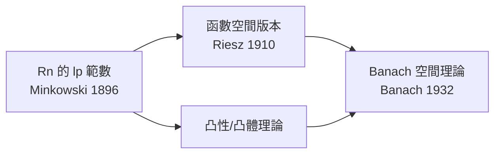

# 6.1 Lp範數與HölderMinkowski不等式

## 本章導言

有了 Lebesgue 積分（第 5 章），可以問一個自然的問題：**把「函數的大小」量出來**。十九世紀已經有零星嘗試——Chebyshev（1882）在機率論中用均方誤差衡量近似，Hölder 與 Minkowski 在數論與幾何中研究類似的不等式——但只有在 Lebesgue 積分的框架下，「 $\int |f|^p$ 有限」才能成為一個穩定的空間概念。1900 年前後，Fredholm 的積分方程理論與 Hilbert 學派的二次型研究，都迫切需要一個「函數的長度」。本節定義 $L^p$ 範數，證明三個支撐性不等式（Hölder、Minkowski、Young），為下一節的完備性鋪路。

### 歷史驅動：積分方程的壓力

1900 年前後，積分方程成為數學的核心問題：

- **Fredholm（1900–1903）**：研究 $\varphi(x) - \lambda \int K(x,y)\varphi(y)\,dy = f(x)$ ；
- **Hilbert（1904–1910）**：以二次型與譜理論重攻同類問題；
- **Riesz（1910）**：發表《Untersuchungen über Systeme integrierbarer Funktionen》，系統建立 $L^p$ 理論，Hölder 不等式與對偶性首次以現代形式出現。

Fredholm–Hilbert 的方法只覆蓋平方可積（ $p=2$ ）情形；Riesz 的問題是：**積分方程在一般的 $p$ 下會怎樣？** 答案需要一般 $p$ 的三角不等式，而這正是 Minkowski 早年（學生時代為 Geometrie der Zahlen 所做）工作在函數空間的翻版。Minkowski 於 1909 年去世，其《幾何數論》於 1910 年出版；他的凸體思想在 $L^p$ 的單位球上獲得無限維的迴響。

### Lp 空間的定義

**定義 6.1.1**：設 $1 \le p < \infty$ 。定義

$$
\|f\|_p = \left( \int |f|^p\,dm \right)^{1/p}, \qquad L^p = \{ f \text{ 可測} : \|f\|_p < \infty \},
$$

其中把 a.e. 相等的函數視為同一元素。 $L^\infty$ 則取本質上確界 $\|f\|_\infty = \inf\{M : |f| \le M \text{ a.e.}\}$ 。

兩個約定的必要性：
- **a.e. 等價類**：若 $f = g$ a.e. 則 $\|f\|_p = \|g\|_p$ ，故只有等價類上的范數才良定（依賴 4.3 的等價觀念與 5.1 的「積分為零 ⟺ a.e. 為零」）。
- ** $p \ge 1$ **： $\|\cdot\|_p$ 在 $p < 1$ 時不滿足三角不等式（ $L^{1/2}$ 中 $\|1\| + \|1\| \ne \|1+1\|$ 的計算可證），故 $p \ge 1$ 是「範數」的資格線。

### Young 不等式：一切的起點

**定理 6.1.2（Young 不等式）**： $1 < p < \infty$ ，記 $q$ 為共軛指數（ $\frac1p + \frac1q = 1$ ）。則對 $a, b \ge 0$ ：

$$
ab \le \frac{a^p}{p} + \frac{b^q}{q}.
$$

**證明**： $\log$ 是凸函數，故 $\log\left(\frac{a^p}{p} + \frac{b^q}{q}\right) \ge \frac1p \log a^p + \frac1q \log b^q = \log(ab)$ ；或幾何地： $ab$ 是曲線 $y = x^{p-1}$ 下的矩形面積，被兩塊積分面積 $\frac{a^p}{p}$ （橫向積）與 $\frac{b^q}{q}$ （縱向積）覆蓋。 $\blacksquare$

**例題 6.1.1**：取 $p = q = 2$ ，證明對任意 $a, b$ ： $ab \le \frac{a^2+b^2}{2}$ ，並解釋這就是 $L^2$ 中 Cauchy–Schwarz 的「逐點版本」。

**解**： $(a-b)^2 \ge 0$ 展開即得 $2ab \le a^2 + b^2$ 。這正是「平方平均大於等於算術平均」的二變數情形。把逐點乘積 $|f g|$ 對整個空間積分、用積分的凸性與縮放技巧，就會爬升到 Hölder 不等式——數值不等式與函數不等式之間隔著的只是「積分化」與「縮放歸一化」兩步。

### Hölder 不等式

**定理 6.1.3（Hölder 不等式, Riesz 1910 的函數形式）**： $f \in L^p$ 、 $g \in L^q$ （ $\frac1p + \frac1q = 1$ ），則 $fg \in L^1$ 且

$$
\int |fg|\,dm \le \|f\|_p\, \|g\|_q.
$$

**證明思想**：先做**縮放歸一化**——不妨設 $\|f\|_p = \|g\|_q = 1$ （否則以 $f/\|f\|_p$ 、 $g/\|g\|_q$ 替換，兩邊同比例縮放）。對每個 $x$ 用 Young 不等式：

$$
|f(x)g(x)| \le \frac{|f(x)|^p}{p} + \frac{|g(x)|^q}{q}.
$$

兩邊積分：右邊 $= \frac{\|f\|_p^p}{p} + \frac{\|g\|_q^q}{q} = \frac1p + \frac1q = 1$ 。 $\blacksquare$

$p = 2$ 時退化為 Cauchy–Schwarz–Buniakowski 的積分版本（Buniakowski 1859 已對 Riemann 積分證明）， $p=1$ 時為 $|fg| \le \|f\|_1 \|g\|_\infty$ 的平凡情形。Hölder 1889 年的原版是有限和的不等式；Riesz 的貢獻是認出它是**對偶性**的表達： $L^q$ 的元素是 $L^p$ 上的連續線性泛函（ $p = 1$ 之外的完全刻畫由 Riesz 表示定理完成）。

### Minkowski 不等式

**定理 6.1.4（Minkowski 不等式）**： $f, g \in L^p$ （ $1 \le p < \infty$ ），則 $f + g \in L^p$ 且

$$
\|f + g\|_p \le \|f\|_p + \|g\|_p.
$$

**證明思想**： $p = 1$ 是積分的次可加性。 $p > 1$ 時寫

$$
|f+g|^p \le (|f| + |g|)^p = (|f|+|g|)^{p-1}|f| + (|f|+|g|)^{p-1}|g|,
$$

對右邊兩項分別用 Hölder（注意 $\frac{1}{p/(p-1)} + \frac1p = 1$ ，共軛指數是 $p$ 與 $q = p/(p-1)$ ）：

$$
\int (|f|+|g|)^{p-1}|f| \le \|(|f|+|g|)^{p-1}\|_q \,\|f\|_p = \|f+g\|_p^{p/q}\, \|f\|_p.
$$

兩項相加，兩邊同除 $\|f+g\|_p^{p/q}$ ，用 $p - p/q = 1$ 收尾。 $\blacksquare$

Minkowski 不等式正是 $L^p$ 是「賦范空間」的最後一塊拼圖。**定理的邏輯依賴順序值得注意**：Young → Hölder → Minkowski → 三角不等式 → 下一節的完備性。沒有 Lebesgue 積分的線性與單調性，整條鏈都接不起來。

### 例題：計算與估計

**例題 6.1.2**：在 $[0,1]$ 上比較 $\|f\|_1$ 、 $\|f\|_2$ 、 $\|f\|_\infty$ 對 $f(x) = x^{-1/2}$ 的值，並判斷 $f$ 屬於哪些 $L^p$ 。

**解**： $\int_0^1 x^{-1/2} dx = 2$ ，故 $f \in L^1$ ， $\|f\|_1 = 2$ 。

$$
\|f\|_2^2 = \int_0^1 x^{-1} dx = \infty \implies f \notin L^2.
$$

$\|f\|_\infty = \infty$ 。結論： $f \in L^1$ 但 $f \notin L^2$ ， $f \notin L^\infty$ 。注意反過來在有限測度空間上 $L^2 \subset L^1$ （用 Hölder： $\|f\|_1 = \int |f| \cdot 1 \le \|f\|_2 \sqrt{m([0,1])}$ ）。**測度有限時高冪空間更小；測度無限時關係反轉**——在 $\mathbb{R}$ 上 $f \in L^1$ 不蘊含 $f \in L^2$ （尖峰函數 $n\chi_{[0,1/n^3]}$ 是反例： $\|f\|_1 \to 0$ 而 $\|f\|_2 \to \infty$ ）。

**例題 6.1.3**：用 Hölder 不等式估計 $\left| \int_0^1 f(x)\,dx \right|$ 上界（ $f \in L^2$ ）。

**解**： $\left|\int_0^1 f \cdot 1\,dx\right| \le \|f\|_2 \cdot \|1\|_2 = \|f\|_2 \cdot 1 = \|f\|_2$ 。這說明「積分泛函」 $f \mapsto \int_0^1 f$ 是 $L^2[0,1]$ 上範數為 $1$ 的連續線性泛函——泛函分析（第 6.3 節的 Hilbert 空間對偶）的起點操作。

### 幾何直覺與凸性

Minkowski 不等式的幾何身世：在 $\mathbb{R}^n$ 中， $\left(\sum |x_i|^p\right)^{1/p}$ 是向量長度的推廣（Minkowski 幾何、相對論中的 Minkowski 時空同名同源——同一個人）。 $L^p$ 把有限維的橫坐標加總換成積分，把凸體理論投射到無限維：

$p = 2$ 的單位球是真正的「球」（由內積誘導，見 6.3）； $p \ne 2$ 的單位球凸但不「圓滑對稱」。這個差別決定了 $L^2$ 是 Hilbert 空間而其他 $L^p$ 只是 Banach 空間。

### 與其他章節的關聯

- **承第 5 章**： $\|f\|_p$ 的良定性依賴「積分為零 ⟺ a.e. 為零」與積分的線性；Hölder 的證明靠積分的單調性。
- **啟 6.2**：完備性證明用 Hölder 檢驗 Cauchy 列的確收斂到 $L^p$ 元素。
- **啟 6.3**： $p=2$ 的特殊地位——內積存在，Hilbert 空間誕生。
- **機率論**： $\|X\|_p = (\mathbb{E}|X|^p)^{1/p}$ 是動差；Hölder 不等式給出 $\mathbb{E}|XY| \le (\mathbb{E}|X|^p)^{1/p}(\mathbb{E}|Y|^q)^{1/q}$ ，是證明 Lyapunov 不等式與大數定律的標準工具。
- **傅立葉分析**：Hausdorff–Young 不等式把 Fourier 變換的 $L^p$ 映射性質直接建在 Hölder 不等式上。

### 本節要點

1. $L^p$ 的元素是 a.e. 等價類； $p \ge 1$ 才有三角不等式。
2. Young → Hölder → Minkowski 的依賴鏈；縮放歸一化是 Hölder 證明的關鍵手法。
3. 有限測度上 $L^p$ 隨 $p$ 增大而收縮；無限測度上無包含量關係。
4. Riesz 1910 年把 Hölder 不等式從數值工具升級為對偶性理論。
5. $p = 2$ 獨一無二：只有它來自內積——下一節的主角。
