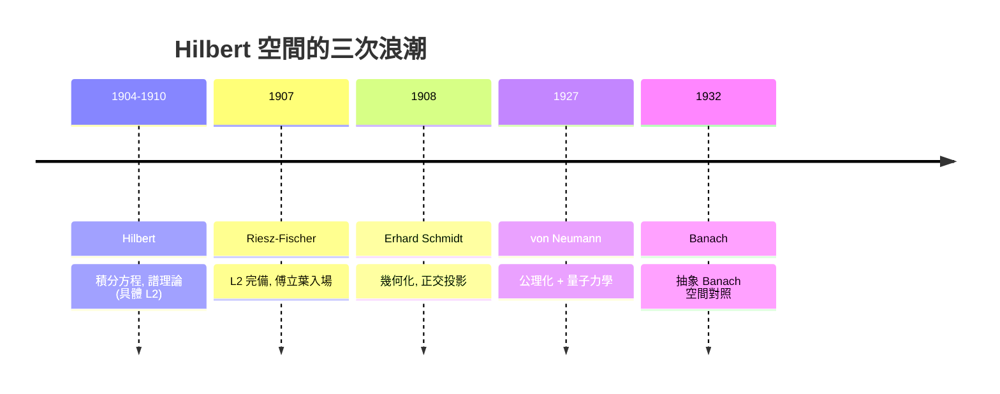

# 6.3 L2與希爾伯特空間

## 本章導言

$p = 2$ 在 $L^p$ 家族中是異數：只有它允許定義**內積**

$$
\langle f, g \rangle = \int f\, \overline{g}\, dm,
$$

而 $\|f\|_2 = \sqrt{\langle f, f\rangle}$ 。內積帶來角度、正交、投影——歐氏幾何的全套直覺可以搬進無限維。**David Hilbert**（1862–1943）在 1904–1910 年的積分方程系列論文中，以「無限維二次型」的形式發展出這個空間的譜理論；**Erich Schmidt**（1908）引入幾何語言（正交、夾角）；**John von Neumann**（1927）在量子力學壓力下給出抽象 Hilbert 空間的公理化。本節講 $L^2$ 如何成為一切 Hilbert 空間的原型。

### 歷史：從積分方程到量子力學

驅動鏈非常清晰：

Hilbert 研究積分方程時把 $[a,b]$ 切成有限段，把積分方程變成 $n$ 元線性方程組，再讓 $n \to \infty$ 。他發現二次型 $\sum a_{ij} x_i x_j$ 的特徵值理論在極限下依然成立——彷彿存在一個「無限維的 $\mathbb{C}^n$ 」。von Neumann 1927 年的公理化則是被量子力學逼出來的：Heisenberg 的矩陣力學與 Schrödinger 的波函數是**同一個數學對象的兩種表象**，只有 Hilbert 空間語言能把兩者統一（狀態 = 向量，觀測量 = 自伴算子）。

### 內積空間的公理與幾何

**定義 6.3.1**：複（或實）向量空間 $H$ 配內積 $\langle \cdot, \cdot \rangle$ ，滿足：共軛對稱、第一變元線性、正定（ $\langle f, f \rangle = 0 \iff f = 0$ ）。若 $\|\cdot\| = \sqrt{\langle \cdot, \cdot \rangle}$ 之下完備，稱 **Hilbert 空間**。

$L^2$ 的內積給出範數 $\|f\|_2 = \left( \int |f|^2 \right)^{1/2}$ ，完備性由 Riesz–Fischer（6.2）保證，故 $L^2$ 是 Hilbert 空間。

**內積的基本恆等式**：

1. **Cauchy–Schwarz**： $|\langle f, g\rangle| \le \|f\| \|g\|$ （Hölder 的 $p = q = 2$ 情形）。
2. **平行四邊形恆等式**： $\|f + g\|^2 + \|f - g\|^2 = 2\|f\|^2 + 2\|g\|^2$ 。
3. **極化恆等式**： $\langle f, g \rangle = \frac{1}{4} \sum_{k=0}^{3} i^k \|f + i^k g\|^2$ ——內積可由範數重建。

第 2、3 條有深刻的判準意義：**一個範數來自內積，若且唯若它滿足平行四邊形恆等式**（Jordan–von Neumann, 1935）。這說明 $p \ne 2$ 的 $L^p$ 絕不可能有內積（取兩個不交支集特徵函數直接驗算即知恆等式失敗）。 $L^2$ 的獨特性由此精確化。

### 正交性與投影定理

**定義 6.3.2**： $\langle f, g \rangle = 0$ 稱 $f \perp g$ 。集合 $\{e_n\}$ 為**正交規範系**（orthonormal）若 $\langle e_m, e_n \rangle = \delta_{mn}$ 。

**定理 6.3.3（正交分解 / 投影定理）**： $M \subseteq H$ 是閉線性子空間，則每個 $f \in H$ 可**唯一**寫成

$$
f = m + m^\perp, \qquad m \in M,\ m^\perp \in M^\perp.
$$

**證明思想**：取 $m \in M$ 最小化 $\|f - x\|$ （ $x \in M$ ）。存在性用變分法：取極小化序列 $\{x_n\}$ ，由平行四邊形恆等式證它是 Cauchy 列，再用完備性與閉性得極限 $m \in M$ 。最佳性條件化為 $\langle f - m, x \rangle = 0$ 對所有 $x \in M$ 。唯一性由正交分解的線性代數論證。 $\blacksquare$

投影定理是 Hilbert 空間的靈魂定理：**最佳逼近 = 垂直投影**。 $p \ne 2$ 的 Banach 空間中最佳逼近存在性一般要靠緊性且不唯一，投影的正交性概念根本不存在。

**定理 6.3.4（Bessel 與 Parseval）**： $\{e_n\}$ 正交規範系， $f \in L^2$ ：

$$
\text{(Bessel)} \quad \sum_n |\langle f, e_n \rangle|^2 \le \|f\|^2; \qquad \text{(Parseval)} \quad f = \sum_n \langle f, e_n\rangle e_n \iff \sum_n |\langle f, e_n\rangle|^2 = \|f\|^2.
$$

**證明思想**：Bessel 由 $\| f - \sum_{n \le N} \langle f, e_n\rangle e_n \|^2 \ge 0$ 展開；Parseval 當系完備（ $\{e_n\}$ 的線性組合稠密）時等號成立。這是 6.2 例題（傅立葉係數實現）的幾何化重述。

### 例題：把函數變成向量

**例題 6.3.1**：在 $L^2[-\pi, \pi]$ 上取 $e_0 = \frac{1}{\sqrt{2\pi}}$ 、 $e_n^{c} = \frac{\cos nx}{\sqrt{\pi}}$ 、 $e_n^{s} = \frac{\sin nx}{\sqrt{\pi}}$ 。驗證這是正交規範系，並計算 $f(x) = x$ 的前三個係數。

**解**：正交性由三角恆等式直接驗算：

$$
\int_{-\pi}^{\pi} \sin nx \sin mx\, dx = \pi\, \delta_{nm}, \quad \int_{-\pi}^{\pi} \cos nx \cos mx\, dx = \pi\, \delta_{nm}, \quad \int_{-\pi}^{\pi} \sin nx \cos mx\,dx = 0.
$$

除以 $\sqrt{\pi}$ 得規範性。 $f(x) = x$ 的係數（ $f$ 是奇函數，餘弦係數為零）：

$$
\langle f, e_n^s \rangle = \frac{1}{\sqrt{\pi}} \int_{-\pi}^{\pi} x \sin nx\, dx = \frac{2}{\sqrt{\pi}} \cdot \frac{(-1)^{n+1}\pi}{n} = \frac{2(-1)^{n+1}\sqrt{\pi}}{n}.
$$

Parseval： $\frac{2\pi^2}{\sum_n 1/n^2}$ 型驗算給出 $\sum_{n=1}^\infty \frac{1}{n^2} = \frac{\pi^2}{6}$ ——**Basil 問題（Basel problem，Euler 1735）成為 Parseval 恆等式的直接推論**。十九世紀要靠 Euler 的天才計算，二十世紀只要讀出幾何。

**例題 6.3.2（投影）**：求 $x^2$ 在 $\text{span}\{1, x\}$ （於 $L^2[-1,1]$ ）上的最佳平方逼近。

**解**： $M = \text{span}\{1, x\}$ 是閉子空間。由對稱性， $x^2 - (a + bx)$ 的最佳逼近中 $b = 0$ （奇函數 $x$ 與偶函數正交，交叉項消失）。解正交條件 $\langle x^2 - a, 1 \rangle = 0$ ：

$$
\int_{-1}^1 (x^2 - a)\,dx = \frac{2}{3} - 2a = 0 \implies a = \frac13.
$$

即 $x^2$ 的最佳線性逼近是常函數 $\frac13$ ，誤差 $\|x^2 - \frac13\|_2^2 = \int (x^2-\frac13)^2 = \frac{4}{45}$ 。這正是**最小平方法**（Legendre 1805、Gauss 1809）的 Hilbert 空間形式：迴歸 = 正交投影。

### 對偶性：Riesz 表示定理

**定理 6.3.5（Riesz 表示定理, 1907）**：Hilbert 空間 $H$ 上的每個連續線性泛函 $T$ 都**唯一**由一個向量表示：存在 $g \in H$ 使

$$
T(f) = \langle f, g \rangle \quad \forall f, \qquad \|T\| = \|g\|.
$$

**證明思想**： $T \ne 0$ 時核 $\ker T$ 是閉超平面，取 $h \perp \ker T$ ， $g = \overline{T(h)} h / \|h\|^2$ 即可；唯一性由 $\langle f, g \rangle = 0\ \forall f \implies g = 0$ 。 $\blacksquare$

這個定理使 $H^* \cong H$ ：**Hilbert 空間是自對偶的**。 $L^2$ 中，它意味著每個泛函都是「與某個函數作內積」。Riesz 正是從這個定理出發（同一篇 1907 年論文！）走向 6.2 的完備性——兩者本是同一研究的兩面。對比一般 $L^p$ ：對偶是 $L^q$ 而非自身，只有 $p = 2$ 自我配對，這又是 $L^2$ 特殊性的體現。

### 算子初窺與量子力學

$L^2$ 上的線性算子（積分算子 $(Tf)(x) = \int K(x, y) f(y)\,dy$ 、微分算子）構成 Hilbert 空間理論的主戰場：譜定理、緊算子、自伴算子。物理的語言：

- 狀態 = $L^2(\mathbb{R}^3)$ 中的單位向量（波函數， $\|f\|_2 = 1$ ）；
- 位置/動量/能量 = 自伴算子；測量值分佈由譜理論給出；
- $|\langle f, g \rangle|^2$ = 轉移振幅的模方。

von Neumann 的統一之所以可能，正因為 $L^2$ 與 $\ell^2$ （平方可和數列空間）同構：**取定一組完備正交規範系，Hilbert 空間的幾何與「坐標」無關**。這個「座標無關性」是無限維幾何相對於矩陣理論的真正躍遷。

### 與其他章節的關聯

- **承 6.1、6.2**：內積誘導的範數滿足全部 $L^2$ 性質；完備性（6.2）是 Hilbert 空間定義的一部分。
- **傅立葉分析**： $\{e^{inx}\}$ 是完備正交規範系；Fourier 級數 = 在該系下的正交展開；Plancherel 定理 = Parseval 在 Fourier 變換上的形式（第 10 章）。
- **機率論**：均值为零的隨機變數構成 Hilbert 空間，內積 = 協方差；正交 = 不相關；投影 = 條件期望（第 9.3 節將用它定義條件期望！）。
- **微分方程**：特徵函數展開（Sturm–Liouville 理論）= 在自伴算子特徵系下的正交展開，是譜定理的應用。

### 本節要點

1. $L^2$ 是唯一自對偶的 $L^p$ ；平行四邊形恆等式是內積存在的精確判準。
2. 投影定理：閉子空間上的最佳逼近 = 正交投影，唯一且完備性保證存在。
3. Bessel/Parseval：正交展開的能量守恆；Euler 的 Basel 問題成為幾何推論。
4. Riesz 表示定理： $H^* \cong H$ ，自對偶性使幾何與分析完全互通。
5. 量子力學的數學語言就是 $L^2$ 的譜理論——von Neumann 1927 年的公理化不是裝飾，是物理必需。
