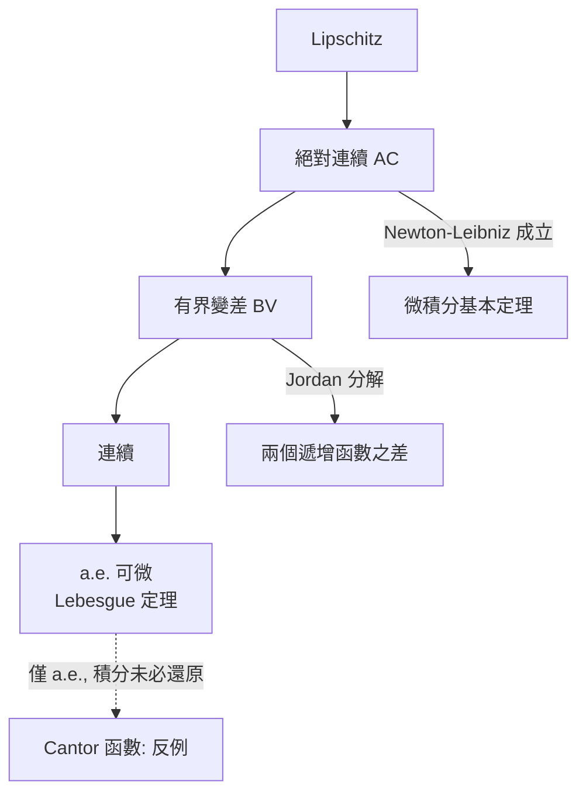

# 7.2 有界變差函數與JORDAN分解

## 本章導言

絕對連續性（7.1）是「好到能寫成不定積分」的條件，但要證明一般定理，我們需要一個更基礎的函數類：**總振盪有限的函數**。Camille Jordan（1838–1922）在 1881 年的論文《Sur la série de Fourier》中為了研究傅立葉級數的收斂，引入了**有界變差**（bounded variation）概念與著名的 **Jordan 分解**：任何有界變差函數都是兩個遞增函數之差。這是本書反覆出現的主題的又一實例——**分解定理**（正負部、Jordan 分解、Hahn 分解、Lebesgue 分解）是分析學的通用武器。本節同時為 7.1 的證明補上最後一塊：絕對連續函數的有界變差性。

### 歷史：傅立葉級數收斂的 Drive

Dirichlet 1829 年證明：分段單調函數的傅立葉級數逐點收斂。Jordan 1881 年的問題：**單調性可以放寬到什麼程度？** 他的答案：放寬到「總變差有限」——即兩個遞增函數之和的型態。Jordan 分解由此誕生，而它的第一個應用是 **Jordan 判準**：有界變差函數的傅立葉級數在連續點收斂到函數值平均 $(f(x^+) + f(x^-))/2$ 。

值得注意的是 Jordan 同一本時期的著作也奠定了集合論進入分析的路（Jordan 可測集，4.1 節的主角）。他在兩個戰場上的工具——「有限分割」——都將被可數版本取代（Lebesgue 測度、Hahn 分解），但概念骨架留存至今。

### 有界變差的定義

**定義 7.2.1**： $F: [a,b] \to \mathbb{R}$ ，對分割 $P: a = x_0 < x_1 < \cdots < x_n = b$ 定義

$$
V(F, P) = \sum_{k=1}^{n} |F(x_k) - F(x_{k-1})|,
$$

**全變差**為

$$
V_a^b(F) = \sup_P V(F, P).
$$

若 $V_a^b(F) < \infty$ ，稱 $F$ **有界變差**（bounded variation, BV）。全體記為 $BV[a,b]$ 。

**例題 7.2.1**：計算 (a) $F(x) = x$ 、(b) $F(x) = \sin(2\pi x / (b-a))$ 、(c) Cantor 函數、(d) $\chi_{\mathbb{Q}\cap[0,1]}$ 於 $[0,1]$ 的全變差。

**解**：
- (a) 任何分割的變差和 $= \sum \Delta x_k = 1$ ，故 $V_0^1 = 1$ 。
- (b) 取分割在波峰波谷取樣： $V = 4$ （兩個完整波，每個振幅 $2$ ）。
- (c) 遞增函數： $V = F(1) - F(0) = 1$ 。**Cantor 函數有界變差但非絕對連續**——BV 嚴格大於 AC。
- (d) 取有理、無理交錯取樣點，變差和可達 $n$ （ $n$ 為取樣點數），無界 ⟹ 無界變差。

**基本性質**： $BV$ 是向量空間， $\|F\|_{BV} = |F(a)| + V_a^b(F)$ 使其成為 Banach 空間； $V_a^b(F - G) \le V(F) + V(G)$ ；且**連續函數未必有界變差**（ $x \sin(1/x)$ 的全變差發散，可自 $1/k$ 型取樣點驗證）。

### Jordan 分解定理

**定理 7.2.2（Jordan, 1881）**： $F$ 有界變差 $\iff$ $F = F_1 - F_2$ ，其中 $F_1, F_2$ 遞增。更精確地，定義

$$
P(x) = \sup\left\{ \sum_k (F(x_k) - F(x_{k-1}))^+ \right\}, \quad N(x) = \sup\left\{ \sum_k (F(x_k) - F(x_{k-1}))^- \right\},
$$

（分別是正變差與負變差的累積），則 $F(x) = F(a) + P(x) - N(x)$ ，且

$$
V_a^b(F) = P(b) + N(b).
$$

**證明思想**：對每個分割， $\sum \Delta F_k = F(b) - F(a) = \sum (\Delta F_k)^+ - \sum (\Delta F_k)^-$ ，且變差 $= \sum |\Delta F_k| = \sum(\Delta F_k)^+ + \sum(\Delta F_k)^-$ 。故「正總和」與「負總和」都 $\le V(F)$ ，取上確界定義 $P, N$ 後驗證： $P + N = V$ （用分割的公共加細同時逼近兩個上確界）， $P - N = F(b) - F(a)$ （變號恆等式取極限）。把上確界的分割端點移動到 $x$ 即得兩個遞增函數 $P(x), N(x)$ 。 $\blacksquare$

**最小性**：若 $F = G_1 - G_2$ 是任何遞增分解，則 $P \le G_1$ 、 $N \le G_2$ ——Jordan 分解是**最小**的遞增分解，這在測度論對應物（Hahn 分解）中同樣成立。

### 遞增函數的微分化：Lebesgue 的勝利

Jordan 分解把一般問題化歸到遞增函數。對遞增函數 $G$ ：

**定理 7.2.3（Lebesgue, 1904）**：遞增函數 $G$ a.e. 可微，且 $G' \ge 0$ 可積。

**證明思想**：證明上導數有限的點集是全集（除零測集）。定義 $E_n = \{ x : D^+G(x) > n \}$ 型集合，用「遞增函數的像集不會太膨脹」的測度估計（ $G$ 把長 $\ell$ 的區間映成長 $\ge \ell \cdot n$ 的像時出現矛盾）逐一排除。這個「遞增函數的膨脹估計」是覆蓋引理的前身。 $\blacksquare$

於是完整的微分學圖景：

$$
\text{遞增} \xrightarrow{\text{Jordan}} \text{BV} \xrightarrow{\text{分解}} \text{a.e. 可微} \xrightarrow{\text{絕對連續時}} \text{Newton–Leibniz}.
$$

BV 函數全部 a.e. 可微（分解 + 定理 7.2.3），但**只有** AC 部分恢復微積分基本定理。

### 測度論的 Jordan 分解：Hahn 分解

Jordan 分解在測度論中的對應物是：

**定理 7.2.4（Hahn 分解, 1921）**：符號測度 $\nu$ （可取負值的可數可加函數）存在分解 $\nu = \nu^+ - \nu^-$ ，其中 $\nu^+ = \nu|_{P}$ 、 $\nu^- = -\nu|_{N}$ ，而 $X = P \sqcup N$ 是某個「正集/負集」分割（Hahn 分解）。

**證明思想**：對 $\nu^+(A) = \sup\{\nu(B): B \subseteq A\}$ 型定義（與 Jordan 的 $P, N$ 完全平行）驗證可數可加性；最優性與 7.2.2 的最小性同構。函數版本的推論： $F \in BV$ 誘導符號測度 $\mu_F$ ，其 Jordan 測度分解恰由 $F$ 的 Jordan 函數分解生成。**函數論與測度論在這裡完全同構**——這種「翻譯」正是 Lebesgue 之後實變的標誌性方法。

### 例題

**例題 7.2.2**：求 $F(x) = x^2 \chi_{[0,1]}(x) - x \chi_{(1,2]}(x)$ 在 $[0,2]$ 的 Jordan 分解與全變差。

**解**： $F$ 在 $[0,1]$ 遞增（ $x^2$ ，變化 $0 \to 1$ ），在 $(1,2]$ 遞減（ $-x$ ，變化 $-1 \to -2$ ，函數值從 $-1$ 降到 $-2$ ）。遞增部分 $F_1$ 、遞減部分 $F_2$ ：

$$
F = \underbrace{x^2 \chi_{[0,1]} + 1\cdot \chi_{(1,2]}}_{F_1 \text{ 遞增}} - \underbrace{(x + 1)\chi_{(1,2]}}_{F_2 \text{ 遞增}} \quad \text{（驗證: } F_1 - F_2 = x^2 \text{ 於 } [0,1], -x \text{ 於 } (1,2]\text{）}.
$$

全變差 $= |F(1) - F(0)| + |F(2) - F(1)| = 1 + 1 = 2$ （單調段上的變差就是端點差）。負變差 $N(2) = 1$ ，正變差 $P(2) = 1$ ， $P + N = 2 = V$ 。✓

**例題 7.2.3**：證明 $\sin\frac{1}{x}$ （ $x \in (0, 1]$ ，補定義 $F(0) = 0$ ）不是有界變差，因此其傅立葉級數的 Jordan 判準不適用。

**解**：取取樣點 $x_k = \frac{2}{(2k+1)\pi}$ （函數值交錯取 $\pm 1$ ）， $k = 1, \dots, n$ ，排成遞增分割，變差和

$$
\sum_{k=1}^{n-1} |F(x_{k+1}) - F(x_k)| = 2(n-1) \to \infty.
$$

故 $V_0^1 = \infty$ 。此函數在 $[0,1]$ 連續——再次強調 **連續 ⇏ BV ⇏ AC** 的嚴格階梯。

### 階梯總結

每條箭頭都嚴格（反例已在本節與 7.1 給出）。這張圖是一維實變微分學的完整地圖。

### 與其他章節的關聯

- **承 7.1**：絕對連續 ⟹ 有界變差（用定義直接驗證），故 7.1 的一般證明可先 Jordan 分解再化歸遞增情形。
- **承 5.3、4.2**：Cantor 函數在 BV 中但不在 AC 中，是階梯圖的關鍵節點。
- **啟 7.3**：BV 函數誘導 Stieltjes 測度；Stieltjes 積分 $\int f\,dF$ 正是「對這個測度積分」。
- **啟 8.3**：Hahn 分解是 Radon–Nikodym 定理證明的第一塊基石。
- **傅立葉分析**：Jordan 判準至今是實用收斂判準；BV 函數的 Fourier 係數 $\hat f(n) = O(1/n)$ 。
- **現代應用**：影像處理的 ROF 模型以 $\|u\|_{BV}$ 為正則項（全變差去噪），BV 空間在二十一世紀反而更活躍。

### 本節要點

1. 全變差 = 依分割取樣的總振盪之上確界；BV 是「總振盪有限」的函數類。
2. Jordan 分解： $F = P - N$ ，最小遞增分解， $V = P + N$ 。
3. BV 全體 a.e. 可微（Lebesgue 1904）；但 Newton–Leibniz 只有 AC 才成立。
4. Hahn 分解是 Jordan 分解的測度論同構物。
5. 階梯 Lipschitz ⊋ AC ⊋ BV ⊋ 連續，每一步都有標本反例。
