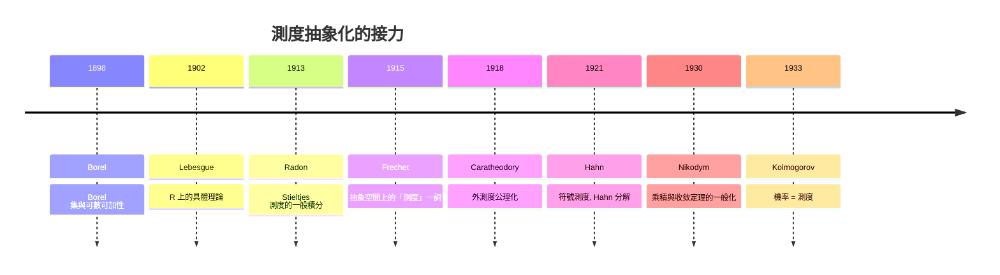

# 9.1 測度的抽象化

## 本章導言

第 4–8 章的測度始終住在 $\mathbb{R}^n$ 上、與區間和長度藕斷絲連。本章把它們全部抽象化：**測度就是定義在 σ-代數上、可數可加、取值 $[0, \infty]$ 的函數**——不多不少。這個「剝離幾何直覺」的過程由 Borel（1898）、Lebesgue（1902）、**Fréchet**（1915，首次用「測度」一詞於抽象空間）、**Carathéodory**（1914–18，《Vorlesungen über reelle Funktionen》，公理化集結）、**Hahn**（1921）、**Nikodym**（1930）接力完成。抽象化的報酬在 9.2 兌現：機率論獲得堅實基礎。本節建立抽象測度的基本理論，並解釋為何「抽象」反而是實用的。

### 歷史：為何要抽象化

驅動力有三股，彼此獨立：

1. **機率論**：二十世紀初的機率論是「集合論、組合數學與分析技巧的混合物」，沒有統一基礎。Borel（1909）與 Fréchet 已經意識到機率與測度的相似，但沒有嚴格的無窮次獨立試驗模型。
2. **泛函分析**：Riesz 表示定理（ $C[0,1]^*$ = 有限測度）顯示測度是對偶空間的自然成員——測度需要脫離 $\mathbb{R}$ 才能服務一般緊空間。
3. **動力系統**：Poincaré 的循環定理（1890，天體力學）已經使用「不變集的體積」概念；Hopf（1932）需要一般相空間上的測度。

### 抽象測度的基本理論

**定義 9.1.1**： $(X, \mathcal{M})$ 可測空間； $\mu: \mathcal{M} \to [0, \infty]$ 是**測度**，若 $\mu(\emptyset) = 0$ 且對不交可測集序列 $\{E_n\}$ ： $\mu\left(\bigcup E_n\right) = \sum \mu(E_n)$ 。 $(X, \mathcal{M}, \mu)$ 稱**測度空間**； $\mu(X) < \infty$ 稱**有限**； $X = \bigcup X_n$ 、 $\mu(X_n) < \infty$ 稱 **σ-有限**。

前八章的所有定理——Chebyshev 不等式、MCT、DCT、Fatou——的證明只用到了：σ-代數的運算律、可數可加性、以及積分的定義結構。**因此它們在抽象測度空間上逐字成立**。這就是抽象化的第一報酬：定理證一次，到處使用。

**新出現的抽象現象**（在 $\mathbb{R}$ 上不明顯，一般空間上必須面對）：

1. **單點可以非零測**：計數測度 $\mu(E) = \#E$ 。積分變成求和： $\int f\, d\mu = \sum_x f(x)$ 。
2. **原子**： $\mu(\{x\}) > 0$ 的點。純原子測度（離散）與非原子測度（連續型）的兩極分化。
3. **拓撲可以缺席**：沒有開集、沒有連續性；「逼近」只能靠單調類與可數運算。

**定理 9.1.2（測度的延拓）**：給定代數 $\mathcal{A}$ （對有限並、補封閉）上的預測度 $\mu_0$ （有限可加 + 下連續），Carathéodory 外測度構造給出 $\sigma(\mathcal{A})$ 上的唯一延拓測度。

**證明思想**：4.2 已在 $\mathbb{R}$ 上演練；抽象版完全平行——外測度定義、切割條件、可數可加性、唯一性（π-λ 定理：在 π-系上一致的有限測度在生成的 σ-代數上一致）。 $\blacksquare$

**定理 9.1.3（單調類 / π-λ 定理）**： $\mathcal{P}$ 是 π-系（對有限交封閉）， $\mathcal{L}$ 是 λ-系（含 $X$ 、對差封閉、對遞增可數並封閉）。若 $\mathcal{P} \subseteq \mathcal{L}$ 則 $\sigma(\mathcal{P}) \subseteq \mathcal{L}$ 。

這個看似技術性的引理是抽象化的第二報酬：**把「驗證 σ-代數上成立」化約為「驗證生成 π-系上成立」**。第 8 章的唯一性論證、機率論中獨立性的傳遞（9.2）、過程的有限維分佈確定性（Kolmogorov 延拓定理），全都靠它。

### 測度空間上的積分與對偶

抽象積分 $\int f\, d\mu$ 按第 5 章的三層火箭定義，所有收斂定理照搬。真正新的內容是**對偶理論**——測度作為線性泛函：

**定理 9.1.4（Riesz 表示定理，緊空間版本, 1909）**： $K$ 緊 Hausdorff 空間， $T: C(K) \to \mathbb{R}$ 是正線性泛函（ $f \ge 0 \Rightarrow Tf \ge 0$ ）。則存在唯一正則 Borel 測度 $\mu$ 使

$$
T(f) = \int_K f\, d\mu.
$$

**證明思想**：用 $T$ 定義開集上的「內容」 $U \mapsto \sup\{T(f) : f \prec U\}$ （ $f \prec U$ 意指 $0 \le f \le 1$ 、支集在 $U$ 內），擴張為外測度，驗證 Borel 集可測（用緊性做有限覆蓋論證——這是緊性第一次在測度構造中充當發動機）。 $\blacksquare$

**歷史意義**：Riesz 1909 年只證了 $K = [0,1]$ （用 Stieltjes 積分語言： $T(f) = \int f\, d\alpha$ ）；一般緊空間版本由 Kakutani、Bourbaki 學派（1930s–40s）完成。這個定理宣告：**連續函數的對偶空間 = 測度**。測度從此獲得雙重身份——既是「面積」，也是「泛函」。泛函分析的譜理論、遍歷理論（不變測度 = 不變泛函的不動點）都建立在这個雙重身份上。

### σ-有限性與完備性的定位

抽象化之後，兩個前章隱含的假設獲得精確定位：

**σ-有限性**：Fubini（8.1–8.2）、Radon–Nikodym（8.3）都需要。直觀：σ-有限空間「可分割成可數塊有限質量」，使覆蓋論證與對角線論證可用。非 σ-有限時這些定理可能失敗（9.1 例題 9.1.2、8.1 的對角線反例）。

**完備性**：Lebesgue 測度完備（零測集的子集可測），但抽象乘積構造（8.1）與 Borel 測度一般**不完備**。Fubini–Tonelli 在不完備空間上照樣成立（只需 $\mathcal{M} \otimes \mathcal{N}$ -可測），故實務上常「先不完備地工作、必要時完備化」。完備化的唯一效果：使「a.e. 極限仍可測」自動成立（4.3 定理 4.3.6 的前提）——這正是 $L^p$ 空間理論偏好完備測度的原因。

**定理 9.1.5（完備化）**：任何測度空間 $(X, \mathcal{M}, \mu)$ 可唯一完備化： $\mathcal{M}^\mu = \{E \cup N : E \in \mathcal{M},\ N \subseteq F,\ F \in \mathcal{M},\ \mu(F) = 0\}$ ， $\mu^\mu(E \cup N) = \mu(E)$ 。

**證明思想**：良定性（不同表示給同值）、σ-代數性、測度性，逐一驗證；唯一性由零測集處理。 $\blacksquare$

### 兩個測度的相對位置：奇異、絕對連續與中間態

**例題 9.1.3**：對 $[0,1]$ 上的測度對 $(\mu, \nu)$ ，判斷關係：(a) $\mu = m$ （Lebesgue）、 $\nu = \delta_0$ ； (b) $\mu = m$ 、 $\nu = x\,m$ ； (c) $\mu = \delta_0$ 、 $\nu = 2\delta_0$ ； (d) $\mu = m|_{[0,1/2]} + \delta_1$ 、 $\nu = \delta_{1/2} + m|_{[1/2,1]}$ 。

**解**：
- (a) $\nu \perp \mu$ ： $\nu$ 住在 $\{0\}$ （ $\mu$ -零測）。
- (b) $\nu \ll \mu$ ，密度 $d\nu/d\mu = x$ （R–N，8.3）；且 $\mu \not\ll \nu$ （ $\nu(\{0\}) = 0$ 但 $\mu(\{0\}) = 0$ ……需細看： $\nu(\{0\}) = 0$ 、 $\mu(\{0\}) = 0$ ，不構成反例；取 $\nu(\{x\}) = 0$ 對所有 $x$ 而 $\mu$ 無原子，實際上此對中 $\mu \ll \nu$ 也成立，因 $m(E) = 0 \implies \int_E x\,dm = 0$ 。**兩者相互絕對連續（等價）**）。
- (c) $\nu \ll \mu$ （ $\delta_0$ 為零 ⟹ $2\delta_0$ 為零）且 $\mu \ll \nu$ ，密度 $d\nu/d\mu = 2$ ——**等價且密度為常數**。
- (d) 混合： $\mu$ 的奇異部分 $\delta_1$ 對 $\nu$ 而言是「質量在 $\{1\}$ ，而 $\nu(\{1\}) = 0$ 」，故 $\mu \not\ll \nu$ ；反向 $\nu$ 的 $\delta_{1/2}$ 部分 ⟹ $\nu \not\ll \mu$ 。兩者**互相奇異於部分、互相絕對連續於部分**——Lebesgue 分解（8.3）的一般形態。

此例顯示抽象框架能同時表述函數論（7.1）與機率論（9.2）中的關係，且術語完全統一。

### 例題

**例題 9.1.1**：在 $X = \mathbb{N}$ 、 $\mathcal{M} = 2^{\mathbb{N}}$ 上，取 $\mu(E) = \sum_{n \in E} 2^{-n}$ 。驗證這是有限測度，計算 $\int f\, d\mu$ （ $f \ge 0$ 可測），並求 $\mu$ 對計數測度的 R–N 導數。

**解**：可數可加性由非負級數的逐項相加（Tonelli 對級數的版本）直接成立； $\mu(\mathbb{N}) = 1$ 有限。對非負 $f$ ：

$$
\int f\, d\mu = \sum_{n=1}^\infty f(n)\, 2^{-n}.
$$

驗證：對示性函數 $f = \chi_E$ 兩邊都是 $\sum_{n \in E} 2^{-n}$ ；線性組合與單調極限推廣（MCT）。對計數測度 $\kappa$ ： $\mu \ll \kappa$ （ $E$ 空 ⟹ 兩者為零），且 $d\mu/d\kappa(n) = 2^{-n}$ ——**權重序列就是密度**。這個例子顯示：機率分佈（本例是幾何分佈）在抽象框架中就是「有限測度」，期望就是積分，級數與積分徹底統一。

**例題 9.1.2**：證明：σ-有限測度空間上， $\mu \times \nu$ 的所有前章結果（Fubini、Tonelli）成立；並舉出一個非 σ-有限測度空間上 Fubini 失敗的具體例子（回顧 8.1 的對角線反例）。

**解**：前半是 8.1–8.2 的內容在抽象空間的逐字重述（證明未用 $\mathbb{R}$ 的特殊性，只用了 σ-有限性）。後半： $X = Y = [0,1]$ ， $\mu$ = Lebesgue、 $\nu$ = 計數測度（非 σ-有限）。對角線 $\Delta$ ：先對 $x$ 積 $\nu(\Delta_x) = \nu(\{x\}) = 1$ ，得 $\int d\mu = 1$ ；先對 $y$ 積 $\mu(\Delta^y) = \mu(\{y\}) = 0$ ，得 $\int d\nu = 0$ 。 $1 \ne 0$ ，交換失敗。**σ-有限性是 Fubini 的最小假設**——這個精確化只有抽象框架能表述清楚（具體 $\mathbb{R}^n$ 的 Lebesgue 測度自動 σ-有限，掩蓋了問題）。

### 構造新測度的工具箱

抽象化之後，測度成為可操作的對象，標準操作：

| 操作 | 定義 | 用途 |
|------|------|------|
| 限制 | $\mu|_A(E) = \mu(E \cap A)$ | 局部化 |
| 推前 | $\mu_\phi(E) = \mu(\phi^{-1}(E))$ | 隨機變數的分佈 |
| 密度 | $f\mu(E) = \int_E f\, d\mu$ | R–N（8.3） |
| 乘積 | $\mu \times \nu$ | 8.1 |
| 符號分解 | $\mu^+ - \mu^-$ | Hahn（7.2） |

**推前測度**尤其重要： $\phi: X \to Y$ 可測時 $\mu_\phi = \mu \circ \phi^{-1}$ 是 $Y$ 上的測度，且「積分搬運」 $\int_Y g\, d\mu_\phi = \int_X (g \circ \phi)\, d\mu$ （簡單函數驗證 + MCT）。機率論的「隨機變數的分佈」嚴格說來就是推前測度；Kolmogorov 的無窮乘積構造（9.2）將把推前、乘積、延拓三個工具合併使用。

### 與其他章節的關聯

- **承 4–8 章**：全部定理的抽象化重述；σ-有限性、完備性等假設在此獲得精確定位。
- **承 6 章**： $L^p(X, \mu)$ 對任意測度空間有意義； $L^2$ 的 Hilbert 理論通用。
- **承 8.3**：R–N 定理在抽象空間是「存在抽象密度」的一般定理。
- **啟 9.2**：機率空間 = 總測度 $1$ 的測度空間；本節工具箱是 Kolmogorov 構造的全部原料。
- **遍歷理論**：保測變換、Birkhoff 遍歷定理（1931）——Poincaré 循環定理的嚴格化需要本節的抽象不變測度。
- **調和分析**：緊群（如圓周 $S^1$ ）上的 Haar 測度是抽象測度；傅立葉分析在一般緊群上的推廣（Pontryagin 對偶）以此為地基。

### 本節要點

1. 抽象測度 = σ-代數上的可數可加函數；前八章定理逐字推廣。
2. 延拓定理與 π-λ 定理是構造與驗證的兩大引擎。
3. Riesz 表示定理：測度 = 連續泛函，獲得雙重身份。
4. 工具箱（限制、推前、密度、乘積、分解）是 Kolmogorov 構造與遍歷理論的原料。
5. 非 σ-有限空間的 Fubini 反例顯示抽象框架能暴露具體框架掩蓋的假設。
