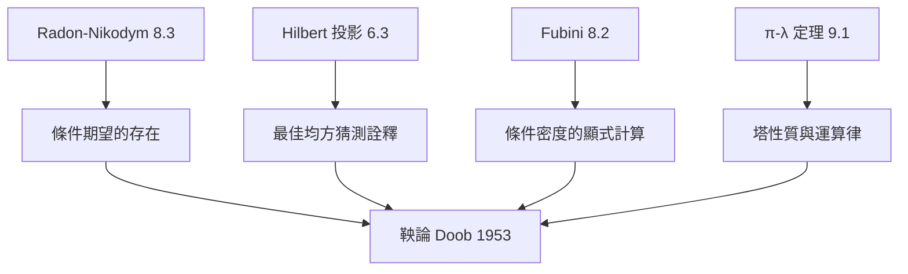

# 9.3 條件期望的測度論基礎

## 本章導言

初等機率的條件期望 $\mathbb{E}[X \mid B] = \mathbb{E}[X\chi_B]/\mathbb{P}(B)$ 依賴 $\mathbb{P}(B) > 0$ ——但現代應用中我們需要「以一個隨機變數 $Y$ 為條件」，而 $\{Y = y\}$ 的機率往往是零（連續型）。更一般地，Kolmogorov 1933 年提出：**以子 σ-代數 $\mathcal{G}$ 為條件**，條件期望 $\mathbb{E}[X \mid \mathcal{G}]$ 是一個**隨機變數**而非一個數。這個定義的存在性靠 Radon–Nikodym 定理（8.3），唯一性靠 a.s. 等價（4.3），幾何直覺靠 Hilbert 空間投影（6.3）。本節是測度論工具箱的總驗收：8.3 的定理成為機率論最深概念的承重牆。

### 歷史：從 Bayes 到 Kolmogorov

| 年代 | 人物 | 事件 |
|------|------|------|
| 1763 | Bayes（遺作） | 條件機率的原始直覺 |
| 1812 | Laplace | 機率論中的條件推理系統化 |
| 1900s | Borel, Fréchet | 連續分佈的條件分佈嘗試（密度式） |
| 1933 | Kolmogorov | 以子 σ-代數定義條件期望 |
| 1930s–50s | Lévy, Doob | 條件期望成為鞅論的基礎 |
| 1953 | Doob | 《Stochastic Processes》，鞅收斂定理 |

Kolmogorov 的動機非常具體：**馬爾可夫過程與隨機過程的轉移機制**。他 1931 年的《Über die analytischen Methoden in der Wahrscheinlichkeitsrechnung》已用條件分佈研究馬爾可夫鏈；1933 年公理化時，條件期望以子 σ-代數的定義使「條件化」成為可迭代的算子操作——隨機過程理論（條件獨立、馬爾可夫性、鞅）全部建立其上。**Doob 的鞅論（1953）是條件期望的勝利閱兵**：下鞅上鞅的定義就是條件期望不等式。

### 定義與存在性

**定義 9.3.1**： $(\Omega, \mathcal{F}, \mathbb{P})$ ， $\mathcal{G} \subseteq \mathcal{F}$ 子 σ-代數， $X \in L^1$ 。**條件期望** $\mathbb{E}[X \mid \mathcal{G}]$ 是滿足：

1. $\mathcal{G}$ -可測；
2. $\int_G \mathbb{E}[X \mid \mathcal{G}]\, d\mathbb{P} = \int_G X\, d\mathbb{P}$ 對所有 $G \in \mathcal{G}$

的隨機變數，記 $Z = \mathbb{E}[X \mid \mathcal{G}]$ 。

條件 2 說：** $Z$ 與 $X$ 在每個 $\mathcal{G}$ -可測「監督區域」上的平均值相同**。條件 1 說： $Z$ 只使用 $\mathcal{G}$ 的資訊。合起來：**在資訊 $\mathcal{G}$ 內對 $X$ 的最佳均方猜測**（下面用投影定理精確化）。

**定理 9.3.2（存在唯一性）**： $X \in L^1$ 時條件期望存在且 a.s. 唯一。

**證明（存在性 = Radon–Nikodym 定理的應用）**：定義 $\mathcal{G}$ 上的測度

$$
\nu(G) = \int_G X\, d\mathbb{P}.
$$

- 若 $X \ge 0$ ： $\nu$ 是有限正測度，且 $\nu \ll \mathbb{P}|_\mathcal{G}$ （ $\mathbb{P}(G) = 0 \implies \nu(G) = 0$ ）。由 R–N 定理（8.3， $\mathbb{P}|_\mathcal{G}$ 有限），存在 $\mathcal{G}$ -可測 $Z \ge 0$ 使 $\nu = Z\,\mathbb{P}|_\mathcal{G}$ ，即 $Z = \frac{d\nu}{d\mathbb{P}}$ 恰是條件 2。
- 一般 $X \in L^1$ ：分解 $X = X^+ - X^-$ ，分別取條件期望相減（各為 a.s. 有限，因 $\mathbb{E}[X^\pm] < \infty$ ）。

**唯一性**：若 $Z_1, Z_2$ 都滿足條件 2，取 $G = \{Z_1 > Z_2 + 1/n\} \in \mathcal{G}$ （ $Z$ 們 $\mathcal{G}$ -可測），得 $0 = \int_G (Z_1 - Z_2) \ge \frac{1}{n}\mathbb{P}(G)$ ，故 $\mathbb{P}(G) = 0$ ；對 $n$ 取並集得 $Z_1 \le Z_2$ a.s.，對稱得相等。 $\blacksquare$

**注意**： $\mathbb{E}[X \mid \mathcal{G}]$ 只是 **a.s. 唯一**——它是一個等價類，任何具體版本（如連續修正）是選擇問題。這是 4.3 的等價觀念在最精緻處的登場。

### 基本性質

**定理 9.3.3**：條件期望的運算律（全部 a.s.）：

1. 線性；保序（ $X \le Y \Rightarrow \mathbb{E}[X|\mathcal{G}] \le \mathbb{E}[Y|\mathcal{G}]$ ）。
2. **塔性質**： $\mathcal{G}_1 \subseteq \mathcal{G}_2 \Rightarrow \mathbb{E}[\mathbb{E}[X|\mathcal{G}_2] | \mathcal{G}_1] = \mathbb{E}[X|\mathcal{G}_1]$ 。
3. **取出已知量**： $Y$ $\mathcal{G}$ -可測且 $XY \in L^1 \Rightarrow \mathbb{E}[XY|\mathcal{G}] = Y\,\mathbb{E}[X|\mathcal{G}]$ 。
4. $\mathbb{E}[\mathbb{E}[X|\mathcal{G}]] = \mathbb{E}[X]$ （ $G = \Omega$ ）。
5. Jensen： $\phi$ 凸 $\Rightarrow \phi(\mathbb{E}[X|\mathcal{G}]) \le \mathbb{E}[\phi(X)|\mathcal{G}]$ 。

**證明思想**：塔性質對 $\mathcal{G}_1$ 中示性函數驗證條件 2 再用單調類（π-λ，9.1）推廣。取出已知量先對 $Y = \chi_G$ 驗證（回到定義），再線性 + 單調逼近。Jensen 用支撐超平面 $\phi(t) \ge \phi(a) + c(t - a)$ 與保序性。 $\blacksquare$

**條件獨立**： $X, Y$ 對 $\mathcal{G}$ 條件獨立 $\iff$ $\mathbb{E}[XY|\mathcal{G}] = \mathbb{E}[X|\mathcal{G}]\,\mathbb{E}[Y|\mathcal{G}]$ 。馬爾可夫性的嚴格定義（未來對過去條件獨立於現在）、Kolmogorov 齊次性的處理，都用這個語言。

### 幾何觀點：Hilbert 空間上的投影

**定理 9.3.4（投影詮釋）**： $X \in L^2$ 時， $\mathbb{E}[X|\mathcal{G}]$ 是 $X$ 到閉子空間

$$
L^2(\mathcal{G}) = \{ Z \in L^2 : Z \text{ } \mathcal{G}\text{-可測} \}
$$

的**正交投影**；且條件期望是唯一的 a.s. 之下的 $L^2$ 最佳逼近： $\|X - Z\|_2$ 在 $Z \in L^2(\mathcal{G})$ 中被 $\mathbb{E}[X|\mathcal{G}]$ 達到。

**證明思想**： $L^2(\mathcal{G})$ 是 Hilbert 空間 $L^2$ 的閉線性子空間（對極限封閉由可測性封閉性，6.2 完備性保證極限存在）；由 6.3 投影定理，正交投影存在唯一。驗證投影 $Z$ 滿足定義 9.3.1 的條件 2：正交性 $\langle X - Z, Y\rangle = 0$ 對所有 $Y \in L^2(\mathcal{G})$ ，取 $Y = \chi_G$ 即得。 $\blacksquare$

**例題 9.3.1（有限分割的條件期望）**： $\mathcal{G}$ 由可數分割 $\{B_1, B_2, \dots\}$ （ $\mathbb{P}(B_k) > 0$ ）生成。求 $\mathbb{E}[X \mid \mathcal{G}]$ 的顯式。

**解**： $\mathcal{G}$ -可測函數恰為在各 $B_k$ 上取常值的函數（在剩餘零測集上任取）。條件 2 逐塊強制：

$$
\mathbb{E}[X \mid \mathcal{G}] = \sum_k \frac{\mathbb{E}[X \chi_{B_k}]}{\mathbb{P}(B_k)}\, \chi_{B_k} = \sum_k \mathbb{E}[X \mid B_k]\, \chi_{B_k}.
$$

驗證條件 2：對 $G = \bigcup_{k \in S} B_k$ ， $\int_G Z = \sum_{k \in S} \mathbb{E}[X\chi_{B_k}] = \mathbb{E}[X\chi_G]$ 。✓ **初等公式是抽象定義的最簡特例**——抽象定義的價值在於它覆蓋了 $\mathbb{P}(B) = 0$ 的情形（ $Z$ 在零測塊上取值任意，反正 a.s. 無所謂）。

**例題 9.3.2（連續型的條件密度）**： $(X, Y)$ 在 $\mathbb{R}^2$ 上有聯合密度 $p(x, y)$ （關於 $\lambda \times \lambda$ ）。求 $\mathbb{E}[f(Y) \mid X]$ 型的條件期望，並以顯式積分表出。

**解**： $\mathcal{G} = \sigma(X)$ 。條件期望是 $g(X)$ 型。條件 2 化為：對所有 Borel $A$ ，

$$
\int_{\{X \in A\}} f(Y)\, d\mathbb{P} = \int_A g(x)\, p_X(x)\, dx.
$$

左邊用 Fubini（8.2：聯合密度可積）化為 $\int_A \left[ \int f(y) p(x, y)\, dy \right] dx$ 。故取

$$
g(x) = \frac{\int f(y)\, p(x, y)\, dy}{p_X(x)} = \int f(y)\, p(y \mid x)\, dy, \qquad p(y|x) = \frac{p(x,y)}{p_X(x)},
$$

在 $\{p_X > 0\}$ 上（ $p_X = 0$ 處 $g$ 任意，反正零測）。**注意這裡每一步的測度論依據**：聯合測度 $\ll \lambda\times\lambda$ ⟹ R–N 給聯合密度；邊際密度 = 邊際測度的 R–N 導數；Fubini 允許截面積分；a.s. 唯一性容忍 $p_X = 0$ 的定義自由。初等教科書的「條件密度公式」其實是一整座測度論大廈的出口。

### 條件期望的帝國

條件期望出場後，機率論的重心從「事件」轉向「資訊流」：

- **鞅**： $\mathbb{E}[X_{n+1} \mid \mathcal{F}_n] = X_n$ 。賭局公平性的數學化；Doob 收斂定理（1953）用上鞅分解與 Fatou 引理證明 a.s. 收斂——本書 5.1 的 Fatou 引理在這裡完成最大單筆投資的回報。
- **馬爾可夫過程**：轉移核 + 條件獨立；Kolmogorov–Chapman 方程是塔性質 + Fubini。
- **隨機微積分**：Itô 積分的構造逐層用條件期望（簡單過程 → 一致極限）；Girsanov 定理的證明核心是條件期望的乘法性質。
- **數理統計**：充分統計量（Fisher–Neyman 因子分解）= 條件分佈不依賴參數；Rao–Blackwell 定理 = 條件期望改進估計（Jensen 的直接應用）。

### 與其他章節的關聯

- **承 8.3**：存在性定理就是 R–N 定理（本節證明即其應用實例）。
- **承 6.3**：投影詮釋把「猜測」變成幾何——最小平方法（6.3 例題 6.3.2 的迴歸）與條件期望是同一件事。
- **承 8.2**：條件密度的計算全程使用 Fubini。
- **承 5.1**：Fatou 引理在鞅收斂定理中擔綱。
- **向前**：隨機微積分、遍歷理論（條件期望於不變 σ-代數 = 時間平均與空間平均的橋樑，Birkhoff 定理的陳述本身用條件期望）。

### 本節要點

1. 條件期望以子 σ-代數為條件，是隨機變數（a.s. 等價類），定義由兩條性質刻畫。
2. 存在性 = Radon–Nikodym： $Z = \frac{d\nu}{d\mathbb{P}|_\mathcal{G}}$ 。
3. 塔性質、取出已知量、Jensen 是三大運算律；幾何詮釋 = 正交投影。
4. 有限分割給初等公式；連續型給條件密度——兩者都是抽象定義的特例。
5. 鞅論、隨機微積分、統計學的嚴格基礎全部由條件期望搭建——它是測度論進入現代機率的最深入口。
