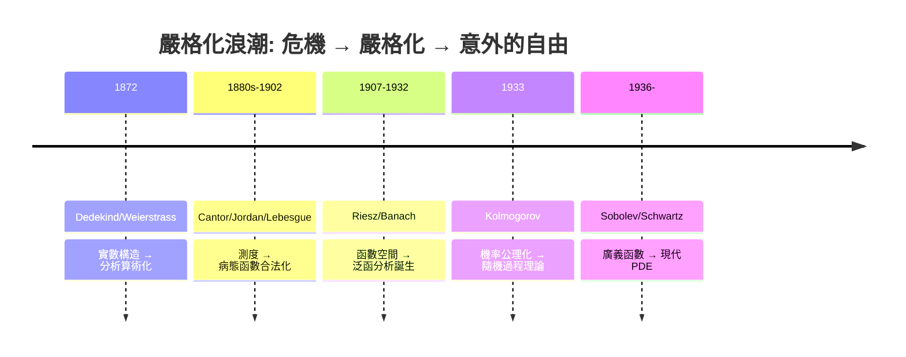

# 10.3 迴顧嚴格化如何解放數學

## 本章導言

本書從 Dedekind 切割（1872）走到 Sobolev 空間（1936）與 Carleson 定理（1966）。最後一節不是摘要，而是回答一個貫穿全書的問題：**為什麼「嚴格化」不是束縛，反而是解放？** 十九世紀的數學家最初抗拒實數構造、抗拒病態函數、抗拒抽象測度——「我們只需要會算的積分」。但每一次嚴格化都沒有收窄數學，而是打開了原先**根本無法表述**的新天地。本節把這個模式整理成可攜帶的歷史教訓，並指出嚴格化的代價與邊界。

### 五次嚴格化浪潮的全景

每一波的劇本驚人地一致：

1. **直覺失效**：某個「顯然」的運算（交換極限與積分、級數重排、逐項積分）出現反例。
2. **概念精化**：為區分好情形與壞情形，發明新概念（一致收斂、可測性、絕對連續、σ-有限）。
3. **表面損失**：新理論把一些舊直覺降級為「有條件成立」，教科書變厚。
4. **實際豐收**：新概念使原先無法提出的問題變得可問、可證（ $L^p$ 完備性、隨機過程存在性、弱解理論）。

### 危機與解放的具體對照

| 危機 | 嚴格化的代價 | 兌現的自由 |
|------|------------|-----------|
| 處處不可微函數（Weierstrass 1872） | 承認連續 ≠ 可微，分析算術化 | 一般收斂理論、拓撲學誕生 |
| Dirichlet 函數不可積（1829–） | Riemann 積分不夠用 | Lebesgue 積分：極限交換免費 |
| $\sum|c_n|^2 < \infty$ 的係數無函數對應 | Riemann 框架內無解 | Riesz–Fischer： $L^2$ 完備，傅立葉理論成型 |
| Volterra 反例： $F'$ 可積但公式失敗 | Newton–Leibniz 有漏洞 | 絕對連續性：微分學的精確範圍 |
| 交換積分次序出錯（Cauchy 以降） | 放棄「顯然交換」 | Fubini–Tonelli：精確判準，卷積理論成立 |
| 機率論無基礎（von Mises 失敗） | 放棄定義「隨機」 | Kolmogorov 公理：隨機過程整個學科 |
| PDE 解不可微 | 「解」的概念擴大 | 弱解 + 正則性：現代 PDE 與幾何分析 |

**模式的核心**：反例摧毀的不是數學，是**未經檢驗的適用範圍**。嚴格化把「有時對有時錯」的命題拆成「精確條件下的恆真」+「條件外的反例」，然後在恆真部分上蓋更高樓。Fubini 定理是最好的標本：Cauchy 的「顯然交換」是假的，但「 $\iint |f| < \infty$ 則交換」是定理——前者是直覺的幻覺，後者是可承重的結構。

### 嚴格化如何「創造」而不只是「修復」

有三個機制使嚴格化超出防禦意義：

**一、精確化揭示不變量。** $L^p$ 空間完備化（6.2）之後，人們發現範數 $\|\cdot\|_p$ 有一整套幾何（Hölder 的對偶性、 $p=2$ 的內積特權）——這些在具體積分計算中不可見的結構，只有抽象框架能表達。**Banach 空間理論（1932）不是 $L^p$ 的推廣，而是 $L^p$ 揭示的規律的獨立存在**。

**二、反例成為分類工具。** Cantor 函數（7.1、7.2）、Vitali 集（4.2）、非 σ-有限的 Fubini 反例（8.1、9.1）、Kolmogorov 的處處發散級數（10.2）——每個反例都精確標記一個概念的邊界，而成為教學與研究的路標。**病態函數不是麻煩，是理論的測深錘**。

**三、統一降低認知成本。** 測度論公理化（9.1）之後，「積分」一詞覆蓋 Riemann 積分、Stieltjes 積分、求和、期望、機率測度、Haar 測度——**一次學會，處處使用**。Laplace 評價「指數函數之統一」的名言在此重演：嚴格化帶來的統一性是最實用的紅利。

### 嚴格化的代價與邊界

誠實的回顧必須記錄代價：

1. **入門門檻升高**：Lebesgue 積分的學習曲線陡峭；初等微積分與嚴格理論之間的斷層是教育真實問題（本書用「先直覺後嚴格」的結構試圖緩和）。
2. **直覺訓練不能省**：Weierstrass 嚴格化了極限，但發現收斂類型的仍是物理與工程直覺（Fourier 是熱學家）。嚴格化之後，**猜想的來源**仍需具體計算與例子。
3. **基礎主義的爭議未決**：邏輯主義、形式主義、直覺主義的三分（Hilbert vs. Brouwer）顯示嚴格化的哲學基礎有選擇空間；選擇公理（Vitali 集所需）至今有建構主義者反對。數學實踐採用了 ZFC 但不宣稱它是唯一真理。
4. **嚴格化有時滯後**：Fourier（1807）的論文因「不嚴格」被拒，但他的級數是真的；Dirac 的 $\delta$ 函數（1920s）先於 Schwartz 分佈論（1950）三十年仍工作良好。**嚴格化是及時雨，不是先決條件**——好的數學往往先於其證明基礎存在。

### 三個「嚴格化意外紅利」的深度案例

**案例一：Lebesgue 積分與 Carleson 定理。** 1807 年 Fourier 提出的展開問題，直到 1966 年 Carleson 證明 $L^2$ 傅立葉級數 a.e. 收斂才算完全解決。Carleson 自己說過，若沒有 Lebesgue 積分提供的「a.e. 收斂」概念與 $L^2$ 框架，這個陳述根本無法寫下。十九世紀的懸案在二十世紀以「先換語言、再解問題」的方式關閉——**換語言本身就是解法的一部分**。

**案例二：Kolmogorov 公理化與布朗運動。** Wiener 1923 年構造布朗運動時用的測度論工具（函數空間上的測度）早於 1933 年的公理化；但公理化之後，隨機過程的理論（馬爾可夫性、鞅、強馬爾可夫性）以條件期望為語言系統化（Doob 1953），速度遠超 Wiener 時代。基礎理論的滯後紅利往往在十年後爆發。

**案例三：Sobolev 空間與幾何分析。** Sobolev 1936 年的動機是流體力學的具體方程；到 1960–80 年代，Sobolev 嵌入與緊性成為微分幾何（極小曲面正則性、Ricci 流的先驗估計）的標準裝備。Hamilton 1982 年的 Ricci 流論文的第一節全是 Sobolev 型估計——**一門為工程而生的技術，成為幾何學的語法**。

### 嚴格化的心智模型：地圖而非牢籠

把全書的圖像壓縮成一張心智地圖：

$$
\text{直覺} \xrightarrow{\text{反例}} \text{危機} \xrightarrow{\text{概念精化}} \text{定理} \xrightarrow{\text{抽象}} \text{結構} \xrightarrow{\text{遷移}} \text{新領域}
$$

三個遷移的實例，展示「地圖」如何跨越領域：

1. **完備化**： $\mathbb{Q} \to \mathbb{R}$ （1.2）的方法論先後遷移到函數空間（6.2， $L^p$ ）與測度空間（9.1，完備化定理）——同一招用三次，領域完全不同。
2. **分解**：Jordan 分解（7.2）→ Hahn 分解 → Lebesgue 分解（8.3）→ 譜分解（von Neumann）——「把對象拆成正負/好壞/連續奇異部分」是同一思想在四個層級的重演。
3. **逼近**：簡單函數逼近（4.3）→ 稠密性（6.2）→ 檢驗函數（10.1）——「在乖對象上做、再逼近到一般對象」是所有存在性證明的共同模板。

**例題 10.3.1**：用五條原則診斷一個虛構的錯誤證明：「因為 $f_n \to f$ 逐點且 $\int f_n \to \int f$ （數值收斂），所以 $\int |f_n - f| \to 0$ 」。

**解**：違反原則 1（交換要證）與原則 2（最小假設）：範數值收斂不是 $L^1$ 收斂（6.2 例題 6.2.2 的 $\chi_{[n,n+1]}$ ： $\|f_n\|_1 = 1$ 收斂，但 $\|f_n - f_m\|_1 = 2$ ）。正確工具是 DCT（需控制）或范數收斂的直接證明。**診斷反例的能力 = 找出被默認而未證的交換**——這是本書訓練的核心技能，比任何單一定理更重要。

### 給讀者的總結原則

綜合十章，可提煉五條原則：

1. **交換運算要求證**：極限、積分、求和、期望之間的每次交換都要有定理許可（一致收斂 / MCT / DCT / Fubini）。
2. **找最小充分條件**：絕對連續性之於 Newton–Leibniz、σ-有限之於 Fubini、 $L^1$ 控制之於 DCT——好定理的假設是「剛好夠用」，多一個都嫌肥。
3. **完備化是預設動作**：空間不完備就完備化（ $\mathbb{Q} \to \mathbb{R}$ 、Riemann $\to L^1$ 、 $C \to L^2$ ），然後在新空間裡重新發現舊理論的推廣。
4. **抽象前先積累具體**：Lebesgue 之前有 50 年病態函數積累；沒有具體危機的抽象是空洞的（Kolmogorov 抽象的背後是 30 年機率危機）。
5. **反例是路標不是絆腳石**：遇到反例，問「它排除了什麼假設」——排除的正是下一個定理的精確前提。

### 與其他領域的匯流

本書十章的主線最終匯入四條大河：

- **泛函分析**： $L^p$ → Banach 空間（1932）→ 算子代數（von Neumann 代數，1930s，量子力學）；
- **機率論**：測度公理化 → 隨機過程 → 隨機分析（Itô 1944）→ 隨機偏微分方程；
- **調和分析**： $L^2$ 傅立葉 → Calderón–Zygmund → 小波 → 解耦理論；
- **幾何分析**：Sobolev 空間 → 變分直接法 → 微分幾何中的 PDE（極小曲面、Ricci 流）。

四條大河的共同上游正是本書的主體：**測度、積分、完備性、對偶性**。1880 年代的家長式擔憂——「病態函數會毀掉分析」——歷史的答案恰恰相反：**正是對病態的正視，使分析獲得了處理一切的能力**。

### 給下一代的建議：如何讀理論

最後給出閱讀與學習本書十個章節的建議路徑：

1. **第一輪（直覺）**：讀每章導言、歷史小節與例題，跳過長證明——先知道「每個定理在防什麼事故」。
2. **第二輪（結構）**：跟著依賴鏈走一遍證明：可數可加性 → MCT → Fatou → DCT → $L^p$ 完備 → R–N → 條件期望。這條主鏈約 15 頁，是全書的脊柱。
3. **第三輪（應用）**：任選一條大河（泛函、機率、調和、幾何分析）向前讀，回頭會發現第 1–9 章的工具在下游以未變形的形式反覆出現。

**例題 10.3.2**：檢驗你是否掌握全書脊柱——不查書，說出從「 $\mathbb{Q}$ 不可完備」到「條件期望存在」之間的最短依賴鏈。

**解**： $\mathbb{Q}$ 不完備（1.2）⟹ 完備化方法論 ⟹ 實數構造 ⟹ 區間長度可數可加（4.2）⟹ 可測集與可測函數（4.3）⟹ Lebesgue 積分（5.1）⟹ MCT/DCT（5.2）⟹ $L^p$ 與 Hölder/Minkowski（6.1）⟹ 完備性（6.2）⟹ R–N 分解（8.3）⟹ 機率公理（9.2）⟹ 條件期望 = R–N 導數（9.3）。**十個章節，一條脊柱，無一節可拆**——這就是「嚴格化作為整體」而非「一組孤立定理」的含義。

### 結語

嚴格化的本質是**把偶然的正確變成必然的正確**。Jordan 容量在 Dirichlet 函數上失敗不是倒楣，而是理論邊界的暴露；Lebesgue 用可數覆蓋修復它，表面上是修一個 bug，實際上是把「測度」從幾何直覺中解放為獨立數學對象——然後機率論、泛函分析、PDE 理論各自來認領。嚴格化的每一代人都以為自己在「防守」，歷史證明他們都在「擴張」。這是本書想留給讀者的最終圖像：**數學的嚴格性不是數學自由的敵人，而是它的引擎**。

### 本節要點

1. 五次嚴格化浪潮共享同一劇本：反例 → 概念精化 → 表面損失 → 實際豐收。
2. 嚴格化「創造」的三機制：揭示不變量、反例分類、統一降本。
3. 代價真實存在：門檻、直覺訓練、基礎爭議、嚴格化的時間滯後。
4. 五條可攜帶原則：交換要證、最小假設、完備化、先具體後抽象、反例即路標。
5. 測度–積分–完備性–對偶是四條現代分支的共同上游；嚴格性是自由的引擎。
