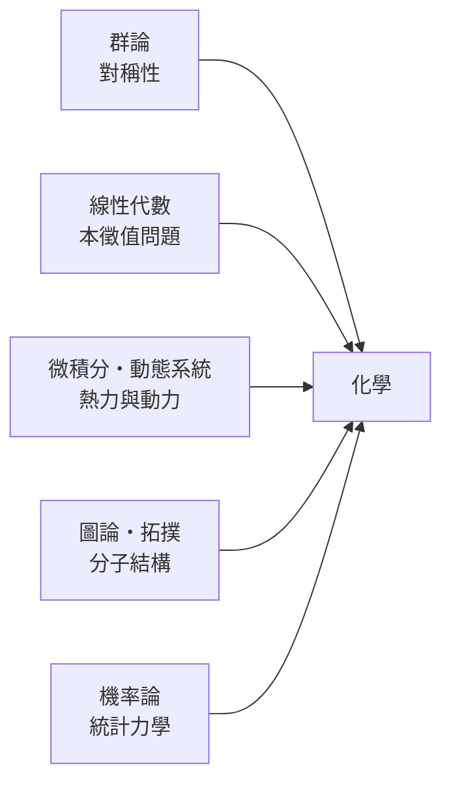

# 前言

## 0.1 從試管到方程式：化學如何蛻變為一門精確的數學科學

十九世紀的化學，一度被視為「廚房科學」：觀察、歸納、背誦。但兩場革命徹底改變了它：

1. **量子革命（1925–1930）**：Heisenberg 的矩陣力學與 Schrödinger 的波動方程，讓「化學鍵」從經驗概念變成可以計算的電子分佈問題。
2. **結構革命（1850–1950）**：Cayley 用圖論數數異構物、Fedorov 完成空間群分類、Wigner 與 Bethe 把群論帶進光譜學——分子第一次有了「代數身分證」。

## 0.2 巨觀與微觀的數學橋樑：為什麼化學需要群論、圖論與微積分

化學的特殊之處在於它同時面對三個尺度：

* **微觀**（電子、軌域）→ 線性代數與算子代數（第 3–4 章）
* **中觀**（分子形狀、結構）→ 群論與圖論（第 1–2、8–9 章）
* **巨觀**（反應速率、平衡、斑圖）→ 微積分與動態系統（第 5–7 章）

而連接三者的黏著劑是**機率**：統計力學（第 11 章）證明巨觀熱力學量只是微觀狀態的加權平均。

## 0.3 閱讀地圖：化學數學的全景導覽

| 篇 | 主題 | 數學工具 | 化學問題 |
|---|---|---|---|
| 一 | 對稱與群論 | 群、表示論、特徵標表 | 分子形狀、光譜、化學鍵 |
| 二 | 量子與矩陣 | 算子、本徵值、變分法 | 波函數、鍵能、軌域 |
| 三 | 微積分與動態系統 | 全微分、ODE、分岔、混沌 | 熱力學、動力學、振盪 |
| 四 | 圖論與化學資訊學 | 矩陣圖論、拓撲、機器學習 | 分子描述、碳同素異形體、藥物設計 |
| 五 | 統計力學 | 機率分佈、資訊熵 | Boltzmann 分佈、熵 |

**建議路線**：

* **化學系學生**：按順序閱讀，第 1–2 章回答「為什麼要背點群」，第 3–4 章回答「為什麼量子化學滿是矩陣」。
* **數學背景讀者**：可先讀第 8–9 章（圖論、拓撲），再回頭看量子篇——你會發現化學是所有數學結構的天然實驗場。
* **只想查表**：附錄 A 點群特徵標表、附錄 B 公式總覽、附錄 C 計算化學演算法。

每章末尾的「下一步」說明本章概念如何驅動下一章的問題，希望讀者讀完後能體會：**對稱性決定分子能否吸收光，線性代數決定電子在哪裡，微分方程決定反應走多快。**
