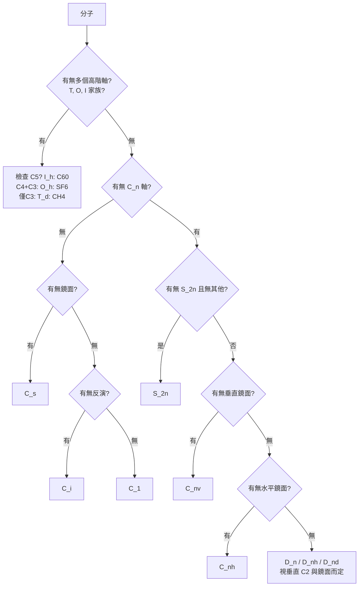

# 01.2 點群：如何用代數分類所有分子的形狀

## 1. 從操作集合到群：一場代數與化學的合流

Galois 在 1832 年證明：五次方程能否用根式求解，取決於方程根的置換群結構。
他發明的方法論——**拋開具體對象、只研究操作之間的合成規律**——在五十年後
被晶體學家撿了起來：Bravais（1849–1851）用群的思想整理晶格；
Fedorov 與 Schoenflies 在 1891 年前後完成 230 個空間群分類；
而分子的分類——**點群**——則因 1929 年 Bethe 的晶體場論論文
與 1930 年代 Wigner、Mulliken 的光譜工作，成為化學家的日常工具。

歷史的反諷值得記住：Galois 的群論最初是純代數；化學家拿來用時，
數學家已經把它發展得極度抽象（Noether、Burnside）；而化學的應用又反過來
讓群論進入大學課堂，成為工科生也懂的語言。**應用需求與理論深度互相驅動**，
這是本章的主旋律。

## 2. 點群的公理與定義

**定義 2.1（點群）**
分子的點群是該分子所有對稱操作構成的集合，在「操作合成」為乘法下形成的群。
因為所有對稱元素至少交於一點（分子是有限物體，不可能有純平移對稱），
故稱「點群」。

**定理 2.1（群的階數與分子的剛性）**
有限分子的點群必為有限群，其階數 $|G|$ 等於對稱操作個數。
由 Lagrange 定理，子群階數整除群階數——這給出強烈的結構限制。

例如 $C_{2v}$ 的階數為 4，其子群只可能有階數 1 或 2：
$\{E\}, \{E,C_2\}, \{E,\sigma_v\}, \{E,\sigma_v'\}, \{E,C_2,\sigma_v,\sigma_v'\}$。
Lagrange 定理在化學上的意義：**對稱性是整層嵌套的**，不存在「半個對稱」。

## 3. Schoenflies 記號與判定流程

化學慣用的 Schoenflies 記號把所有分子點群分成幾大家族：

| 家族 | 特徵 | 例子 |
|------|------|------|
| $C_n$ | 僅一根 $C_n$ 軸 | $H_2O_2$（扭轉構型）屬 $C_2$ |
| $C_{nv}$ | $C_n$ 軸 + $n$ 個含軸鏡面 | $H_2O$（$C_{2v}$）、$NH_3$（$C_{3v}$） |
| $C_{nh}$ | $C_n$ 軸 + 一個水平鏡面 | 反式-1,2-二氯乙烯（$C_{2h}$） |
| $D_n, D_{nh}, D_{nd}$ | $n$ 根垂直 $C_2$ 軸 | 苯（$D_{6h}$）、乙烷交錯型（$D_{3d}$） |
| $S_{2n}$ | 僅有 $S_{2n}$ 軸 | 1,3,5,7-四甲基環辛四烯（$S_4$） |
| $T, T_d, O, O_h, I, I_h$ | 多面體群 | $CH_4$（$T_d$）、$SF_6$（$O_h$）、$C_{60}$（$I_h$） |
| $C_s, C_i, C_1$ | 只剩鏡面/反演/全無 | 多數生物分子屬 $C_1$ |

**判定流程圖**：



## 4. 共軛類：把操作分組的代數剪刀

**定義 2.2（共軛類）**
$g,h\in G$ 同類若存在 $x\in G$ 使 $h=xgx^{-1}$。

**定理 2.2（類的化學意義）**
同一類中的操作在幾何上是「同種」的：同階的旋轉、同方向的鏡面。
共軛的代數意義是「換一個坐標系看同一個操作」。

以 $NH_3$（$C_{3v}$，階數 6）為例，操作分為三類：
$\{E\}$、$\{C_3, C_3^2\}$（正向與反向轉 $120^\circ$）、
$\{\sigma_1,\sigma_2,\sigma_3\}$（三個含軸鏡面）。

化學直覺：三個 N–H 鍵完全等價，所以三個鏡面必然同類；
代數把它變成可證明的命題。類的數目直接等於不可約表示的數目
（02.1 章將證明這一點），所以**分類操作就是預備光譜分析**。

## 5. 用 Python 判定點群

```python
import numpy as np

def point_group_ops(formula_geometry):
    """由原子座標產生候選對稱操作，回傳所有使分子不變的操作。
    formula_geometry: list of (element, np.array([x,y,z]))"""
    atoms = [(e, np.array(p, float)) for e, p in formula_geometry]
    def invariant(g):
        for _, p in atoms:
            q = g @ p
            hit = [ (e2, np.linalg.norm(g@p2 - q)) for e2, p2 in atoms]
            # 每個像必須對應同元素且等距的原子
            ok = any(e2 == e and np.allclose(g@p2, q)
                     for e2, p2 in atoms)
            if not ok:
                # 更嚴謹應做一對一匹配，此處示意
                pass
        return True  # 示意：實作需置換匹配

    cands = []
    for theta_n in [2,3,4,5,6]:
        # 產生繞各候選軸的旋轉並測試（略）
        pass
    return cands

# 實務上建議使用現成工具，例如 pymatgen.symmetry：
# from pymatgen.symmetry.analyzer import PointGroupAnalyzer
# ana = PointGroupAnalyzer(molecule)
# print(ana.get_pointgroup())   # 例如 'C2v'
```

工業級的做法是呼叫 `pymatgen` 或 `spglib`：前者處理分子點群，
後者正是 Fedorov 230 空間群分類的現代數位實現。
**數學分類完成於 1891 年，軟體實現於 2010 年代——百年時間差，同一套數學。**

## 6. 點群的幾個深層定理

**定理 2.3（Abel 性與一維表示）**
$C_{2v}$、$C_{3v}$？——注意 $C_{nv}$ 在 $n\ge 3$ 時**不是**交換群
（轉軸與鏡面不交換），只有 $C_{2v}$、$C_s$、$C_i$、$C_1$ 等小群是交換群。
交換群的不可約表示全為一維，因此 $C_{2v}$ 的特徵標表就是一張 $4\times 4$
的整數表，毫無矩陣負擔。

**定理 2.4（Burnside）**
$|G|=\sum_i d_i^2$，其中 $d_i$ 為各不可約表示的維度。
$C_{3v}$ 階數 6，有三類，故有三個不可約表示：
$1^2+1^2+2^2=6$。於是 $C_{3v}$ 必有兩個一維、一個二維表示——
**還沒算任何矩陣，維度就已經被代數鎖死**。這是群論預測力的第一次展示。

**定理 2.5（子群鏈與相關表）**
當分子從高對稱構型變到低對稱構型（如 Jahn-Teller 畸變、取代基破壞對稱），
點群沿子群鏈下降：$D_{4h}\to C_{4v}\to C_{2v}$。
高群的簡併在低群中分裂——這正是晶體場分裂（Bethe 1929）的數學骨架：
$O_h$ 場中 $d$ 軌域分裂為 $t_{2g}+e_g$，降到 $D_{4h}$ 時進一步分裂為
$b_{2g}+e_g+b_{1g}+a_{1g}$。過渡金屬錯合物的顏色由此而來。

## 7. 歷史案例：甲烷與四面體群的遇合

$CH_4$ 的對稱群 $T_d$ 有 24 個操作，與置換群 $S_4$ 同構——
四個氫的置換就是全部的對稱操作。這不是巧合：
**分子的對稱群本質上是「原子的合法重排群」**，Galois 研究的置換群
在化學中找到了第二生命。1904 年 Burnside 的教科書寫下這些抽象理論時，
沒有人想到三十年後它們會成為解釋甲烷紅外光譜與紫外光譜的必備工具。

## 8. 章末小結

1. 點群是分子全部對稱操作構成的有限群；Schoenflies 記號給出系統命名。
2. Lagrange 定理迫使對稱性整層嵌套；Burnside 定理鎖死不可約表示的維度。
3. 共軛類把「同種操作」歸類，類數 = 不可約表示數。
4. 子群鏈解釋對稱降低時能階分裂，是晶體場論與配位化學的數學核心。
5. 230 空間群（1891）與分子點群共用同一套群論，數學一次建成、多處收成。

## 下一步

點群描述有限分子的對稱；但要描述「無限重複」的晶體，需要把旋轉與**平移**
結合起來，這就產生了 230 個空間群。01.3 章將回到 Fedorov 與 Schoenflies
的 1890 年代，看數學家如何在 X 光繞射被發現（1912）之前二十年，
就用純邏輯窮盡了所有可能的晶體對稱。
