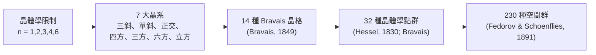

# 01.3 空間群與晶體結構：固態化學的對稱網格

## 1. 一樁科學史奇案：三個人在三個國家同時完成分類

1890 年前後，俄國晶體學家 **Fedorov**、德國數學家 **Schoenflies**、
英國業餘科學家 **Barlow** 幾乎同時、各自獨立地證明：三維空間中允許週期性
重複的對稱群恰好有 **230 個**。Fedorov 用的是向量幾何與繁複的窮舉；
Schoenflies 用剛發展成熟的群論語言；Barlow 的推導甚至有瑕疵，結論卻正確。
三份工作互相印證，構成數學史上最壯觀的獨立收斂案例之一。

更驚人的是時間差：**X 光繞射要到 1912 年（Laue、Bragg 父子）才證明晶體
真的是原子週期排列**。也就是說，數學家在實驗證據出現前 21 年，
就用純邏輯預先寫好了所有可能晶體的清單。此後每一個新晶體結構被解析
（至今超過一百萬個，登錄於 ICSD 與 CSD 資料庫），都只是往這 230 個格子的
某一格裡填例子——**沒有一個結構跳脫出清單**，直到 1984 年準晶的發現
挑戰了「週期性」這個前提本身。

## 2. 晶格與平移群：無限的數學化

**定義 3.1（晶格）**
晶格是形如
$$
L=\{\, n_1\mathbf{a}_1+n_2\mathbf{a}_2+n_3\mathbf{a}_3 \mid n_1,n_2,n_3\in\mathbb{Z}\,\}
$$
的 $\mathbb{R}^3$ 中的離散子群， $\mathbf{a}_1,\mathbf{a}_2,\mathbf{a}_3$ 為初基向量。

**定義 3.2（空間群）**
空間群是 $\mathbb{R}^3$ 的等距變換群 $G$ ，使晶格 $L$ 映至自身，且
$G$ 的平移子群恰為 $L$ （的某指標有限子群情形另論）。

空間群的每個元素可寫成 $(R\mid\mathbf{t})$ ：
$$
(R\mid\mathbf{t}):\mathbf{x}\mapsto R\mathbf{x}+\mathbf{t},
\qquad R\in O(3),\ \mathbf{t}\in\mathbb{R}^3
$$

平移與旋轉結合，誕生了點群中不存在的新操作：

- **螺旋軸（screw axis）** $n_m$ ：旋轉 $\frac{360^\circ}{n}$ 後沿軸平移 $\frac{m}{n}$ 倍晶格向量。
- **滑移面（glide plane）**：鏡射後沿面內平移半個晶格向量。

化學實例： $\alpha$ -石英屬 $P3_1 21$ 或 $P3_2 21$ ，含 $3_1$ / $3_2$ 螺旋軸；
這對螺旋的手性使石英天然分成左旋與右旋晶體——Pasteur 的旋光故事
在晶體尺度上的重演。金紅石 $TiO_2$ 屬 $P4_2/mnm$ ，含 $4_2$ 螺旋軸。

## 3. 晶格限制定理：為什麼沒有五角形的瓷磚牆

**定理 3.1（晶體學限制）**
空間群中允許的真旋轉階數只有 $n=1,2,3,4,6$ 。

*證明*：旋轉 $R$ 共軛作用於晶格 $L$ ，故在 $L$ 的整數基底下 $R$ 的矩陣是
整係數矩陣，其特徵多項式為首一整多項式，特徵值是代數整數。
平面旋轉的特徵值為 $e^{\pm i\theta}$ ，故 $2\cos\theta$ 必為整數：
$2\cos\theta\in\{-2,-1,0,1,2\}$ ，解得 $\theta\in\{180^\circ,120^\circ,90^\circ,60^\circ,0^\circ\}$ ，
即 $n\in\{2,3,4,6,1\}$ 。 $\blacksquare$

這條定理直接回答了固態化學的經典問題：**為什麼長週期以五重對稱的
合金繞射圖案「不該存在」**。1984 年 Shechtman 在 Al-Mn 急冷合金中
拍到十重對稱繞射圖，遭物理大師 Pauling 強烈質疑（「準晶是準科學」），
最終 Shechtman 獲 2011 年諾貝爾化學獎。數學上，準晶繞過限制的方法
是放棄「週期平移」，改用「準週期平移」——其對稱群是某高維晶格的
無理截面投影。**限制定理沒有被推翻，而是被更精準地圈出了適用邊界。**

## 4. 從 7 系到 14 Bravais 晶格到 230 空間群

分類的漏斗結構：



各層的計數邏輯：

- **7 晶系**：按晶格常數與夾角的約束分類。
- **14 Bravais 晶格**：加入底心 $C$ 、體心 $I$ 、面心 $F$ 心平移後的獨立晶格數。
- **32 點群**：與平移相容的宏觀對稱（無螺旋、無滑移，因宏觀下平移不可見）。
- **230 空間群**：點群 × 心平移 × 螺旋軸 × 滑移面的所有相容組合。

**記號**：Hermann–Mauguin（國際）記號如 $P4_2/mnm$ ，
四個位置依序給出晶格類型 $P$ 與三個觀察方向的對稱元素。
Schoenflies 記號則把空間群寫成點群加編號（ $D_{4h}^{14}$ ）。
化學文獻用前者，歷史文獻多用後者——同一群、兩個名字，
正如同一個 Galois 群可以用不同生成元描述。

## 5. 空間群的化學例算：NaCl 與鑽石

NaCl 屬 $Fm\bar{3}m$ （編號 225），鑽石屬 $Fd\bar{3}m$ （編號 227）。
兩者都是面心立方 $F$ 晶格，差別在滑移面（ $d$ -glide）與沿對角鏡的操作。

用 Python 查詢並生成結構：

```python
from pymatgen.core import Structure, Lattice

# NaCl：岩鹽結構，空間群 Fm-3m (225)
nacl = Structure.from_spacegroup(
    "Fm-3m", Lattice.cubic(5.64),
    species=["Na", "Cl"],
    coords=[[0, 0, 0], [0.5, 0.5, 0.5]],
)
print(nacl.composition, "| site count in cell:", len(nacl))

# 鑽石：空間群 Fd-3m (227)，注意 d-glide 滑移面
diamond = Structure.from_spacegroup(
    "Fd-3m", Lattice.cubic(3.567),
    species=["C"], coords=[[0, 0, 0]],
)
print(diamond.composition, "| site count in cell:", len(diamond))

# 反查：任給一結構，找出其空間群（Fedorov 分類的數位化身）
from pymatgen.symmetry.analyzer import SpacegroupAnalyzer
sga = SpacegroupAnalyzer(nacl, symprec=1e-3)
print(sga.get_space_group_symbol(), sga.get_space_group_number())
```

程式中 `from_spacegroup` 的工作原理正是空間群的定義：
給定一個不對稱單元（asymmetric unit），把 230 群中該群的全部操作
$(R\mid\mathbf{t})$ 逐一作用上去，生成整個單胞。
**結構化學家的工作量因此從「算出所有原子位置」縮減為「給出一顆種子原子」。**

## 6. Wyckoff 位置：對稱決定化學環境

**定義 3.3（Wyckoff 位置）**
空間群中，在該群作用下軌道（orbit）相同的坐標點構成一個 Wyckoff 位置，
記作字母 $a,b,c,\dots$ 與重複數（multiplicity）。

NaCl 中 Na 佔 $4a$ （重複數 4，點對稱 $m\bar{3}m$ ），Cl 佔 $4b$ 。
重複數越小，該位置的對稱越高。**化學意義**：
同構異質（isomorphous substitution）、缺陷與摻雜都必須發生在
特定 Wyckoff 位置上；固態化學的「佔據率」參數寫的就是 Wyckoff 符號。
半導體工業中，砷化鎵 $GaAs$ 的 $Fd\bar{3}m$ 結構裡，
Ga 與 As 各佔 $8a$ 的兩套互穿面心晶格——摻雜原子擠進哪一套，
決定它是 $n$ 型還是 $p$ 型，直接影響晶片的電性。

## 7. 平移會破壞什麼？點群、空間群的分工

| 問題 | 用點群還是空間群？ | 原因 |
|------|--------------------|------|
| 分子振動、IR/Raman 活性 | 點群 | 局部相互作用，平移無關 |
| 晶體能帶在布里淵區的對稱 | 空間群 | 需要平移週期性 |
| 選擇律（ $k$ 處的躍遷） | 空間群的「小群」 | 波矢 $k$ 是平移的表示標籤 |
| 宏觀性質（壓電、旋光） | 點群（晶類） | 宏觀量對微觀平移不敏感 |

這張表是本章最重要的一張分工圖：**平移把群變大，也把問題分層**。
固態化學家先在整個空間群裡挑出晶體動量 $k=0$ （Γ 點）的部分，
那裡的行為退化回點群——這就是為什麼 01.2 章的點群技術
在晶體問題中仍然可用，只是多了 $k$ 這個新的量子數。

## 8. 章末小結

1. 空間群 = 旋轉 × 平移；新操作為螺旋軸與滑移面。
2. 晶體學限制定理（ $n\le 6$ 且 $n\ne 5$ ）證明於 1891 年前，準晶於 1984 年找到繞道。
3. 分類漏斗：7 晶系 → 14 Bravais 晶格 → 32 點群 → 230 空間群。
4. Fedorov/Schoenflies/Barlow 的獨立收斂是數學窮舉法的勝利；
   pymatgen/spglib 是它的現代實現。
5. Wyckoff 位置把「原子坐在哪」與「對稱有多高」綁定，是固態化學的語法。

## 下一步

有了群（01.1–01.3），接下來要問：**群如何「表示」成矩陣？** 02.1 章進入
表示論的核心——不可約表示與特徵標表。我們將看到：一張 $C_{2v}$ 的
$4\times 4$ 整數表如何預測水分子的三條振動吸收峰、決定哪些軌域可以
成鍵，並成為所有光譜分析軟體內建的「分子指紋」。
