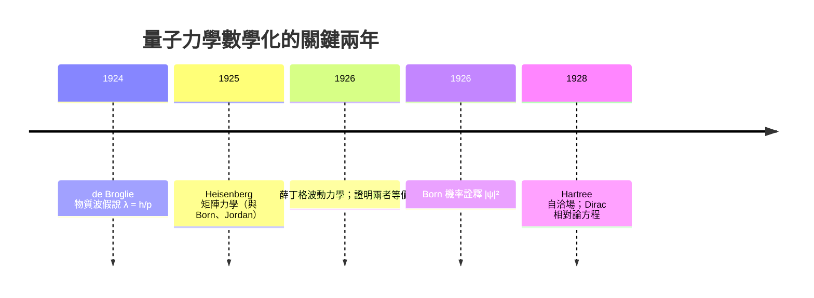

# 03.1 薛丁格方程的數學本質：本徵值與本徵函數問題

## 1. 導言：一條方程改寫了化學

1925 年 Heisenberg 提出矩陣力學，以無限維矩陣描述可觀測量；半年後（1926 年初），薛丁格（Erwin Schrödinger）受到 de Broglie 物質波假說（1924）的啟發，寫下波動力學方程。兩套數學表面迥異——一為矩陣代數，一為偏微分方程——但薛丁格在 1926 年隨即證明兩者**數學等價**。這段歷史告訴我們：物理理論的進步，往往就是數學表述的進步。

對化學家而言，薛丁格方程不只是一條公式，而是把「原子為何穩定」「為何有週期表」「分子鍵如何形成」全部化約為一個**本徵值問題（eigenvalue problem）**。本章將從數學結構切入，說明為何解化學問題＝解線性算子的譜問題。

## 2. 定義：時間相關與時間無關薛丁格方程

**定義 2.1（時間相關薛丁格方程，TDSE）**

$$i\hbar \frac{\partial}{\partial t}\Psi(\mathbf{r},t) = \hat{H}\,\Psi(\mathbf{r},t)$$

其中 $\hbar = h/2\pi$ ， $\hat{H}$ 是 Hamilton 算子。

**定義 2.2（時間無關薛丁格方程，TISE）**
若 $\hat{H}$ 不顯含時間，以分離變數 $\Psi(\mathbf{r},t)=\psi(\mathbf{r})\,e^{-iEt/\hbar}$ 代入，得

$$\hat{H}\psi(\mathbf{r}) = E\,\psi(\mathbf{r})$$

**觀察**：TISE 恰是線性代數中的本徵值方程 $\hat{A}\mathbf{v}=\lambda\mathbf{v}$ 的無限維版本：
- 算子 $\hat{H}$ 對應矩陣 $A$
- 波函數 $\psi$ 對應向量 $\mathbf{v}$
- 能量 $E$ 對應本徵值 $\lambda$

## 3. 定理：Hermite 算子的譜性質

化學中所有物理可觀測量對應的算子都必須是**自伴（Hermite）**的，即

$$\langle \phi | \hat{A} \psi \rangle = \langle \hat{A}\phi | \psi \rangle$$

**定理 3.1（Hermite 算子譜定理）**
設 $\hat{A}$ 為 Hermite 算子，則：
1. 所有本徵值 $a_n$ 為**實數**（這正是「能量可測」的數學保證）。
2. 不同本徵值對應的本徵函數**正交**： $\langle \psi_m|\psi_n\rangle = \delta_{mn}$ 。
3. 本徵函數構成完備正交基，任意態可展開為 $\Psi=\sum_n c_n\psi_n$ 。

> **化學意義**：定理 3.1 的第 2 點就是「原子軌域正交」的根源—— $2s$ 與 $2p$ 軌域積分為零不是巧合，而是 Hermite 結構的必然；第 3 點則是日後 LCAO-MO 方法（見 04.3 節）得以成立的數學基石。

**定理 3.2（Sturm–Liouville 理論）**
一維束縛態問題 $\hat{H}=-\frac{\hbar^2}{2m}\frac{d^2}{dx^2}+V(x)$ 的本徵值離散、非簡併、且按能量排序 $\psi_0,\psi_1,\dots$ 的節點數恰為 $0,1,2,\dots$ 。

> **化學意義**：「節點數遞增」解釋了原子軌域的層級結構—— $1s$ 無節點、 $2s$ 一個節點，節點越多能量越高，這正是 Pauli 填充原理背後的能量排序依據。

## 4. 歷史驅動：矩陣力學與波動力學的統一



Heisenberg 的做法：物理量 $x$ 、 $p$ 用矩陣表示，且服從對易關係 $[x,p]=i\hbar$ 。薛丁格的做法：能量與動量以**微分算子**表示

$$\hat{p} = -i\hbar\nabla, \qquad \hat{T} = -\frac{\hbar^2}{2m}\nabla^2$$

兩者可互換，因為微分算子在適當基底下就是矩陣。Dirac 進一步發展 bras 與 kets 記號 $\langle\phi|\hat{A}|\psi\rangle$ ，使矩陣語言與波函數語言合一——今日量子化學的符號系統即源於此。

## 5. 範例一：一維無限位能井——最簡單的本徵值問題

$$\hat{H} = -\frac{\hbar^2}{2m}\frac{d^2}{dx^2},\quad 0<x<L,\ \ V=0;\quad \psi(0)=\psi(L)=0$$

解之得本徵函數與本徵值：

$$\psi_n(x) = \sqrt{\frac{2}{L}}\sin\frac{n\pi x}{L},\qquad E_n = \frac{n^2 h^2}{8mL^2},\quad n=1,2,3,\dots$$

**化學實例：共軛多烯的π電子**
丁二烯（butadiene， $\mathrm{C_4H_6}$ ）的 4 個 π 電子可粗略視為「關在長度 $L\approx 5.7$ Å 的井中」。電子按 Pauli 原理填入 $n=1,2$ 各兩顆，HOMO–LUMO 能隙決定吸收波長：

```python
import numpy as np

h, c = 6.626e-34, 3.0e8
m_e = 9.109e-31
L = 5.7e-10          # 丁二烯共軛鏈長 (m)
E_n = lambda n: n**2 * h**2 / (8 * m_e * L**2)

dE = E_n(3) - E_n(2)                 # HOMO(n=2) -> LUMO(n=3)
lam = h * c / dE
print(f"預測吸收波長 ≈ {lam*1e9:.0f} nm")   # 實驗值約 217 nm
```

質點在井模型（particle-in-a-box）雖粗糙，卻正確預言了「共軛鏈越長、能隙越小、吸收越紅移」的趨勢——這是本徵值問題直接解釋光譜的第一課。

## 6. 範例二：簡諧振子與分子振動

分子振動（紅外光譜的來源）由諧振子描述：

$$\hat{H} = -\frac{\hbar^2}{2\mu}\frac{d^2}{dx^2} + \frac{1}{2}kx^2
\;\Rightarrow\; E_v = \hbar\omega\left(v+\tfrac{1}{2}\right),\ \ \omega=\sqrt{k/\mu}$$

**化學實例**：HCl 分子的約化質量 $\mu \approx 1.627\times10^{-27}$ kg、力常數 $k\approx 481$ N/m，基本振動頻率 $\tilde{\nu}=\omega/2\pi c$ ：

```python
mu  = 1.627e-27      # kg
k   = 481.0          # N/m
c   = 3.0e10         # cm/s
nu_tilde = np.sqrt(k/mu) / (2*np.pi*c)
print(f"HCl 基頻 ≈ {nu_tilde:.0f} cm⁻¹")   # 實驗值約 2990 cm⁻¹
```

注意零點能 $E_0=\frac{1}{2}\hbar\omega>0$ ：束縛系統永不靜止，這是本徵值**下界**的直接體現，也是同位素效應（D 取代 H 使 $\mu$ 變大、頻率變小）的理論根據。

## 7. 數值觀點：離散化即矩陣化

在電腦上，我們把 $[-\frac{\hbar^2}{2m}\frac{d^2}{dx^2}$ 用有限差分離散化，TISE 就變成**實對稱矩陣的本徵值問題** $H\mathbf{c}=E\mathbf{c}$ ——薛丁格 1926 年的洞見在數值上被完整重演：

```python
import numpy as np

n = 200
L, m, hbar = 1.0, 1.0, 1.0
dx = L/(n+1)
main = np.full(n, -2.0); off = np.ones(n-1)
H = (-hbar**2/(2*m*dx**2)) * (np.diag(main) + np.diag(off,1) + np.diag(off,-1))
E = np.linalg.eigvalsh(H)
print("數值 E1..E3 :", np.round(E[:3], 6))
print("解析 h²n²/8 :", np.round([i**2*hbar**2/(8*m*L**2) for i in (1,2,3)], 6))
```

對稱矩陣 $\Rightarrow$ 實本徵值 $\Rightarrow$ 可對角化，與定理 3.1 完全呼應。

## 8. 章末小結

| 數學概念 | 化學對應 |
|---|---|
| 本徵值方程 $\hat H\psi=E\psi$ | 定態能量與光譜線 |
| Hermite 算子實本徵值 | 能量可測、物理量為實數 |
| 本徵函數正交性 | 軌域正交、選擇規則 |
| 節點數遞增定理 | 軌域能階排序、電子填充 |
| 連續譜 vs 離散譜 | 游離態 vs 束縛態 |
| 離散化後的矩陣本徵值問題 | 計算化學的核心演算法 |

**關鍵回顧**
1. TISE 是無限維 Hermite 算子的本徵值問題；譜定理保證實能量、正交基、完備展開。
2. Heisenberg 矩陣力學與薛丁格波動力學是同一數學結構的兩種表述，Dirac 記號統一之。
3. 質點在井與諧振子兩個可解析模型，直接解釋共軛分子吸收與分子振動光譜。

**下一步**：能量、動量算子之間不能隨意交換次序——這個「不交換性」正是不確定性原理與 Pauli 原理的數學源頭。詳見 03.2 節。

---

## 習題

1. 證明：若 $\hat{A}$ Hermite，則其任意本徵值為實數。（提示： $\langle\psi|\hat A|\psi\rangle=a\langle\psi|\psi\rangle$ ，取共軛比較。）
2. 質點在井中，計算 $n=1\to2$ 躍遷能量，並以 Python 驗證節點數與 $n$ 的關係。
3. 說明為何有限差分矩陣 $H$ 必為對稱矩陣，並解釋這與定理 3.1 的關聯。
4. 以諧振子模型估計 DCl 的基頻（ $\mu_{\mathrm{DCl}}\approx 3.162\times10^{-27}$ kg）。
