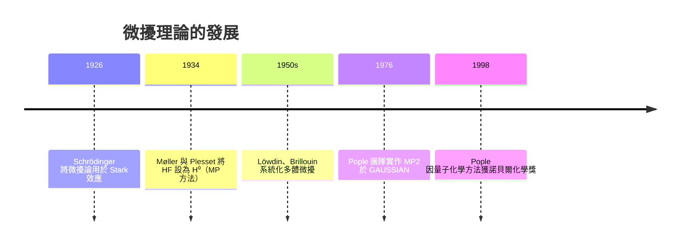

# 04.2 微擾理論：微小改變如何影響分子性質

## 1. 導言：從「可解」逼近「不可解」

變分法（04.1）給出嚴格上界，但每次改進都需重新優化。1930 年代，物理學家回頭借用天文學的古老武器——**微擾論**（19 世紀用於行星軌道，Lindstedt、Poincaré），由 Schrödinger 本人（1926）與 Born、Heisenberg 移植到量子力學。其哲學截然不同：

> 若 $\hat H=\hat H^{(0)}+\lambda\hat V$ 而 $\hat H^{(0)}$ 可精確解，則把物理量展開為小參數 $\lambda$ 的冪級數，逐階修正。

化學中「微小改變」無所不在：外電場（Stark 效應）、磁場（NMR、Zeeman）、分子振動的非諧性、電子間的瞬時相關（MP2）。本章講述 Rayleigh–Schrödinger 微擾論及其在化學的旗艦應用——Møller–Plesset 二階微擾（MP2）。

## 2. 定義：微擾展開

**定義 2.1** 設

$$\hat H(\lambda)=\hat H^{(0)}+\lambda\hat V,\qquad \hat H^{(0)}|n^{(0)}\rangle=E_n^{(0)}|n^{(0)}\rangle$$

並假設

$$E_n(\lambda)=E_n^{(0)}+\lambda E_n^{(1)}+\lambda^2E_n^{(2)}+\cdots,\qquad
|n(\lambda)\rangle=|n^{(0)}\rangle+\lambda|n^{(1)}\rangle+\cdots$$

**中間歸一化**：$\langle n^{(0)}|n(\lambda)\rangle=1$，即 $\langle n^{(0)}|n^{(k)}\rangle=0\ (k\ge1)$。

## 3. 定理：各階能量修正

**定理 3.1（非簡併 Rayleigh–Schrödinger 微擾論）**
一階與二階能量修正為：

$$E_n^{(1)}=\langle n^{(0)}|\hat V|n^{(0)}\rangle$$

$$E_n^{(2)}=\sum_{m\ne n}\frac{|\langle m^{(0)}|\hat V|n^{(0)}\rangle|^2}{E_n^{(0)}-E_m^{(0)}}$$

一階波函數修正：

$$|n^{(1)}\rangle=\sum_{m\ne n}\frac{\langle m^{(0)}|\hat V|n^{(0)}\rangle}{E_n^{(0)}-E_m^{(0)}}|m^{(0)}\rangle$$

**解讀**：
1. $E^{(1)}$ 是微擾在未擾動態上的平均值——「一階看平均值」。
2. $E^{(2)}$ 是「激發態藉混合回饋」的修正：若 $|n^{(0)}\rangle$ 能量低於 $|m^{(0)}\rangle$（$E_n<E_m$），則貢獻為**負**——體系總能透過與高階態混合而降低，這與變分原理精神一致。
3. 能隙越小、耦合越強，修正越大——這解釋了為何微擾論在「近簡併」時失效。

**定理 3.2（簡併微擾：二階矩陣對角化）**
若 $E_n^{(0)}$ 有 $g$ 重簡併，須先在簡併子空間中對角化矩陣 $V_{ij}=\langle n,i|\hat V|n,j\rangle$，其本徵值即一階修正。**簡併被微擾「解除」**。

> **化學意義**：分子在磁場中 NMR 化學位移的差異、配位場理論中 $d$ 軌域分裂成 $t_{2g}$ 與 $e_g$（八面體場），全是簡併微擾的矩陣對角化。

## 4. 歷史驅動：微擾論如何成為量子化學支柱



關鍵轉折是 1934 年 Møller–Plesset 的選擇：以 **Hartree–Fock 的 Fock 算子**為 $\hat H^{(0)}$。因 HF 已含平均場，$\hat V$ 只是電子的**瞬時相關**（電子互相迴避的動態行為），天然是「小項」。

## 5. 旗艦應用：MP2 相關能

MP2 電子相關能（閉殼層）：

$$E_{\mathrm{corr}}^{(2)} = \sum_{i,j}^{\text{occ}}\sum_{a,b}^{\text{virt}}
\frac{|\langle ij \| ab\rangle|^2}{\varepsilon_i+\varepsilon_j-\varepsilon_a-\varepsilon_b}$$

其中 $\langle ij\|ab\rangle$ 為雙電子反對稱化積分（含 03.3 的交換積分 $K$）。

**結構解讀**：
- 只有**雙激發**（$i,j\to a,b$）貢獻二階能量——Brillouin 定理保證單激發對能量無一階貢獻。
- 虛軌域能量 $\varepsilon_a$ 越低（能隙小），修正越大：這與定理 3.1 的「能隙小、混合強」一致。
- MP2 是**後 HF 方法中最便宜的相關能校正**，在 1976 年 Pople 實作後成為計算化學的標準工具。

**化學實例**：氫分子在 HF 下解離能嚴重高估（HF 無法描述鍵斷裂時的靜相關），MP2 大幅改善；但對金屬與自由基，微擾展開分母變小而發散——這正是「近簡併破壞微擾論」的實際案例，需改用多組態方法。

## 6. 數值實驗：二階 Stark 效應與極化率

對諧振子加微擾 $\hat V = -qFx$（電場 $F$）：

- 一階修正 $E^{(1)}=-qF\langle x\rangle=0$（基態無固有偶極）
- 二階修正 $E^{(2)} = -\frac{q^2F^2}{2m\omega^2}$

由 $E(F)=E(0)-\frac12\alpha F^2$，得**極化率** $\alpha = q^2/(m\omega^2)$——分子的可極化性直接從二階微擾算出，而極化率決定折射率、Raman 強度與凡得瓦力。以下數值驗證：

```python
import numpy as np

n = 60; hbar = m = w = q = 1.0
a = np.diag(np.sqrt(np.arange(1, n)), 1)
X = (a + a.T) / np.sqrt(2)          # x 矩陣（ħ=m=ω=1）
H0 = hbar*w*(np.diag(np.arange(n)+0.5))
for F in (0.02, 0.05, 0.1):
    E = np.linalg.eigvalsh(H0 - q*F*X)
    dE = E[0] - hbar*w*0.5
    print(f"F={F:4.2f}  ΔE={dE:+.6f}  −αF²/2={-0.5*q*q*F*F/(m*w**2):+.6f}")
# 數值 ΔE 與 −αF²/2 吻合 → α = q²/(mω²) 獲得驗證
```

## 7. 微擾論的適用邊界

| 情境 | 微擾論表現 | 原因 | 對策 |
|---|---|---|---|
| 電子相關（閉殼層平衡結構） | 良好 | 動相關小、能隙大 | MP2 可用 |
| 鍵斷裂、自由基、過渡金屬 | 失效（發散） | 近簡併、靜相關 | CASSCF、DFT |
| 色散力 | MP2 部分成功 | 長程相關需更高階 | DFT-D、CCSD(T) |
| 外場弱微擾（Stark/Zeeman） | 極佳 | 真正的小參數 | 標準微擾 |

這張表是方法選擇的化學常識：**微擾論的有效範圍由「能隙 vs 耦合強度」的比值決定**，純粹是數學收斂問題。

## 7.5 一階修正的化學速算：偶極矩與分子辨識

$E^{(1)}=\langle\hat V\rangle$ 常可紙筆估計，用於預測分子對外場的「一階反應」：

1. **Stark 效應一階項**：極性分子（HF、CO）在電場中 $E^{(1)}=-\boldsymbol\mu\cdot\mathbf F$，非極性分子（$\mathrm{N_2}$、$\mathrm{CO_2}$）$\langle\mu\rangle=0$，一階消失、只剩二階——這正是微波光譜能區分極性與非極性气体的數學原因。
2. **Zeeman 效應與 NMR**：核自旋在磁場中 $E^{(1)}=-g_N\mu_N m_I B_0$，能階差 $\propto B_0$；電子雲的屏蔽使有效場偏移，化學位移 $\delta$ 本質是「一階修正的環境修正」。
3. **超精細分裂**：電子自旋與核自旋的費米接觸項使 EPR 譜線分裂為 $2nI+1$ 條——自由基結構鑑定的標準工具，其理論骨架完全是一階微擾。

**速算範例**：質子在 $B_0=9.4$ T（400 MHz 儀器）下的 Larmor 頻率

$$\nu = \frac{g_N\mu_N B_0}{h} \approx 400\ \text{MHz}$$

一切 NMR 實驗的「共振條件」就是一階微擾的能量差配上行星光子能量。

## 8. 微擾論的歷史基因：從行星到電子

微擾論並非量子力學的發明。18–19 世紀天文學家為解釋木星對土星軌道的攝動，發展出逐階展開技術；Poincaré 在三体問題中證明級數一般**發散**但仍漸近有效，這一洞察直接預告了量子微擾論的適用條件。Schrödinger 1926 年的論文第四篇即以微擾論處理 Stark 效應，向天文學致敬。

**漸近級數的性質**：微擾級數 $\sum_k \lambda^k E^{(k)}$ 通常不收斂（項數夠多後發散），但前幾項隨階數**先降後升**。實務上取最小項附近截斷（「最佳截斷」），MP2 常落在有效區間，MP4 之後反而可能變差——這就是為何「更高階不一定更好」的數學原因。

**化學實例：MP2 vs MP3 vs CCSD(T) 對氫鍵**
水雙體的氫鍵能，MP2 給出過度結合（色散過強），CCSD(T)（含更高階項的耦合群方法）與實驗吻合——當微擾階數逼近失效區，需改用非微擾的指數擬合（耦合群的 $e^{\hat T}$ 參數化）。

## 9. 章末小結

1. Rayleigh–Schrödinger 微擾論逐階修正：一階取平均、二階經虛激發混合，分母 $E_n^{(0)}-E_m^{(0)}$ 決定收斂。
2. 簡併時先在簡併子空間對角化微擾矩陣——配位場分裂與 NMR 位移由此而生。
3. Møller–Plesset 以 Fock 算子為 $\hat H^{(0)}$，MP2 以雙激發求和給出相關能，是 Pople 實作後量子化學的標準配備。
4. 二階微擾直接產生分子極化率，連結光譜與分子間作用力；近簡併是微擾論的天敵。

**下一步**：從氫原子的解析解，到 LCAO 基底 + 矩陣對角化，再到 HF/MP2——所有方法最後都匯流到同一個數值動作：**構建矩陣並對角化**。見 04.3 節總其成。

---

## 習題

1. 推導二階能量修正公式（代入展開式、逐階比較 $\lambda$ 的係數）。
2. 證明二階修正 $E_n^{(2)}$ 對非簡併基態恆為負。
3. 以 $\hat V=-qFx$ 對諧振子手算 $E^{(2)}$，並用 $x\propto a+a^\dagger$ 的階梯關係說明只有 $n\to n\pm1$ 貢獻。
4. 用 Python 重現第 6 節數值實驗，並對 $n=30,60,120$ 比較截斷誤差，說明其與微擾階數的關係。
