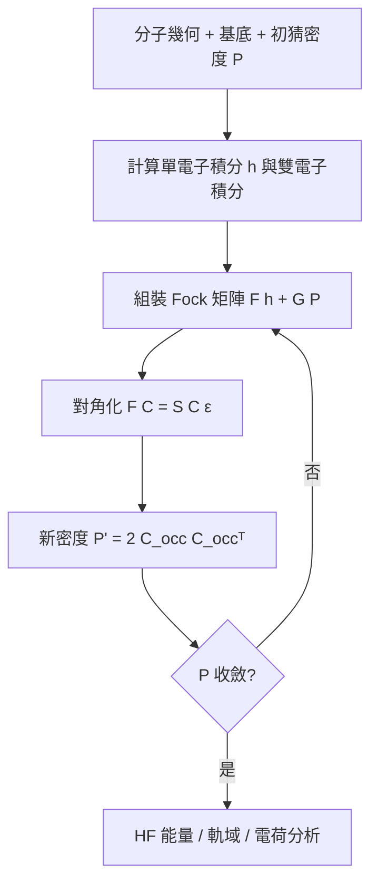
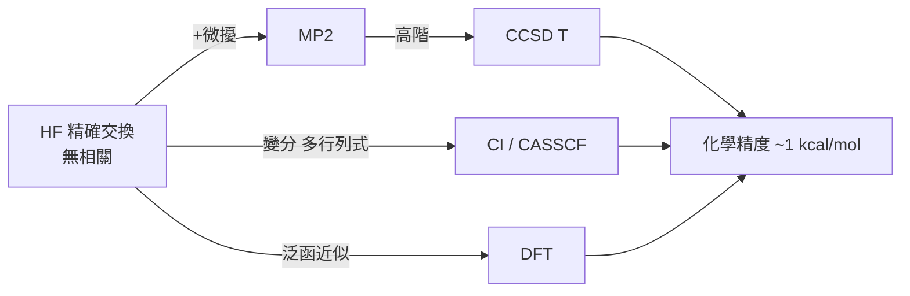

# 04.3 從氫原子到複雜分子：軌域疊加與矩陣對角化的實踐

## 1. 導言：一條從解析到數值的收束之路

1926 年薛丁格解出氫原子；1927 年 Heitler–London 解出（近似的） $\mathrm{H_2}$ ——從此化學有了量子理論。此後九十年的量子化學史，是一部「**把無限維本徵值問題壓縮成有限矩陣對角化**」的工程史。本章整合前三節的全部數學：譜定理（03.1）、算子代數（03.2）、Slater 行列式（03.3）、變分法（04.1）、微擾論（04.2），展示現代計算化學（Gaussian、ORCA、PySCF）的完整邏輯鏈。

## 2. 氫原子：唯一的解析錨點

氫原子 TISE 在球座標下分離變數，角向部分由 03.2 的角動量代數直接給出（球諧函數 $Y_l^m$ ），徑向部分化為 Laguerre 方程：

$$E_n = -\frac{E_h}{2}\,\frac{Z^2}{n^2},\qquad
\psi_{nlm}(r,\theta,\phi)=R_{nl}(r)\,Y_l^m(\theta,\phi)$$

其中 $E_h=27.211$ eV（Hartree 能量，原子單位制的基石）。氫原子的價值不在本身，而在其**軌域成為一切分子的建造材料**：

$$\text{原子軌域 } \{1s,2s,2p_x,\dots\} \;\xrightarrow{\text{疊加}}\; \text{分子軌域}$$

## 3. LCAO–MO：軌域疊加的變分表述

**定義 3.1（LCAO 試探函數）**

$$\psi_k = \sum_{\mu=1}^M C_{\mu k}\,\chi_\mu$$

其中 $\{\chi_\mu\}$ 為原子軌域基底（真實計算中常用 Gaussian 型軌域，因多中心積分可解析）。代入 Rayleigh 商（04.1）並對係數變分：

$$\boxed{\;\mathbf{FC} = \mathbf{SC}\,\boldsymbol\varepsilon\;}$$

這是 Roothaan–Hall 方程（1951）：**量子化學的核心方程，本質是廣義本徵值問題**。因 Fock 矩陣依賴未知 $\mathbf C$ ，構成自洽迭代（SCF）循環：



## 4. 定理：對角化的數學保證

**定理 4.1（Löwdin 正交化）**
重疊矩陣 $\mathbf S$ Hermite 正定，存在 $\mathbf S^{-1/2}$ 。令 $\mathbf C'=\mathbf S^{1/2}\mathbf C$ ，則

$$\mathbf S^{-1/2}\mathbf F\,\mathbf S^{-1/2}\,\mathbf C' = \boldsymbol\varepsilon\,\mathbf C'$$

化為標準對稱本徵值問題，可安全使用 Jacobi、QR 或 Davidson 等演算法。

**定理 4.2（Koopmans 定理，1933）**
HF 軌域能量的負值近似游離能： $I\approx-\varepsilon_{\mathrm{HOMO}}$ （忽略軌域鬆弛）。同樣地 $\varepsilon_{\mathrm{LUMO}}\approx-EA$ 。這讓「對角化一次」就得到光譜學量的零階估計。

**定理 4.3（Hund–Mulliken 填充與鍵級）**
按 Pauli 原理將電子填入最低軌域後，Mulliken 鍵級

$$P_{\mu\nu}^{\text{bond}} = \sum_{i\in occ} C_{\mu i}C_{\nu i}\,(2\delta_{ii} ) \;\Rightarrow\; \text{鍵級}\approx\tfrac12(\text{成鍵電子} - \text{反鍵電子})$$

> **化學意義**： $\mathrm{He_2}$ 鍵級 0（不成鍵）、 $\mathrm{H_2}$ 鍵級 1、 $\mathrm{O_2}$ 鍵級 2 且具兩顆未成對電子（順磁性）——1920 年代「氧為何是順磁體」的懸案由 MO 理論與 Pauli 原理一舉解決。

## 5. 化學實例：丁二烯的 Hückel 模型——紙筆上的對角化

Hückel 理論（1930）是 LCAO 的極簡版：只保留 $\pi$ 体系，取 $\alpha=\langle\phi_i|\hat H|\phi_i\rangle$ 、 $\beta=\langle\phi_i|\hat H|\phi_{i+1}\rangle$ ，忽略非相鄰作用。丁二烯（4 個碳）：

$$\mathbf H = \begin{pmatrix}\alpha&\beta&0&0\\ \beta&\alpha&\beta&0\\ 0&\beta&\alpha&\beta\\ 0&0&\beta&\alpha\end{pmatrix}$$

```python
import numpy as np

n = 4
H = np.diag(np.full(n, -0.5)) + np.diag(np.full(n-1, -0.75), 1) + np.diag(np.full(n-1, -0.75), -1)
E, C = np.linalg.eigh(H)          # 對稱矩陣 → 特徵值遞增排序
print("π 軌域能量 :", np.round(E, 4))
print("HOMO(2) 係數:", np.round(C[:, 1], 4))
print("LUMO(3) 係數:", np.round(C[:, 2], 4))
```

對角化立刻得到：4 個 π 軌域、2 占 2 空；HOMO–LUMO 能隙預測吸收波長、末端係數最大預測親電反應位置（有機化學的電子密度直覺由此而來）。**化學直覺 = 本徵向量的分量分佈。**

## 6. 實踐全貌：現代量化軟體的數值階梯

| 步驟 | 數學操作 | 對應章節 |
|---|---|---|
| 幾何輸入 + 基底選擇 | 有限子空間逼近 | 04.1（Rayleigh–Ritz） |
| 積分計算 | $h_{\mu\nu},(\mu\nu\|\lambda\sigma)$ | 03.2（算子矩陣元） |
| SCF 迭代 | 廣義本徵值問題反覆對角化 | 04.1（變分）+ 03.3（Slater 行列式） |
| 相關能 | MP2 對 $(ij,ab)$ 求和 | 04.2（微擾） |
| 性質計算 | 微擾回應（極化率、NMR） | 04.2 |
| 幾何優化 | $\partial E/\partial R$ ，能量面爬山 | 變分 + 微擾聯手 |

以下用 PySCF 風格的偽碼展示完整流程（真實軟體同一邏輯）：

```python
# pip install pyscf
from pyscf import gto, scf

mol = gto.M(atom="H 0 0 0; F 0 0 1.73", basis="6-31g", verbose=0)
mf  = scf.RHF(mol)
e_hf = mf.kernel()                       # SCF: 反覆組裝 F 並對角化
print(f"HF 能量 = {e_hf:.6f} Eh")
print(f"HOMO = {mf.mo_energy[mf.mo_occ>0][-1]:.3f} Eh")
print(f"偶極矩(au) =", mf.dip_moment())
```

約二十行程式，重現了 1926–1951 年間三代物理學家的工作。

## 7. 方法的譜系與極限：誤差從哪裡來



- **HF 的系統性偏差**：無電子相關（04.2 的 MP2 補正動相關）。
- **近簡併**（鍵斷裂、自由基）：微擾失效，需多組態變分（CASSCF）。
- **基底不完備**：擴大基組按 Hylleraas–Undheim–MacDonald 單調收斂（04.1），即「complete basis set」外推。

化學精度的追求，本質是**同時控制變分誤差與微擾誤差**的數值工程。

## 8. 從對角化到化學語言：軌域、電荷與反應性

對角化的輸出不是數學終點，而是化學語言的起點：

1. **軌域影像**：本徵向量 $\{C_{\mu k}\}$ 把係數疊回原子軌域，畫出 MO 立體圖——化學家的「電子雲」是本徵向量的視覺化。
2. **電荷分析**：Mulliken 或 Löwdin 佈居分析將密度矩陣 $\mathbf P$ 拆解為原子電荷，預測親電/親核攻擊位置。
3. **光譜模擬**：躍遷偶極矩 $\langle\psi_i|\hat\mu|\psi_j\rangle$ 由本徵向量計算，直接給出 UV-Vis 吸收強度（選擇規則由對稱性決定，見 02 章）。
4. **幾何優化**：能量對核座標的梯度 $\partial E/\partial R_\alpha$ （Hellmann–Feynman 定理）反饋給優化器，找到極小值即平衡結構。

**例：HF 分子的偶極矩**
SCF 收斂後由密度矩陣得 $\mu\approx 1.8$ D（實驗 1.82 D）。電荷分佈不對稱的來源可追溯到 MO 係數：氟的 $2p$ 與氫的 $1s$ 能量失配，使成鍵軌域偏向氟——**電負度的量子詮釋就是軌域能量失配在本徵向量中的體現**。

## 9. 章末小結

1. 氫原子提供解析錨點；其軌域經 LCAO 疊加成分子軌域，變分得 Roothaan–Hall 方程 $\mathbf{FC}=\mathbf{SC}\varepsilon$ 。
2. 一切現代量子化學 = **組裝積分矩陣 → Löwdin 正交化 → 對角化 → 填充（Pauli）→ 迭代至自洽**。
3. Koopmans 定理、Hückel 模型、鍵級與 $\mathrm{O_2}$ 順磁性，都是「對角化產生化學知識」的直接範例。
4. 方法譜系（HF→MP2→CC、CI、DFT）由變分與微擾兩大數學支柱組合而成，誤差來源可用兩者的理論精確診斷。

**下一步**：有了能量與軌域，化學家真正想要的是**結構、光譜與反應性**：勢能面與振動分析（Hessian 對角化）、電子躍遷（TD-DFT）、以及群論對稱性如何預先決定哪些矩陣元為零。對稱性與光譜的世界，將在下一章展開。

---

## 習題

1. 推導 H₂ 的 Hückel 矩陣並對角化，證明鍵級為 1。
2. 用 Python 對丁二烯做 Hückel 計算，比較 HOMO–LUMO 能隙與實驗吸收 217 nm 的對應關係。
3. 解釋 Löwdin 正交化如何把廣義本徵值問題化為標準問題，並說明 $\mathbf S$ 需正定的原因。
4. 用 PySCF 計算 $\mathrm{H_2O}$ 的 HF 能量與偶極矩，改變基組（STO-3G → 6-31G → cc-pVDZ）觀察能量單調下降，驗證變分定理。
