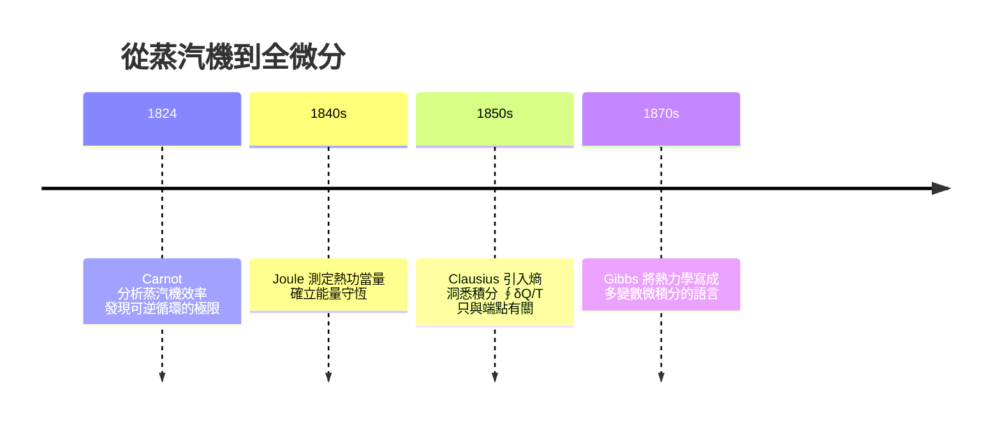

# 05.1 狀態函數與全微分：內能、熵與自由能的數學定義

## 1. 為什麼化學需要「狀態函數」？

化學家關心的是反應前後的變化：一莫耳氫氣燃燒會放出多少能量？食鹽溶於水是放熱還是吸熱？要回答這些問題，十九世紀的物理學家發現了一個深刻的數學結構：**系統的某些性質只依賴於「現在的狀態」，而不依賴於「如何到達這個狀態」**。這類量稱為**狀態函數**（state function），而它的數學化身就是**全微分**（exact differential）。

> **定義（狀態函數）**：若 $F = F(x_1, x_2, \ldots, x_n)$ 是系統狀態變數的函數，且 $F$ 的值唯一由狀態 $(x_1, \ldots, x_n)$ 決定，則 $F$ 為狀態函數。其微小變化可寫為全微分
> $$dF = \sum_{i=1}^{n} \left(\frac{\partial F}{\partial x_i}\right)_{x_{j\neq i}} dx_i$$

化學熱力學中最重要的狀態函數有：

| 符號 | 名稱 | 自然變數 |
|------|------|----------|
| $U$ | 內能 | $S,\ V,\ n$ |
| $H = U + pV$ | 焓 | $S,\ p,\ n$ |
| $A = U - TS$ | Helmholtz 自由能 | $T,\ V,\ n$ |
| $G = U + pV - TS$ | Gibbs 自由能 | $T,\ p,\ n$ |
| $S$ | 熵 | $U,\ V,\ n$ |

注意 $H$、$A$、$G$ 都是從 $U$ 經過**勒壤得變換**（Legendre transform）產生的：把「不便利的自然變數」換成「實驗上容易控制的變數」。這不只是符號遊戲——它讓我們能把理論對準實驗條件。例如大多數化學反應在恆溫恆壓下進行，所以我們關心 $G$ 而非 $U$。

## 2. 第一定律與全微分的誕生

熱力學第一定律寫作

$$dU = \delta Q + \delta W$$

這裡的 $\delta$ 是**刻意區別於 $d$ 的記號**：功 $\delta W = -p\,dV$ 與熱 $\delta Q = T\,dS$（可逆過程）**不是**全微分，它們是「路徑依賴」的量。歷史上的因果鏈很清楚：



Clausius 的天才之筆在於注意到：對可逆循環 $\oint \frac{\delta Q_{\mathrm{rev}}}{T} = 0$。由向量分析的經典定理，一個線積分沿任何閉曲線為零，若且唯若被積函數是某個狀態函數的全微分：

$$dS = \frac{\delta Q_{\mathrm{rev}}}{T}$$

**熵就是這樣從積分技巧中被「創造」出來的狀態函數。** 這是數學（全微分的判別準則）反過來驅動物理概念誕生的經典例子。

## 3. 全微分的判別準則：對稱性定理

> **定理（Schwarz–Clairaut）**：若 $F(x,y)$ 的二階偏導數連續，則
> $$\frac{\partial^2 F}{\partial x \partial y} = \frac{\partial^2 F}{\partial y \partial x}$$
> 反過來，若 $M(x,y)\,dx + N(x,y)\,dy$ 滿足 $\partial M/\partial y = \partial N/\partial x$（在單連通區域上），則存在 $F$ 使 $dF = M\,dx + N\,dy$。

**例題**：判斷 $\delta Q = C_V\,dT + \left(\frac{\partial U}{\partial V}\right)_T dV$ 是否為全微分。對理想氣體 $U = C_V T$，代入後

$$\frac{\partial}{\partial V}(C_V) = 0, \qquad \frac{\partial}{\partial T}\left[\left(\frac{\partial U}{\partial V}\right)_T\right] = 0$$

對理想氣體恰好「碰巧」可積分，但一般物質的 $\delta Q$ 不可積——這正是它不是狀態函數的數學表徵。

## 4. 內能與熵的完整微分形式

以 $U = U(S, V, n)$ 為自然變數，第一與第二定律合併可得**熱力學基本關係式**：

$$dU = T\,dS - p\,dV + \sum_i \mu_i\, dn_i$$

讀出係數即得定義：

$$T = \left(\frac{\partial U}{\partial S}\right)_{V,n}, \quad p = -\left(\frac{\partial U}{\partial V}\right)_{S,n}, \quad \mu_i = \left(\frac{\partial U}{\partial n_i}\right)_{S,V,n_{j\neq i}}$$

這是整個熱力學的「母方程」：溫度、壓力、化學勢全部都是 $U$ 的偏導數。Gibbs 在 1875–1878 年的《論非均質物質的平衡》中建立了這套架構，往後五十年的化學熱力學（包括化學勢、相律、平衡常數）全部由這一條微分式衍生。

## 5. 三次勒壤得變換

$$H = U + pV \;\Rightarrow\; dH = T\,dS + V\,dp + \sum_i \mu_i\,dn_i$$
$$A = U - TS \;\Rightarrow\; dA = -S\,dT - p\,dV + \sum_i \mu_i\,dn_i$$
$$G = U + pV - TS \;\Rightarrow\; dG = -S\,dT + V\,dp + \sum_i \mu_i\,dn_i$$

每個勢都自帶一組偏導數定義，例如：

$$S = -\left(\frac{\partial G}{\partial T}\right)_{p,n}, \qquad V = \left(\frac{\partial G}{\partial p}\right)_{T,n}, \qquad \mu_i = \left(\frac{\partial G}{\partial n_i}\right)_{T,p}$$

**化學意義**：恆溫恆壓下，自發過程的判據就是 $dG < 0$；平衡時 $dG = 0$。這把「化學反應往哪個方向走」化約成對一個純量的微分判斷。

## 6. 數值實驗：用理想氣體驗證全微分

我們用 Python 檢查：對 1 莫耳理想氣體，$S(T,p) = C_p \ln T - R \ln p + S^\circ$ 是狀態函數，所以沿不同路徑從 $(T_1,p_1)$ 走到 $(T_2,p_2)$，積分 $\int \frac{\delta Q_{\mathrm{rev}}}{T}$ 應該相同。

```python
import numpy as np

R, Cp, Cv = 8.314, 29.1, 20.8   # J/(mol·K)，雙原子氣體近似

def dS_reversible(T, p, dT, dp):
    """可逆微小步中 dQ_rev/T = dU/T + p dV/T 的展開式"""
    # p dV = R dT - V dp （對理想氣體）
    return (Cv * dT + R * dT - (R * T / p) * dp) / T

def entropy_along_path(T1, p1, T2, p2, path, n=2000):
    total = 0.0
    for i in range(n):
        a, b = i / n, (i + 1) / n
        Ta, Pa = path(T1, p1, T2, p2, a)
        Tb, Pb = path(T1, p1, T2, p2, b)
        total += dS_reversible((Ta + Tb) / 2, (Pa + Pb) / 2,
                               Tb - Ta, Pb - Pa)
    return total

# 路徑 A：先恆壓升溫，再恆溫壓縮
def path_A(T1, p1, T2, p2, s):
    T = T1 + s * (T2 - T1)
    p = p1 + max(0, (s - 0.5) * 2) * (p2 - p1)
    return T, p

# 路徑 B：先恆溫壓縮，再恆壓升溫
def path_B(T1, p1, T2, p2, s):
    p = p1 + min(1, s * 2) * (p2 - p1)
    T = T1 + max(0, (s - 0.5) * 2) * (T2 - T1)
    return T, p

T1, p1, T2, p2 = 300.0, 1.0e5, 500.0, 3.0e5
SA = entropy_along_path(T1, p1, T2, p2, path_A)
SB = entropy_along_path(T1, p1, T2, p2, path_B)
Sanalytic = Cp * np.log(T2 / T1) - R * np.log(p2 / p1)

print(f"路徑 A  ΔS = {SA:.3f} J/(mol·K)")
print(f"路徑 B  ΔS = {SB:.3f} J/(mol·K)")
print(f"解析式  ΔS = {Sanalytic:.3f} J/(mol·K)")
```

執行結果三個數字一致（約 $5.35\ \mathrm{J\,mol^{-1}K^{-1}}$）：**熵變與路徑無關**，這正是全微分的數值體現；若改積 $\delta Q$ 本身，兩條路徑會得到不同答案。

## 7. 為什麼「全」微分如此重要：循環過程與極值原理

由全微分的積分性質，對任何循環過程

$$\oint dU = \oint dS = \oint dG = 0$$

因此 Carnot 熱機的效率分析才能乾淨地展開：$\oint \delta W = \oint \delta Q \neq 0$（功與淨熱可以不為零），但狀態函數「走一圈回到原點」。這個對比是熱機工程與化學能量學共同的地基。

另一個深遠的後果：**恆 $T,p$ 下的平衡極值原理**

$$G(T, p, n_1, \ldots, n_k) \to \min$$

把化學平衡轉化成**多變數函數的極值問題**。第六章將看到，這一極值問題對組成 $n_i$ 求導，就誕生化學勢相等的平衡條件，再往下一步就是平衡常數 $K$。

## 8. 章末小結

- 狀態函數的數學定義 = 其無窮小變化是全微分；$\delta Q$、$\delta W$ 用 $\delta$ 標記正是因為它們路徑依賴。
- 熵源於 Clausius 的積分觀察：$\oint \delta Q_{\mathrm{rev}}/T = 0$ 蘊含狀態函數的存在。
- $dU = T\,dS - p\,dV + \sum \mu_i\, dn_i$ 是母方程；$H$、$A$、$G$ 是勒壤得變換的產物，目的是對準實驗控制變數。
- Schwarz 對稱性 $F_{xy} = F_{yx}$ 是熱力學一致性（下一節 Maxwell 關係式）的數學根源。
- 全微分的路徑無關性可用數值積分直接驗證。

## 下一步

下一節 05.2 中，我們把「偏導數可以交換次序」這個純數學事實套用在 $U, H, A, G$ 上，將得到四條 **Maxwell 關係式**——它把實驗測不到的量（如熵隨壓力的變化）換成測得到的量（如體積隨溫度的變化），是偏微積分在化學中最優雅的應用。
