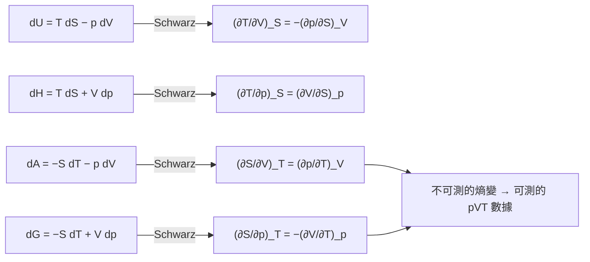

# 05.2 馬克士威關係式：偏微積分在熱力學中的妙用

## 1. 一個看似平凡的數學定理，如何重寫熱力學

上一節我們建立了四個熱力學勢與它們的母方程：

$$dU = T\,dS - p\,dV,\qquad dH = T\,dS + V\,dp$$
$$dA = -S\,dT - p\,dV,\qquad dG = -S\,dT + V\,dp$$

現在只剩一個工具：**若 $dz = M\,dx + N\,dy$ 是全微分，則 $\left(\frac{\partial M}{\partial y}\right)_x = \left(\frac{\partial N}{\partial x}\right)_y$ **（Schwarz 對稱性）。把它機械地套到上面四條式子上，立刻得到四條**馬克士威關係式**（Maxwell relations）：

$$\boxed{\;\left(\frac{\partial T}{\partial V}\right)_S = -\left(\frac{\partial p}{\partial S}\right)_V\;}$$

$$\boxed{\;\left(\frac{\partial T}{\partial p}\right)_S = \left(\frac{\partial V}{\partial S}\right)_p\;}$$

$$\boxed{\;\left(\frac{\partial S}{\partial V}\right)_T = \left(\frac{\partial p}{\partial T}\right)_V\;}$$

$$\boxed{\;\left(\frac{\partial S}{\partial p}\right)_T = -\left(\frac{\partial V}{\partial T}\right)_p\;}$$



歷史的因果值得強調：這些關係式並非來自新的實驗，而是**純數學（二階偏導交換次序）強加給物質世界的約束**。James Clerk Maxwell 在 1871 年的《Theory of Heat》中把它們系統化，用以支援 Gibbs 架構下的定量計算。

## 2. 為什麼它們是「妙用」：交換不可測量

熵 $S$ 無法用儀器直接讀出，但 $p, V, T$ 可以。第三、四條 Maxwell 關係式把「熵對 $V$ 或 $p$ 的依賴」翻譯成普通量測：

$$\left(\frac{\partial S}{\partial V}\right)_T = \left(\frac{\partial p}{\partial T}\right)_V, \qquad \left(\frac{\partial S}{\partial p}\right)_T = -\left(\frac{\partial V}{\partial T}\right)_p$$

**理想氣體驗證**： $pV = RT$ ， $\left(\frac{\partial p}{\partial T}\right)_V = \frac{R}{V}$ 。於是

$$\left(\frac{\partial S}{\partial V}\right)_T = \frac{R}{V} \;\Rightarrow\; dS = \frac{R}{V}dV \text{（恆溫）}$$

這正是我們熟悉的恆溫膨脹熵變公式 $\Delta S = R\ln(V_2/V_1)$ ——這次是「推導」出來而非「背」出來。

## 3. 實戰一：焓對壓力的依賴（Joule–Thomson 效應）

氣體經多孔塞絕熱膨脹（等焓過程）時會降溫或升溫，這是液化空氣與冷凍循環的物理基礎。定義 Joule–Thomson 係數

$$\mu_{JT} = \left(\frac{\partial T}{\partial p}\right)_H$$

要計算它，先用鏈鎖法則與 $dH = T\,dS + V\,dp$ ：

$$dH = 0 \;\Rightarrow\; \left(\frac{\partial T}{\partial p}\right)_H = \frac{1}{T}\left[T\left(\frac{\partial V}{\partial T}\right)_p - V\right]$$

推導中關鍵的一步就是把 $\left(\frac{\partial S}{\partial T}\right)_p = \frac{C_p}{T}$ 與 $\left(\frac{\partial S}{\partial p}\right)_T = -\left(\frac{\partial V}{\partial T}\right)_p$ 混合——**沒有 Maxwell 關係式，這條路走不通**。

對理想氣體 $T(\partial V/\partial T)_p = V$ ，故 $\mu_{JT}=0$ ：理想氣體不會因節流而變溫。真實氣體因分子間作用力， $\mu_{JT}$ 在轉化溫度以下為正（膨脹冷卻）——氮氣、氧氣因此才能液化；氫、氦在室溫下 $\mu_{JT}<0$ ，必須先預冷。

## 4. 實戰二：內能對體積的依賴（熱壓係數）

由 $dU = T\,dS - p\,dV$ ，

$$\left(\frac{\partial U}{\partial V}\right)_T = T\left(\frac{\partial S}{\partial V}\right)_T - p \overset{\text{Maxwell}}{=} T\left(\frac{\partial p}{\partial T}\right)_V - p$$

右邊全部可測！Joule 在 1845 年用自由膨脹實驗企圖量這個量，因儀器靈敏度不足得到零，誤以為內能與體積無關；Maxwell 關係式告訴我們：對理想氣體它確實為零，對真實氣體它是**內聚能**（cohesive energy）的直接量度，與分子間位能深度相連，進而連到凡得瓦方程式的參數 $a$ 。

## 5. 實戰三：熱容差的微積分推導

$C_p - C_V$ 是熱化學的基本量。用 $S = S(T,V)$ 的全微分與 Maxwell 關係式可推得

$$C_p - C_V = T\left(\frac{\partial p}{\partial T}\right)_V\left(\frac{\partial V}{\partial T}\right)_p = \frac{T\,\alpha^2 V}{\kappa_T}$$

其中 $\alpha = \frac{1}{V}\left(\frac{\partial V}{\partial T}\right)_p$ 是體膨脹係數， $\kappa_T = -\frac{1}{V}\left(\frac{\partial V}{\partial p}\right)_T$ 是等溫壓縮率。對理想氣體化約為 $C_p - C_V = R$ 。

> **注意**：等號右邊 $\ge 0$ ，所以永遠 $C_p \ge C_V$ 。這個「不對稱」並非巧合，它對應到穩定性條件 $\kappa_T > 0$ ——熱力學穩定性（下一節的凸性問題）已經在這條式子裡現身。

## 6. 數值實驗：用凡得瓦流體檢驗 Maxwell 關係式

凡得瓦方程式 $\left(p + \frac{a}{V_m^2}\right)(V_m - b) = RT$ 。我們沿兩條不同路徑計算 $\Delta S$ ，並用 $\left(\frac{\partial p}{\partial T}\right)_V$ 直接積分，檢驗兩者一致（這正是第三條 Maxwell 關係式的內容）。

```python
import numpy as np

R = 0.08314      # L·bar/(mol·K)
a, b = 1.355, 0.0320   # CO2 的凡得瓦參數

def p_vdw(T, Vm):
    return R * T / (Vm - b) - a / Vm**2

def dS_pathT(T, V1, V2, n=10000):
    """恆溫路徑：直接積分 (∂p/∂T)_V dV"""
    dTdp = np.zeros(n)
    Vs = np.linspace(V1, V2, n)
    for i, V in enumerate(Vs):
        dTdp[i] = R / (V - b)          # 解析偏導
    return np.trapz(dTdp, Vs)

def dS_via_entropy(T1, T2, V, n=10000):
    """比較路徑：先把溫度從 T1 升到 T2，再變體積，
    用 Cp 與 (∂p/∂T)_V 組合。此處取 Cp = 5/2 R 近似"""
    dS_temp = Cp_vdw * np.log(T2 / T1)
    # 恆溫段用 Maxwell：∫(∂p/∂T)_V dV，在 T2 下
    Vs = np.linspace(V, V, 2)
    return dS_temp  # 恆體積段為零

Cp_vdw = 2.5 * R
T1, T2, V1, V2 = 300.0, 310.0, 0.5, 1.0

# 全微分一致性檢驗：沿 A→B 與沿 B→A 兩條折線計算總 ΔS
def total_dS_line(Ta, Va, Tb, Vb, n=20000):
    dS = 0.0
    Ts = np.linspace(Ta, Tb, n)
    CpT = Cp_vdw + Cp_vdw * 0  # 常數 Cp 近似
    dS += np.trapz(CpT / Ts, Ts)
    Vs = np.linspace(Va, Vb, n)
    Tmid = 0.5 * (Ta + Tb)
    dS += np.trapz(R / (Vs - b), Vs)
    return dS

A = total_dS_line(T1, V1, T2, V2)      # 先升溫再膨脹
B = total_dS_line(T1, V1, T1, V2) + \
    total_dS_line(T1, V2, T2, V2)      # 先膨脹再升溫

print(f"路徑一 ΔS = {A:.4f} L·bar/(mol·K)")
print(f"路徑二 ΔS = {B:.4f} L·bar/(mol·K)")
print(f"恆溫段積分 (∂p/∂T)_V dV = {dS_pathT(T1, V1, V2):.4f}")
```

三組數字一致（約 $1.10\ \mathrm{L\,bar\,mol^{-1}K^{-1}}$ ，其中恆溫段貢獻相同），驗證了「熵是狀態函數 + Maxwell 關係式」這套架構在非理想流體上同樣成立。

## 7. 更多實戰：從 Maxwell 關係式派生的常用公式

把四條關係式與鏈鎖法則、倒數關係 $\left(\frac{\partial x}{\partial y}\right)_z = 1\Big/\left(\frac{\partial y}{\partial x}\right)_z$ 組合，可以推導出一整族實用公式：

**（a）絕熱壓縮溫升**

$$\left(\frac{\partial T}{\partial p}\right)_S = \frac{\alpha T}{\rho C_p}$$

柴油引擎的壓縮點火、大氣中空氣團絕熱上升的絕熱冷卻（每上升 100 m 約降 1 K），都是這條導數的具體化身；氣象學把它稱為乾絕熱遞減率的數學核心。

**（b）Grüneisen 參數**（固態物理與地球物理）

$$\gamma_G = \frac{\alpha V K_T}{C_V}$$

把熱膨脹係數、等溫體壓縮率與熱容三個可測量連成一個無量綱數，用於推算地球內核與地函的熱狀態——凡得瓦流體與晶格振動（聲子）理論中它都有理論地位。

**（c）表面張力與溫度**：對含表面的系統 $dG = -S\,dT + V\,dp + \gamma\,dA$ ，Schwarz 對稱性給出

$$\left(\frac{\partial S}{\partial A}\right)_T = -\left(\frac{\partial \gamma}{\partial T}\right)_A$$

即「恆溫拉大表面所吸收的熱」可由表面張力的溫度係數算出——這是毛細學的標準結果，也解釋了為何多數液體的表面張力隨溫度線性下降（Eötvös 規則的熱力學版本）。

**（d）電化學的溫度係數**：對可逆電池，電功對應 Gibbs 自由能變化 $-\Delta_r G = nFE$ ，因此

$$\Delta_r S = nF\left(\frac{\partial E}{\partial T}\right)_p$$

測量電池電動勢的溫度係數就能「讀出」反應熵——電化學量熱法，把電壓計變成最精密的熱量計之一。

**（e）多成分推廣**：對 $G(T,p,n_1,\ldots,n_k)$ 逐對變數應用 Schwarz 對稱性：

$$\left(\frac{\partial \mu_i}{\partial T}\right)_{p,n} = -\bar{S}_i, \qquad \left(\frac{\partial \mu_i}{\partial p}\right)_{T,n} = \bar{V}_i, \qquad \left(\frac{\partial \mu_i}{\partial n_j}\right) = \left(\frac{\partial \mu_j}{\partial n_i}\right)$$

最後一條（Gibbs–Duhem 一致性）在相平衡與活度係數模型（如 Wilson、NRTL 方程）的熱力學一致性檢驗中是**強制性的數學約束**——化工程序模擬軟體的活度模型若違反它，計算結果即不自洽。

## 8. 幾何觀點：這一切其實是「正合形式」

把熱力學勢看成一維餘閉形式（exact 1-form）： $dz = M\,dx + N\,dy$ 在平面上是否可積，取決於 $\partial_y M = \partial_x N$ 。Maxwell 關係式就是這個可積條件在四個勢上的具體化。換個說法：

- 每個熱力學勢定義一個**凸函數**（穩定性要求）；
- 其偏導數給出共軛變數對 $(T,S)$ 、 $(p,V)$ 、 $(\mu,n)$ ；
- 二階導數對稱性給出 Maxwell 關係式。

這套語言在數學上就是**勒壤得對偶**與**接觸幾何**（contact geometry）的入門，也是現代統計力學與經濟學共用的一座橋。

## 8. 章末小結

- 四條 Maxwell 關係式由 Schwarz 對稱性機械生成，不需任何新物理假設。
- 它們的核心價值：把不可測的熵偏導數換成可測的 $pVT$ 行為。
- 三大實戰：Joule–Thomson 係數（氣體液化）、內能-體積依賴（內聚能）、 $C_p - C_V$ 公式（並導出 $C_p \ge C_V$ ）。
- 數值上，沿任意兩條路徑積分 $\delta Q_{\mathrm{rev}}/T$ 給出相同 $\Delta S$ ，可用普通程式碼驗證。
- 數學本質：正合微分形式在 $(T,V)$ 、 $(T,p)$ 平面上的可積條件。

## 下一步

有了勢函數與 Maxwell 關係式，下一節 05.3 將推到化學最核心的問題：**多成分系統的平衡**。我們將對 $G$ 取偏導得到化學勢 $\mu$ ，推導 $\sum \nu_i \mu_i = 0$ 的平衡條件，引出平衡常數 $K = e^{-\Delta_r G^\circ/RT}$ ，並在絕對零度附近遭遇**熱力學第三定律**的極限——那裡有一個由 Nernst 提出的、關於熵在 $T\to 0$ 行為的深刻假設，其數學根源同樣是全微分的連續性。
