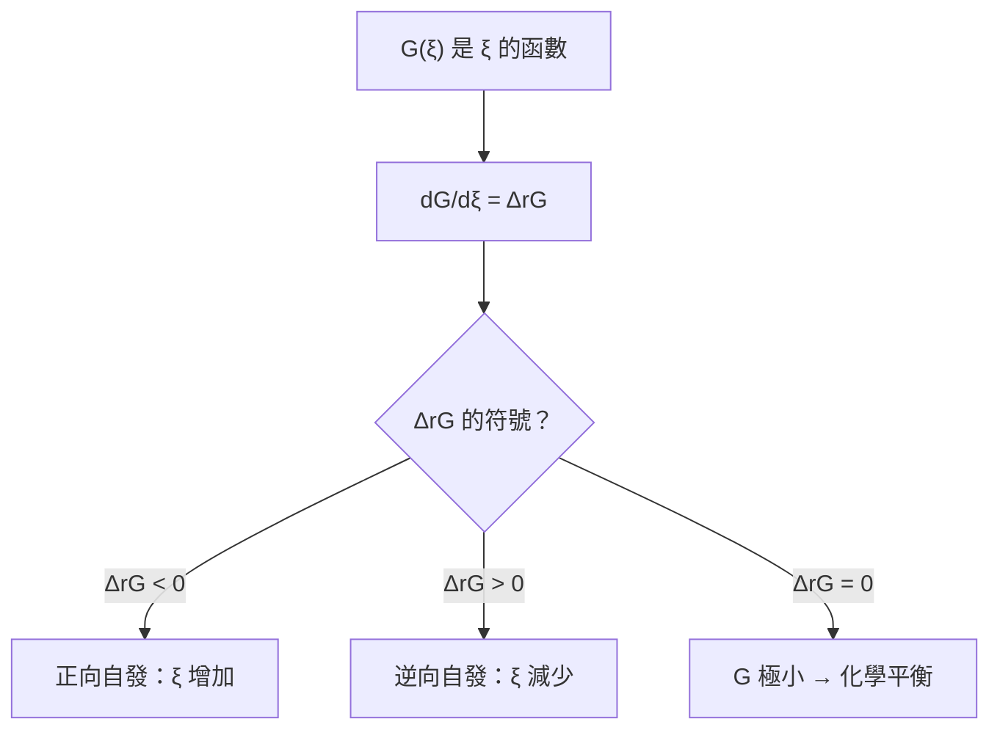
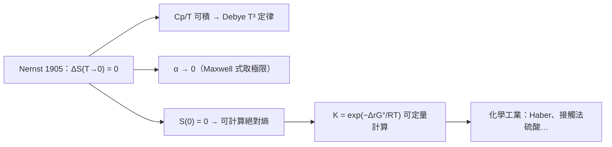

# 05.3 化學平衡的微積分推導：化學勢與熱力學第三定律的極限

## 1. 從「極值」到「化學」：Gibbs 的決定性一步

前兩節處理的是純物質。1875 年 Gibbs 把微分架構推廣到成分可變的系統：

$$dG = -S\,dT + V\,dp + \sum_{i=1}^{k} \mu_i\, dn_i, \qquad \mu_i = \left(\frac{\partial G}{\partial n_i}\right)_{T,p,n_{j\neq i}}$$

$\mu_i$ 稱為物種 $i$ 的**化學勢**（chemical potential）。名字取得極好：它扮演化學世界中的「電位」——電荷從高電位流向低電位，物質則從高化學勢流向低化學勢。

> **定義（化學平衡條件）**：對反應 $0 = \sum_i \nu_i A_i$（$\nu_i$ 對產物取正、反應物取負），恆 $T,p$ 下平衡的充要條件是
> $$\Delta_r G = \sum_i \nu_i \mu_i = 0$$
> 自發方向：$\Delta_r G < 0$。

**推導**：令反應進度為 $\xi$，則 $dn_i = \nu_i\, d\xi$。於是

$$dG = \sum_i \mu_i\, \nu_i\, d\xi = \Delta_r G\, d\xi$$

恆 $T,p$ 下自發過程要求 $dG < 0$，即 $\Delta_r G\, d\xi < 0$；平衡時 $G$ 達到極小，$dG/d\xi = 0$，得 $\Delta_r G = 0$。**化學平衡被化約成一條一階導數為零的條件**——這是微積分對化學最直接的統治。



## 2. 混合熵與化學勢的濃度依賴

理想氣體混合的自由能來自**組合數**（Boltzmann 觀點）或**理想溶液模型**，結果是

$$\mu_i(T, p, x_i) = \mu_i^\circ(T, p) + RT \ln x_i$$

因為 $x_i < 1$，$\ln x_i < 0$，所以混合永遠降低化學勢——這是「氣體自發擴散」「糖溶於水」的熱力學根源。代入平衡條件：

$$\Delta_r G = \Delta_r G^\circ + RT\ln Q = 0, \qquad Q = \prod_i x_i^{\nu_i}$$

其中 $Q$ 是**反應商**。在平衡點 $Q = K$，立即得到**平衡常數公式**：

$$\boxed{\;\Delta_r G^\circ = -RT \ln K, \qquad K = e^{-\Delta_r G^\circ/RT}\;}$$

> **定理（van 't Hoff 方程式）**：對上式兩邊對 $T$ 求導，並利用 Gibbs–Helmholtz 方程 $\left(\frac{\partial (G/T)}{\partial T}\right)_p = -\frac{H}{T^2}$，得
> $$\frac{d\ln K}{dT} = \frac{\Delta_r H^\circ}{RT^2}$$
> 吸熱反應（$\Delta_r H^\circ > 0$）升溫時 $K$ 增大，放熱反應相反——這是 Le Chatelier 原理的定量版本。

van 't Hoff 在 1884 年前後建立此式，並因化學動力學與化學平衡的研究獲 1901 年首屆諾貝爾化學獎。注意它的推導純粹是「對 $T$ 做隱函數求導」——微積分的鏈鎖法則直接給出了工業化學設計反應溫度的依據。

## 3. 平衡常數的溫度積分與計算實例

將 van 't Hoff 方程式積分（假設 $\Delta_r H^\circ$ 近似常數）：

$$\ln \frac{K_2}{K_1} = -\frac{\Delta_r H^\circ}{R}\left(\frac{1}{T_2} - \frac{1}{T_1}\right)$$

**化學實例：氨的合成** $\mathrm{N_2 + 3H_2 \rightleftharpoons 2NH_3}$，$\Delta_r H^\circ \approx -92.2\ \mathrm{kJ/mol}$（放熱）。低溫有利於平衡，但低溫速率太慢（第六章的主題）——Haber–Bosch 程序選 $400{-}500\,^\circ\mathrm{C}$，正是**熱力學（本節）與動力學（下一章）的妥協**。

```python
import numpy as np
import matplotlib.pyplot as plt

R = 8.314
dH = -92.2e3      # J/mol
K298 = 6.1e5      # 298 K 的近似 Kp

Ts = np.linspace(300, 900, 300)
lnK = np.log(K298) - dH / R * (1 / Ts - 1 / 298.0)

plt.figure(figsize=(7, 4.5))
plt.plot(1000 / Ts, lnK, lw=2)
plt.xlabel("1000/T  (K$^{-1}$)")
plt.ylabel("ln K")
plt.title("van 't Hoff 圖：N$_2$ + 3H$_2$ ⇌ 2NH$_3$")
plt.grid(alpha=0.3)
plt.savefig("vant_hoff.png", dpi=150)

# 求平衡產率隨溫度的變化（總壓 100 bar，計量比進料）
for T in [400, 500, 600, 700]:
    K = np.exp(np.log(K298) - dH / R * (1 / T - 1 / 298.0))
    print(f"T = {T} K,  K ≈ {K:.3g}")
```

繪圖可見 $\ln K$ 對 $1/T$ 是斜率為 $-\Delta_r H^\circ/R$ 的直線：放熱反應斜率為正，升溫使 $K$ 下降。這條直線是實驗上測量反應熱的標準方法（van 't Hoff 圖法）。

## 4. 極限的邊界：熱力學第三定律

平衡常數公式 $K = e^{-\Delta_r G^\circ/RT}$ 需要**絕對熵** $S^\circ$，而不只是熵變。絕對熵從何而來？答案是 1905 年 Nernst 提出的假設，後稱**熱力學第三定律**：

> **定理（Nernst 熱定理 / 第三定律）**：當 $T \to 0$，凝聚相系統在等溫過程中的熵變趨於零：
> $$\lim_{T\to 0} \Delta S = 0$$
> Planck 強化版：完美晶體在 $T = 0$ 時 $S = 0$。

它的數學後果深遠。由 Maxwell 關係式 $\left(\frac{\partial S}{\partial p}\right)_T = -\left(\frac{\partial V}{\partial T}\right)_p$，取 $T\to 0$ 極限：

$$\left(\frac{\partial V}{\partial T}\right)_p \xrightarrow{T\to 0} 0, \qquad \left(\frac{\partial p}{\partial T}\right)_V \xrightarrow{T\to 0} 0$$

**即熱膨脹係數 $\alpha$ 在絕對零度附近必須趨於零**——這是可實驗檢驗的預測。同理由 $\left(\frac{\partial S}{\partial T}\right)_p = \frac{C_p}{T}$ 與 $S(0)=0$ 積分得

$$S(T) = \int_0^T \frac{C_p(T')}{T'}\, dT'$$

因熵必須有限，$C_p/T$ 必須可積分，這迫使低溫熱容滿足 Debye 的 $T^3$ 定律（聲子統計）——**熱力學的極限假設回頭驅動了固態物理的發展**。



## 5. 第三定律的「不可達」形式

第三定律還有一個動力學版本：**不可能在有限步驟內把任何系統冷卻到絕對零度**。數學上，若每個等熵降壓 / 等溫去磁步驟能把溫度乘上因子 $r < 1$，則 $n$ 步後 $T_n = T_0 r^n \to 0$ 僅當 $n \to \infty$。絕對零度是溫度軸上的**漸近線**，如同 $\ln K$–$1/T$ 圖延伸到 $1/T = 0$ 的外插。

## 6. 相律：Gibbs 的另一份遺產

化學勢相等也是相平衡的語言。多相平衡時，同一物種在各相的化學勢必須相等：$\mu_i^{(\alpha)} = \mu_i^{(\beta)} = \cdots$。由此 Gibbs 導出**相律**：

$$F = C - P + 2$$

$F$：獨立強度變數數（自由度）、$C$：成分數、$P$：相數。**推導只是一個變數計數**：$C$ 個成分、$P$ 個相共有 $2 + C(P-1)$ 個可調變數（$T,p$ 加上每相組成），化學勢相等提供 $C(P-1)$ 個約束，兩者相減即得。

**水的例子**（$C=1$）：單相區 $F=2$（可調 $T$ 與 $p$）；兩相共存線 $F=1$（選定 $T$ 則 $p$ 唯一，即飽和蒸氣壓曲線）；三相點 $F=0$——**溫度壓力都被鎖死在 273.16 K、611.7 Pa**，這正是 1954 年後舊版 Kelvin 溫標的定義點。熱力學的變數計數，直接給出了國際單位制的基石。

## 7. 數值練習：同時解平衡與能量守恆

絕熱火焰溫度是「平衡 + 能量守恆」聯立求解的經典例子：反應放熱使產物升溫，最終溫度由 $\sum n_i(T) \bar{C}_{p,i}\,dT$ 的積分與 $\Delta_r H$ 平衡決定。

```python
import numpy as np
from scipy.optimize import brentq

R = 8.314
# 甲烷完全燃燒 CH4 + 2O2 -> CO2 + 2H2O(g)
dH298 = -802.3e3       # J/mol，以水蒸氣計
Cp = {"CO2": 37.1, "H2O": 33.6, "N2": 29.1}   # J/(mol·K) 平均值
moles = {"CO2": 1, "H2O": 2, "N2": 2*3.76}    # 計量比 + 空氣氮

def heat_absorbed(Tad):
    return sum(moles[s]*Cp[s]*(Tad - 298) for s in moles)

Tad = brentq(lambda T: heat_absorbed(T) + dH298, 300, 3000)
print(f"絕熱火焰溫度 ≈ {Tad:.0f} K（忽略解離的估算）")
print(f"考慮高溫解離(CO2, H2O 部分分解)後實際約 2200 K")
```

簡化模型給出約 2400 K；實際因高溫下 $\mathrm{CO_2 \rightleftharpoons CO + \tfrac12 O_2}$ 等解離反應（其 $K$ 由本節公式計算）吸熱，真實火焰約 2200 K。**「平衡常數隨溫度變化」與「能量守恆」必須同時成立**——這種耦合非線性方程組正是燃燒模擬、化工程序設計的核心計算。

## 8. Le Chatelier 原理的微積分形式

課本口訣「平衡向抵消外擾的方向移動」可以精確化。對平衡條件 $\Delta_r G = 0$ 取全微分：

$$\left(\frac{\partial \xi_{\mathrm{eq}}}{\partial T}\right)_p = \frac{\Delta_r H^\circ}{T\, \Delta_r C_p^{\ddagger}} \;\propto\; \Delta_r H^\circ \quad\text{（定性上）}$$

更嚴謹地，利用穩定性條件（$G$ 對 $\xi$ 的二階導數為正）可以證明：

- 升溫使平衡向**吸熱**方向移動（van 't Hoff 方程式的直接推論）；
- 加壓使平衡向**摩爾數減少**的方向移動（由 $\left(\partial \mu_i/\partial p\right)_T = \bar{V}_i > 0$ 推出）；
- 增加反應物使平衡**正向**移動（$\Delta_r G$ 中 $Q$ 變小）。

Le Chatelier 1884 年提出此原理時僅是經驗法則；五年後他在給 van 't Hoff 的信中承認看到對方論文時「既驚訝又遺憾」——兩人幾乎同時抵達，但 van 't Hoff 的微積分版本更完備。**口訣背後永遠有一條導數等式。**

## 9. 章末小結

- 化學勢 $\mu_i = (\partial G/\partial n_i)_{T,p}$ 把平衡條件化為 $\sum \nu_i \mu_i = 0$，即 $dG/d\xi = 0$。
- $\mu_i = \mu_i^\circ + RT\ln x_i$ 導出 $K = e^{-\Delta_r G^\circ/RT}$；van 't Hoff 方程式由隱函數求導而來。
- 第三定律補上了絕對熵的「零點」，使平衡常數可從熱容數據算出；其數學約束（$C_p/T$ 可積、$\alpha \to 0$）塑造了低溫物理。
- 熱力學說明反應「能」走到哪裡，但不說「多快」——這是下一章的任務。

## 下一步

平衡是靜態的極值，真實化學是流動的時間過程。第六章 06.1 起，我們把「反應進度 $\xi$」從熱力學變數升級為**時間的函數**，建立速率方程 $\frac{d\xi}{dt} = k\prod c_i^{-\nu_i}$，用常微分方程的解法處理一級、二級與複雜反應——並在 06.2 中遇到本書最重要的經驗公式：Arrhenius 方程式。
