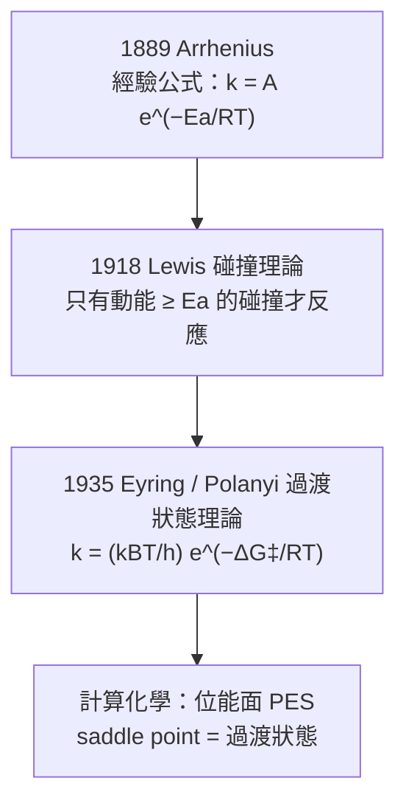

# 06.2 活性化能與阿倫尼烏斯方程式的幾何直觀

## 1. 一條來自電解質研究的公式，統治了化學反應

1889 年，Svante Arrhenius 在研究反應速率隨溫度的變化時，受 van 't Hoff 的熱力學類比啟發（van 't Hoff 曾用 $\frac{d\ln K}{dT} = \frac{\Delta H}{RT^2}$ 處理平衡），把同樣的指數形式套到速率常數上：

$$\boxed{\;k = A\, e^{-E_a/RT}\;}$$

- $E_a$ ：**活性化能**（activation energy，J/mol）
- $A$ ：**指數前因子**（pre-exponential factor）
- $R$ ：氣體常數

> **定理（Arrhenius 作圖）**：兩邊取對數，
> $$\ln k = \ln A - \frac{E_a}{R}\cdot\frac{1}{T}$$
> $\ln k$ 對 $1/T$ 作圖應為直線：斜率 $= -E_a/R$ ，截距 $= \ln A$ 。

這個「線性化」動作是本節的幾何核心：**把指數定律變成直線，斜率直接讀出分子世界的能量尺度。** 一條 $E_a = 50\ \mathrm{kJ/mol}$ 的反應，從 25 °C 升到 35 °C，速率倍數為

$$\frac{k_2}{k_1} = e^{-\frac{E_a}{R}\left(\frac{1}{308}-\frac{1}{298}\right)} \approx 1.93$$

**溫度每升 10 度，速率約加倍**——這是化學實驗室的口訣，其數學根源就是指數函數的敏感度 $\frac{d\ln k}{dT} = \frac{E_a}{RT^2}$ 。

## 2. 為什麼會有活性化能？三層理論的層層逼近



**（一）碰撞理論**：分子以 Maxwell–Boltzmann 速度分佈運動，動能超過閾值 $\varepsilon_a$ 的分子比例正是 $\int_{\varepsilon_a}^{\infty} e^{-\varepsilon/kT}\, d\varepsilon \propto e^{-\varepsilon_a/kT}$ 。**指數因子是 Boltzmann 因子的直接後果**——Arrhenius 公式的「物理內涵」在 1889 年還不存在，是二十世紀統計力學回頭把它解釋清楚。這是「經驗公式先行、理論追認」的典型案例。

**（二）過渡狀態理論**（Eyring，1935）：反應物必須翻越位能面上的鞍點。推導給出

$$k = \frac{k_B T}{h}\, e^{-\Delta G^\ddagger/RT} = \frac{k_B T}{h}\, e^{\Delta S^\ddagger/R}\, e^{-\Delta H^\ddagger/RT}$$

與 Arrhenius 式對照： $E_a = \Delta H^\ddagger + RT$ ， $A \approx \frac{k_BT}{h}e^{\Delta S^\ddagger/R}$ 。**指數前因子裡藏著活化熵**——反應需要「擺好姿勢」（負 $\Delta S^\ddagger$ ）會讓 $A$ 變小，即使能障不高，速率也不快。

**（三）位能面**： $V(q_1, \ldots, q_{3N-6})$ 是所有核座標的函數，反應座標是從反應物谷底經過鞍點到產物谷底的路徑。 $E_a$ 就是沿此路徑的最高點減起點。微積分語言：**過渡狀態是位能面的駐點（梯度為零），且是反應座標方向的極大、其他方向的極小**——鞍點，多變數微積分的二階判別式在化學中的化身。

## 3. 幾何直觀：兩個為什麼

**為什麼是指數？** 因為它源自 Boltzmann 分佈 $P(E) \propto e^{-E/kT}$ 。指數函數是「尾部分數」的通用形狀；任何「需要累積罕見能量才能發生」的過程，速率都帶 $e^{-E_a/kT}$ 。

**為什麼 $A$ 幾乎不隨溫度變？** 因為 $E_a \sim 50{-}200\ \mathrm{kJ/mol}$ 遠大於 $RT \sim 2.5\ \mathrm{kJ/mol}$ （室溫），指數項對溫度的敏感度壓倒性地大。但**並非嚴格不變**：精密實驗（尤其氣相自由基反應）常見 $k \sim T^n e^{-E_a/RT}$ 的修正， $n$ 來自碰撞的立體因子與配分函數的溫度依賴。

## 4. 實驗實戰：從數據到 $E_a$

標準流程：恆定其他條件，測 5–7 個溫度下的 $k$ ，作 $\ln k$ – $1/T$ 圖，線性回歸。

```python
import numpy as np
import matplotlib.pyplot as plt

# 模擬「過氧化氫分解」實驗數據（加催化劑）
T_C = np.array([20, 30, 40, 50, 60])       # °C
k_obs = np.array([1.1e-4, 2.6e-4, 5.9e-4, 1.3e-3, 2.7e-3])  # s^-1

T = T_C + 273.15
x, y = 1 / T, np.log(k_obs)

# 線性回歸
slope, intercept = np.polyfit(x, y, 1)
Ea = -slope * 8.314 / 1000       # kJ/mol
A = np.exp(intercept)
print(f"Ea = {Ea:.1f} kJ/mol,  A = {A:.3g} s^-1")
print(f"相關係數 r² = {np.corrcoef(x, y)[0,1]**2:.5f}")

# 檢驗「升 10 度加倍」口訣
for i in range(1, 4):
    ratio = k_obs[i+1] / k_obs[i-1]   # 隔 20 度的比值
    print(f"{T_C[i-1]}→{T_C[i+1]} °C: k 比值 = {ratio:.2f} "
          f"(每 10 °C 約 ×{np.sqrt(ratio):.2f})")

xx = np.linspace(x.min(), x.max(), 100)
plt.plot(xx, slope*xx + intercept, "-", label=f"斜率 = {slope:.0f} K")
plt.plot(x, y, "o", ms=8, label="實驗點")
plt.xlabel("1/T (K$^{-1}$)"); plt.ylabel("ln k")
plt.title(f"Arrhenius 作圖：Ea = {Ea:.1f} kJ/mol")
plt.legend(); plt.grid(alpha=0.3)
plt.show()

# 用擬合結果「內插」預測 65 °C 的速率
k65 = A * np.exp(-Ea*1000 / (8.314 * 338.15))
print(f"預測 65 °C: k = {k65:.2e} s^-1")
```

典型結果： $E_a \approx 51\ \mathrm{kJ/mol}$ 、 $r^2 > 0.999$ 。**相關係數接近 1 本身就是活性化能概念成立的證據**——若速率行為不是 Arrhenius 型，此圖會彎曲。

## 5. 催化劑：降低 $E_a$ 而不改變平衡

催化劑提供一條位能面上更低的鞍點路徑：

- 催化前： $k = A e^{-E_a/RT}$
- 催化後： $k' = A' e^{-E_a'/RT}$ ， $E_a' < E_a$

因 $k \propto e^{-E_a/RT}$ 對 $E_a$ 指數敏感， $E_a$ 降 20 kJ/mol（室溫、 $A$ 不變）速率加快 $e^{20000/8.314/298} \approx 3200$ 倍。**但催化劑完全不影響平衡常數 $K$ **——因為它同倍率加速正逆反應，不改變 $\Delta_r G^\circ$ （第五章的結論在這裡會合）。1909 年 Haber 以此設計合成氨：用鐵催化劑降 $E_a$ ，讓反應能在 $450\,^\circ\mathrm{C}$ （速率可接受）而平衡產率尚可的區間工作。

> **例**：酶是生物催化劑。一個典型的酶把 $E_a$ 從 90 降到 50 kJ/mol，在 37 °C 速率比約 $e^{40000/8.314/310} \approx 5\times 10^6$ ——生命化學「快到可用」全靠這個指數。

## 6. 溫度的反面：熱爆炸與 Semenov 理論

Arrhenius 指數不只在實驗室有用，它也是**災難的數學**。放熱反應在容器中：溫度升高 → 速率指數上升 → 放熱更多 → 溫度更高。Semenov（1928）分析散熱線性、產熱指數的競爭：

$$\text{產熱} \sim Q\,k_0 e^{-E_a/RT}, \qquad \text{散熱} \sim h\,(T - T_0)$$

當兩條曲線相切時出現**臨界條件**——切點條件是兩個方程（相交）加一個導數方程（相切），正是微積分裡「重根 = 相切」的標準技巧。超過臨界尺寸或環境溫度，即發生熱爆炸（儲存過氧化氫、硝酸銨的工安原理；也是內燃機「預燃」的化學）。Semenov 因此獲 1956 年諾貝爾化學獎。

**數值演練**：取 $Q k_0 e^{-E_a/RT} = h(T - T_0)$ ， $E_a = 80\ \mathrm{kJ/mol}$ ， $T_0 = 350\ \mathrm{K}$ ，改變散熱係數 $h$ ，用數值法找曲線交點個數：

```python
import numpy as np
from scipy.optimize import brentq

Qk0, Ea, R, T0 = 1e12, 80e3, 8.314, 350.0

def f(T, h):
    return Qk0*np.exp(-Ea/(R*T)) - h*(T - T0)

for h in [1e8, 3e8, 1e9]:
    # 掃描找根與切點
    Ts = np.linspace(T0+1, 1200, 5000)
    vals = f(Ts, h)
    roots = []
    for i in range(len(Ts)-1):
        if vals[i]*vals[i+1] < 0:
            roots.append(brentq(lambda t: f(t, h), Ts[i], Ts[i+1]))
    print(f"h={h:.1e}: 交點數 = {len(roots)}，T = {[f'{r:.0f}' for r in roots]}")
```

$h$ 小時只有一個高溫交點（爆炸態）； $h$ 大時一個低溫穩定交點；中間出現**三個交點**——低溫穩定、中間不穩定、高溫「著火」態。這個 S 形曲線與交點個數的變化，正是**滯回（hysteresis）與臨界現象**的最小化學模型，也是分岔理論的另一個入口。

## 7. 數學旁註：指數敏感度的量化

把 Arrhenius 式對 $E_a$ 與 $T$ 分別求偏導，可以精確說出「多敏感」：

$$\frac{\partial \ln k}{\partial E_a} = -\frac{1}{RT} \approx -\frac{1}{2.5\ \mathrm{kJ/mol}}\ \text{（室溫）}$$

即 $E_a$ 每差 2.5 kJ/mol，室溫速率差約 $e$ 倍（2.7 倍）。這解釋了：

- 為什麼**藥物代謝酶的單點突變**（改變過渡態結合幾個 kJ/mol）能讓藥效差數倍——酵素抑制劑的設計就是在打這場 kJ/mol 尺度的戰爭；
- 為什麼**同位素效應**（C–H vs C–D，零點能差約 5 kJ/mol）能讓速率差 5–7 倍——測量動力學同位素效應是判斷「C–H 鍵斷裂是否在決速步」的標準診斷，把過渡狀態的結構資訊反推出來；
- 為什麼**精密熱力學與動力學測量**要控溫到 0.01 K：溫度差 0.01 K 對 $E_a = 100\ \mathrm{kJ/mol}$ 的反應意味著速率差約 0.1%——儀器極限與理論精度在同一個量級上相遇。

**雙參數補償效應**（compensation effect）：實驗上同一族反應或同族催化劑， $\ln A$ 與 $E_a$ 常呈線性關係 $\ln A = \ln A_0 + E_a/(RT_0)$ ， $T_0$ 稱補償溫度。其數學後果是所有反應在 $T = T_0$ 處速率相同——這暗示 $A$ 與 $E_a$ 並非獨立參數，源於過渡態與反應物之間的熵-焓互補。此現象至今仍無完全公認的理論，是動力學中少數的開放問題。

## 8. 從 $E_a$ 到分子設計：現代的延伸

二十一世紀的化學動力學不再止於兩個參數：

- **變分過渡狀態理論**（VTST，Truhlar 等）：允許「分割面」沿反應座標滑動取最小通量，處理隧道效應（ $\mathrm{H}$ 原子穿越位障——低溫下速率偏離 Arrhenius 直線、曲線上翹，正是量子隧穿的指紋；酶動力學中的氫隧穿是熱門課題）。
- **微觀可逆性**：任何基元步驟的逆反應活化能 $E_a^{\mathrm{rev}} = E_a^{\mathrm{fwd}} - \Delta_r H$ （位能面上的同一鞍點）。這條 trivial 的幾何恆等式，是檢查任何機理提案是否自洽的第一道關卡。
- **計算化學**：DFT 計算可直接算出鞍點的位能與頻率，預測 $E_a$ 與 $\Delta S^\ddagger$ ——Arrhenius 作圖從「測量手段」升級為「與理論對帳的驗收標準」。

**例題（微觀可逆性檢查）**：有人提案機理 $\mathrm{A \to I}$ （ $E_a = 80\ \mathrm{kJ/mol}$ ）與 $\mathrm{I \to B}$ （ $E_a = 20\ \mathrm{kJ/mol}$ ），並宣稱總反應 $\mathrm{A \to B}$ 放熱 $120\ \mathrm{kJ/mol}$ 。用位能圖核算：I 相對 A 高 80 kJ；B 相對 I 低 120 kJ，故 $\Delta_r H = 80 - 120 = -40$ kJ/mol，與宣稱矛盾——**機理被微觀可逆性否決**。這種「畫位能圖、查鞍點」的習慣，是動力學數據與熱力學數據交叉驗證的基本功。

## 9. 章末小結

- Arrhenius 1889 的經驗式先於理論； $\ln k$ – $1/T$ 直線的斜率給 $E_a$ 、截距給 $A$ 。
- 指數因子源自 Boltzmann 分佈（碰撞理論）；Eyring 的 $k = (k_BT/h)e^{-\Delta G^\ddagger/RT}$ 把 $A$ 與活化熵連起來；過渡狀態是位能面的鞍點。
- 「升 10 度加倍」是 $d\ln k/dT = E_a/RT^2$ 在典型 $E_a$ 下的近似口訣。
- 催化劑降 $E_a$ 、加速反應但不動 $K$ ；酶的高效就是指數的紅利。
- 產熱（指數）與散熱（線性）的相切條件給出熱爆炸的臨界判據。

## 下一步

單一基元反應的 Arrhenius 行為清楚了，但真實反應往往是多步機理，中間產物濃度低、壽命短，寫出並求解所有 ODE 不切實際。下一節 06.3 介紹**穩態近似法**（steady-state approximation）：假設中間物 $d[\mathrm{I}]/dt \approx 0$ ，用代數取代微分方程——這個「化學家的近似技巧」與數學上的奇異攝動理論、以及第七章的振盪化學，有著出人意料的連結。
