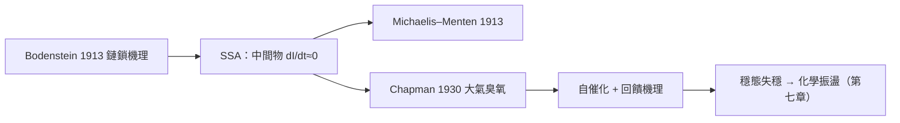

# 06.3 複合反應網格與穩態近似法

## 1. 為什麼需要近似：機理是網，不是鏈

真實化學反應很少是 $A \to B \to C$ 的直鏈。燃燒是數百個自由基基元步驟、大氣臭氧化學有上百個物種、酶催化有五到十個中間態。機理的完整動力學是**大系統 ODE**：

$$\frac{dc_i}{dt} = f_i(c_1, \ldots, c_n), \qquad i = 1, \ldots, n$$

解析解幾乎不可能。1920 年代，Chapman（臭氧光化學，1930）與 Bodenstein（氫-碘反應鏈，1913）先後發展出一個實用技巧：

> **定義（穩態近似，Steady-State Approximation, SSA）**：對濃度低、生成與消耗速度快的活性中間物 $I$ （自由基、激發態等），假設
> $$\frac{d[I]}{dt} \approx 0$$
> 於是微分方程**退化為代數方程**，可解出 $[I]$ 再代回速率式。

## 2. 經典演練：氫-溴反應

$\mathrm{H_2 + Br_2 \to 2HBr}$ 的鏈鎖機理（Bodenstein–Lind 1906–07，穩態近似的誕生地）：

$$\mathrm{Br_2 \xrightarrow{h\nu} 2Br\cdot} \quad k_1$$
$$\mathrm{Br\cdot + H_2 \to HBr + H\cdot} \quad k_2$$
$$\mathrm{H\cdot + Br_2 \to HBr + Br\cdot} \quad k_3$$
$$\mathrm{H\cdot + HBr \to H_2 + Br\cdot} \quad k_4 \text{（抑制步驟）}$$
$$\mathrm{2Br\cdot \to Br_2} \quad k_5$$

中間物 $[\mathrm{Br\cdot}]$ 、 $[\mathrm{H\cdot}]$ 。寫穩態方程：

$$0 = 2k_1[\mathrm{Br_2}] - 2k_5[\mathrm{Br\cdot}]^2 + k_2[\mathrm{Br\cdot}][\mathrm{H_2}] + k_4[\mathrm{H\cdot}][\mathrm{HBr}] - k_3[\mathrm{H\cdot}][\mathrm{Br_2}]$$
$$0 = k_2[\mathrm{Br\cdot}][\mathrm{H_2}] - k_4[\mathrm{H\cdot}][\mathrm{HBr}] - k_3[\mathrm{H\cdot}][\mathrm{Br_2}]$$

兩式相加得 $[\mathrm{Br\cdot}] = \sqrt{k_1[\mathrm{Br_2}]/k_5}$ ，回代解出 $[\mathrm{H\cdot}]$ ，最後得到著名的速率定律

$$\frac{d[\mathrm{HBr}]}{dt} = \frac{a\,[\mathrm{H_2}][\mathrm{Br_2}]^{1/2}}{1 + b\,[\mathrm{HBr}]/[\mathrm{Br_2}]}$$

**注意這個形式的奇異之處**： $\frac{1}{2}$ 級（來自自由基的平方根雙分子終止）、分母中的抑制項（來自逆抑制步驟）。這種「分數級 + 有理函數」的複雜形狀，**不可能**由單一步驟產生——穩態近似把「機理推速率式」變成可操作的代數演算，而實驗速率式的形狀反過來成為猜機理的指紋。

## 3. 穩態近似的數學身分：奇異攝動

SSA 不是「中間物濃度為零」，而是「中間物反應快、濃度小但非零」。數學上設速率常數 $k_{\mathrm{fast}} = \frac{1}{\varepsilon}\bar{k}$ （ $\varepsilon \ll 1$ ）：

$$\varepsilon\frac{dI}{dt} = g(I, S), \qquad \frac{dS}{dt} = f(I, S)$$

當 $\varepsilon \to 0$ ，快變數 $I$ 被壓到**慢流形**（slow manifold） $g(I, S) = 0$ 上，這正是奇異攝動理論（Tikhonov 定理，1948–52）的核心。**化學家的經驗法則「中間物要活躍且稀少」＝ Tikhonov 的可解性條件**。這是又一個「化學先行、數學追認」的例子，也預告了第七章：慢流形上發生的動力學，正是振盪與混沌的舞台。

> **何時穩態近似失效？**（i）反應初期（誘導期， $I$ 還在累積）；（ii）中間物不夠快（如自由基累積的爆炸系統）；（iii）接近分岔時（慢流形消失，見第七章）。

## 4. 另一個近似：前平衡近似（pre-equilibrium）

若第一步是快速可逆、第二步慢：

$$A + B \rightleftharpoons I \;(\text{快，} K = k_1/k_{-1}), \qquad I \to P\;(\text{慢，} k_2)$$

則假設 $I$ 與反應物**始終處於平衡**： $[I] = K[A][B]$ ，速率 $= k_2 K [A][B]$ ，表觀二級、活化能為 $E_1 + E_2 - E_{-1}$ 的組合。前平衡近似與 SSA 的差別：前者要求**逆反應快**，後者要求**中間物消耗快**。同一機理、兩個近似、不同適用域——近似的選擇本身就是化學判斷。

## 5. Michaelis–Menten：穩態近似的最高成就

1913 年 Michaelis 與 Menten（稍後 1925 年 Briggs–Haldane 以穩態重推）：

$$E + S \xrightleftharpoons[k_{-1}]{k_1} ES \xrightarrow{k_2} E + P$$

SSA： $\frac{d[ES]}{dt} = k_1[E][S] - (k_{-1}+k_2)[ES] = 0$

用總酶濃度 $[E]_0 = [E] + [ES]$ 解出 $[ES]$ ：

$$[ES] = \frac{[E]_0[S]}{K_M + [S]}, \qquad K_M = \frac{k_{-1}+k_2}{k_1}$$

$$\boxed{\;v = \frac{v_{\max}[S]}{K_M + [S]}\;}$$

這條**雙曲線**是全生物化學的基石：低濃度時一級（ $v \propto [S]$ ），高濃度時零級（ $v \to v_{\max}$ ，酶飽和）。1934 年 Lineweaver–Burk 把它線性化（ $\frac{1}{v} = \frac{K_M}{v_{\max}}\frac{1}{[S]} + \frac{1}{v_{\max}}$ ）以便作圖求參數——又一次「線性化」把非線性問題化為直線。

## 6. 數值實驗：穩態近似的精度檢驗

我們直接解完整 ODE，與 SSA 的解析結果比較，並觀察 $\varepsilon$ （中間物快慢比）如何控制誤差。

```python
import numpy as np
import matplotlib.pyplot as plt
from scipy.integrate import solve_ivp

# 機理：A -> I (k1), I -> P (k2)，k2 >> k1 時 I 處於穩態
k1, k2 = 0.1, 20.0
A0 = 1.0

def rhs(t, y):
    A, I, P = y
    return [-k1*A, k1*A - k2*I, k2*I]

sol = solve_ivp(rhs, [0, 80], [A0, 0, 0],
                t_eval=np.linspace(0, 80, 800), rtol=1e-9)

# SSA：dI/dt ≈ 0 => I = k1 A / k2，dA/dt = -k1 A
t = sol.t
A_ssa = A0 * np.exp(-k1 * t)
I_ssa = k1 * A_ssa / k2
P_ssa = A0 - A_ssa - I_ssa

print("=== 穩態近似的誤差 ===")
for tt in [10, 30, 60]:
    i = np.searchsorted(t, tt)
    err_I = abs(sol.y[1][i] - I_ssa[i]) / max(sol.y[1][i], 1e-12)
    print(f"t={tt:2d}s:  [I]_exact={sol.y[1][i]:.5f}  "
          f"[I]_SSA={I_ssa[i]:.5f}  相對誤差={err_I:.3%}")

plt.figure(figsize=(7, 4.5))
plt.plot(t, sol.y[0], "b-", label="A (精確)")
plt.plot(t, sol.y[1], "r-", lw=2, label="I (精確)")
plt.plot(t, I_ssa, "k--", label="I (SSA)")
plt.plot(t, sol.y[2], "g-", label="P (精確)")
plt.xlabel("t"); plt.ylabel("濃度")
plt.title(f"SSA 檢驗：k1={k1}, k2={k2}（比值 {k2/k1:.0f}）")
plt.legend(); plt.grid(alpha=0.3)
plt.show()
```

$k_2/k_1 = 200$ 時，除最初一小段（快瞬變 transient）外，SSA 曲線與精確解幾乎重合（誤差 $<0.5\%$ ）。把 $k_2$ 改成 0.5 重跑，誤差立刻爆表——**近似的好壞由速率常數比值（奇異攝動參數）定量決定**，這就是用數值實驗「測量」一個近似。

## 7. 穩態思想之後：從化學到生態再到振盪

SSA 把維度壓低，但有代價：它假設系統最終走向單調的穩態。如果機理中出現**自催化**（產物加速自身生成）與**回饋**，慢流形上可能出現的就不是定點而是**振盪**。1921 年 Bray 報告碘酸-碘偶聯反應的振盪，被同行以「違反熱力學第二定律」為由質疑（其實不違反——開放系統）；直到 1950 年代 Belousov 的發現（下一章），人們才認真對待化學振盪。因果鏈是：



## 8. 實用技巧匯總與陷阱

化學家使用 SSA 時的實用清單：

| 情境 | 推薦近似 | 適用條件 |
|------|----------|----------|
| 活性中間物（自由基、激發態） | 穩態近似 SSA | 生成慢、消耗快、濃度極低 |
| 快速可逆前處理 | 前平衡近似 | 逆反應明顯快於後續步驟 |
| 酶-受質複合體 | Briggs–Haldane SSA | $[S] \gg [E]_0$ |
| 鍵結/解離極快（質子轉移） | 前平衡 + 緩衝假設 | $\mathrm{pH}$ 由緩衝液鎖定 |
| 反應初期累積中間物 | 不得用 SSA（有誘導期） | 需解完整 ODE 或奇異攝動展開 |

**常見陷阱**：

1. **忘記誘導期**：SSA 在 $t = 0$ 附近必然失準（中間物要從 0 累積到穩態值），若實驗關心的正是初期行為，SSA 會給出質性錯誤的結論。
2. **把 SSA 用在不活潑的物種**：近似只對「既活躍又稀少」的中間物成立；對主要反應物 $d[A]/dt \approx 0$ 是荒謬的。
3. **級數的誤導**：SSA 推出的速率式中的「級數」是表觀的、有條件的（依賴濃度範圍），在不同濃度區間會看到不同的表觀級數——氫-溴反應在不同 $\mathrm{[HBr]/[Br_2]}$ 比值下從 $\frac{3}{2}$ 級滑向受抑制的行為。
4. **忽略閉環約束**：若機理中每一步都寫成正反雙向，速率常數必須滿足細緻平衡（Wegscheider 條件），否則模型在熱力學上不自洽——這是寫模擬程式時最常見的隱性 bug。

## 9. 數值旁註：剛性 ODE 與軟體的選擇

SSA 的數學根源（快慢時間尺度分離）也造成了**數值計算的痛點**：快慢並存的系統是**剛性**（stiff）ODE，顯式方法（如經典 Runge–Kutta）被迫用極小步長追蹤最快的時間尺度，計算量大爆炸。這正是隱式方法（BDF／Gear 法，1970 年代）被發明的直接動機，也是 MATLAB 的 `ode15s`、SciPy 的 `LSODA` 存在的理由。**化學動力學是數值分析史上「剛性問題」這個概念的原始出處之一**（Curtiss 與 Hirschfelder 1952 年首次明確提出剛性方程一詞，用的例子就是化學反應）。

蒙特卡羅路線：當系統小（分子數少，如單細胞內的基因調控），濃度的連續近似失效，需要 **Gillespie 演算法**（1976）直接模擬隨機的化學事件序列——它精確抽樣化學主方程（chemical master equation），在低分子數下比 ODE 更真實。SSA（近似）與 Gillespie（精確隨機）縮寫撞名，是化學動力學文獻中著名的笑話，也提醒我們：同一組基元反應，在不同尺度上需要不同的數學。

## 10. 章末小結

- 複合反應的完整動力學是高維 ODE；穩態近似把活性中間物的微分方程換成代數方程。
- 氫-溴反應展示 SSA 的威力： $\frac{1}{2}$ 級與抑制項都是機理的指紋。
- SSA 的數學身分是奇異攝動／慢流形（Tikhonov），適用條件可定量檢驗。
- Michaelis–Menten 是 SSA 的最高成就， $v = v_{\max}[S]/(K_M+[S])$ 的雙曲線由代數直接給出。
- 近似假設「走向穩態」；一旦有自催化回饋，穩態可能失穩——通向振盪之門。

## 下一步

如果穩態不穩定會怎樣？下一章 07.1 我們走進化學中最戲劇性的故事：Belousov 在 1951 年前後發現溶液自己一會兒黃一會兒透明地振盪，論文被拒、發現被埋沒十餘年，直到 Zhabotinsky 與 Prigogine 的耗散結構理論登場。數學上，我們將見到**極限環**——Poincaré 在 1880 年代從天體力學中發現的封閉軌道，在化學燒杯中活了過來。
