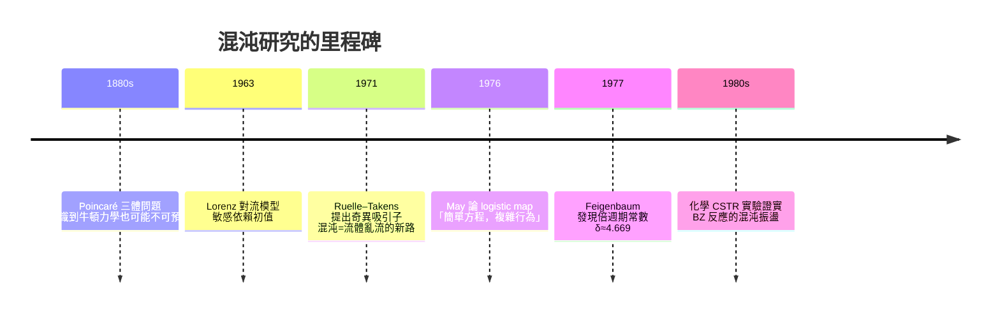

# 07.2 混沌化學：非線性微分方程中的奇異吸引子

## 1. Lorenz 的蝴蝶：氣象學家誤闖數學

1963 年，MIT 氣象學家 Edward Lorenz 把大氣對流的簡化模型（三個變數的 ODE）輸入電腦，某次他想重跑一段計算，偷懶只輸入了小數點後三位（0.506 而非 0.506127）。幾個「模擬月」後，兩條軌跡完全分道揚鑣。

$$\dot{x} = \sigma(y - x), \qquad \dot{y} = x(\rho - z) - y, \qquad \dot{z} = xy - \beta z$$

$\sigma = 10,\ \rho = 28,\ \beta = 8/3$ 時，軌道被吸在一個**雙葉的、永不自交的奇怪形狀**上：軌跡在兩葉之間不規則地左右跳換，任何兩條初值只差 $10^{-6}$ 的軌道，幾十個時間單位後完全不同——**初值敏感依賴**（sensitive dependence on initial conditions），俗稱蝴蝶效應。Lorenz 的論文標題就是預言：「Deterministic Nonperiodic Flow」——**完全確定的方程，產生不可長期預測的行為。**

> **定義（奇異吸引子）**：系統相空間中被軌道趨近的緊緻集合 $A$ ，且：(i) 對初值敏感；(ii) 不可分（軌道可在 $A$ 內互相靠近）；(iii) 具分形（非整數）維度。週期軌道與極限環是「平凡吸引子」，奇異吸引子是混沌的幾何載體。



## 2. 為什麼二維不可能混沌，三維才行

Poincaré–Bendixson 定理（上一節）說：平面有界軌道只有三種歸宿——定點、極限環、或兩者的連接。所以**連續時間混沌至少需要三個獨立變數**（離散時間則兩個變數，如 logistic map 即可）。化學上的教訓：

- 批次反應的振盪若要混沌，機理中至少要有三個「慢」變數；
- 連續攪拌槽反應器（CSTR）天然多一個維度（進料把停留時間分佈變成第三個變數），所以 **CSTR + BZ 反應是實驗室中最早被證實的化學混沌系統之一**（1980 年代 Argonne 與 Austin 的團隊，Swinnney、Epstein 等）。

## 3. 敏感度的定量：Lyapunov 指數

> **定義（Lyapunov 指數）**：沿軌道放大率對時間的指數平均
> $$\lambda = \lim_{t\to\infty}\lim_{\|\delta_0\|\to 0}\frac{1}{t}\ln\frac{\|\delta(t)\|}{\|\delta_0\|}$$

- $\lambda_{\max} > 0$ ：混沌（初值誤差以 $e^{\lambda t}$ 指數放大）；
- $\lambda_{\max} < 0$ ：收斂到定點； $\lambda_{\max} = 0$ ：極限環。

**可預測時限** $t_{\mathrm{pred}} \approx \frac{1}{\lambda}\ln\frac{\Delta}{\delta_0}$ ：即使把初始測量精度提高一千倍，預測時限只延長 $\ln 1000 / \lambda \approx 6.9/\lambda$ ——**線性投資、對數回報**，這是大氣預報不可能超過兩週的數學原因（Lorenz 1969）。

## 4. 通向混沌的標準路線

**倍週期路線**（period doubling）：極限環的週期 $T \to 2T \to 4T \to \cdots \to$ 混沌。Feigenbaum 1977 證明：對一大類系統，相鄰分岔參數差的比值收斂到普適常數 $\delta \approx 4.6692$ 。化學 CSTR 實驗中，改變流速可實際觀察到 $T, 2T, 4T$ 乃至 $8T$ 的振盪序列——**一個實驗旋鈕，沿著數學預言的路線走向混沌**。

**准週期路線**（Ruelle–Takens–Newhouse）：極限環 → 環面（兩個不可通約頻率）→ 混沌。**間歇路線**：規則與爆發交替。

## 5. 化學混沌的實驗場景

- **BZ-CSTR**：連續進料的 BZ 反應，流速與溴酸濃度作分岔參數，觀察到倍週期、環面、混合式振盪（compound oscillation）與「非定相混沌」。
- **CO 氧化** $\mathrm{2CO + O_2 \to 2CO_2}$ 在鉑表面：表面吸附動力學的回饋造成溫度/速率混沌。
- **酶反應**：過氧化物酶-氧化酶反應在開放條件下呈現混沌振盪。
- **生物化學**：糖解作用的 NADH 振盪、cAMP 波——細胞代謝網是天然的的非線性動力系統。

這些系統的共同點：**開放（遠離平衡）、非線性（自催化或吸附飽和）、至少三個有效變數**——Lorenz 的三個條件在化學中的翻譯。

## 6. 數值模擬：Lorenz 系統與軌道分離

```python
import numpy as np
import matplotlib.pyplot as plt
from scipy.integrate import solve_ivp

sigma, rho, beta = 10.0, 28.0, 8/3

def lorenz(t, y):
    x, y_, z = y
    return [sigma*(y_ - x), x*(rho - z) - y_, x*y_ - beta*z]

# 兩條初值只差 1e-6 的軌道
t_eval = np.linspace(0, 50, 25000)
s1 = solve_ivp(lorenz, [0, 50], [1.0, 1.0, 1.0],
               t_eval=t_eval, rtol=1e-10, atol=1e-10)
s2 = solve_ivp(lorenz, [0, 50], [1.0+1e-6, 1.0, 1.0],
               t_eval=t_eval, rtol=1e-10, atol=1e-10)

d = np.linalg.norm(s1.y - s2.y, axis=0)
d = np.maximum(d, 1e-16)

# 估計最大 Lyapunov 指數（初始指數增長段的斜率）
sel = (d > 1e-8) & (d < 1)
lam = np.polyfit(t_eval[sel], np.log(d[sel]), 1)[0]
print(f"λ_max ≈ {lam:.3f}  （理論值 ≈ 0.906）")
print(f"可預測時限（精度 1e-3 → 1）≈ {np.log(1e3)/lam:.1f} 時間單位")

fig = plt.figure(figsize=(11, 4.2))
ax = fig.add_subplot(1, 2, 1, projection="3d")
ax.plot(*s1.y, lw=0.3)
ax.set_title("Lorenz 奇異吸引子")
plt.subplot(1, 2, 2)
plt.semilogy(t_eval, d, lw=0.6)
plt.xlabel("t"); plt.ylabel("‖δ(t)‖")
plt.title("初值差 1e-6 的指數放大")
plt.tight_layout()
plt.show()
```

半對數圖上誤差先是直線上升（斜率即 $\lambda$ ），達到吸引子尺寸後飽和——**指數放大 + 有界吸陷**，這兩件事同時成立，正是奇異吸引子的定義性張力：整體被吸住、局部永遠分離，於是軌道無限摺疊、產生分形結構（Lorenz 吸引子的分形維度 $\approx 2.06$ ）。

## 7. 混沌的化學意義：不是災難，而是資訊

- **為什麼生物學需要混沌？** 心跳與神經放電呈現受控混沌；完全週期 = 癲癇或心室顫動的風險。混沌軌道能快速遍歷相空間的各個區域，讓系統有「可達的多樣性」。
- **化學工程的教訓**：攪拌槽若操作在混沌區，產物分率不可精確預測，必須靠回饋控制（OGY 控制法，1990：用微小擾動把軌道釘在吸引子內的不穩定週期軌道上）。
- **哲學層面**：確定性與可預測性分家。牛頓式的「知道方程就等於知道未來」在 $\lambda > 0$ 的世界裡失效——Poincaré 1880 年代的直覺，Lorenz 1963 的數值，Chandrasekhar 之後整個非線性科學的共識。

## 8. 更進一步：logistic map——五行程式碼的混沌宇宙

混沌不一定需要三維 ODE。一維離散映射

$$x_{n+1} = r\,x_n(1-x_n)$$

（生態學中的蟲口模型，May 1976 年在《Nature》發表著名的呼籲「簡單數學模型有極複雜的動態」）就有完整的混沌。 $r$ 從 0 到 4 掃描：

- $0 < r < 3$ ：收斂到定點；
- $3 < r < 3.449$ ：2 週期（倍週期第一次分岔）；
- $r$ 繼續增加：4、8、16… 週期倍增，分岔參數按 Feigenbaum 比值 $\delta \approx 4.669$ 收斂；
- $r > r_\infty \approx 3.570$ ：混沌區，夾雜著週期窗口（如 $r \approx 3.83$ 的 3 週期窗口——Li–Yorke 定理 1975：「週期三蘊含混沌」）。

```python
import numpy as np
import matplotlib.pyplot as plt

fig, ax = plt.subplots(figsize=(8, 4.5))
for r in np.linspace(2.8, 4.0, 1200):
    x = 0.5
    for _ in range(400):        # 丟掉暫態
        x = r*x*(1-x)
    xs = []
    for _ in range(80):         # 收集吸引子上的點
        x = r*x*(1-x)
        xs.append(x)
    ax.plot([r]*80, xs, ",k", alpha=0.25)
ax.set_xlabel("r"); ax.set_ylabel("x")
ax.set_title("Logistic map 的分岔圖：倍週期通往混沌")
plt.show()
```

這張**分岔圖**是混沌的教科書圖像：一棵不斷分叉的樹，最後碎成灰霧（混沌帶），其中又浮出週期窗口。化學 CSTR 實驗中掃描流速得到的實驗分岔圖，形狀與此定性一致——**一維映射預言了化學反應器的行為**。

**與化學的橋接**：離散映射可視為「脈衝式進料的批次反應器」的 Poincaré 截面——每投一次料記錄一次濃度，連續的混沌軌道就離散化成映射迭代。Poincaré 截面（1880s 天體力學）→ May 的蟲口（1976 生態）→ 化學 CSTR 的實驗截面（1980s），三個領域共用一座橋。

## 9. 章末小結

- Lorenz 1963 的三維對流模型揭示：確定性 ODE 也能不可預測；根源是初值敏感依賴 $\delta(t) \sim \delta_0 e^{\lambda t}$ 。
- 奇異吸引子 = 吸引 + 敏感 + 分形；連續系統至少三維才可能混沌（Poincaré–Bendixson 的推論）。
- Lyapunov 指數把「混沌」量化；可預測時限只隨測量精度對數增長。
- 化學混沌在 BZ-CSTR、CO 氧化、酶反應中均有實驗證據；倍週期路線與 Feigenbaum 常數把理論與實驗接起來。
- 混沌是遠離平衡化學的常態之一，也是受控有序（OGY 控制）與生理節律的資源。

## 下一步

以上都在攪拌均勻的「點」世界裡。若反應發生在**空間**中：每個位置一個振盪器、彼此用擴散相連，圖樣開始出現——斑點、條紋、迷宮。1952 年 Alan Turing 用純數學預言：**兩個原本穩定的均勻態，只因為「抑制劑擴散得比活化劑快」，就會自發長出空間花樣**。下一節 07.3 我們推導 Turing 不穩定性，走進形態發生學與 CIMA 反應的實驗室。
