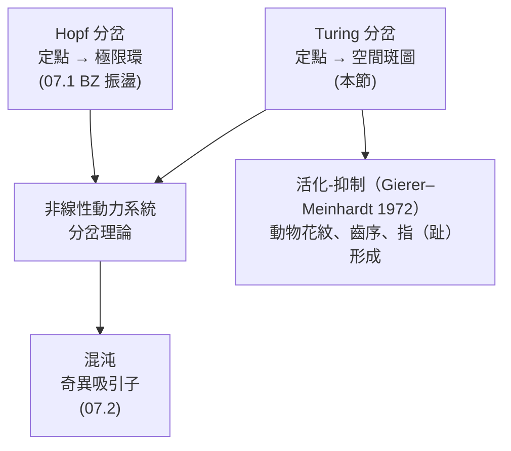

# 07.3 圖靈斑圖：化學形態發生中的分岔理論

## 1. Turing 1952：密碼學家問了一個生物學問題

1952 年，Alan Turing（前一年因破解 Enigma 的工作間接結束二戰，卻因性向被判化學閹割）發表了《The Chemical Basis of Morphogenesis》。他問：**胚胎是一團近似均勻的細胞球，豹紋、斑馬紋、手指是從哪裡來的？** 他的答案驚人：不需要預先畫好的藍圖，只要兩種化學物質（他稱為 morphogen，形態素）反應並以不同速度擴散，均勻態就會**自發失穩**，長出固定的空間花樣。

> **反直覺之處**：擴散通常「抹平」不均勻（熱傳導讓溫度均勻化）。Turing 證明：當活化劑自行催化、抑制劑擴散更快時，**擴散反而製造不均勻**。這被稱為「擴散驅動的不穩定性」（diffusion-driven instability）。

歷史因果的另一面：Turing 的論文在 1950 年代無人能做實驗驗證（化學家不知道要找什麼），沉寂近四十年。1990 年 Castets、Dulos、Boissonade、De Kepper 在波爾多大學做出**CIMA 反應**（氯-碘-丙二酸）的實驗斑圖；1991 年 Lengyel 與 Epstein 證明指示劑（澱粉）就是擴散慢的關鍵物種，模型與 Turing 理論定量吻合。同年，動物學家在斑馬魚、貝殼花紋中找到符合 Turing 機制的證據鏈。**數學預言了四十年，實驗才追上**——與 Belousov 的遭遇互為鏡像。

## 2. 反應-擴散方程

Turing 的數學框架（兩物種、一維空間）：

$$\frac{\partial u}{\partial t} = f(u, v) + D_u \frac{\partial^2 u}{\partial x^2}$$
$$\frac{\partial v}{\partial t} = g(u, v) + D_v \frac{\partial^2 v}{\partial x^2}$$

$u$：活化劑（自催化）、$v$：抑制劑；$D_u, D_v$ 擴散係數。無擴散時系統有穩定均勻態 $(u_0, v_0)$：$f(u_0,v_0) = g(u_0,v_0) = 0$，且 Jacobian

$$J = \begin{pmatrix} f_u & f_v \\ g_u & g_v \end{pmatrix}_{(u_0,v_0)}$$

滿足穩定條件 $\mathrm{tr}\,J < 0$、$\det J > 0$。

## 3. Turing 不穩定性的推導：微積分+線性代數的合奏

對均勻態加上微擾，用 Fourier 模展開 $u = u_0 + a\,e^{\lambda t}\cos(kx)$：

$$\lambda\begin{pmatrix}a\\ b\end{pmatrix} = \begin{pmatrix} f_u - D_u k^2 & f_v \\ g_u & g_v - D_v k^2\end{pmatrix}\begin{pmatrix}a\\b\end{pmatrix}$$

每個波數 $k$ 一個 $2\times 2$ 矩陣。**擴散的數學效果：只改對角線**（$-D k^2$），不改非對角項。微擾增長（$\mathrm{Re}\,\lambda > 0$）需要 $\det J_k < 0$：

$$\det J_k = \det J - k^2(D_v f_u + D_u g_u)\,\cdots \;+$$

展開可得（記 $d = D_v/D_u$）：

> **定理（Turing 不穩定性條件）**：均勻態穩定但被擴散破壞，若且唯若
> $$(\mathrm{i})\ f_u + g_v < 0,\quad (\mathrm{ii})\ f_u g_v - f_v g_u > 0,\quad (\mathrm{iii})\ d\, f_u + g_u > 0,\quad (\mathrm{iv})\ (d f_u + g_u)^2 > 4d\,(f_u g_v - f_v g_u)$$
> 由 (iii)：因 $g_u < 0$（抑制劑由活化劑產生），必須 $d > 1$ 且夠大——**抑制劑必須擴散顯著更快**。

失穩的波數帶 $\lambda(k) > 0$ 存在於一個區間，增長最快的模式波數 $k_c$ 決定**特徵波長** $\lambda_{\mathrm{pat}} = 2\pi/k_c$——這就是斑點間距由化學參數決定的定量來源。動物花紋的「條紋寬度」因此可以用微積分算出來。

## 4. 分岔理論的視角

Turing 不穩定性是一次**分岔**：控制參數（如 $d$、進料濃度）越過臨界值時，均勻定點失去穩定性，非均勻定態（斑圖）分支誕生。它與前兩章的關係：



Turing 在論文中就展示了二維數值斑圖（用劍橋的早期計算機手算迭代）——**計算機、密碼學、生物學在同一篇論文裡會師**。

## 5. 數值模擬：一維與二維的 Turing 斑圖

```python
import numpy as np
import matplotlib.pyplot as plt

# Gierer–Meinhardt 型：u 自催化，v 被 u 激發並回頭抑制 u
Du, Dv = 0.05, 1.0        # 抑制劑擴散快 20 倍（Turing 條件）
a, b = 0.02, 0.001

def step(u, v, dt):
    lap = lambda w: (np.roll(w,1,0)+np.roll(w,-1,0)
                     +np.roll(w,1,1)+np.roll(w,-1,1)-4*w)
    fu = a - b*u + u*u/(1+u*u) / v        # 自催化 + 被抑制
    fv = u*u - v                          # 抑制劑跟隨活化劑
    u = u + dt*(fu + Du*lap(u))
    v = v + dt*(fv + Dv*lap(v))
    u, v = np.clip(u, 1e-6, None), np.clip(v, 1e-6, None)
    return u, v

np.random.seed(1)
n = 128
u = 0.5 + 0.01*np.random.randn(n, n)
v = 1.0 + 0.01*np.random.randn(n, n)

fig, axes = plt.subplots(1, 3, figsize=(12, 4))
for ax, snap in zip(axes, [0, 5000, 20000]):
    for _ in range(5000 if snap else 0):
        u, v = step(u, v, 0.02)
    ax.imshow(u, cmap="magma")
    ax.set_title(f"t = {snap}")
    ax.axis("off")
plt.suptitle("反應-擴散系統自發形成斑點圖樣（Turing 機制）")
plt.show()
```

初始只是隨機雜訊（$t=0$），數萬步後浮現出尺度整齊的斑點或條紋——**花樣不是被「畫」上去的，是被動力學「選」出來的**：增長最快的 Fourier 模（波長 $2\pi/k_c$）在競爭中勝出。把 $D_v/D_u$ 改小於 1 重跑，花樣消失、回到均勻——Turing 條件 (iii) 的直接驗證。

## 6. 化學與生物的實例

- **CIMA / CDIMA 反應**（1990–）：凝膠反應器中的藍白斑點與條紋，第一個無爭議的化學 Turing 圖樣；澱粉指示劑複合物擴散慢，恰好扮演「擴散慢的活化劑載體」。
- **BZ-AOT 微乳**：奈米尺度水滴中的 BZ 反應產生 Turing 與驻波花樣（Vanag 與 Epstein，2001）。
- **發育生物學**：斑馬魚色素細胞條紋（2010s 定量驗證）、齒與腭褶（palatal rugae）的間距規律、指尖脊紋（2023 年 Science：EDN3/WNT 與 BMP 通路構成活化-抑制對，符合 Turing 預言的波长公式）。
- **材料化學**：電沉積、氧化膜孔洞陣列（AAO）中觀察到 Turing 類花樣，用於製造奈米結構。

> **注意**：生物系統比兩變數模型複雜（細胞移動、機械力回饋），「Turing 機制」在發育學中的角色是**花樣選擇的原理**而非全部細節——但 $\lambda(k)$ 與 $k_c$ 的數學骨架不變。

## 7. 從振盪到斑圖到混沌：一條主線

本書第三樂章的三節其實是一個連續的故事：**非線性 + 回饋 + （開放/擴散）**產生不同層次的有序：

| 現象 | 數學載體 | 化學主角 | 歷史 |
|------|----------|----------|------|
| 時間振盪 | 極限環（Hopf 分岔） | BZ 反應 | Belousov 1951 → Prigogine 1977 |
| 空間花樣 | Turing 分岔、特徵波長 | CIMA | Turing 1952 → Castets 1990 |
| 時空混沌 | 奇異吸引子、分形維度 | BZ-CSTR | Lorenz 1963 → Feigenbaum 1977 |

三者的共同數學工具——定點的穩定性分析（Jacobian 特徵值）、分岔、相空間——全部來自 Poincaré 開創的動力系統理論。**一門為天體力學而生的數學，二十世紀在化學燒杯中完成第二春，二十一世紀回到生物發育的解釋核心。**

## 8. 活化-抑制模型：Lengyel–Epstein 與生物學的標準形

Turing 之後，Gierer 與 Meinhardt（1972）把機理提煉成「活化-抑制」標準形：

$$\frac{\partial a}{\partial t} = \rho_a + \frac{a^2}{v} - \mu_a a + D_a \nabla^2 a, \qquad \frac{\partial v}{\partial t} = \rho_v + a^2 - \mu_v v + D_v \nabla^2 v$$

$a$ 自催化（$a^2$ 項）並刺激 $v$；$v$ 擴散快、回頭抑制 $a$。**局部自活化 + 長程抑制**（local self-activation and long-range inhibition）這個口訣，正是 Turing 條件 $D_v > D_u$ 的生物學語言。 Meinhardt 用它解釋了從斑馬條紋、蝸牛殼螺旋紋到觸手排列的一系列發育圖樣。

Lengyel–Epstein（1991）對 CIMA 反應的化約同樣精采：把 FKN 機理數十個物種壓到兩個變數——碘離子（擴散慢的活化劑，因與澱粉複合）與亞氯酸根（擴散快的抑制劑）——得到的模型定量重現了實驗斑圖的波長與分岔序列。**「多變數機理 → 兩變數核」的化約藝術**，與 06.3 的穩態近似一脈相承：Tikhonov 慢流形上的兩個慢變數，就是斑圖的兩個 morphogen。

**波長公式**（線性化近似下）：

$$\lambda_{\mathrm{pat}} = 2\pi\left[\frac{2 D_u D_v\,(f_u g_v - f_v g_u)}{D_v f_u + D_u g_u}\right]^{1/4} \Big/ \sqrt{\,\cdot\,}$$

（比例上 $\lambda \sim (D_u D_v)^{1/4} \cdot (\text{反應速率})^{-1/4}$ 的形式。）它預言：**擴散越慢、反應越快，花樣越細密**——CIMA 實驗中把澱粉濃度加倍使碘擴散變慢，條紋間距肉眼可見地縮小，這是課堂上最震撼的定量驗證之一。

## 8b. 振盪與斑圖的相遇：從 BZ 波到「斑點中的極限環」

反應-擴散系統的行為光譜由兩個軸決定：動力學（振盪與否）與擴散（快慢比）。組合起來：

| 動力學 ＼ 擴散 | $D_v/D_u$ 小 | $D_v/D_u$ 大 |
|----------------|--------------|--------------|
| 不振盪（單穩態） | 均勻趨平衡 | **Turing 斑圖**（斑點/條紋） |
| 振盪（極限環） | **行進波/螺旋波**（BZ 未攪拌） | **駐波、可激發斑圖**（BZ-AOT） |

Turing 斑圖與極限環還可以**共存**：在 BZ-AOT 微乳實驗中，同一樣品裡觀察到駐波與斑點圖樣交替出現（Vanag 與 Epstein 稱之為「anti-Turing」與 Turing 結構並存）。數學上這是 Turing 分岔與 Hopf 分岔在參數空間中的相遇——**codimension-2 分岔點**附近，兩種失穩模式競爭與合作，產生最豐富的圖樣目錄。理論預測（Yang、Epstein 等的雙層耦合模型）與實驗在此達到質量皆高的定量吻合，是當代非線性化學的活躍前沿。

## 9. 章末小結## 9. 章末小結

- Turing 1952：兩個擴散速率不同的反應物可讓均勻態失穩；抑制劑必須擴散更快（$D_v > D_u$）。
- 推導工具：Fourier 微擾 + $2\times 2$ 矩陣特徵值；失穩波數帶決定特徵波長 $2\pi/k_c$。
- Turing 分岔是斑圖誕生的標準機制，1990 年 CIMA 反應提供實驗證實，2023 年指紋形成提供生物證據。
- 振盪、混沌、斑圖共用同一套動力系統語言：穩定性 → 分岔 → 吸引子。

## 下一步

至此，本書走完了一條完整的因果鏈：**熱力學勢與全微分（05.1–05.3）→ 速率方程與 Arrhenius（06.1–06.2）→ 穩態近似與慢流形（06.3）→ 極限環與耗散結構（07.1）→ 奇異吸引子（07.2）→ Turing 斑圖（07.3）**。建議讀者回頭重繪這張知識圖譜：每一節的數學工具（偏導、ODE、線性化、分岔）如何在下一節被重新利用。若繼續深造，下一站是反應-擴散方程的偏微分方程理論、隨機化學動力學（Gillespie 演算法），以及計算化學中的位能面與分子動力學——那些故事，將從這些頁面已經建立的微積分語言出發。
