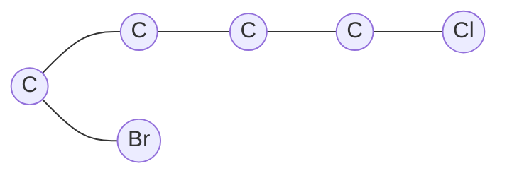

# 08.1 分子作為圖：頂點原子與邊化學鍵的矩陣表示

## 8.1.1 一個改變兩門學科的洞察

1857 年，英國數學家 Arthur Cayley 在論文〈On the theory of the analytical
forms called trees〉中，為了解決一個純數學問題——列舉所有滿足特定條件的
「樹狀結構」——建立了樹（tree）的理論。僅僅數年之後，Cayley 意識到這套理
論恰好可以描述當時剛剛誕生的**化學結構式**：碳原子四價、氫原子一價，分子
正是由這些「節點」與「連結」組成的圖。這是歷史上數學與化學最深刻的相互驅
動案例之一：

- **化學的需求驅動了數學**：同分異構物（isomer）計數問題——為什麼
  $\mathrm{C_4H_{10}}$ 恰有兩種異構物？——催生了「有根樹計數」與
  Pólya 計數定理（1937）。
- **數學的工具反哺化學**：有了圖的語言，「分子的形狀」第一次可以離開
  紙面上的圖畫，成為可計算、可比較、可儲存的**數學物件**。

> **歷史注記**：Cayley 1875 年的論文〈On the analytical forms called
> trees, with application to the theory of chemical combinations〉
> 明確地用樹計數解決了烷烴 $\mathrm{C_nH_{2n+2}}$ 的異構物數目問題。

## 8.1.2 分子圖的定義

**定義 8.1（分子圖，Molecular Graph）**
一個分子圖是有序對 $G = (V, E)$ ，其中：

- 頂點集 $V = \{v_1, \dots, v_n\}$ ，每個頂點對應一個原子；
- 邊集 $E \subseteq V \times V$ ，每條邊對應一個化學鍵。

若邊上的鍵級（單鍵、雙鍵、三鍵）也納入考量，則得到**加權分子圖**
$G = (V, E, w)$ ，其中權重函數 $w: E \to \{1, 2, 3\}$ （芳香鍵常記為
$w = 1.5$ ，源自 Hückel 分子軌域理論中鍵級的近似值）。

**定義 8.1（氫壓縮圖，Hydrogen-Depleted Graph）**
實務上常將氫原子隱去，只保留重原子（C、N、O、S……），此稱氫壓縮圖。
氫原子數可由價鍵規則恢復：碳為四價，故碳原子上連接的氫數
$h_i = 4 - \deg(v_i)$ （對飽和碳而言）。這個壓縮讓圖的規模從
$O(n_{\text{all}})$ 降到 $O(n_{\text{heavy}})$ ，是化學資訊學的標準做法。



上圖即 1-bromo-4-chlorobutane 的氫壓縮圖：4 個碳頂點、5 條邊。

## 8.1.3 三種基本矩陣表示

將圖「翻譯」成矩陣，是讓化學進入線性代數領域的關鍵一步。

### 一、鄰接矩陣（Adjacency Matrix）

**定義 8.2** 無向圖 $G$ 的鄰接矩陣 $A \in \mathbb{R}^{n \times n}$ 定義為

$$
A_{ij} =
\begin{cases}
1, & (v_i, v_j) \in E \\
0, & \text{otherwise}
\end{cases}
$$

**性質 8.1** 對簡單無向圖：

1. $A$ 是對稱的： $A_{ij} = A_{ji}$ ；
2. $A_{ii} = 0$ （不考慮自環時）；
3. $(A^k)_{ij}$ 等於從 $v_i$ 走到 $v_j$ 、長度恰為 $k$ 的走法數。
   這一條在化學上對應「電子或自旋沿鍵傳遞 $k$ 步的路徑數」。

### 二、鍵結矩陣／連接表（Connection Table, CTAB）

化學資訊系統（如 MOL 檔案格式）實際使用的不是 $A$ ，而是「連接表」：
每行記錄一個原子的元素、座標，每筆鍵記錄 $(i, j, \text{鍵級})$ 。
這等價於圖的**邊列表**（edge list）表示，儲存複雜度
$O(|E|)$ 而非 $O(n^2)$ ，因為分子圖是**稀疏圖**——
有機分子中原子價不超過四，故 $|E| \le 2n$ ， $A$ 中的非零元占比極低。

### 三、度矩陣（Degree Matrix）

**定義 8.3** 度矩陣 $D$ 是對角矩陣， $D_{ii} = \deg(v_i) = \sum_j A_{ij}$ 。
在化學上， $\deg(v_i)$ 就是原子的鍵結數，直接連結到**形式電荷**與
**不飽和度**的計算。

## 8.1.4 化學實例：乙醇與二甲醚——同分異構的矩陣判別

乙醇 $\mathrm{CH_3CH_2OH}$ 與二甲醚 $\mathrm{CH_3OCH_3}$ 擁有完全相同的
分子式 $\mathrm{C_2H_6O}$ ，但它們的氫壓縮圖不同：

- 乙醇：路徑 C—C—O（氧在末端）
- 二甲醚：路徑 C—O—C（氧在中間）

用鄰接矩陣判別（見程式）——這正是 Cayley 1857 年直覺的現代實踐：
**結構決定性質，而矩陣決定性地編碼結構。**

```python
import numpy as np

def adjacency(elements, bonds):
    """由元素清單與鍵列表建立氫壓縮鄰接矩陣"""
    n = len(elements)
    A = np.zeros((n, n), dtype=int)
    idx = {e: i for i, e in enumerate(elements)}
    for i, j in bonds:
        A[idx[i], idx[j]] = A[idx[j], idx[i]] = 1
    return A, idx

# 乙醇 C-C-O
A_eth, _ = adjacency(["C0", "C1", "O"], [("C0","C1"), ("C1","O")])
# 二甲醚 C-O-C
A_dme, _ = adjacency(["C0", "O", "C1"], [("C0","O"), ("O","C1")])

print("乙醇:\n", A_eth)
print("二甲醚:\n", A_dme)
print("是否同構（矩陣是否相同）:", np.array_equal(A_eth, A_dme))
# 頂點度序列：乙醇 (1,2,1)，二甲醚 (1,2,1) —— 度序列相同但圖不同構！
```

**重要警示**：度序列相同不代表同構。乙醇與二甲醚的度序列都是
$(2, 1, 1)$ ，但連接方式不同。判定兩個分子圖是否同構（graph
isomorphism）是化學資訊學的核心難題之一，也是 2015 年 Babai 提出
擬多項式時間演算法的著名圖同構問題（Graph Isomorphism Problem）的
化學動機來源。

## 8.1.5 圖不變量：化學「指紋」的數學基礎

為了繞開同構判定的昂貴成本，化學資訊學轉而使用**圖不變量**
（graph invariants）：在所有同構的表示下取值相同的量。

| 不變量 | 定義 | 化學意義 |
|---|---|---|
| 頂點數 $n$ | $\lvert V\rvert$ | 重原子數 |
| 邊數 $m$ | $\lvert E\rvert$ | 鍵數（氫壓縮後） |
| 度序列 | 各頂點度的排序 | 原子連接輪廓 |
| 特徵值譜 $\mathrm{spec}(A)$ | $A$ 的 $n$ 個特徵值 | 與 Hückel 軌域能量直接相關（見 08.2） |
| Wiener 指數 $W$ | $\frac{1}{2}\sum_{i\ne j} d(i,j)$ | 與沸點相關（見 08.3） |

**定義 8.4（圖距）** $d(i, j)$ 是頂點 $v_i$ 與 $v_j$ 之間最短路上的
邊數，即分子中兩原子間「隔了幾根鍵」。

**定理 8.1（矩陣樹定理，Kirchhoff 1847）** 令 $L = D - A$ 為拉普拉斯
矩陣， $\tau(G)$ 為圖的生成樹數目，則

$$
\tau(G) = \frac{1}{n}\prod_{k=2}^{n} \lambda_k(L),
$$

其中 $\lambda_2, \dots, \lambda_n$ 是 $L$ 的非零特徵值。Kirchhoff 當年
正是為了分析電流網路而發明此定理——電路與化學鍵網路在數學上是同一個
物件，這一點將在 08.2 的電阻距離中再次浮現。

## 8.1.6 從矩陣回到化學：譜圖論的預告

鄰接矩陣的特徵多項式

$$
\phi(G; x) = \det(xI - A)
$$

在化學文獻中被稱為**特徵多項式**（characteristic polynomial of the
molecule）——因為 Hückel 近似下， $\pi$ 電子系統的能量本徵值恰為
$\alpha + \beta\lambda_k$ ，其中 $\lambda_k$ 是 $A$ 的特徵值、
$\alpha$ 是庫侖積分、 $\beta$ 是共振積分。苯的穩定性、1,3-丁二烯的
顏色、石墨烯的零能隙，全部可以從「分子圖鄰接矩陣的特徵值」讀出。
這條「結構 → 矩陣 → 特徵值 → 能量 → 性質」的推理鏈，就是接下來
兩節的主題。

## 8.1.7 章末小結

1. 分子天然是圖：原子為頂點、鍵為邊；氫壓縮圖是化學資訊學的標準物件。
2. Cayley 1857 年的樹理論與化學結構式互相催生，同分異構計數是圖論
   最早的「應用數學」成果。
3. 鄰接矩陣 $A$ 、度矩陣 $D$ 、連接表是三種基本表示；分子圖是稀疏的。
4. $(A^k)_{ij}$ 計數長度 $k$ 的走法；矩陣樹定理把生成樹數與
   拉普拉斯譜連結起來。
5. 同分異構物可能度序列相同，故需要更強的不變量——譜、拓撲指數、
   分子指紋（第 10 章主題）。

**下一步**：08.2 將深入鄰接矩陣與拉普拉斯矩陣的譜理論，說明
Hückel 分子軌域理論如何把「分子的能量」變成「矩陣的特徵值」，並以
苯的 $4n+2$ 芳香性作為第一個大勝利。
