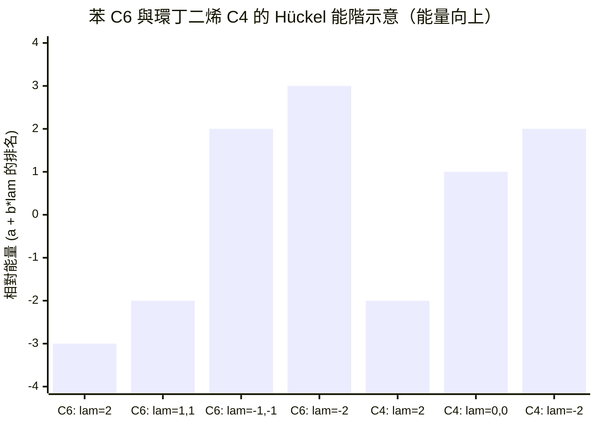

# 08.2 鄰接矩陣與拉普拉斯矩陣：如何用數字描述分子的連通性

## 8.2.1 從「畫出分子」到「算出分子」

上一節我們把分子編碼成矩陣。本節要證明一件更深刻的事：**矩陣的譜
（特徵值集合）不是任意的數字，而是分子的物理——電子能階、穩定性、
甚至導電性——的直接化身。** 這條思路由兩位化學家完成：

- Erich Hückel（1931）：以鄰接矩陣的特徵值近似 $\pi$ 電子能階；
- Gustav Kirchhoff（1847）：以拉普拉斯矩陣分析電阻網路，百年後被
  Klein 與 Randić（1993）重新詮釋為分子圖上的「電阻距離」。

化學提供問題，線性代數提供答案，而答案又回頭指導新分子的合成——
這是本書反覆出現的「雙向驅動」結構。

## 8.2.2 拉普拉斯矩陣的定義與基本譜性質

**定義 8.5（拉普拉斯矩陣）** 對圖 $G$，定義

$$
L = D - A, \qquad L_{ij} =
\begin{cases}
\deg(v_i), & i = j \\
-1, & (i, j) \in E \\
0, & \text{otherwise}
\end{cases}
$$

亦有一個歸一化版本

$$
\mathcal{L} = D^{-1/2} L D^{-1/2}, \qquad \mathcal{L}_{ij} =
\begin{cases}
1, & i = j \\
-\dfrac{1}{\sqrt{\deg_i \deg_j}}, & (i,j) \in E
\end{cases}
$$

後者對度差異懸殊的分子（如重鹵素接氫碳）更為公平。

**定理 8.2（拉普拉斯譜基本定理）** 對 $n$ 頂點的無向圖 $G$：

1. $L$ 是半正定的；所有特徵值 $0 = \lambda_1 \le \lambda_2 \le \cdots \le \lambda_n$。
2. 零特徵值的重數 = $G$ 的連通分量數。
3. $\lambda_2(G)$ 稱為**代數連通度**（algebraic connectivity，Fiedler 1973）：
   $\lambda_2 > 0 \iff G$ 連通，且 $\lambda_2$ 越大，圖越「難切斷」。

**化學詮釋**：

- 零特徵值重數 $> 1$ 對應分子分解成幾個不連接的片段（如鹽類晶體中
  的獨立分子單元）。
- $\lambda_2$ 小表示分子有「細腰」——例如兩個大基團以單鍵相連，
  該鍵恰對應 Fiedler 向量（$\lambda_2$ 的特徵向量）中符號變化之處。
  這正是化學家尋找**最易斷裂的鍵**與**反應位點**的一種譜學啟發法。

## 8.2.3 Hückel 理論：鄰接矩陣即哈密頓算符

**Hückel 近似（1931）** 對共軛 $\pi$ 系統，分子軌域
$\psi = \sum_i c_i p_i$（$p_i$ 為各碳的 $p_z$ 軌域）滿足的久期方程
在以下近似下化為線性代數：

1. 只考慮相鄰 $p_z$ 軌域間的共振積分 $\beta$；
2. 所有碳的庫侖積分相同，記為 $\alpha$。

得到的能量本徵值問題正是：

$$
A\,\mathbf{c} = \lambda\,\mathbf{c}, \qquad E_k = \alpha + \beta\,\lambda_k .
$$

**注意**：$\beta < 0$，故 $\lambda$ 越大、能量越低。Hückel 的天才之處
在於：他把量子化學問題**完全歸約為圖論問題**——只要會求鄰接矩陣的
特徵值，就能算 $\pi$ 電子能量，完全不需要積分。

**定理 8.3（Hückel $4n+2$ 規則，1931）** 單環平面共軛系統若有
$4n+2$ 個 $\pi$ 電子，則所有成鍵軌域恰好填滿，分子芳香、特別穩定；
若有 $4n$ 個 $\pi$ 電子，則出現半填滿的簡併軌域，分子反芳香、
特別不穩定。

**證明概要（以苯為例）**：苯是 6-循環 $C_6$，其鄰接矩陣特徵值為

$$
\lambda = 2,\ 1,\ 1,\ -1,\ -1,\ -2 .
$$

6 個 $\pi$ 電子成對填入 $\lambda = 2, 1, 1$ 三個成鍵軌域——恰好填滿、
無簡併半填層 → 芳香。反觀環丁二烯 $C_4$：特徵值
$2, 0, 0, -2$，4 個電子填入 $\lambda = 2$ 與簡併的 $\lambda = 0$ 層，
依 Hund 規則兩電子分佔簡併軌域且自旋平行 → 三線態雙自由基、反芳香。
環丁二烯確實極不穩定，只能在低溫基質中捕捉——數學預測與化學現實
完美吻合。



## 8.2.4 電阻距離：Kirchhoff 定理的化學重生

把每條化學鍵視為 $1\,\Omega$ 的電阻，整個分子就是一個電阻網路。
**定義 8.6（電阻距離）** $\Omega_{ij}$ = 網路中頂點 $i, j$ 間的等效
電阻。

**定理 8.4（Klein–Randić 1993）** 電阻距離可由拉普拉斯逆矩陣的
廣義逆（Moore–Penrose 逆 $L^+$）表示：

$$
\Omega_{ij} = (L^+)_{ii} + (L^+)_{jj} - 2 (L^+)_{ij} = (\mathbf{e}_i - \mathbf{e}_j)^\top L^+ (\mathbf{e}_i - \mathbf{e}_j) .
$$

**Kirchhoff 指數** $Kf(G) = \sum_{i<j} \Omega_{ij}$ 則滿足

$$
Kf(G) = n \sum_{k=2}^{n} \frac{1}{\lambda_k(L)} .
$$

化學意義：電阻距離比圖距更「物理」——並聯路徑會降低電阻，這正對應
分子中**多條共振路徑**（如苯環的兩條通道）使電子傳遞更容易。純拓撲
的圖距無法表達這種並聯效應，拉普拉斯譜可以。

## 8.2.5 化學實例：計算乙烯、苯的譜與電阻距離

```python
import numpy as np

def spectra(A):
    """回傳鄰接與拉普拉斯矩陣的特徵值"""
    n = len(A)
    D = np.diag(A.sum(axis=1))
    L = D - A
    ev_A = np.linalg.eigvalsh(A)
    ev_L = np.linalg.eigvalsh(L)
    return ev_A, ev_L

def kirchhoff_index(L, n):
    """Kf = n * sum(1/lambda_k), k>=2"""
    ev = np.linalg.eigvalsh(L)
    return n * np.sum(1.0 / ev[1:])

# 乙烯 C2H4 的 pi 系統：兩個碳相連
A_ethylene = np.array([[0, 1],
                       [1, 0]])
# 苯：6-循環
A_benzene = np.zeros((6, 6), dtype=int)
for i in range(6):
    A_benzene[i, (i + 1) % 6] = A_benzene[(i + 1) % 6, i] = 1

evA, evL = spectra(A_benzene)
print("苯的 Hückel 特徵值:", np.round(evA, 4))
# [ 2. 1. 1. -1. -1. -2.]  → 6 個 pi 電子填滿 lam=2,1,1 → 芳香
print("苯的拉普拉斯特徵值:", np.round(evL, 4))
print("苯的 Kirchhoff 指數:", round(kirchhoff_index(
      np.diag(A_benzene.sum(1)) - A_benzene, 6), 4))
```

**結果解讀**：苯的 Kirchhoff 指數為 8.5，小於同樣 6 頂點的線性
己烷（鏈狀圖）之 $Kf$ 值——環提供了並聯通路，等效電阻下降，
這正是苯環導電性與離域穩定性的譜學足跡。

## 8.2.6 譜不變量與「譜等價」陷阱

**定義 8.7** 若兩圖的鄰接矩陣有相同特徵值多重集，稱它們**同譜**
（cospectral）。

反例：存在許多非同構但同譜的分子圖（Collatz–Sinogowitz 1957 年起
陸續發現）。這告訴我們：譜是強大但不完備的分子描述子——不同的
分子可能有相同的 Hückel 能階！這個「理論陷阱」推動了後續兩個方向：

1. **加入更多矩陣**：除 $A$、$L$ 外，還有無符號拉普拉斯
   $Q = D + A$、距離矩陣 $\Delta_{ij} = d(i,j)$，形成完整譜描述子；
2. **放棄譜、改用序列式指紋**：這是第 10 章 Morgan 演算法與
   Daylight 指紋的起點。

## 8.2.7 章末小結

1. 拉普拉斯矩陣 $L = D - A$ 的譜編碼連通性：零根重數 = 分量數，
   $\lambda_2$（Fiedler 值）度量分子「易斷」之處。
2. Hückel 理論把 $\pi$ 電子能階化為鄰接矩陣特徵值：
   $E_k = \alpha + \beta\lambda_k$；苯與環丁二烯的對比是 $4n+2$
   規則最乾淨的驗證。
3. Kirchhoff 1847 年的電路定理在 1993 年被 Klein–Randić 轉譯為
   分子電阻距離，克服了圖距無法表達並聯共振的缺陷。
4. 同譜非同構分子的存在，說明單一譜不變量不完備，為拓撲指數
   （08.3）與分子指紋（10.1）鋪路。

**下一步**：譜提供了能量，但要預測**沸點**這類巨觀性質，化學家需要
更簡單、更好算、能回歸的數字。08.3 介紹 Wiener 1947 年的指數——
圖論進入工業化學（聚合物蒸餾塔設計）的起點。
