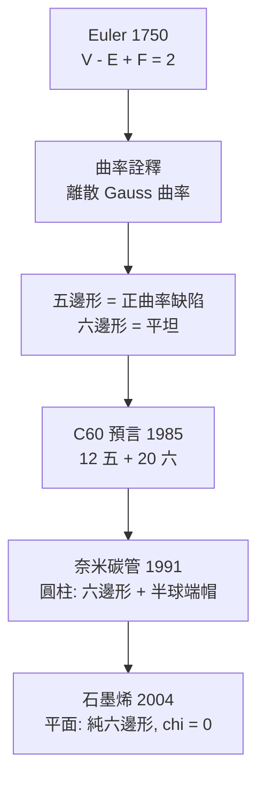

# 09.1 多面體與尤拉示性數在碳同素異形體中的應用

## 9.1.1 一條 1750 年的等式如何預言 1985 年的分子

1750 年，Euler 在給 Goldbach 的信中寫下：對任何凸多面體，

$$
V - E + F = 2,
$$

其中 $V$ 是頂點數、 $E$ 是稜數、 $F$ 是面數。這條等式最初只是幾何學
的優雅觀察。235 年後，它成為分子化學中**最成功的理論預言**之一：

1985 年，Kroto、Curl、Smalley 在模擬星際碳塵的雷射汽化實驗中發現，
質譜上 $m/z = 720$ （即 $\mathrm{C_{60}}$ ）的峰異常突出。團隊用硬紙板
與膠帶拼出了答案——**截角二十面體**（truncated icosahedron），即
足球的形狀。而這個猜測能成立，第一步就是用 Euler 公式檢查：

**驗證**：60 個頂點、每頂點 3 價 → 由握手引理
$E = \frac{3 \times 60}{2} = 90$ 條邊；
Euler 公式給 $F = 2 + E - V = 2 + 90 - 60 = 32$ 個面。
若每個面是五邊形或六邊形（碳的 $sp^2$ 環只能如此），設五邊形
$p$ 個、六邊形 $h$ 個：

$$
p + h = 32, \qquad 5p + 6h = 2E = 180
$$

解得 $p = 12,\ h = 20$ ——**恰好 12 個五邊形與 20 個六邊形**，
與足球完全一致。四天之內，Euler 公式從古代幾何躍升為諾貝爾獎
（1996）工作的理論支柱。

## 9.1.2 尤拉示性數的推廣：曲面上的化學

**定理 9.1（Euler–Poincaré）** 對虧格 $g$ 的閉曲面（ $g$ 個「把手」）
上的多面體剖分，

$$
V - E + F = \chi = 2 - 2g .
$$

$\chi$ 是**拓撲不變量**——無論如何剖分都不變，只由曲面本身決定。

**化學應用**：富勒烯是嵌在球面（ $g = 0$ ， $\chi = 2$ ）上的碳網格。
將碳原子視為頂點、鍵為稜、環為面，握手引理（碳三價）
$E = \frac{3V}{2}$ 代入 Euler 公式：

$$
F = 2 + E - V = 2 + \frac{3V}{2} - V = 2 + \frac{V}{2},
$$

再加上五、六邊形計數（同前），得到富勒烯的**普適定理**：

**定理 9.2（富勒烯五邊形隔離）** 任何由五邊形與六邊形構成、
每頂點三價的閉碳籠，**必含恰好 12 個五邊形**，六邊形數目為
$h = \frac{V}{2} - 10$ 。特別地，**不含五邊形的純六邊形碳籠不可能
存在**（石墨片必須有邊界，除非引入曲率）。

推論：最小的可能碳籠需 $h \ge 1$ ，即 $V \ge 22$ ；但 22 個碳無法
排成合法籠（無孤立五邊形要求），實際最小的穩定富勒烯是
$\mathrm{C_{20}}$ （純十二面體，無六邊形）。數學在實驗之前就劃定了
可能分子的邊界。

## 9.1.3 五邊形隔離原理與 IPR

**定義 9.1（孤立五邊形規則，Isolated Pentagon Rule, IPR）**
五邊形兩兩不相鄰的富勒烯最穩定。原因：相鄰五邊形造成局部張力與
$p$ 軌域角度偏差，破壞 $\pi$ 共軛（與 09.2 的芳香性相連）。

在 $\mathrm{C_{60}}$ 中，12 個五邊形被 20 個六邊形完全隔開——
$\mathrm{C_{60}}$ 是**滿足 IPR 的最小富勒烯**。 $\mathrm{C_{70}}$
（橢球狀， $D_{5h}$ 對稱）是第二個。這解釋了為何富勒烯質譜譜線
集中在 60 與 70：**拓撲約束選出了自然的穩定島嶼。**



## 9.1.4 離散曲率：高斯—博內定理的化學版

**定理 9.3（離散 Gauss–Bonnet）** 對三價平面網格，令頂點 $i$ 的
角虧（angle deficit）為 $\kappa_i = 2\pi - \sum_{\theta \in v_i} \theta$ ，
則

$$
\sum_{i} \kappa_i = 2\pi\,\chi .
$$

對正五、六邊形網格：六邊形頂點處角和 $= 3 \times 120° = 360°$ ，
角虧為零（平坦）；五邊形頂點處 $= 2 \times 120° + 108° = 348°$ ，
角虧 $12°$ 。故每個五邊形貢獻 $3 \times 12° = 36°$ 的正曲率，
12 個五邊形總曲率 $= 432° = 2 \times 360° = 2\pi\chi$ （球面所需）。

**化學詮釋**：**五邊形是碳網格的曲率源**。這一句話解釋了三個
諾貝爾獎級的發現：

| 結構 | 拓撲 | 曲率 | 年代 |
|---|---|---|---|
| 石墨烯 | 平面，純六邊形， $\chi = 0$ | 零 | 2004 |
| 奈米碳管 | 圓柱， $\chi = 0$ | 零（軸向） | 1991 |
| 富勒烯 $\mathrm{C_{60}}$ | 球， $\chi = 2$ | 正 | 1985 |
| 負曲率碳（schwarzite，理論） | 鞍面， $g \ge 2$ | 負（需七邊形） | 2018 部分合成 |

要造負曲率碳，需引入**七邊形**（角和 $> 360°$ ）——這是拓撲直接
指導合成設計的範例。

## 9.1.5 化學實例：程式驗證富勒烯拓撲約束

```python
def fullerene_check(V):
    """給定碳數，檢查富勒烯的面組成與價鍵一致性"""
    E = 3 * V // 2          # 三價碳的握手引理
    F = 2 + E - V           # Euler: chi = 2（球面）
    # 5p + 6h = 2E, p + h = F
    # => p = 6F - 2E = 12
    p = 6 * F - 2 * E
    h = F - p
    return V, E, F, p, h

print(f"{'V':>4} {'E':>4} {'F':>4} {'五邊形':>6} {'六邊形':>6}")
for V in [20, 24, 28, 60, 70, 76, 84]:
    Vv, E, F, p, h = fullerene_check(V)
    print(f"{Vv:>4} {E:>4} {F:>4} {p:>7} {h:>7}")
# 任何偶數 V>=20 皆得 p = 12；h = V/2 - 10
# C60 → 12 五 + 20 六；C70 → 12 五 + 25 六
```

## 9.1.6 尤拉示性數與分子軌域的深層連結

有趣的是， $\mathrm{C_{60}}$ 的 60 個 $p_z$ 軌域構成的 Hückel 矩陣
（見 08.2）有 3 個零特徵值——在 $I_h$ 對稱下， $h_u$ 五重簡併能階
恰可容納 10 個電子，60 個 $\pi$ 電子填滿所有成鍵軌域。**籠的拓撲
對稱性（截角二十面體）與電子結構（閉殼、芳香）在此互相鎖定**：
拓撲決定對稱群，對稱群決定簡併結構，簡併結構決定電子穩定性。
Euler 的等式因此不只是計數工具，而是通往分子量子力學的第一級台階。

## 9.1.7 章末小結

1. Euler 公式 $V - E + F = 2$ 在 1985 年為 $\mathrm{C_{60}}$ 提供了
   五分鐘內可完成的關鍵驗證：12 個五邊形、20 個六邊形。
2. 示性數 $\chi = 2 - 2g$ 是拓撲不變量；富勒烯普適定理指出任何
   碳籠必含 12 個五邊形——純六邊形封閉籠不存在。
3. 離散 Gauss–Bonnet 定理把「五邊形 = 正曲率源」變成定量陳述，
   統一解釋石墨烯（零曲率）、碳管（圓柱）、富勒烯（球）與
   schwarzite（負曲率，需七邊形）。
4. IPR 規則解釋 $\mathrm{C_{60}}$ 、 $\mathrm{C_{70}}$ 的特殊穩定性；
   拓撲、對稱性與 Hückel 電子結構層層鎖定。

**下一步**：封閉籠是 $g = 0$ 的定向曲面。但如果我們把分子「扭曲
半圈再接回去」，得到的是不可定向空間——Möbius 帶。09.2 講述
Heilbronner 1964 年的預言與 2003 年後 Möbius 芳香分子的合成故事。
