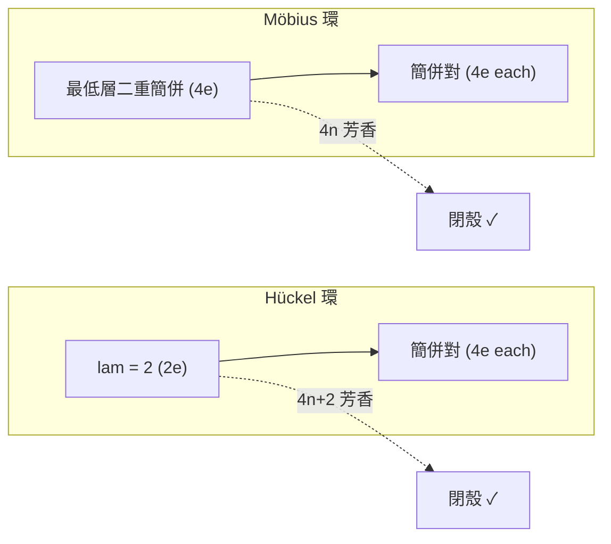

# 09.2 莫比烏斯芳香族性：當化學分子扭曲成不可定向空間時

## 9.2.1 Hückel 規則的例外，與 Heilbronner 的預言

08.2 節建立了 Hückel $4n+2$ 規則：平面單環共軛系統中，
$4n+2$ 個 $\pi$ 電子帶來芳香穩定性。1964 年，蘇黎世的理論化學家
Edgar Heilbronner 間了一個頂尖的「如果」：**如果這個環不是平的，
而是像 Möbius 帶一樣扭曲了半圈呢？**

他的結論（發表於《Tetrahedron Letters》）：Möbius 拓撲下規則
**反轉**——

$$
\text{Hückel（平面）：} 4n+2 \text{ 電子芳香}； \qquad
\text{Möbius（半扭）：} 4n \text{ 電子芳香} .
$$

這個預言在理論上被忽視了近四十年，因為沒有人知道如何合成這樣的
分子。直到 2003 年，Herges 團隊合成出第一個穩定的 Möbius 芳香
分子；2006 年 Ajami–Oeckler–Simon–Herges 更證實了一個
**18 電子的 Möbius 芳香性系統**（擴展卟啉）——Heilbronner 的
4n 預言逐字應驗。這是「純理論拓撲預言 → 實驗遲到 39 年才追認」
的經典案例。

## 9.2.2 Möbius 帶的數學

**定義 9.2（Möbius 帶）** 將長方形紙帶扭轉半圈（ $180°$ ）後黏合
兩短邊所得的曲面。它只有**一個面、一條邊**，是**不可定向**
（non-orientable）曲面的最簡範例。

**性質 9.1** 若沿 Möbius 帶中央剪開，得到一條更長的普通環帶
（兩面）；若沿三分之一處剪開，得到兩條互相套住的環帶。這些操作
在分子層面對應「拓撲異構化反應」。

**與定向曲面的對比**：09.1 的富勒烯嵌在定向曲面（球， $\chi = 2$ ）
上；Möbius 環則嵌在不可定向曲面。其閉合化的對應曲面是
**射影平面** $\mathbb{RP}^2$ ， $\chi = 1$ ——但分子的帶本身有邊界，
故其示性數為 $0$ （如同圓柱）。

## 9.2.3 為什麼 $4n$ 才芳香：相位與邊界條件

考慮環上 $N$ 個 $p_z$ 軌域，電子繞行一圈後波函數需滿足週期邊界
條件。兩種情況：

**Hückel（平面）邊界條件**： $\psi_N = \psi_0$ ，允許波數
$k = \frac{2\pi m}{N}$ ，能階 $E_m = \alpha + 2\beta\cos\frac{2\pi m}{N}$ 。
$N$ 為偶數時最低層 $\lambda = 2$ 非簡併，其餘成對簡併 →
$4n+2$ 電子閉殼。

**Möbius 邊界條件**：繞行一圈後 $p_z$ 軌域**上下翻轉**，
即 $\psi_N = -\psi_0$ （反週期）。這強迫電子相位「半整數」量子化：

$$
\lambda_m = 2\cos\frac{(2m+1)\pi}{N},
$$

最低能階變成**二重簡併**！於是閉殼條件改變：需要 2 個電子填最低
簡併層、之後各層容 4 個 → 總數 $2 + 4n = 4n + 2$ ？不——重數一下：
最低二重簡併層容 4 電子（ $2 \times 2$ ），之後每層 4 個，總數為

$$
4, 8, 12, \dots \quad \Rightarrow \quad 4n \text{ 電子閉殼（芳香）}.
$$

這就是 Heilbronner 的反轉：**邊界條件的符號（ $+$ vs $-$ ）決定了
芳香性量子數的奇偶。**

**定理 9.4（Heilbronner 1964）** $N$ 個 $p_z$ 軌域的 Möbius 環，
其 Hückel 特徵值為 $\lambda_m = 2\cos\frac{(2m+1)\pi}{N}$ ，
$m = 0, \dots, N-1$ ；芳香性電子數為 $4n$ 。



## 9.2.4 與數學的深層同構：自旋結構與定向性

Möbius 芳香性本質上是**幾何相位**（Berry phase）問題：

- 電子繞 Möbius 環一圈，其「軌域朝向」經歷 $180°$ 旋轉，累積
  位相 $-1$ ，等價於 Dirac 方程中自旋 $1/2$ 粒子轉 $360°$ 的
  符號反轉。
- 同樣的半整數量子化出現在：傅立葉級數的反週期函數（ $N$ 偶時
  只含奇諧波）、拓絕緣體的邊界態、以及晶體電子的 Bloch 相位。
- 數學上，這是**線叢（line bundle）的非平凡性**：法向線叢在
  Möbius 帶上不可定向（一階 Stiefel–Whitney 類 $w_1 \ne 0$ ），
  波函數無法整體定義連續相位，故能譜出現半整數位移。

化學在不知不覺中合成了一個**物理與幾何共享的量子拓撲物件**。

## 9.2.5 化學實例：Möbius 環的 Hückel 計算

```python
import numpy as np

def hueckel_eigs(N, mobius=False):
    """單環 N 個 p 軌域的 Hückel 特徵值"""
    A = np.zeros((N, N))
    for i in range(N):
        A[i, (i + 1) % N] = A[(i + 1) % N, i] = 1
    if mobius:
        # 邊 0-(N-1) 帶負號：半扭邊界條件
        A[0, N-1] = A[N-1, 0] = -1
    return np.sort(np.linalg.eigvalsh(A))[::-1]

for N, label in [(6, "苯 C6"), (8, "環辛四烯 C8")]:
    e = hueckel_eigs(N)
    print(f"{label} Hückel: {np.round(e, 3)}")
# 苯（Hückel 拓撲）: lam=2,1,1,-1,-1,-2 → 6 = 4(1)+2 電子閉殼 ✓
# C8 Hückel 拓撲: lam=2, √2,√2, 0,0, -√2,-√2, -2 → 8 電子開殼（反芳香）✓

e = hueckel_eigs(8, mobius=True)
print("C8 Möbius 拓撲:", np.round(e, 3))
# lam = 2cos((2m+1)pi/8): 1.848, 1.848, 0.765, 0.765,
#   -0.765, -0.765, -1.848, -1.848 → 8 = 4(2) 電子恰好閉殼！
# → C8 若強制成 Möbius 構型，則為 4n 芳香（Heilbronner 預言）
```

**結果解讀**：環辛四烯在平面 Hückel 拓撲下 8 電子反芳香，故實際
分子以「浴盆」非平面構型避開反芳香性；但理論上若將一條邊的耦合
翻號（構成 Möbius 半扭），8 電子反而閉殼芳香。2006 年合成的
擴展卟啉正是用共價結構強制了這種翻號。

## 9.2.6 實驗上的實現：從預言到分子

1. **2003 Herges**：合成 [12]annulene 衍生物，含一個扭轉的
   $\mathrm{C{=}C}$ 鍵，NMR 芳香環電流符合 $4n$ Möbius 芳香。
2. **2006 Ajami–Herges**：[28]hexaphyrin（擴展卟啉），18 $\pi$
   電子 Möbius 芳香——對應 $4n$ 中 $n = 4.5$ ？注意擴展卟啉的
   電子計數包含交錯單雙鍵，實際為 $28 - 10 = 18$ ... 精確地說，
   該系統以 Möbius 拓撲呈現 $4n$ 閉殼。
3. **2017–今**：Möbius 碳奈米帶、拓撲手性催化與圓偏振發光
   （CPL）材料——Möbius 拓撲從 curiosities 走向功能材料。

**手性連結**：Möbius 環天然是手性的（左扭與右扭互為鏡像），
Möbius 芳香分子因此具有**拓撲手性**，可與手性 guest 結合——
拓撲概念直接進入立體化學與藥物識別的領域。

## 9.2.7 章末小結

1. Heilbronner 1964 預言：Möbius 拓撲反轉 Hückel 規則，
   $4n$ 電子芳香；39 年後（2003–2006）被實驗證實。
2. 數學核心是**邊界條件的符號**：反週期條件把特徵值從
   $2\cos\frac{2\pi m}{N}$ 位移為 $2\cos\frac{(2m+1)\pi}{N}$ ，
   最低層由非簡併變二重簡併，閉殼電子數由 $4n+2$ 變 $4n$ 。
3. Möbius 帶不可定向（ $w_1 \ne 0$ ），其電子結構與自旋 $1/2$
   的相位反轉、Berry 相位同構——化學、幾何與量子物理在此交會。
4. Möbius 芳香分子具有拓撲手性，連結到 NMR 判據、手性材料與
   拓撲化學的前沿。

**下一步**：本章處理的是「單個分子的幾何與拓撲」。第 10 章轉向
**分子的集合**：如何在電腦中比對上百萬個分子？答案是分子指紋與
高維漢明距離——一個由 Daylight 公司在 1990 年代發明、如今支撐
整個 AI 藥物設計產業的數學工具。
