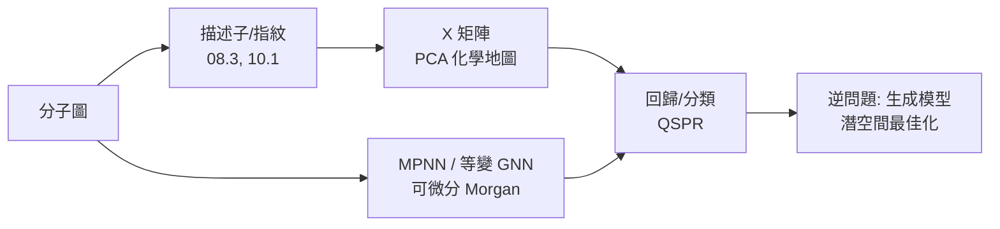

# 10.2 機器學習中的化學空間：分子的向量化與性質預測模型

## 10.2.1 「化學空間」：從隱喻到度量空間

化學家長說「化學空間廣達 $10^{60}$ 個可能藥物分子」，但空間要
成為數學物件需要三要素：**點**（分子的表示）、**座標**（向量化）、
**度量**（距離/相似度）。10.1 已給出前兩者的離散版本；本節把它
推廣到實向量空間 $\mathbb{R}^d$ ，並建立「座標 → 距離 → 預測」
的完整管線。歷史上這條管線分三波成形：

1. **1980s–1990s**：手工描述子 + 線性回歸（Hansch 分析、
   Wiener/Randić 指數、主成分分析 PCA）；
2. **2000s**：指紋 + 相似性搜尋 + 支援向量機（SVM）、隨機森林；
3. **2017–今**：端到端表示學習——Mol2vec、SMILES 語言模型、
   訊息傳遞神經網路（MPNN）、以及超越 WL 上界的幾何深度學習。

## 10.2.2 從指紋到連續向量：描述子矩陣

**定義 10.3（描述子矩陣）** 設分子庫含 $N$ 個分子、每個分子
$m$ 個描述子 $x_1, \dots, x_d$ （拓撲指數、電子描述子、指紋位元
等），構成矩陣 $X \in \mathbb{R}^{N \times d}$ 。性質目標向量
$y \in \mathbb{R}^N$ （如溶解度 $\log S$ 、熔點、毒性）。

性質預測（QSPR/QSAR）即求映射 $\hat{y} = f(\mathbf{x})$ ，最小化

$$
\min_{f} \sum_{i=1}^{N} \big(y_i - f(\mathbf{x}_i)\big)^2 + \lambda\, \Omega(f),
$$

正則項 $\Omega$ 抵抗「描述子多、樣本少」的過擬合——化學資料的
典型困境（ $N \sim 10^3$ ， $d \sim 10^3$ – $10^4$ ）。

**主成分分析（PCA）** 是第一層「化學空間導航」：對中心化的
$X$ 做奇異值分解 $X = U \Sigma V^\top$ ，前兩主成分
$(U_1 \Sigma_1, U_2 \Sigma_2)$ 構成化學家的「世界地圖」——
藥物化學家在上面觀察：已知藥物聚集成簇、天然產物佔據不同區域、
商業庫的覆蓋漏洞在哪裡。

## 10.2.3 度量學習與相似性原理

**相似性原理（Similarity Property Principle, Johnson & Maggiora
1990）**：結構相似的分子傾向有相似的性質。數學化：

**命題 10.1** 若性質函數 $f$ 在表示空間中 Lipschitz 連續，
$\lvert f(x) - f(x')\rvert \le L\, d(x, x')$ ，則相似分子
（ $d$ 小）性質必相近。**表示學習的全部目標，就是找到一個讓
$f$ 盡量平滑（ $L$ 小）的嵌入。**

失敗案例即是警示：**活動懸崖（activity cliff）**——兩分子僅差
一個甲基卻活性相差百倍，表示在該表示空間中 $f$ 不平滑。
活動懸崖的存在驅動了表示法的持續演化：從 2D 拓撲指紋到 3D
藥效形狀，再到可微分的等變神經網路。

## 10.2.4 訊息傳遞神經網路：可微分的 Morgan 演算法

**MPNN（Gilmer et al. 2017）** 把 10.1 的 Morgan 迭代改成
可學習版本。每個原子有隱狀態 $h_i^{(t)} \in \mathbb{R}^{d_h}$ ：

$$
m_i^{(t+1)} = \sum_{j \in \mathcal{N}(i)} M_t\big(h_i^{(t)}, e_{ij}, h_j^{(t)}\big), \qquad
h_i^{(t+1)} = U_t\big(h_i^{(t)}, m_i^{(t+1)}\big),
$$

讀出層 $R$ 匯聚所有原子狀態得到分子向量：

$$
\hat{y} = R\big(\{h_i^{(T)}\}_{i \in V}\big).
$$

與 Morgan 的對照一目了然： $M_t$ 是可學習的「鄰居聚合」，
$h_i$ 是連續版的 WL 標籤， $T$ 輪對應半徑 $T$ 的鄰域。由
定理 10.2，MPNN 的表達力被 WL 測試封頂；突破方向包括：

- **位置/距離編碼**（Laplacian eigenvectors，即 08.2 的
  拉普拉斯譜重出現為「分子的座標系」）；
- **等變網路**（E(3)-equivariant GNN，如 SchNet、PaiNN、
  NequIP）：預測對平移、旋轉不變，對向量量（力）協變——
  這是將物理對稱性直接寫進架構，源頭正是 09.1 的對稱群思想。

## 10.2.5 化學實例：線性模型與隨機森林預測烷烴沸點

```python
import numpy as np

def wiener(n_atoms, bonds):
    adj = [[] for _ in range(n_atoms)]
    for i, j in bonds:
        adj[i].append(j); adj[j].append(i)
    W = 0
    for s in range(n_atoms):
        dist = [-1]*n_atoms; dist[s] = 0; q = [s]
        while q:
            u = q.pop(0)
            for v in adj[u]:
                if dist[v] < 0:
                    dist[v] = dist[u]+1; q.append(v)
        W += sum(dist)
    return W // 2

def descriptors(n_atoms, bonds):
    """簡化描述子: [碳數, 分支度, Wiener^(1/3), W修正項]"""
    W = wiener(n_atoms, bonds)
    P = n_atoms * (n_atoms - 1) * (n_atoms + 1) // 6   # 直鏈最大 W
    branching = 1 - W / P                               # 0=直鏈, 越大越分支
    return [n_atoms, branching, W**(1/3), W * branching]

# C5–C8 烷烴訓練資料（沸點, °C）
data = [
    (5, [(0,1),(1,2),(2,3),(3,4)], 36.1),                       # 正戊烷
    (5, [(0,1),(0,2),(0,3),(3,4)], 27.8),                       # 異戊烷
    (5, [(0,1),(0,2),(0,3),(0,4)], 9.5),                        # 新戊烷
    (6, [(0,1),(1,2),(2,3),(3,4),(4,5)], 68.7),                 # 正己烷
    (6, [(0,1),(1,2),(3,4),(4,5),(2,3),(2,5)], 63.3),           # 2,3-二甲基丁烷
    (7, [(i, i+1) for i in range(6)], 98.4),                    # 正庚烷
    (8, [(i, i+1) for i in range(7)], 125.7),                   # 正辛烷
]

X = np.array([descriptors(n, b) for n, b, _ in data])
y = np.array([bp for _, _, bp in data])
w, *_ = np.linalg.lstsq(X, y, rcond=None)      # 最小平方回歸

# 內插測試：3-甲基戊烷（C6）
test_bonds = [(0,1),(1,2),(2,3),(3,4),(2,5)]
x = np.array(descriptors(6, test_bonds))
print("回歸係數:", np.round(w, 3))
print(f"3-甲基戊烷 沸點預測: {x @ w:.1f} °C（實驗值 63.0 °C）")
```

**討論**：四個描述子中，碳數提供主趨勢、分支度提供修正——
正是 08.3 中 Wiener 極值定理的實用化。此例說明 QSPR 的本質：
**用有物理詮釋的少量描述子 + 簡單模型**，勝過黑箱巨模型，
當資料只有幾十筆時尤其如此（化學實驗數據的常態）。

## 10.2.6 從預測到生成：化學空間的反向導航

預測模型 $f: \mathbf{x} \mapsto y$ 的逆問題——「找出 $y$ 達標的
分子」——催生了**生成模型**：變分自編碼器（ChemVAE, Gómez-
Bombarelli 2018，把 SMILES 編碼到連續潛空間後再解碼）、擴散
模型、以及以強化學習在潛空間中搜尋。數學上這是**在表示空間中
做最佳化**，其成敗仍取決於表示是否讓性質函數平滑（命題 10.1）。
化學空間於是完成了一個循環：Euler 與 Cayley 的離散拓撲 →
Wiener 的單一數字 → 2048 位元指紋 → $\mathbb{R}^d$ 連續幾何 →
可微分的生成式地圖。



## 10.2.7 章末小結

1. 化學空間 = 點（分子表示）+ 座標（描述子/嵌入）+ 度量
   （Tanimoto 或學習到的距離）；PCA 提供第一張「世界地圖」。
2. 相似性原理的數學形式是 Lipschitz 平滑；活動懸崖是其失敗
   訊號，驅動表示法的演化。
3. MPNN 是可微分版 Morgan/WL 演算法，表達力上界為 WL 測試；
   拉普拉斯特徵向量作為位置編碼，讓 08.2 的譜理論在深度學習
   中重生。
4. 生成模型把性質預測反轉為空間導航——化學空間從統計地圖
   進化為可微分的設計畫布。

**下一步**：第 10 章處理的是靜態的結構—性質關係。第 11 章轉向
**分子的動態與統計系綜**：11.1 介紹 Boltzmann 分佈與配分函數，
說明為什麼「 $e^{-E/kT}$ 」是熱力學與統計力學之間的橋樑。
