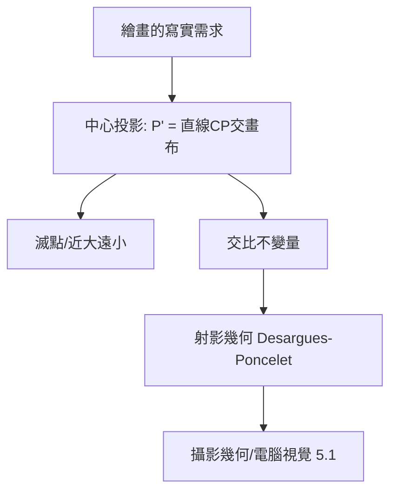

# 1.1 1435年：透視法與投影幾何——圖像的空間語言

## 1. 問題：如何在平面上畫出三維世界？

文藝復興的繪畫遭遇一個數學危機：中世紀繪畫是「象徵式」的——人物大小代表重要性，空間關係任意。但藝術家開始要求繪畫**看起來像眼睛所見**：遠的東西小、平行線交於一點、深度可以被感受。

問題的數學形式：

> 三維空間中物體上每一點 $P$，沿視線投射到畫布平面，像的位置由什麼規則決定？

這不是美學問題，而是**投影的幾何問題**——兩千年後的電腦圖學（5.1 節）與攝影機標定，用的正是這套語言。

## 2. 數學：中心投影與射影幾何

布魯內萊斯基（Brunelleschi，約 1415，佛羅倫斯洗禮堂透視實驗）首先演示，阿爾伯蒂（Alberti）1435 年《論繪畫》首次系統化。核心結構：**中心投影**——從眼睛（投影中心 $C$）出發，物點 $P$ 沿直線 $CP$ 落在畫布平面 $\Pi$ 上：

$$
P' = \Pi \cap \overline{CP}
$$

三個直接數學後果，成為此後六百年圖像的語法：

1. **平行線交於滅點**：地面上平行於視線的直線，其像交於水平線上同一點（滅點 $F$ = 直線方向與畫布的交點）；
2. **比例不可保**：中心投影不保持長度與比例（中世紀的「度量直覺」被否定），只保持**交比**（cross-ratio）——四點共線的不變量
$$
\mathrm{CR}(A,B;C,D) = \frac{AC\cdot BD}{BC\cdot AD}
$$
3. **射影幾何的誕生**：平行不再特殊（平行線交於「無窮遠點」），點與線對偶。Desargues（1639）、Poncelet（1822）把文藝復興畫家的直覺建成嚴格的射影幾何——**藝術實踐先於數學理論三百年**。

## 3. 後果

- **繪畫的革命**：達文西、杜勒（Dürer 甚至出版測量用投影儀器版畫）以透視法重構繪畫，寫實主義成為西方繪畫四百年的正統。
- **地圖學與測量**：中心投影的逆問題——「從圖像反推空間」——孵化了製圖投影（Mercator, 1569）與大地測量。
- **攝影的先聲**：暗箱（camera obscura）+ 透視數學 = 十九世紀攝影術（1839）的完整理論準備；今日每一台相機的針孔模型 $\lambda x = K [R\,|\,t] X$ 就是 1435 年的中心投影。

## 4. 回饋

射影幾何在十九世紀成為純數學重鎮（與非歐幾何、群論合流，Klein 的 Erlangen 綱領 1872：「幾何 = 研究某變換群下的不變量」）——**繪畫問題催生的數學，反過來重定義了「什麼是幾何」**。而當二十世紀工程師要讓機器「看」與「畫」，投影幾何自動成為圖形管線（5.1 節：齊次座標、矩陣變換）與電腦視覺（相機標定、對極幾何）的基礎——六百年一個閉環。

## 5. 延伸思考

1. 透視法是「眼睛的真相」還是「一種文化選擇」？東方散點透視（山水長卷）違反中心投影卻符合移動視點——數學上兩者如何統一（多視點拼接，正是全景影像的演算法）？
2. 交比是射影不變量——電腦視覺用交比做相機標定：從畫家的規則到機器的標定，數學傳承了什麼？
