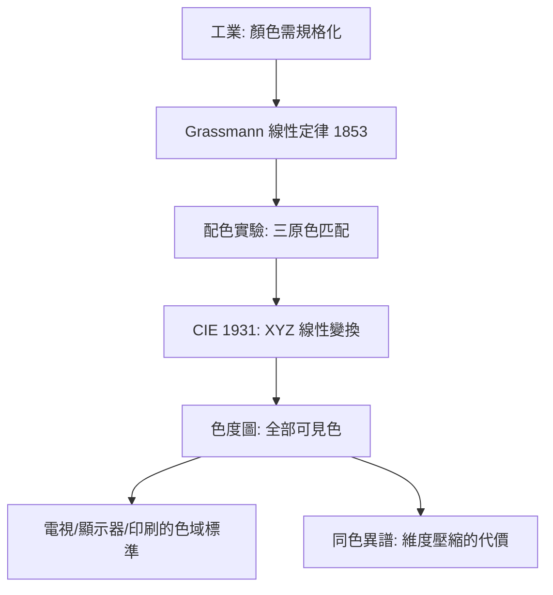

# 1.2 1931年：CIE色度學——顏色的三維向量空間

## 1. 問題：顏色如何被測量與交換？

到 1930 年代，工業（照明、印刷、電視的前身）迫切需要回答：

> 客戶說「要這個藍」，如何用數字規格化？兩台燈「看起來一樣白」的條件是什麼？

更深一層是物理與感知的矛盾：顏色是光的光譜功率分佈（無限維的函數 $S(\lambda)$），但人眼只有三種視錐細胞——**無限維的物理，被三個數字感覺**。這個維度壓縮是什麼？它何時失效（同色異譜 metamerism）？

## 2. 數學：三刺激值、線性空間與色彩匹配

### Grassmann 定律（1853）：顏色是線性的

人的顏色混合同空間向量加法：若 $\vec A = \vec B$、$\vec C = \vec D$，則 $\vec A + \vec C = \vec B + \vec D$。**顏色感知構成一個三維線性空間。**

### CIE 1931 標準

Wright 與 Guild 的配色實驗：觀察者用三原色光 $(R,G,B)$ 匹配任意單色光 $\lambda$，記錄配色函數 $\bar r(\lambda), \bar g(\lambda), \bar b(\lambda)$（某些波長需要「負紅色」= 減色，因為光譜超出原色三角形）。

CIE 把它線性變換成全正的虛構基——**XYZ 三刺激值**：

$$
\begin{pmatrix}X\\Y\\Z\end{pmatrix} = k\int S(\lambda)\begin{pmatrix}\bar x(\lambda)\\ \bar y(\lambda)\\ \bar z(\lambda)\end{pmatrix}d\lambda
$$

其中 $\bar y(\lambda)$ 特意取為人眼明度函數 $V(\lambda)$——**一條積分變成亮度**。色度平面（Chromaticity diagram）：

$$
x = \frac{X}{X+Y+Z}, \quad y = \frac{Y}{X+Y+Z}
$$

馬蹄形區域 = 人眼可見的所有顏色；任意實體顯示器的色域 = 其三原色構成的三角形。

### 維度壓縮的數學本質

配色過程是把無限維函數 $S(\lambda)$ 投影到三維：

$$
\mathbb{R}^{\infty} \xrightarrow{\;P\;} \mathbb{R}^3
$$

$P$ 的核（kernel）非平凡——**所有落在核裡的不同光譜，人眼看成同一顏色**（同色異譜）。這既是產業的基礎（三原色顯示器可能），也是陷阱（印刷打樣在不同光源下變色）。

## 3. 後果

- **顯示器與電視的設計規範**：NTSC（1953）、sRGB（1996）、Rec. 709/2020——每個標準就是 CIE 色度圖上的一個三角形 + 白點。
- **色彩管理的工業化**：ICC 設定檔把「相機→螢幕→印表機」的顏色轉換統一為 XYZ 空間中的矩陣/表查找——顏色第一次可以像尺寸一樣跨設備傳遞。
- **影像壓縮的伏筆**：$Y$（明度）與 $(x,y)$（色度）的分離直接催生 YUV/YCbCr 顏色空間——3.3 節 JPEG 對色度做 4:2:0 降採樣的理論根據即在此。

## 4. 回饋

CIE 空間是「感知均勻」的假象：色度圖上兩點的歐氏距離**不等於**感覺色差——MacAdam（1942）橢圓實驗顯示色差區域是不等大小的橢圓。這逼出**非線性感知空間**：CIE L\*a\*b\*（1976）以冪律 $L^* \propto (Y/Y_n)^{1/3}$ 壓縮明度，色差 $\Delta E$ 成為工業公差單位。更深一層：

1. **感知非線性 = 對比度編碼**：$\gamma$ 修正（冪律）進入所有影像管線——人眼對暗部的對數式敏感度，成為 3.3 節量化表設計的依據；
2. **從三維到高維**：多光譜成像、光線場、BRDF——當應用超出「人眼三維」，顏色空間的線性代數被推廣為一般的函數空間離散化。

## 5. 延伸思考

1. 色盲（二色視者）的顏色空間是二維的——CIE 框架如何為不同觀察者「重新降維」？
2. 同色異譜證明「顏色不是光的屬性而是觀察者的函數」——那麼顯示器呈現的顏色與真實場景的顏色，本質關係是什麼？（渲染中 colorimetric reproduction 的目標設定）
