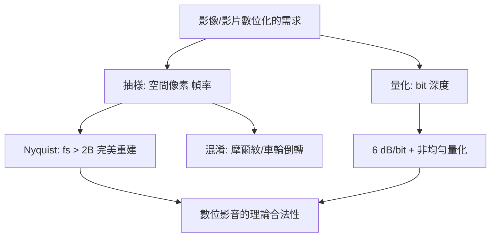

# 1.3 1949年：抽樣定理與人眼解析度——連續世界如何變成像素

## 1. 問題：多少像素才夠？多少幀才流暢？

影像從化學底片走向數位的路上，工程師面對三個量化問題：

1. 一張照片需要**多少像素**？電話線能傳的影像需要**最少多少**？
2. 電影每秒 24 幀、電視每秒 30 幀——**為什麼這些數字？更低會怎樣？**
3. 量化成 8 bit 灰階夠嗎？為什麼 6 bit 會出現「色帶」？

這些問題共同的本質：**連續函數（空間/時間/強度）被離散化時，資訊會丟多少、失真長什麼樣？**

## 2. 數學：抽樣定理與混淆

### Whittaker–Nyquist–Kotelnikov–Shannon 抽樣定理

對頻寬受限 $B$ 的信號 $f(t)$，以超過 Nyquist 率抽樣即可**完美重建**：

$$
f_s > 2B \quad\Longrightarrow\quad f(t) = \sum_{n} f(nT_s)\,\mathrm{sinc}\!\left(\frac{t - nT_s}{T_s}\right), \quad T_s = \frac{1}{f_s}
$$

sinc 內插給出「帶限信號的離散化 = 無損」的驚人結論——**連續與離散之間有一座數學橋樑**。

### 混淆（Aliasing）

抽樣不足時，高頻偽裝成低頻：

$$
f_{\text{alias}} = |f - k f_s|
$$

影像上的表現：摩爾紋（衣料/螢幕拍攝的波紋）、電影車輪倒轉（車輪輻條頻率 > 24 Hz 幀率）。空間域同理：像素網格對高頻紋理混淆。

### 量化的誤差

振幅離散化的誤差：$N$ bit 均勻量化的訊噪比

$$
\mathrm{SNR}_{dB} \approx 6.02\,N + 1.76
$$

每加 1 bit 得 6 dB——但這是對「白噪化」的誤差而言；若人眼/耳**非均勻**（對數感知，1.2 節），非均勻量化（對數、$\mu$-律）可大幅節省位元。

### 感知端的「Nyquist」

人眼參數直接決定設計常數：

- 中央凹視銳度約 1 角分 ⇒ 60ppi 在正常距離可辨像素（「視網膜螢幕」的定義）；
- 時間臨界融合頻率（CFF）約 60 Hz（暗部更敏感 ⇒ 24 幀電影配遮光板葉片 ×3）；
- 這些數字成為 HD/4K/8K 規格、電視掃描標準的**感知論證**。

## 3. 後果

- **數位影像/影片的合法性**：只要先**抗混淆低通濾波**再抽樣，數位影像可完美代表連續場景——這一條定理把「數位化」從妥協變成科學。
- **掃描標準的設計**：NTSC 525 行、PAL 625 行、1080p/4K 的行數選擇 = 視銳度 × 觀看距離的幾何計算。
- **抗混淆成為影像管線的義務**：相機的光學低通濾鏡、圖形學的 MIP mapping 與超取樣（5.1 節）、縮圖演算法——都是 sinc 理論的工程化身。

## 4. 回饋

抽樣定理假設**均勻網格 + 帶限信號**，兩者在影音中都被挑戰，催生新數學：

1. **人眼不是均勻取樣器**：中央凹高密度、周邊低密度——非均勻抽樣理論（Landau 密度條件）與 foveated rendering（VR 的效能救星）；
2. **影像不是帶限的**：邊緣含無限高頻 ⇒ 螢幕上的鋸齒，催生超解析（super-resolution）——用先驗（自然影像的統計）超越 Nyquist，是「從資料補回被丟棄的資訊」的典範，直通 5.3 節的生成模型；
3. **抽樣與壓縮的合流**：壓縮感知（Candès–Tao, 2006）證明稀疏信號可用遠低於 Nyquist 的測量重建——MRI 加速、單像素相機——**抽樣理論在數位時代完成自我革命**。

## 5. 延伸思考

1. 「帶限」與「稀疏」是兩種先驗——從 sinc 重建到壓縮感知到深度學習超解析，重建問題的先驗越來越強，代價（假影風險）是什麼？
2. 電影 24 fps 的「電影感」（motion blur + judder）是數學缺陷被文化接受為美學——標準的選擇如何被感知物理與藝術傳統共同鎖定？
