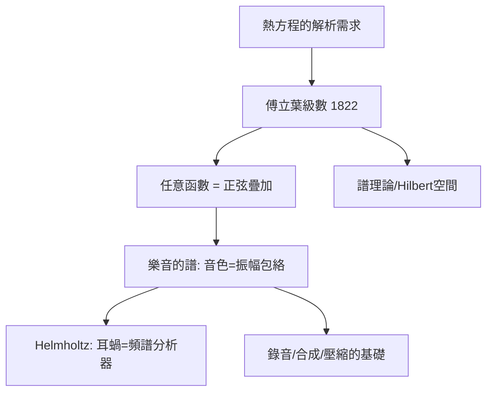

# 2.2 1822年：傅立葉級數與音色——樂音的和弦分解

## 1. 問題：同一個音高，為什麼小提琴與長笛聽起來不同？

音高（頻率）與響度（振幅）可以量化（2.1 節），但**音色**（timbre）——區分樂器的「質感」——在十九世紀初完全沒有數學描述。更深的问题是熱學的：

> 一根金屬桿的溫度分佈（可以是很任意的初始形狀）如何隨時間演化？熱方程的解能否表達為「簡單振盪」的疊加？

傅立葉（Joseph Fourier）1822 年《熱的解析理論》給出答案，並附帶解決了音色問題。

## 2. 數學：傅立葉級數與譜

傅立葉主張：任意（週期）函數可展開為正弦與餘弦的無窮級數：

$$
f(t) = \frac{a_0}{2} + \sum_{n=1}^{\infty}\left(a_n\cos\frac{2\pi n t}{T} + b_n\sin\frac{2\pi n t}{T}\right)
$$

係數由內積（投影）給出：

$$
a_n = \frac{2}{T}\int_0^T f(t)\cos\frac{2\pi n t}{T}\,dt, \qquad b_n = \frac{2}{T}\int_0^T f(t)\sin\frac{2\pi n t}{T}\,dt
$$

數學史意義重大：正弦函數是 $\frac{d^2}{dt^2} + \omega^2$ 這類算符的**特徵函數**——傅立葉級數是無窮維空間的**特徵分解**，是 Hilbert 空間理論與譜理論的起點（當時「任意函數」的嚴格性爭論持續百年，Dirichlet、Riemann、Lebesgue 相繼介入）。

### 應用到樂音

撥弦/管中的駐波解天然是諧音列：

$$
f, 2f, 3f, 4f, \dots
$$

**音色的定義就此誕生**：音高 = 基頻 $f$ ；音色 = 各諧音的**振幅譜包絡** $\{A_n\}$ 。亥姆霍茲（Helmholtz, 1863《論音的感覺》）以共振球實驗證實：耳朵做的是機械式傅立葉分析（耳蝸基底膜 = 頻率分析的濾波器組）。

## 3. 後果

- **聲學的科學化**：樂器製作從經驗進入計算（弦方程、管的有效長度、共振峰 formant）。
- **錄音與重放的理論靶**：留聲機（1877）與電話（1876）的設計目標變成「保留足夠的譜帶寬」——頻寬概念誕生，直通 3.1/3.2 節的資訊理論。
- **整個影音壓縮的地基**：把信號變成「係數」再處理，是 JPEG 的 DCT（3.2 節）、MP3 的 MDCT（見 3.3 延伸）的共同祖語——**傅立葉變換是影音數學的第一公民**。

## 4. 回饋

傅立葉的成功立刻暴露三個缺口，各自孵化新數學：

1. **收斂性**：傅立葉級數在間斷點的行為（Gibbs 現象，1899）逼出 Lebesgue 積分與 $L^2$ 理論——「函數空間」的現代概念誕生於聲學與熱學問題。
2. **非平穩信號**：音樂的譜隨時間劇烈變化，全域傅立葉分析抹平時間資訊——**短時距傅立葉變換**（STFT, Gabor 1946）、小波（多解析度，見 3.3 節回饋）相繼誕生；MP3 的時頻分析正是 STFT 家族。
3. **感知加權**：Helmholtz 之後，Fletcher（1940）測出**臨界頻帶**（critical band，耳蝸濾波寬度約 $\frac{f}{4}$ 在低頻）——譜的度量要用感知尺度（Bark/mel），這是 3.3 節 MP3 心理聲學模型的直接依據。

## 5. 延伸思考

1. 耳蝸 = 常數 Q 濾波器組（對數頻率軸），與 2.1 節平均律的對數音階驚人一致——生物演化與樂理的對數是同一個數學嗎？
2. 傅立葉級數用「無限長」的正弦表達「任意短」的事件——時間—頻率的不可兼得（測不準原理 $\Delta t\,\Delta\omega \ge \frac{1}{2}$ ）如何約束所有影音編碼？
